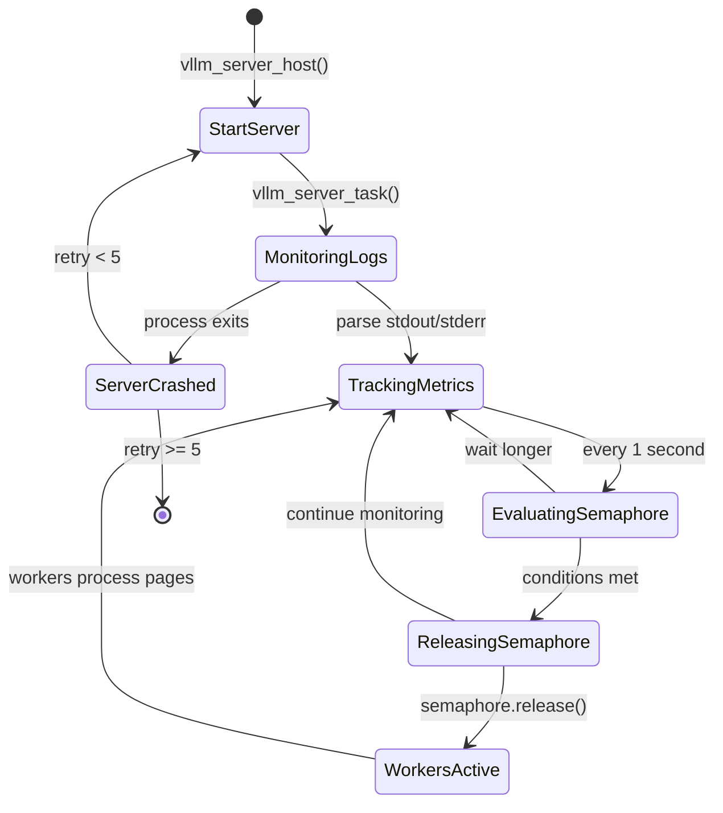
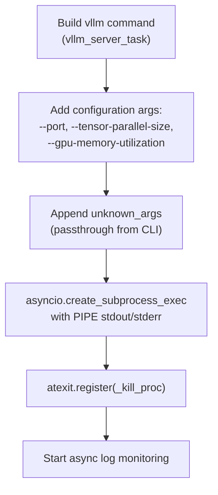
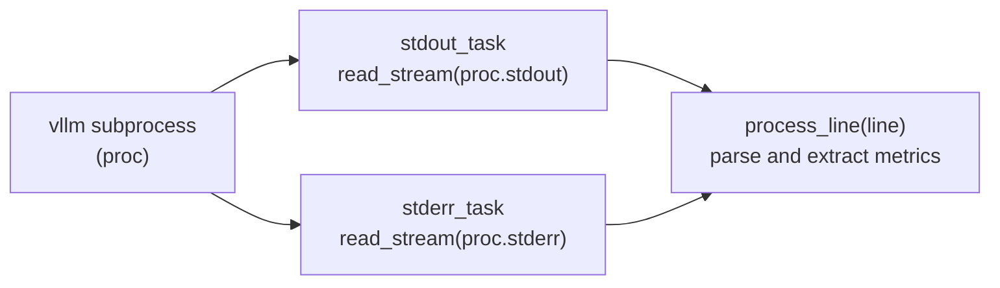
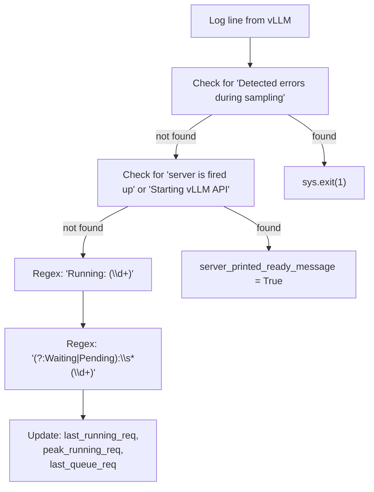
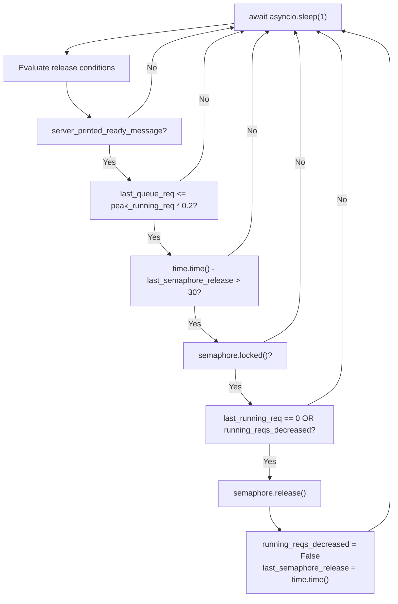
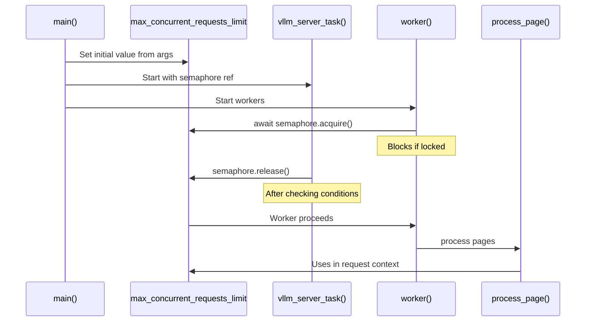
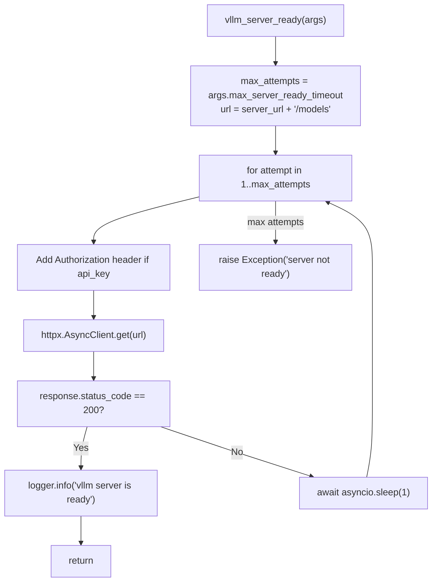
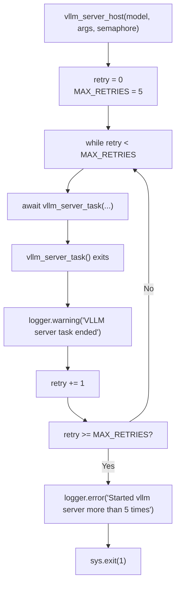
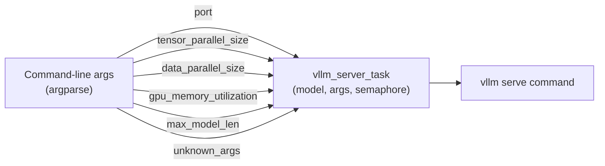

<!-- source: DeepWiki mcp.deepwiki.com · repo allenai/olmocr · page 2.3 VLM Server Management · fetched 2026-10-26 -->

# VLM Server Management

<details>
<summary>Relevant source files</summary>

The following files were used as context for generating this wiki page:

- [CHANGELOG.md](CHANGELOG.md)
- [olmocr/pipeline.py](olmocr/pipeline.py)
- [olmocr/version.py](olmocr/version.py)
- [olmocr/work_queue.py](olmocr/work_queue.py)
- [scripts/release.sh](scripts/release.sh)
- [tests/gnarly_pdfs/edgar_image.pdf](tests/gnarly_pdfs/edgar_image.pdf)
- [tests/test_pipeline.py](tests/test_pipeline.py)
- [tests/test_s3_work_queue.py](tests/test_s3_work_queue.py)

</details>


This document describes the vLLM server lifecycle management system in the olmOCR pipeline. The system handles subprocess control, monitors server readiness through log parsing, and implements dynamic semaphore release to prevent worker overload. For information about how workers use the server for page processing, see [Page Processing and Rotation Correction](#2.4). For details on the overall pipeline architecture, see [Pipeline Architecture and Workflow](#2.1).

## Overview

The VLM server management system is responsible for starting, monitoring, and restarting the vLLM inference server as a subprocess. It parses server logs in real-time to track request queue depth, dynamically releases worker semaphores to prevent overload, and automatically restarts the server on failures. The system is implemented primarily in three functions: `vllm_server_task()`, `vllm_server_host()`, and `vllm_server_ready()` in [olmocr/pipeline.py:713-890]().

**Sources:** [olmocr/pipeline.py:713-890]()

## Server Lifecycle Architecture



The server lifecycle begins when `vllm_server_host()` calls `vllm_server_task()`, which spawns the vLLM server subprocess. The system continuously monitors stdout and stderr, parsing log lines to extract queue metrics. A timeout task evaluates semaphore release conditions every second, releasing workers when the server is ready and queue depth is manageable. If the server crashes, the host function automatically restarts it up to 5 times.

**Sources:** [olmocr/pipeline.py:713-863]()

## Server Startup and Configuration

### Subprocess Creation

The `vllm_server_task()` function constructs the vLLM command with specific arguments and spawns it as an asyncio subprocess:



The function builds a command array starting with `["vllm", "serve", model_name_or_path]` and adds configuration parameters. Key parameters include:

| Parameter | Purpose | Source Line |
|-----------|---------|-------------|
| `--port` | API server port (default from args) | [olmocr/pipeline.py:718-719]() |
| `--tensor-parallel-size` | Number of GPUs for model parallelism | [olmocr/pipeline.py:725-726]() |
| `--data-parallel-size` | Data parallel replicas | [olmocr/pipeline.py:727-728]() |
| `--gpu-memory-utilization` | KV cache memory fraction | [olmocr/pipeline.py:734]() |
| `--max-model-len` | Maximum context length | [olmocr/pipeline.py:737]() |
| `--limit-mm-per-prompt` | Disable video encoder to save RAM | [olmocr/pipeline.py:729-730]() |

The subprocess is created with `OMP_NUM_THREADS=1` to prevent CPU contention when running multiple olmOCR instances on multi-GPU machines [olmocr/pipeline.py:747]().

**Sources:** [olmocr/pipeline.py:713-748]()

### Cleanup Registration

The system registers an `atexit` handler to ensure the server subprocess is terminated on pipeline shutdown:

```python
def _kill_proc():
    try:
        proc.terminate()
    except:
        logger.info("VLLM Process already terminated")

atexit.register(_kill_proc)
```

This guarantees cleanup even if the main process exits unexpectedly [olmocr/pipeline.py:751-757]().

**Sources:** [olmocr/pipeline.py:751-757]()

## Log Monitoring and State Tracking

### Asynchronous Stream Reading

The system monitors both stdout and stderr using dedicated async tasks:



The `read_stream()` coroutine continuously reads lines from a stream and passes them to `process_line()` [olmocr/pipeline.py:793-802]():

```python
async def read_stream(stream):
    while True:
        line = await stream.readline()
        if not line:
            break
        try:
            line = line.decode("utf-8").rstrip()
            await process_line(line)
        except Exception as ex:
            logger.warning(f"Got {ex} when reading log line from inference server, skipping")
```

**Sources:** [olmocr/pipeline.py:793-802]()

### Metric Extraction

The `process_line()` function extracts critical metrics from vLLM log output using regex patterns:



Key tracked variables:

- `last_running_req`: Current number of running inference requests [olmocr/pipeline.py:777-787]()
- `peak_running_req`: Highest observed running requests (used for queue threshold) [olmocr/pipeline.py:779-782]()
- `last_queue_req`: Current number of queued/waiting requests [olmocr/pipeline.py:789-791]()
- `running_reqs_decreased`: Flag set when running requests decrease, indicating server capacity freed [olmocr/pipeline.py:784-786]()
- `server_printed_ready_message`: Readiness indicator from server startup logs [olmocr/pipeline.py:773-775]()

If the line contains "Detected errors during sampling", the pipeline immediately exits with an error, as this indicates model corruption [olmocr/pipeline.py:769-771]().

**Sources:** [olmocr/pipeline.py:765-791]()

## Dynamic Semaphore Management

### Semaphore Release Logic

The system implements a sophisticated semaphore release mechanism to prevent overwhelming the vLLM server. A dedicated `timeout_task()` coroutine evaluates release conditions every second:



The release conditions [olmocr/pipeline.py:811-817]() are:

1. **Server readiness**: `server_printed_ready_message` must be True
2. **Low queue depth**: `last_queue_req <= int(peak_running_req * 0.2)` ensures queue is at most 20% of peak capacity
3. **Cooldown period**: At least 30 seconds since last release to prevent rapid oscillation
4. **Semaphore locked**: `semaphore.locked()` checks if there are workers waiting
5. **Available capacity**: Either no running requests (`last_running_req == 0`) or requests have decreased (`running_reqs_decreased`)

When all conditions are met, the semaphore is released, allowing one worker to proceed. The `running_reqs_decreased` flag is reset to prevent multiple rapid releases [olmocr/pipeline.py:820-823]().

**Sources:** [olmocr/pipeline.py:804-825]()

### Semaphore Usage Pattern

The semaphore `max_concurrent_requests_limit` is initialized at module level and configured in `main()`:



Workers acquire the semaphore before getting work [olmocr/pipeline.py:599](), but release it in the `finally` block of their work loop if using an external server [olmocr/pipeline.py:707-710](). This temporary workaround addresses issue #383 where workers don't properly release on completion.

**Sources:** [olmocr/pipeline.py:83](), [olmocr/pipeline.py:596-711]()

## Server Readiness Detection

### External Server Health Check

The `vllm_server_ready()` function checks if an external vLLM server is operational by polling the `/models` endpoint:



The function implements a simple retry loop with 1-second delays [olmocr/pipeline.py:865-890]():

- Constructs URL by appending `/models` to the server endpoint
- Adds `Authorization: Bearer {api_key}` header if provided
- Makes GET request using `httpx.AsyncClient`
- Returns successfully on 200 status code
- Logs warnings and retries on failures
- Raises exception after `max_server_ready_timeout` attempts (configurable via args)

This is called during pipeline initialization when using an external server specified via `--server` argument.

**Sources:** [olmocr/pipeline.py:865-890]()

## Restart and Recovery Mechanisms

### Automatic Restart Loop

The `vllm_server_host()` function wraps `vllm_server_task()` with retry logic:



The restart mechanism [olmocr/pipeline.py:847-863]():

1. Runs `vllm_server_task()` in a loop with maximum 5 retries
2. If the server task exits (crash or termination), logs a warning
3. Increments retry counter and restarts the server
4. After 5 restarts, logs an error with installation instructions and exits the pipeline

The error message directs users to the vLLM installation documentation, as repeated crashes typically indicate installation or compatibility issues [olmocr/pipeline.py:859-861]().

**Sources:** [olmocr/pipeline.py:847-863]()

### Graceful Shutdown

When the pipeline receives a cancellation request, the server task handles cleanup:

```python
except asyncio.CancelledError:
    logger.info("Got cancellation request for VLLM server")
    proc.terminate()
    try:
        await asyncio.wait_for(proc.wait(), timeout=10.0)
    except asyncio.TimeoutError:
        logger.warning("VLLM server did not terminate within 10 seconds")
    raise
```

The shutdown sequence [olmocr/pipeline.py:834-841]():

1. Catches `asyncio.CancelledError` from task cancellation
2. Calls `proc.terminate()` to send SIGTERM to subprocess
3. Waits up to 10 seconds for graceful shutdown
4. Logs warning if timeout expires (server may require SIGKILL)
5. Re-raises the cancellation exception to propagate to parent tasks

The timeout tasks and stream readers are cancelled and gathered with `return_exceptions=True` to ensure all resources are cleaned up [olmocr/pipeline.py:843-844]().

**Sources:** [olmocr/pipeline.py:832-844]()

## Server Management API

### Function Reference

| Function | Location | Purpose |
|----------|----------|---------|
| `vllm_server_task()` | [olmocr/pipeline.py:713-845]() | Main server lifecycle management, spawns subprocess and monitors logs |
| `vllm_server_host()` | [olmocr/pipeline.py:847-863]() | Wraps server task with retry logic, handles automatic restarts |
| `vllm_server_ready()` | [olmocr/pipeline.py:865-890]() | Health check for external servers, polls `/models` endpoint |
| `read_stream()` | [olmocr/pipeline.py:793-802]() | Async log line reader for stdout/stderr streams |
| `process_line()` | [olmocr/pipeline.py:765-791]() | Parses log lines and extracts queue metrics |
| `timeout_task()` | [olmocr/pipeline.py:804-825]() | Evaluates semaphore release conditions every second |

**Sources:** [olmocr/pipeline.py:713-890]()

### Configuration Parameters

The server accepts configuration through command-line arguments that are passed to the vLLM subprocess:



Unknown arguments are passed directly to vLLM via `unknown_args` parameter [olmocr/pipeline.py:739-740](), allowing users to specify additional vLLM-specific options not explicitly handled by olmOCR.

**Sources:** [olmocr/pipeline.py:713-740]()

---

