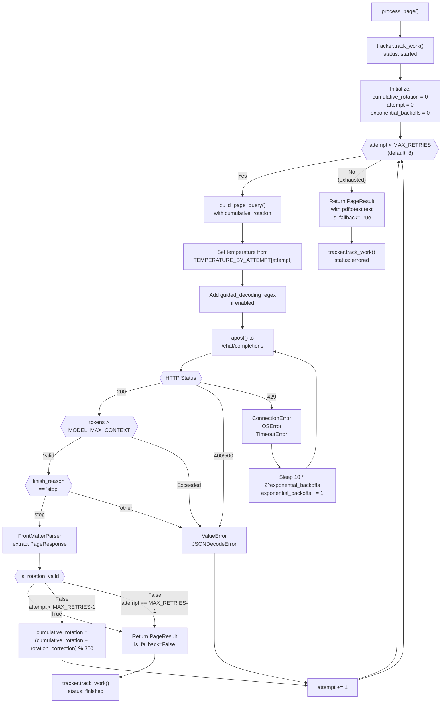
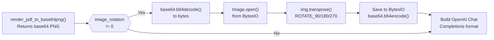
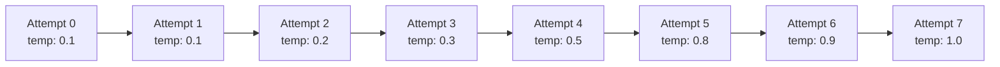
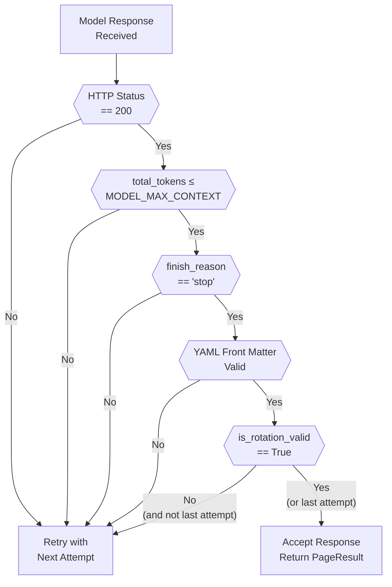
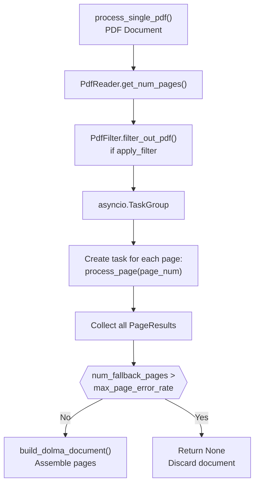

<!-- source: DeepWiki mcp.deepwiki.com · repo allenai/olmocr · page 2.4 Page Processing and Rotation Correction · fetched 2026-10-26 -->

# Page Processing and Rotation Correction

<details>
<summary>Relevant source files</summary>

The following files were used as context for generating this wiki page:

- [CHANGELOG.md](CHANGELOG.md)
- [olmocr/pipeline.py](olmocr/pipeline.py)
- [olmocr/version.py](olmocr/version.py)
- [olmocr/work_queue.py](olmocr/work_queue.py)
- [scripts/release.sh](scripts/release.sh)
- [tests/gnarly_pdfs/edgar_image.pdf](tests/gnarly_pdfs/edgar_image.pdf)
- [tests/test_pipeline.py](tests/test_pipeline.py)
- [tests/test_s3_work_queue.py](tests/test_s3_work_queue.py)

</details>


This page documents the core page processing logic within the olmOCR pipeline, focusing on how individual PDF pages are processed by the vision-language model and how rotation correction is handled automatically. This covers the `process_page()` function and its retry mechanisms.

For information about PDF rendering to images, see [PDF Rendering and Image Conversion](#3.1). For information about how processed pages are assembled into documents, see [Output Formats and Data Models](#3.3). For details on the vLLM server itself, see [VLM Server Management](#2.3).

**Sources:** [olmocr/pipeline.py:288-419]()

## Overview

Page processing is the heart of the OCR pipeline. Each page of a PDF is independently processed by sending a rendered image to the vision-language model, which returns markdown text along with metadata about the page's orientation, language, and content type. The system automatically detects and corrects page rotation issues through an iterative refinement process.

The main workflow:
1. Render the PDF page to a base64-encoded PNG image
2. Apply any cumulative rotation from previous attempts
3. Send the image to the vLLM server with a structured prompt
4. Parse the YAML front matter response to extract metadata
5. If rotation is invalid, retry with corrected rotation
6. If all retries fail, fall back to pdftotext

**Sources:** [olmocr/pipeline.py:288-419]()

## Core Page Processing Architecture



**Sources:** [olmocr/pipeline.py:288-419]()

## Page Processing Function Signature

The `process_page()` function orchestrates the entire page processing workflow:

| Parameter | Type | Description |
|-----------|------|-------------|
| `args` | argparse.Namespace | Pipeline arguments including server URL, model name, retry limits |
| `worker_id` | int | Worker identifier for logging and tracking |
| `pdf_orig_path` | str | Original PDF path (for metadata and logging) |
| `pdf_local_path` | str | Local filesystem path to the PDF file |
| `page_num` | int | 1-indexed page number to process |

**Return Value:** `PageResult` dataclass containing:
- `s3_path`: Original PDF path
- `page_num`: Page number processed
- `response`: `PageResponse` object with markdown and metadata
- `input_tokens`: Number of prompt tokens used
- `output_tokens`: Number of completion tokens generated
- `is_fallback`: Boolean indicating if pdftotext fallback was used

**Sources:** [olmocr/pipeline.py:288-289](), [olmocr/pipeline.py:133-142]()

## Rotation Detection and Correction Mechanism

The vision-language model is trained to detect when a page image is incorrectly rotated. It signals this through the YAML front matter in its response:

```yaml
---
primary_language: en
is_rotation_valid: false
rotation_correction: 90
is_table: false
is_diagram: false
---
```

When `is_rotation_valid` is `false`, the pipeline automatically retries the page with the suggested `rotation_correction` applied. The rotation corrections accumulate across multiple attempts.

### Cumulative Rotation Tracking

The system tracks `cumulative_rotation` as a state variable that persists across retry attempts. When the model requests a rotation correction, it is added to the cumulative total:

```python
cumulative_rotation = (cumulative_rotation + page_response.rotation_correction) % 360
```

The modulo 360 operation ensures rotations wrap around correctly (e.g., 270° + 180° = 90°).

**Example Sequence:**
1. Attempt 0: `cumulative_rotation = 0°`, model returns `rotation_correction: 90`, `is_rotation_valid: false`
2. Attempt 1: `cumulative_rotation = 90°`, model returns `rotation_correction: 90`, `is_rotation_valid: false`
3. Attempt 2: `cumulative_rotation = 180°`, model returns `rotation_correction: 0`, `is_rotation_valid: true` ✓

**Sources:** [olmocr/pipeline.py:294](), [olmocr/pipeline.py:357-365]()

### Image Rotation Implementation

The `build_page_query()` function applies rotation to rendered page images using PIL (Pillow):



Valid rotation values are `0`, `90`, `180`, and `270` degrees. The rotation is applied counter-clockwise using PIL's `Image.Transpose` constants:
- `90°` → `Image.Transpose.ROTATE_90`
- `180°` → `Image.Transpose.ROTATE_180`
- `270°` → `Image.Transpose.ROTATE_270`

**Sources:** [olmocr/pipeline.py:144-184](), [olmocr/pipeline.py:152-169]()

## Retry Mechanism and Temperature Escalation

The page processing system implements a sophisticated retry strategy that distinguishes between model quality issues and infrastructure failures.

### Configuration Constants

| Constant | Value | Purpose |
|----------|-------|---------|
| `MAX_RETRIES` | `args.max_page_retries` (default 8) | Maximum attempts before falling back |
| `MODEL_MAX_CONTEXT` | 16384 | Maximum token limit for responses |
| `TEMPERATURE_BY_ATTEMPT` | `[0.1, 0.1, 0.2, 0.3, 0.5, 0.8, 0.9, 1.0]` | Temperature progression |

**Sources:** [olmocr/pipeline.py:290-292]()

### Temperature Escalation Strategy

To overcome model repetition issues or stubborn incorrect outputs, the temperature parameter increases with each attempt:



Higher temperatures introduce more randomness into the model's output, which can help escape repetition loops at the expense of consistency.

**Sources:** [olmocr/pipeline.py:292](), [olmocr/pipeline.py:299-309]()

### Error Categories and Handling

The retry logic distinguishes between two types of errors:

**Network/Infrastructure Errors** (do not count against retry budget):
- `ConnectionError`
- `OSError`
- `asyncio.TimeoutError`

These trigger exponential backoff without incrementing the attempt counter:
```
sleep_delay = 10 * (2^exponential_backoffs)
```

**Model/Response Errors** (count against retry budget):
- `ValueError` (invalid response format, exceeded context, wrong finish reason)
- `json.JSONDecodeError` (malformed JSON response)
- HTTP 400 (BadRequestError)
- HTTP 500 (InternalServerError)
- `is_rotation_valid: false` (rotation needs correction)

These increment the `attempt` counter and retry with the next temperature setting.

**Sources:** [olmocr/pipeline.py:376-398]()

## Response Parsing and Validation

### YAML Front Matter Structure

The model returns responses in YAML front matter format, parsed using `FrontMatterParser`:

```python
parser = FrontMatterParser(front_matter_class=PageResponse)
front_matter, text = parser._extract_front_matter_and_text(model_response_markdown)
page_response = parser._parse_front_matter(front_matter, text)
```

The `PageResponse` dataclass contains:

| Field | Type | Purpose |
|-------|------|---------|
| `natural_text` | str \| None | Extracted markdown content |
| `primary_language` | str \| None | Detected language code (e.g., "en") |
| `is_rotation_valid` | bool | Whether page orientation is correct |
| `rotation_correction` | int | Suggested rotation in degrees (0/90/180/270) |
| `is_table` | bool | Whether page contains tables |
| `is_diagram` | bool | Whether page contains diagrams |

**Sources:** [olmocr/pipeline.py:353-356]()

### Guided Decoding

When `--guided-decoding` is enabled, a regex constraint is applied to enforce the YAML structure:

```python
query["guided_regex"] = (
    r"---\nprimary_language: (?:[a-z]{2}|null)\n"
    r"is_rotation_valid: (?:True|False|true|false)\n"
    r"rotation_correction: (?:0|90|180|270)\n"
    r"is_table: (?:True|False|true|false)\n"
    r"is_diagram: (?:True|False|true|false)\n"
    r"(?:---|---\n[\s\S]+)"
)
```

This ensures the model output conforms to the expected format, reducing parsing errors.

**Sources:** [olmocr/pipeline.py:312-315]()

### Response Validation Checks

Before accepting a model response, several validation checks are performed:



**Sources:** [olmocr/pipeline.py:329-365]()

## Fallback Strategy

When all retry attempts are exhausted, the system falls back to extracting text using `pdftotext`, a traditional PDF text extraction tool:

```python
return PageResult(
    pdf_orig_path,
    page_num,
    PageResponse(
        natural_text=get_anchor_text(pdf_local_path, page_num, pdf_engine="pdftotext"),
        primary_language=None,
        is_rotation_valid=True,
        rotation_correction=0,
        is_table=False,
        is_diagram=False,
    ),
    input_tokens=0,
    output_tokens=0,
    is_fallback=True,
)
```

### Fallback Characteristics

- **Trigger Condition:** After `MAX_RETRIES` attempts fail
- **Text Source:** `get_anchor_text()` with `pdf_engine="pdftotext"`
- **Metadata:** All metadata fields set to default/None values
- **Token Counts:** Both set to 0 (no model API usage)
- **Fallback Flag:** `is_fallback=True` marks this result for potential filtering

### Document-Level Fallback Handling

At the document level, if the fallback page count exceeds `max_page_error_rate`, the entire document is discarded:

```python
if num_fallback_pages / num_pages > args.max_page_error_rate:
    logger.error(f"Document {pdf_orig_path} has {num_fallback_pages} fallback pages "
                 f"out of {num_pages} exceeding max_page_error_rate of "
                 f"{args.max_page_error_rate}, discarding document.")
    return None
```

**Sources:** [olmocr/pipeline.py:404-419](), [olmocr/pipeline.py:499-505]()

## Metrics and Tracking

### Page-Level Metrics

The system tracks detailed metrics for each page processing attempt:

```python
metrics.add_metrics(
    server_input_tokens=base_response_data["usage"].get("prompt_tokens", 0),
    server_output_tokens=base_response_data["usage"].get("completion_tokens", 0),
)
```

Upon successful completion:

```python
metrics.add_metrics(**{"completed_pages": 1, f"finished_on_attempt_{attempt}": 1})
```

This allows analysis of how many pages require multiple attempts and at what temperature/attempt they succeed.

**Sources:** [olmocr/pipeline.py:346-349](), [olmocr/pipeline.py:366]()

### Work Tracking

The `tracker` object monitors the status of each page throughout its lifecycle:

| Event | Call |
|-------|------|
| Start processing | `tracker.track_work(worker_id, f"{pdf_orig_path}-{page_num}", "started")` |
| Successful completion | `tracker.track_work(worker_id, f"{pdf_orig_path}-{page_num}", "finished")` |
| Exhausted retries | `tracker.track_work(worker_id, f"{pdf_orig_path}-{page_num}", "errored")` |
| Cancelled | `tracker.track_work(worker_id, f"{pdf_orig_path}-{page_num}", "cancelled")` |

This provides visibility into which pages are currently being processed and their outcomes.

**Sources:** [olmocr/pipeline.py:296](), [olmocr/pipeline.py:367](), [olmocr/pipeline.py:388](), [olmocr/pipeline.py:402]()

## Concurrency and Rate Limiting

Page processing respects two semaphores to control resource usage:

### PDF Render Semaphore

```python
pdf_render_max_workers_limit = asyncio.BoundedSemaphore(
    int(float(os.environ.get("BEAKER_ASSIGNED_CPU_COUNT", 
                             max(1, multiprocessing.cpu_count() - 2))))
)
```

Limits concurrent PDF rendering operations based on available CPU cores to prevent system overload.

**Sources:** [olmocr/pipeline.py:82](), [olmocr/pipeline.py:149]()

### Request Concurrency Semaphore

```python
max_concurrent_requests_limit = asyncio.BoundedSemaphore(1)  # Set by args in main()
```

Controls the maximum number of concurrent requests to the vLLM server. This value is dynamically adjusted by the vLLM server management task based on queue depth and server capacity.

**Sources:** [olmocr/pipeline.py:83](), [olmocr/pipeline.py:326-327]()

## Integration with Broader Pipeline

The `process_page()` function is called from `process_single_pdf()`, which orchestrates page processing for an entire document:



All pages are processed concurrently using `asyncio.TaskGroup`, allowing efficient parallel processing of multi-page documents.

**Sources:** [olmocr/pipeline.py:461-514](), [olmocr/pipeline.py:491-497]()

## Testing and Validation

The test suite validates rotation correction behavior extensively:

### Test Coverage

| Test | Purpose | Source |
|------|---------|--------|
| `test_no_rotation` | Verifies 0° rotation preserves original image | [tests/test_pipeline.py:58-81]() |
| `test_rotate_90_degrees` | Validates 90° counter-clockwise rotation | [tests/test_pipeline.py:83-106]() |
| `test_rotate_180_degrees` | Validates 180° rotation | [tests/test_pipeline.py:108-131]() |
| `test_rotate_270_degrees` | Validates 270° counter-clockwise rotation | [tests/test_pipeline.py:133-156]() |
| `test_process_page_with_rotation_correction` | End-to-end test of rotation correction flow | [tests/test_pipeline.py:206-305]() |
| `test_process_page_with_cumulative_rotation` | Validates cumulative rotation across attempts | [tests/test_pipeline.py:308-414]() |
| `test_process_page_rotation_wraps_around` | Validates modulo 360 wrapping | [tests/test_pipeline.py:417-513]() |

The tests use a real PDF with rotation issues (`tests/gnarly_pdfs/edgar-rotated90.pdf`) to verify the correction logic works in practice.

**Sources:** [tests/test_pipeline.py:57-514]()

---

