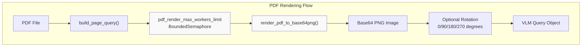
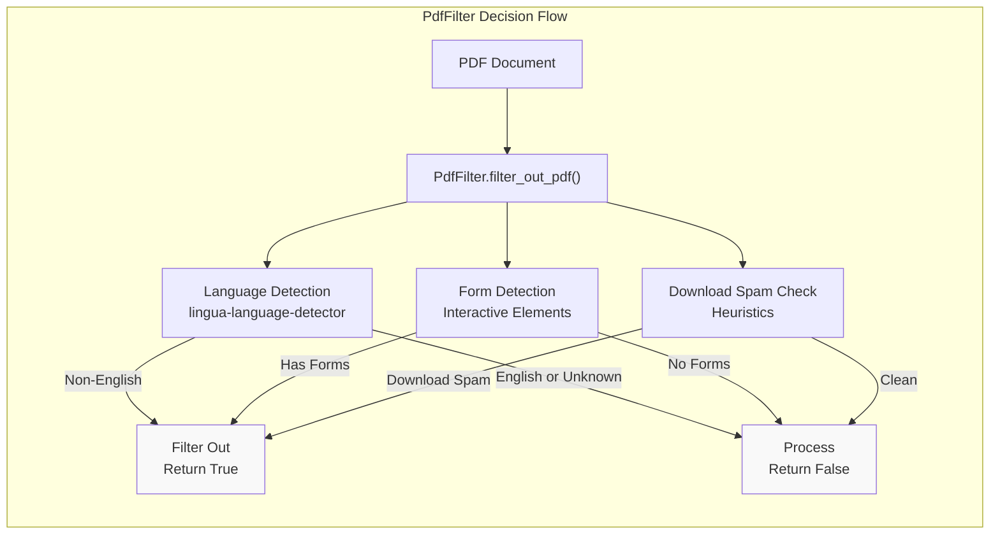
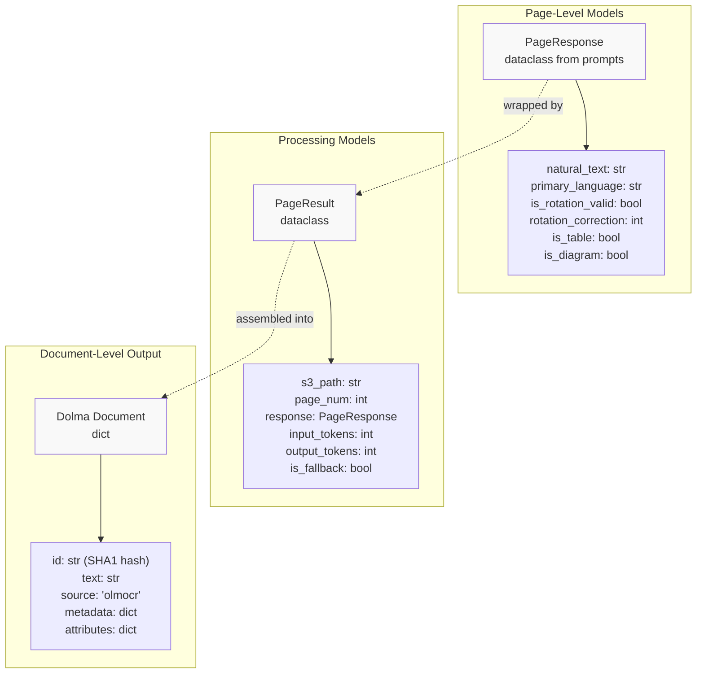
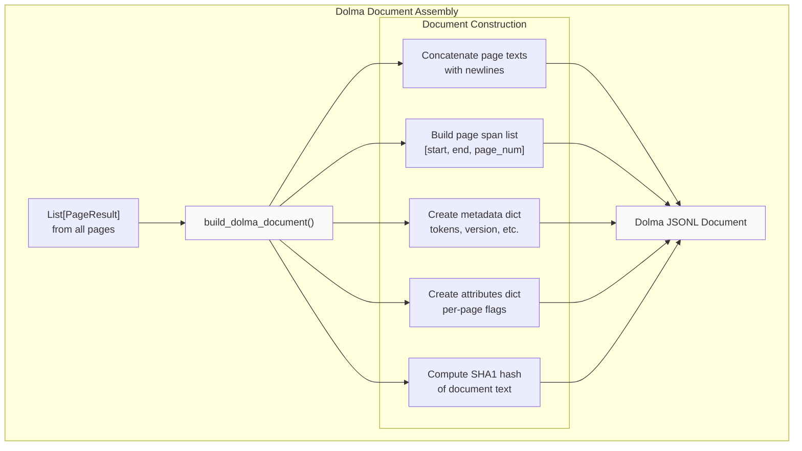
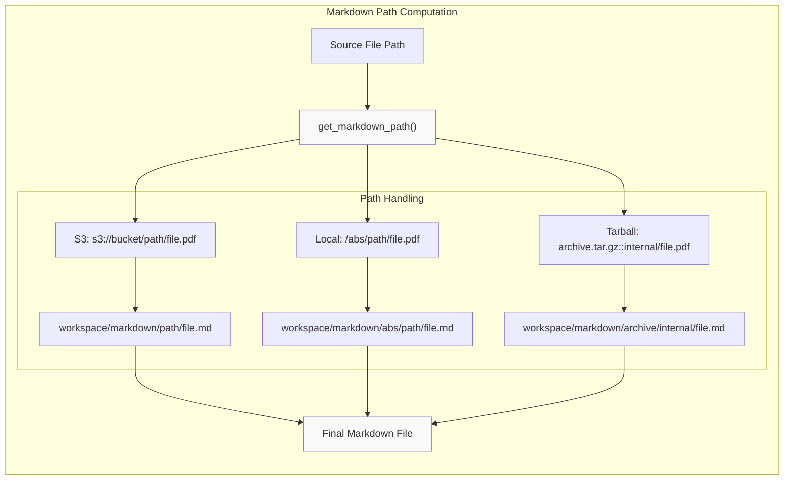

<!-- source: DeepWiki mcp.deepwiki.com · repo allenai/olmocr · page 3 Document Processing · fetched 2026-10-26 -->

# Document Processing

<details>
<summary>Relevant source files</summary>

The following files were used as context for generating this wiki page:

- [CHANGELOG.md](CHANGELOG.md)
- [Dockerfile](Dockerfile)
- [Dockerfile.with-model](Dockerfile.with-model)
- [olmocr/pipeline.py](olmocr/pipeline.py)
- [olmocr/version.py](olmocr/version.py)
- [olmocr/work_queue.py](olmocr/work_queue.py)
- [pyproject.toml](pyproject.toml)
- [scripts/release.sh](scripts/release.sh)
- [tests/gnarly_pdfs/edgar_image.pdf](tests/gnarly_pdfs/edgar_image.pdf)
- [tests/test_pipeline.py](tests/test_pipeline.py)
- [tests/test_s3_work_queue.py](tests/test_s3_work_queue.py)

</details>


This page covers document-level processing concerns in the olmOCR pipeline. While page-level processing is handled by the VLM server and covered in [Page Processing and Rotation Correction](#2.4), this section focuses on preparing PDFs for processing, filtering unwanted documents, and generating structured output formats.

The document processing layer handles three main responsibilities:
1. Rendering PDF pages to images with appropriate resolution settings
2. Filtering out forms, spam, and non-English documents before processing
3. Assembling page-level results into structured Dolma JSONL and Markdown outputs

For information about the overall pipeline workflow and distributed processing, see [Pipeline Architecture and Workflow](#2.1). For details on how individual pages are processed by the VLM, see [Page Processing and Rotation Correction](#2.4).

---

## PDF Rendering and Image Conversion

The pipeline converts PDF pages to PNG images before sending them to the vision-language model. This rendering step uses `poppler-utils` under the hood and includes support for converting standalone images (JPEG/PNG) into PDF format when needed.

### Rendering Process

The core rendering function `render_pdf_to_base64png` converts a specific PDF page to a base64-encoded PNG image. The rendering process applies several optimizations:

**Resolution Control**: The `target_longest_image_dim` parameter controls the maximum dimension of the rendered image. The default value is 1288 pixels, which balances image quality with token consumption in the VLM. Lower values reduce processing time and memory usage but may lose fine details like small text.

**Concurrent Rendering**: PDF rendering operations run in a bounded thread pool to prevent system overload. The `pdf_render_max_workers_limit` semaphore (defined at [olmocr/pipeline.py:82]()) limits concurrent rendering operations based on available CPU cores.



**Diagram: PDF Rendering Process with Concurrency Control**

Sources: [olmocr/pipeline.py:82](), [olmocr/pipeline.py:144-184]()

### Image Format Conversion

When processing image files directly (JPEG or PNG), the pipeline automatically converts them to PDF format before processing. This conversion happens in `process_pdf`:

| Function | Purpose | Location |
|----------|---------|----------|
| `is_jpeg()` | Detects JPEG image format | olmocr/image_utils.py |
| `is_png()` | Detects PNG image format | olmocr/image_utils.py |
| `convert_image_to_pdf_bytes()` | Converts image to PDF bytes | olmocr/image_utils.py |

The conversion logic at [olmocr/pipeline.py:531-535]() checks the file format and applies the conversion if needed:

```
if is_png(tf.name) or is_jpeg(tf.name):
    logger.info(f"Converting {pdf_orig_path} from image to PDF format...")
    tf.seek(0)
    tf.write(convert_image_to_pdf_bytes(tf.name))
    tf.flush()
```

After conversion, the image is processed using the same pipeline as native PDFs.

### Image Rotation

The rendering process supports rotating images by 0, 90, 180, or 270 degrees before sending them to the VLM. This rotation capability is essential for the rotation correction feature described in [Page Processing and Rotation Correction](#2.4). The rotation is applied using PIL's `transpose` method with the appropriate rotation constant at [olmocr/pipeline.py:152-169]().

Sources: [olmocr/pipeline.py:144-184](), [olmocr/pipeline.py:517-542](), [olmocr/pipeline.py:82]()

---

## PDF Filtering and Quality Control

The `PdfFilter` system screens documents before processing to exclude forms, spam, and non-English content. This pre-filtering saves computational resources by avoiding expensive VLM inference on unsuitable documents.

### PdfFilter Configuration

The filter is initialized as a cached singleton at [olmocr/pipeline.py:86]():

```python
get_pdf_filter = cache(lambda: PdfFilter(
    languages_to_keep={Language.ENGLISH, None}, 
    apply_download_spam_check=True, 
    apply_form_check=True
))
```

The filter is only instantiated when needed, and the `cache` decorator ensures only one instance exists throughout the pipeline's lifetime.



**Diagram: PDF Filtering Decision Tree**

Sources: [olmocr/pipeline.py:86]()

### Filter Application

The filter is applied in `process_single_pdf` at [olmocr/pipeline.py:483-485]():

```python
if args.apply_filter and get_pdf_filter().filter_out_pdf(local_pdf_path):
    logger.info(f"Filtering out pdf {pdf_orig_path}")
    return None
```

The `--apply-filter` command-line flag controls whether filtering is enabled. When a document is filtered out, the function returns `None`, which prevents any page processing and excludes the document from the final output.

### Filter Components

The `PdfFilter` class applies three distinct checks:

**Language Detection**: Uses the `lingua-language-detector` library (listed in [pyproject.toml:28]()) to identify the document's primary language. Documents that are not English (or have unknown language) are filtered out. This prevents wasting resources on documents that the English-trained VLM cannot accurately process.

**Form Detection**: Scans the PDF for interactive form elements like text fields, checkboxes, and buttons. Documents with form fields are typically structured data entry documents that don't benefit from OCR processing.

**Download Spam Check**: Applies heuristics to detect common patterns in spam or malformed PDFs that were downloaded from unreliable sources. This catches documents that might cause parsing errors or contain low-quality content.

Sources: [olmocr/pipeline.py:86](), [olmocr/pipeline.py:483-485](), [pyproject.toml:28]()

---

## Output Formats and Data Models

The pipeline generates two primary output formats: Dolma JSONL for downstream processing and optional Markdown files for human readability. Both formats are built from page-level results structured using the `PageResponse` and `PageResult` data models.

### Data Model Hierarchy



**Diagram: Data Model Hierarchy from Page to Document**

Sources: [olmocr/pipeline.py:133-142](), [olmocr/prompts.py:41]()

### PageResponse Structure

The `PageResponse` dataclass represents the VLM's output for a single page. It is parsed from the YAML frontmatter in the model's response using `FrontMatterParser` at [olmocr/pipeline.py:353-355]().

Key fields:
- `natural_text`: The extracted text content in natural reading order
- `primary_language`: Detected language code (e.g., "en")
- `is_rotation_valid`: Whether the page orientation is correct
- `rotation_correction`: Degrees to rotate (0, 90, 180, or 270)
- `is_table`: Whether the page contains primarily tabular data
- `is_diagram`: Whether the page contains primarily diagrams

Sources: [olmocr/pipeline.py:353-355]()

### PageResult Structure

The `PageResult` dataclass wraps `PageResponse` with additional metadata about the processing operation:

| Field | Type | Purpose |
|-------|------|---------|
| `s3_path` | str | Original PDF path (can include tarball paths with `::` separator) |
| `page_num` | int | Page number (1-indexed) |
| `response` | PageResponse | VLM output for this page |
| `input_tokens` | int | Number of tokens in the prompt |
| `output_tokens` | int | Number of tokens in the response |
| `is_fallback` | bool | Whether this page used pdftotext fallback instead of VLM |

The `is_fallback` field indicates when a page exceeded the maximum retry limit and fell back to using `pdftotext` for text extraction. See [olmocr/pipeline.py:404-419]() for the fallback logic.

Sources: [olmocr/pipeline.py:133-142](), [olmocr/pipeline.py:404-419]()

### Dolma JSONL Format

The Dolma format is the primary output format for downstream training and processing. Each successfully processed PDF produces one Dolma document in the output JSONL file.



**Diagram: Dolma Document Assembly from Page Results**

The document assembly happens in `build_dolma_document` at [olmocr/pipeline.py:544-593](). The function performs these steps:

1. **Text Concatenation**: Combines `natural_text` from all pages, inserting newlines between pages (except after the last page)
2. **Span Tracking**: Records character positions for each page as `[start_char, end_char, page_number]` tuples
3. **Metadata Creation**: Includes source file path, olmOCR version, page counts, and token statistics
4. **Attributes Storage**: Preserves per-page flags (language, rotation, table/diagram indicators)
5. **ID Generation**: Computes SHA1 hash of the document text for deduplication

Example Dolma document structure:
```json
{
  "id": "a9b3c1d5e7f9...",
  "text": "Page 1 text\nPage 2 text\nPage 3 text",
  "source": "olmocr",
  "added": "2024-01-15",
  "created": "2024-01-15",
  "metadata": {
    "Source-File": "s3://bucket/path/document.pdf",
    "olmocr-version": "0.4.12",
    "pdf-total-pages": 3,
    "total-input-tokens": 12500,
    "total-output-tokens": 2800,
    "total-fallback-pages": 0
  },
  "attributes": {
    "pdf_page_numbers": [[0, 150, 1], [151, 320, 2], [321, 450, 3]],
    "primary_language": ["en", "en", "en"],
    "is_rotation_valid": [true, true, true],
    "rotation_correction": [0, 0, 0],
    "is_table": [false, true, false],
    "is_diagram": [false, false, true]
  }
}
```

Sources: [olmocr/pipeline.py:544-593]()

### Markdown Output

When the `--markdown` flag is enabled, the pipeline writes each document's natural text to a Markdown file. The output path is computed by `get_markdown_path` at [olmocr/pipeline.py:89-131]().

**Path Computation**: The function handles three input formats:
- **S3 paths** (`s3://bucket/path/file.pdf`): Strips bucket name and places in `workspace/markdown/path/file.md`
- **Local paths** (`/absolute/path/file.pdf`): Strips leading slash and places in `workspace/markdown/absolute/path/file.md`
- **Tarball paths** (`tarball.tar.gz::internal/file.pdf`): Creates structure `workspace/markdown/tarball/internal/file.md`

The function includes security protections against path traversal attacks at [olmocr/pipeline.py:116-119](), removing any `..` components from paths.

**Writing Process**: Markdown files are written in the worker loop at [olmocr/pipeline.py:666-696]() after successful Dolma document creation. For S3 workspaces, files are uploaded; for local workspaces, directories are created as needed.



**Diagram: Markdown Path Computation for Different Source Types**

Sources: [olmocr/pipeline.py:89-131](), [olmocr/pipeline.py:666-696]()

### Metadata Preservation

The pipeline preserves extensive metadata about the processing operation in the Dolma document's `metadata` field:

| Metadata Field | Description |
|----------------|-------------|
| `Source-File` | Original PDF path (may include `::` for tarball members) |
| `olmocr-version` | Version string from [olmocr/version.py:11]() |
| `pdf-total-pages` | Total number of pages in the document |
| `total-input-tokens` | Sum of prompt tokens across all pages |
| `total-output-tokens` | Sum of completion tokens across all pages |
| `total-fallback-pages` | Count of pages that used pdftotext fallback |

The `attributes` field stores per-page information as parallel arrays:
- `pdf_page_numbers`: Character span boundaries for each page
- `primary_language`: Language codes for each page
- `is_rotation_valid`: Rotation validity flags for each page
- `rotation_correction`: Applied rotation in degrees for each page
- `is_table`: Table content flags for each page
- `is_diagram`: Diagram content flags for each page

This metadata enables downstream consumers to:
- Filter documents by quality (e.g., exclude high-fallback-rate documents)
- Analyze processing costs (token usage)
- Locate specific pages within concatenated text
- Understand document characteristics (language, content types)

Sources: [olmocr/pipeline.py:566-592](), [olmocr/version.py:11]()

### Output File Organization

The pipeline writes output files to organized directories within the workspace:

```
workspace/
├── results/
│   └── output_{work_hash}.jsonl     # Dolma JSONL documents
├── markdown/                          # Optional markdown output
│   ├── bucket1/
│   │   └── path/
│   │       └── file.md
│   └── tarball/
│       └── internal/
│           └── file.md
├── done_flags/                        # Completion markers
│   └── done_{work_hash}.flag
└── worker_locks/                      # Processing locks
    └── worker_{work_hash}.lock
```

Each work item (group of PDFs) produces one output file named with its work hash. The work hash is computed from the sorted list of input paths, ensuring deterministic naming. See [Work Queue and Distributed Processing](#2.2) for details on work item management.

Sources: [olmocr/pipeline.py:652](), [olmocr/pipeline.py:673]()

---

