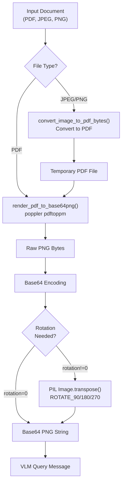
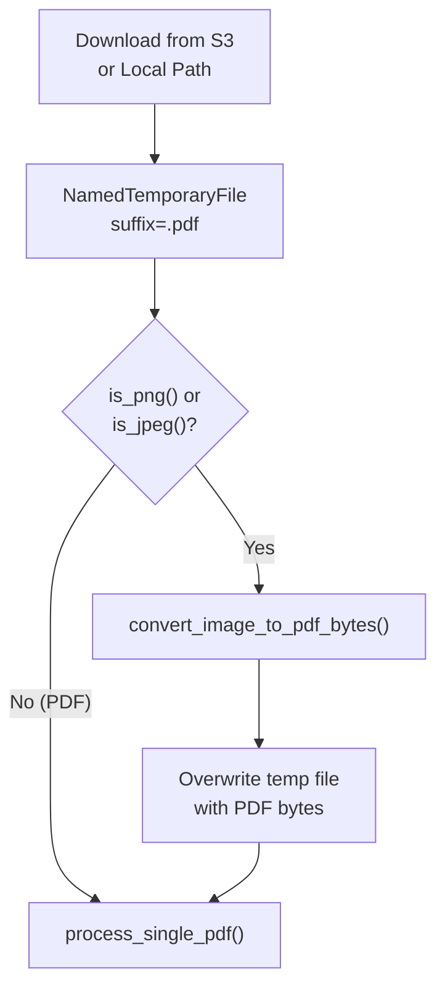
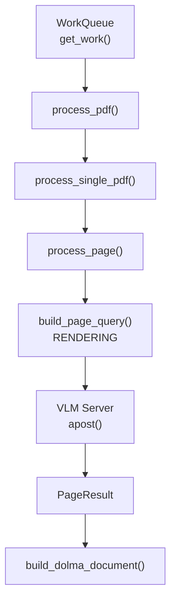

<!-- source: DeepWiki mcp.deepwiki.com · repo allenai/olmocr · page 3.1 PDF Rendering and Image Conversion · fetched 2026-10-26 -->

# PDF Rendering and Image Conversion

<details>
<summary>Relevant source files</summary>

The following files were used as context for generating this wiki page:

- [CHANGELOG.md](CHANGELOG.md)
- [Dockerfile](Dockerfile)
- [Dockerfile.with-model](Dockerfile.with-model)
- [olmocr/pipeline.py](olmocr/pipeline.py)
- [olmocr/version.py](olmocr/version.py)
- [olmocr/work_queue.py](olmocr/work_queue.py)
- [pyproject.toml](pyproject.toml)
- [scripts/release.sh](scripts/release.sh)
- [tests/gnarly_pdfs/edgar_image.pdf](tests/gnarly_pdfs/edgar_image.pdf)
- [tests/test_pipeline.py](tests/test_pipeline.py)
- [tests/test_s3_work_queue.py](tests/test_s3_work_queue.py)

</details>


**Purpose and Scope**: This document covers the conversion of PDF documents and image files into base64-encoded PNG format suitable for processing by vision-language models. This includes PDF page rendering using poppler-utils, resolution management, image rotation, and conversion of JPEG/PNG inputs to PDF format.

For information about how these rendered images are processed by the VLM server, see [VLM Server Management](#2.3). For rotation correction logic applied during processing, see [Page Processing and Rotation Correction](#2.4). For PDF filtering before rendering, see [PDF Filtering and Quality Control](#3.2).

---

## Overview

The olmOCR pipeline converts PDF pages into base64-encoded PNG images before sending them to the vision-language model for OCR. This conversion is performed on-demand for each page during processing and is designed to produce high-quality images at controlled resolutions while managing computational resources efficiently.

The rendering subsystem handles three main tasks:
1. Converting PDF pages to PNG images using poppler-utils
2. Encoding images as base64 strings for transmission to the VLM
3. Converting non-PDF image files (JPEG, PNG) to PDF format first

Sources: [olmocr/pipeline.py:37-39](), [olmocr/pipeline.py:144-185]()

---

## Rendering Pipeline Architecture



**Rendering Pipeline Flow**: Input documents are first normalized to PDF format if needed, then rendered to PNG using poppler-utils. The PNG is base64-encoded and optionally rotated before being embedded in the VLM query.

Sources: [olmocr/pipeline.py:144-185](), [olmocr/pipeline.py:517-542]()

---

## Core Rendering Function

### `build_page_query`

The [`build_page_query`](olmocr/pipeline.py:144-185)() function orchestrates the complete rendering and query construction process:

```python
async def build_page_query(
    local_pdf_path: str, 
    page: int, 
    target_longest_image_dim: int, 
    image_rotation: int = 0, 
    model_name: str = "olmocr"
) -> dict
```

**Parameters:**
- `local_pdf_path`: Path to the PDF file on local disk
- `page`: Page number to render (1-indexed)
- `target_longest_image_dim`: Maximum dimension for the longest edge of the rendered image
- `image_rotation`: Rotation angle in degrees (0, 90, 180, 270)
- `model_name`: Model identifier for the VLM query

**Process:**
1. Acquires a semaphore slot to limit concurrent rendering operations
2. Calls `render_pdf_to_base64png` to convert the PDF page to a base64 string
3. If rotation is needed, decodes the base64, rotates using PIL, and re-encodes
4. Constructs the VLM chat completion message with the image embedded

Sources: [olmocr/pipeline.py:144-185]()

---

## PDF to Image Rendering

### `render_pdf_to_base64png`

The actual PDF rendering is performed by [`render_pdf_to_base64png`](olmocr/data/renderpdf.py)() which is imported from `olmocr.data.renderpdf`:

```python
from olmocr.data.renderpdf import render_pdf_to_base64png
```

This function uses **poppler-utils**, specifically the `pdftoppm` command, to render PDF pages to PNG format. Poppler is a PDF rendering library that provides high-quality rasterization of PDF content.

**Installation**: Poppler-utils is installed as a system dependency in the Docker image:

```dockerfile
apt-get install -y --no-install-recommends \
    poppler-utils \
    fonts-crosextra-caladea \
    fonts-crosextra-carlito \
    gsfonts \
    lcdf-typetools \
    ttf-mscorefonts-installer
```

The font packages are included to ensure accurate rendering of text in various fonts, particularly for documents that use uncommon or proprietary fonts.

Sources: [olmocr/pipeline.py:37](), [Dockerfile:29-35]()

---

## Resolution Management

### Target Longest Image Dimension

The `target_longest_image_dim` parameter controls the resolution of rendered images. This value determines the size of the longest edge (width or height) of the output image in pixels.

**Default Value**: 1288 pixels (from pipeline arguments)

**Purpose**: 
- Balances image quality with token consumption in the VLM
- Higher resolutions capture more detail but increase processing cost
- Lower resolutions reduce costs but may miss fine details

**Example Scaling**:
- For a portrait page (8.5" × 11"): If width is 850px, height scales proportionally to ~1288px
- For a landscape page (11" × 8.5"): If height is 850px, width scales proportionally to ~1288px

The rendering function automatically calculates the appropriate DPI to achieve the target dimension while maintaining the PDF page's aspect ratio.

Sources: [olmocr/pipeline.py:144-150](), [tests/test_pipeline.py:198]()

---

## Image Rotation

### Rotation During Rendering

When the VLM detects that a page is incorrectly oriented, the pipeline can apply rotation corrections before re-submitting the page. Rotation is handled using PIL (Pillow) after the initial rendering:


**Rotation Implementation** [olmocr/pipeline.py:152-169]():

```python
if image_rotation != 0:
    image_bytes = base64.b64decode(image_base64)
    with Image.open(BytesIO(image_bytes)) as img:
        if image_rotation == 90:
            tranpose = Image.Transpose.ROTATE_90
        elif image_rotation == 180:
            tranpose = Image.Transpose.ROTATE_180
        else:
            tranpose = Image.Transpose.ROTATE_270
        
        rotated_img = img.transpose(tranpose)
        
        # Save the rotated image to a bytes buffer
        buffered = BytesIO()
        rotated_img.save(buffered, format="PNG")
    
    # Encode the rotated image back to base64
    image_base64 = base64.b64encode(buffered.getvalue()).decode("utf-8")
```

**Supported Rotations**: 0°, 90°, 180°, 270° (validated by assertion)

**Rotation Semantics**: All rotations are counter-clockwise:
- 90° = rotate 90° counter-clockwise (equivalent to 270° clockwise)
- 180° = rotate 180°
- 270° = rotate 270° counter-clockwise (equivalent to 90° clockwise)

Sources: [olmocr/pipeline.py:146-169](), [tests/test_pipeline.py:57-193]()

---

## Image-to-PDF Conversion

### Handling JPEG and PNG Inputs

The pipeline can process raw image files (JPEG, PNG) by first converting them to PDF format. This conversion happens transparently in the `process_pdf` function:



**Implementation** [olmocr/pipeline.py:531-535]():

```python
if is_png(tf.name) or is_jpeg(tf.name):
    logger.info(f"Converting {pdf_orig_path} from image to PDF format...")
    tf.seek(0)
    tf.write(convert_image_to_pdf_bytes(tf.name))
    tf.flush()
```

**Helper Functions**:
- `is_jpeg(path)`: Checks file magic bytes for JPEG signature
- `is_png(path)`: Checks file magic bytes for PNG signature
- `convert_image_to_pdf_bytes(path)`: Converts image file to PDF bytes

These functions are imported from `olmocr.image_utils` and likely use PIL or similar libraries to create a single-page PDF containing the image.

Sources: [olmocr/pipeline.py:39](), [olmocr/pipeline.py:531-535]()

---

## Concurrency Control

### Rendering Semaphore

PDF rendering is CPU-intensive and can overload the system if too many pages are rendered simultaneously. A bounded semaphore limits concurrent rendering operations:

**Semaphore Configuration** [olmocr/pipeline.py:82]():

```python
pdf_render_max_workers_limit = asyncio.BoundedSemaphore(
    int(float(os.environ.get("BEAKER_ASSIGNED_CPU_COUNT", 
                             max(1, multiprocessing.cpu_count() - 2))))
)
```

**Default Behavior**:
- In Beaker environment: Uses `BEAKER_ASSIGNED_CPU_COUNT` environment variable
- Local environment: Uses `cpu_count() - 2` to leave cores for other operations
- Minimum: 1 worker

**Usage Pattern** [olmocr/pipeline.py:149-150]():

```python
async with pdf_render_max_workers_limit:
    image_base64 = await asyncio.to_thread(
        render_pdf_to_base64png, 
        local_pdf_path, 
        page, 
        target_longest_image_dim=target_longest_image_dim
    )
```

The semaphore ensures that:
1. PDF rendering doesn't overwhelm the CPU
2. Other async operations can proceed
3. Memory usage remains bounded

The rendering itself is executed in a thread pool using `asyncio.to_thread` since poppler is a synchronous C library.

Sources: [olmocr/pipeline.py:82](), [olmocr/pipeline.py:149-150]()

---

## Dependencies and System Requirements

### Required System Libraries

The PDF rendering subsystem requires the following system packages:

| Package | Purpose |
|---------|---------|
| `poppler-utils` | PDF rendering via `pdftoppm` |
| `fonts-crosextra-caladea` | Substitute for Cambria font |
| `fonts-crosextra-carlito` | Substitute for Calibri font |
| `gsfonts` | Ghostscript fonts |
| `lcdf-typetools` | Font utilities |
| `ttf-mscorefonts-installer` | Microsoft Core Fonts (Arial, Times New Roman, etc.) |

**Font Installation Rationale**: Many PDF documents embed font references without including the actual font data. These font packages ensure that common fonts can be rendered accurately. The Microsoft Core Fonts require accepting an EULA during installation, which is handled in the Dockerfile:

```dockerfile
echo "ttf-mscorefonts-installer msttcorefonts/accepted-mscorefonts-eula select true" | \
    debconf-set-selections
```

Sources: [Dockerfile:24-35]()

### Python Dependencies

The rendering pipeline requires:

- `Pillow`: Image processing library for rotation and format conversion
- `pypdfium2`: PDF metadata reading (used for page counting)
- `pypdf>=5.2.0`: PDF manipulation utilities

These are specified in `pyproject.toml` core dependencies.

Sources: [pyproject.toml:26-29]()

---

## Image Format Specifications

### Base64 Encoding

All rendered images are base64-encoded for transmission to the VLM. The encoding follows these specifications:

**Format**: PNG (Portable Network Graphics)
- Lossless compression
- Supports transparency
- Widely supported by VLMs

**Encoding Process**:
1. Render PDF page to raw PNG bytes
2. Base64-encode the bytes using Python's `base64` module
3. Decode bytes to UTF-8 string for JSON serialization

**VLM Message Format** [olmocr/pipeline.py:172-179]():

```python
{
    "role": "user",
    "content": [
        {"type": "text", "text": build_no_anchoring_v4_yaml_prompt()},
        {
            "type": "image_url", 
            "image_url": {"url": f"data:image/png;base64,{image_base64}"}
        },
    ],
}
```

The image is embedded as a data URL with the `data:image/png;base64,` prefix.

Sources: [olmocr/pipeline.py:172-179]()

---

## Testing and Validation

### Rotation Testing

The rotation functionality is extensively tested to ensure correct image transformation:

**Test Coverage** [tests/test_pipeline.py:57-193]():

| Test Case | Validates |
|-----------|-----------|
| `test_no_rotation` | Identity transform (0°) preserves original image |
| `test_rotate_90_degrees` | 90° counter-clockwise rotation |
| `test_rotate_180_degrees` | 180° rotation |
| `test_rotate_270_degrees` | 270° counter-clockwise rotation |
| `test_invalid_rotation_angle` | Rejects invalid angles (e.g., 45°) |
| `test_rotation_preserves_image_quality` | PNG format and RGB mode preserved |

**Test Methodology**: Tests create synthetic images with distinct colored regions, apply rotations, and verify that pixel colors appear in expected positions after transformation.

Sources: [tests/test_pipeline.py:57-193]()

### Cumulative Rotation Testing

The pipeline supports multiple rotation attempts, accumulating rotations across retries. This is tested with scenarios where the model requests sequential rotations:

**Example Flow**:
1. First attempt: Model requests 90° rotation → cumulative = 90°
2. Second attempt: Model requests 90° rotation → cumulative = 180°
3. Third attempt: Model confirms correct orientation

**Wraparound**: Cumulative rotation modulo 360° ensures values stay in valid range [0, 90, 180, 270].

```python
cumulative_rotation = (cumulative_rotation + page_response.rotation_correction) % 360
```

Sources: [olmocr/pipeline.py:362](), [tests/test_pipeline.py:308-414]()

---

## Performance Considerations

### Rendering Performance

**Typical Rendering Times**:
- Single page at 1288px: 0.5-2 seconds (depends on page complexity)
- CPU-bound operation (poppler rendering)
- I/O-bound for reading PDF from disk

**Optimization Strategies**:
1. **Parallel Rendering**: Multiple pages can render simultaneously up to the semaphore limit
2. **Async Thread Pool**: Rendering happens in `asyncio.to_thread` to avoid blocking
3. **Caching**: PDFs are downloaded once to temporary files and reused for all pages

### Memory Management

**Memory Consumption per Page**:
- Raw PNG at 1288px: ~1-5 MB depending on content complexity
- Base64 encoding increases size by ~33%
- Rotation requires duplicate in-memory representation temporarily

**Cleanup**:
- Temporary PDF files are deleted after processing using `finally` blocks
- Base64 strings are garbage collected after VLM processing
- PIL images are closed using context managers

Sources: [olmocr/pipeline.py:517-542]()

---

## Error Handling

### Rendering Failures

The rendering subsystem handles several failure modes:

**Page Count Failures** [olmocr/pipeline.py:474-479]():

```python
try:
    reader = PdfReader(local_pdf_path)
    num_pages = reader.get_num_pages()
except:
    logger.exception(f"Could not count number of pages for {pdf_orig_path}, aborting document")
    return None
```

**Rendering Exceptions**:
- Caught at the page level in `process_page`
- Logged with full traceback
- Falls back to text extraction after maximum retries

**Image Conversion Failures**:
- Invalid image formats are skipped
- Corrupted images abort document processing

Sources: [olmocr/pipeline.py:474-479](), [olmocr/pipeline.py:512-514]()

---

## Integration Points

### Integration with Pipeline

The rendering subsystem integrates with the broader pipeline at these points:



**Rendering Occurs**: In `build_page_query` which is called by `process_page` for each page of the PDF.

**Data Flow**:
1. Work queue provides PDF path
2. PDF downloaded to temporary file
3. For each page, `build_page_query` renders and constructs VLM request
4. VLM response parsed into `PageResult`
5. Multiple `PageResult` objects aggregated into Dolma document

Sources: [olmocr/pipeline.py:288-419](), [olmocr/pipeline.py:461-515]()

---

## Configuration Options

### Command-Line Arguments

Rendering behavior is controlled by these pipeline arguments:

| Argument | Default | Description |
|----------|---------|-------------|
| `--target-longest-image-dim` | 1288 | Maximum dimension for longest edge in pixels |
| (CPU count from environment) | cpu_count() - 2 | Maximum concurrent rendering operations |

The target dimension can be adjusted based on document characteristics:
- **Technical documents**: Higher resolution (1500-2000px) for small text and diagrams
- **Simple text**: Lower resolution (800-1000px) to reduce costs
- **Forms/tables**: Higher resolution for grid alignment

Sources: [olmocr/pipeline.py:82](), [olmocr/pipeline.py:144]()

---

## Summary

The PDF rendering and image conversion subsystem provides:

1. **High-quality rendering** using poppler-utils with comprehensive font support
2. **Resolution control** via `target_longest_image_dim` parameter
3. **Format normalization** converting JPEG/PNG to PDF then to PNG
4. **Rotation support** for correcting page orientation
5. **Concurrency management** to prevent CPU overload
6. **Base64 encoding** for VLM compatibility

This subsystem is critical for preparing document pages for vision-language model processing, ensuring consistent image quality while managing computational resources efficiently.

Sources: [olmocr/pipeline.py:144-185](), [Dockerfile:29-35](), [pyproject.toml:22-43]()

---

