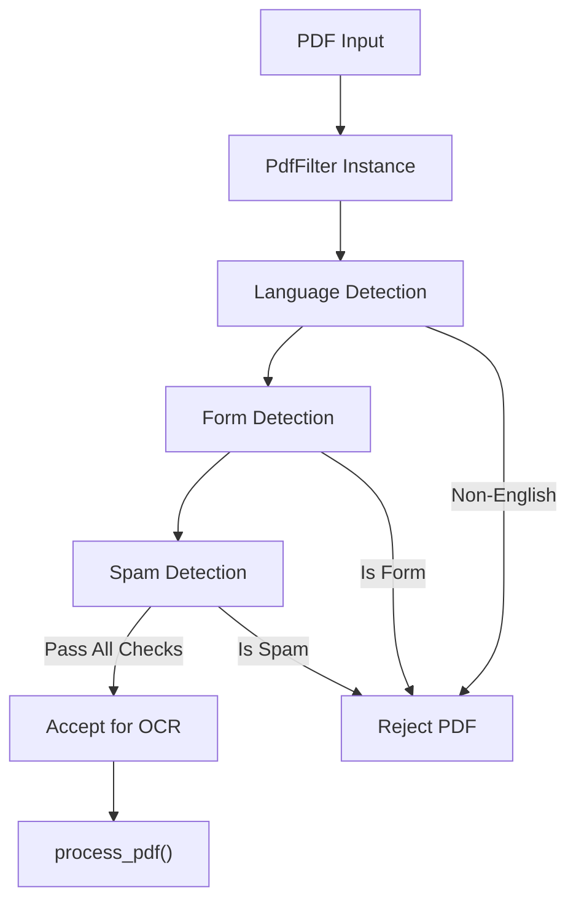
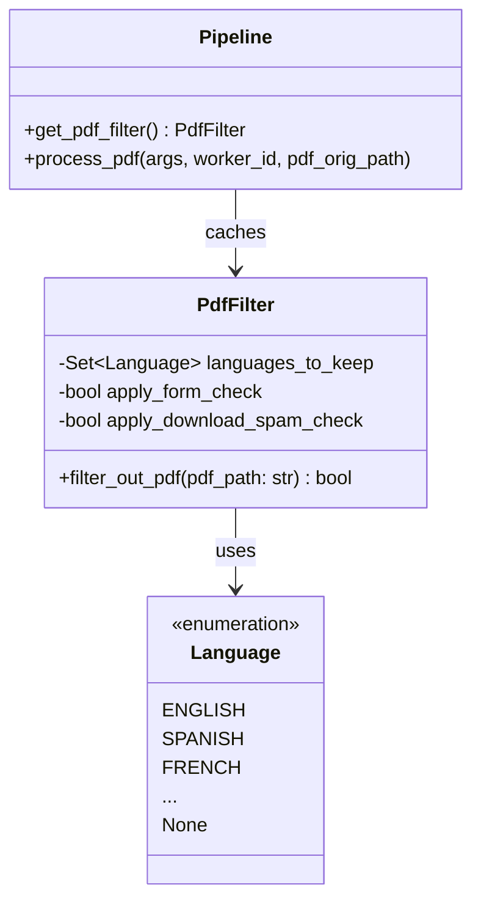
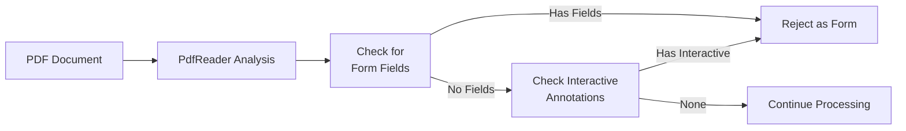
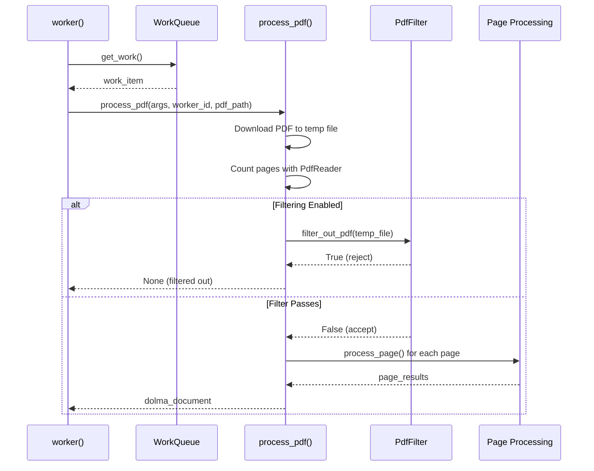

<!-- source: DeepWiki mcp.deepwiki.com · repo allenai/olmocr · page 3.2 PDF Filtering and Quality Control · fetched 2026-10-26 -->

# PDF Filtering and Quality Control

<details>
<summary>Relevant source files</summary>

The following files were used as context for generating this wiki page:

- [CHANGELOG.md](CHANGELOG.md)
- [olmocr/pipeline.py](olmocr/pipeline.py)
- [olmocr/version.py](olmocr/version.py)
- [olmocr/work_queue.py](olmocr/work_queue.py)
- [scripts/release.sh](scripts/release.sh)
- [tests/gnarly_pdfs/edgar_image.pdf](tests/gnarly_pdfs/edgar_image.pdf)
- [tests/test_filter.py](tests/test_filter.py)
- [tests/test_pipeline.py](tests/test_pipeline.py)
- [tests/test_s3_work_queue.py](tests/test_s3_work_queue.py)

</details>


## Purpose and Scope

The PDF filtering and quality control system provides automated document quality assessment to exclude low-value or problematic PDFs from the OCR pipeline. This system operates upstream of the main OCR processing to prevent wasted computational resources on documents that are unlikely to produce useful text output.

This page covers the filtering mechanisms applied before OCR processing begins. For information about the OCR pipeline itself, see [Pipeline Architecture](#2.1). For training data preparation filters, see [Training Data Preparation](#5.1).

---

## System Overview

The filtering system is implemented as a set of early-stage quality checks that examine PDFs before they are processed by the vision-language model. Filtering is optional and controlled by the `--apply_filter` command-line flag in the pipeline.



**Diagram: PDF Filtering Decision Flow**

The system operates as a gating mechanism where documents must pass all enabled checks to proceed to OCR processing. Documents failing any check are silently discarded with a log message.

**Sources:** [olmocr/pipeline.py:33-38](), [olmocr/pipeline.py:452-454]()

---

## PdfFilter Class Architecture



**Diagram: PdfFilter Class Structure**

The `PdfFilter` class is instantiated once per pipeline execution and cached using Python's `functools.cache` decorator. This ensures filter resources (such as language detection models) are loaded only once and reused across all PDF processing operations.

**Sources:** [olmocr/pipeline.py:92]()

---

## Filter Configuration

### Default Configuration

The pipeline creates a `PdfFilter` instance with the following default settings:

```python
get_pdf_filter = cache(lambda: PdfFilter(
    languages_to_keep={Language.ENGLISH, None}, 
    apply_download_spam_check=True, 
    apply_form_check=True
))
```

**Configuration Parameters:**

| Parameter | Type | Default | Description |
|-----------|------|---------|-------------|
| `languages_to_keep` | `Set[Language]` | `{ENGLISH, None}` | Languages to accept; `None` allows documents with undetectable language |
| `apply_form_check` | `bool` | `True` | Enable form detection filter |
| `apply_download_spam_check` | `bool` | `True` | Enable spam/SEO content detection |

**Sources:** [olmocr/pipeline.py:92]()

### Pipeline Integration

Filtering is controlled via the `--apply_filter` command-line argument:

```bash
# Enable filtering
python -m olmocr.pipeline ./workspace --pdfs input/*.pdf --apply_filter

# Disable filtering (default behavior)
python -m olmocr.pipeline ./workspace --pdfs input/*.pdf
```

The filter check occurs after page counting but before page-level processing begins:

```python
if args.apply_filter and get_pdf_filter().filter_out_pdf(tf.name):
    logger.info(f"Filtering out pdf {pdf_orig_path}")
    return None
```

**Sources:** [olmocr/pipeline.py:452-454](), [README.md:385]()

---

## Filter Types

### Language Detection

The language detection filter identifies the primary language of document text and rejects PDFs that do not match the configured `languages_to_keep` set.

**Purpose:** Focus OCR processing on English documents (or other specified languages) while avoiding computational waste on documents in unsupported languages.

**Behavior:**
- Documents identified as English: **Pass**
- Documents with undetectable language (`None`): **Pass** (allows image-only documents)
- Documents in other languages: **Reject**

**Implementation Location:** `olmocr/filter/filter.py` (Language detection logic)

**Sources:** [olmocr/pipeline.py:38](), [olmocr/pipeline.py:92]()

---

### Form Detection

The form detection filter identifies PDF documents that contain interactive form fields (text boxes, checkboxes, radio buttons, etc.) which typically do not require OCR processing since they already contain extractable digital text.

**Purpose:** Exclude forms and fillable PDFs that are not suitable targets for vision-based OCR, as they contain structured data rather than natural document text.



**Diagram: Form Detection Logic Flow**

**Test Coverage:**

The form detection system is tested to ensure it catches forms appearing on later pages (not just the first page):

```python
self.filter = PdfFilter(apply_form_check=True)
self.assertTrue(self.filter.filter_out_pdf(
    os.path.join(os.path.dirname(__file__), "gnarly_pdfs", "form_on_later_pages.pdf")
))
```

**Sources:** [olmocr/pipeline.py:92](), [tests/test_filter.py:10-17]()

---

### Spam and SEO Content Detection

The spam detection filter identifies PDFs that appear to be low-quality SEO content, link farms, or automatically generated documents designed for search engine manipulation rather than human reading.

**Purpose:** Exclude documents that would contribute little value to training datasets or OCR applications, focusing resources on legitimate documents with meaningful content.

**Characteristics Checked:**
- Excessive keyword repetition
- Abnormal link density
- Suspicious text patterns common in SEO spam
- Low content-to-noise ratio

**Configuration:** Controlled by the `apply_download_spam_check` parameter.

**Sources:** [olmocr/pipeline.py:92](), [README.md:424]()

---

## Pipeline Integration Points



**Diagram: Filter Integration in Pipeline Execution**

The filtering check occurs at a strategic point in the pipeline:

1. **After PDF download:** The PDF must be locally available for analysis
2. **After page counting:** Ensures the PDF is valid and readable
3. **Before page processing:** Prevents wasted VLM inference on rejected documents

This placement minimizes wasted work while ensuring the filter has access to the complete PDF structure for analysis.

**Sources:** [olmocr/pipeline.py:442-454]()

---

## Performance Characteristics

### Computational Cost

PDF filtering is designed to be fast relative to OCR processing:

- **Language detection:** Milliseconds per document
- **Form detection:** Microseconds (metadata inspection only)
- **Spam detection:** Milliseconds (heuristic text analysis)

**Total filtering overhead:** Typically < 100ms per document, compared to 1-10 seconds for OCR processing.

### Filter Cache Strategy

The `get_pdf_filter()` function uses Python's `@cache` decorator to ensure the filter instance is created only once per pipeline execution:

```python
get_pdf_filter = cache(lambda: PdfFilter(...))
```

This caching is critical because:
- Language detection models may load large statistical models
- Form detection compiles regex patterns
- Spam detection initializes keyword databases

Without caching, these initialization costs would be repeated for every PDF, significantly degrading performance.

**Sources:** [olmocr/pipeline.py:92]()

---

## Usage Examples

### Enabling Filtering in Local Pipeline

```bash
# Process PDFs with filtering enabled
python -m olmocr.pipeline ./workspace \
    --pdfs ./documents/*.pdf \
    --apply_filter \
    --markdown
```

### Disabling Specific Filters

While the command-line interface does not expose fine-grained filter control, you can modify the filter configuration programmatically:

```python
from olmocr.filter.filter import PdfFilter, Language

# Create filter that only checks for forms
custom_filter = PdfFilter(
    languages_to_keep=None,  # Accept all languages
    apply_form_check=True,
    apply_download_spam_check=False
)

result = custom_filter.filter_out_pdf("document.pdf")
```

### Testing Filter Behavior

```python
from olmocr.filter import PdfFilter

# Test form detection
filter = PdfFilter(apply_form_check=True)
is_filtered = filter.filter_out_pdf("path/to/document.pdf")

if is_filtered:
    print("Document rejected by filter")
else:
    print("Document accepted for processing")
```

**Sources:** [tests/test_filter.py:10-17](), [README.md:385]()

---

## Logging and Observability

When a PDF is filtered out, the pipeline logs an informational message:

```python
logger.info(f"Filtering out pdf {pdf_orig_path}")
```

This log entry is written to `olmocr-pipeline-debug.log` and appears in the console output, allowing operators to track how many documents are being excluded by the filtering system.

**Log Analysis:**

To analyze filtering effectiveness, you can grep the log file:

```bash
# Count filtered PDFs
grep "Filtering out pdf" olmocr-pipeline-debug.log | wc -l

# View filtered PDF paths
grep "Filtering out pdf" olmocr-pipeline-debug.log
```

**Sources:** [olmocr/pipeline.py:453](), [olmocr/pipeline.py:63]()

---

## Design Rationale

### Why Filter Before OCR?

The filtering system is positioned before OCR processing for several key reasons:

1. **Cost Efficiency:** VLM inference is expensive (GPU compute, memory, time). Filtering prevents wasted resources on unsuitable documents.

2. **Training Data Quality:** For dataset creation workflows, filtering ensures that only high-quality source documents contribute to training data.

3. **Early Failure:** Better to reject a document in milliseconds during filtering than to spend seconds processing it only to produce poor results.

### Why These Specific Filters?

**Language:** English language filtering reflects the target use case for olmOCR, though the system is extensible to other languages.

**Forms:** Interactive PDFs already contain extractable text and don't benefit from vision-based OCR. Processing them wastes compute and may produce inferior results compared to direct text extraction.

**Spam:** Low-quality SEO documents pollute training datasets and provide no value in production OCR scenarios. Early rejection improves overall data quality.

**Sources:** [README.md:424]()

---

## Relationship to Training Filters

The pipeline filtering system (`PdfFilter`) is distinct from training data preparation filters. The training system includes additional quality control mechanisms:

- **Data augmentation filters** in `BaseMarkdownPDFDataset`
- **Coherency analysis** for anchor text selection
- **Front matter validation** in `FrontMatterParser`

These training-specific filters are documented in [Training Data Preparation](#5.1).

**Sources:** [olmocr/pipeline.py:38](), [olmocr/pipeline.py:51]()

---

## Implementation Files

| Component | File Path | Description |
|-----------|-----------|-------------|
| Main Filter Class | `olmocr/filter/filter.py` | Implementation of `PdfFilter` and `Language` enum |
| Pipeline Integration | [olmocr/pipeline.py:452-454]() | Filter invocation in `process_pdf()` |
| Filter Cache | [olmocr/pipeline.py:92]() | Cached filter instance creation |
| Unit Tests | [tests/test_filter.py]() | Filter behavior validation |

**Sources:** [olmocr/pipeline.py:38](), [tests/test_filter.py:1-18](), [README.md:424]()

---

