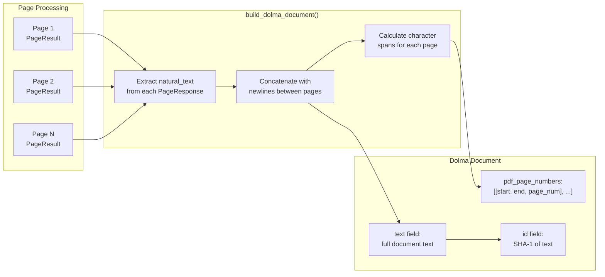
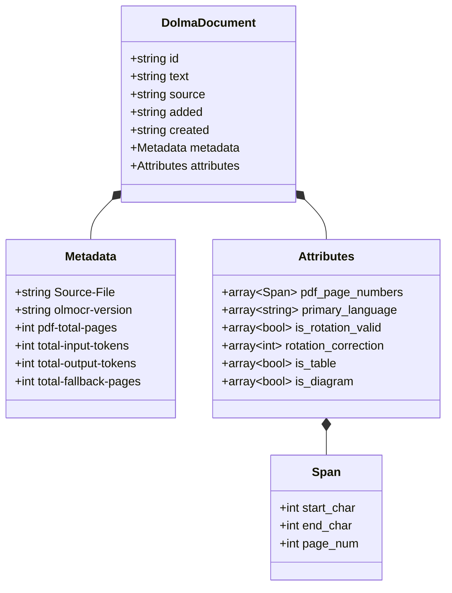
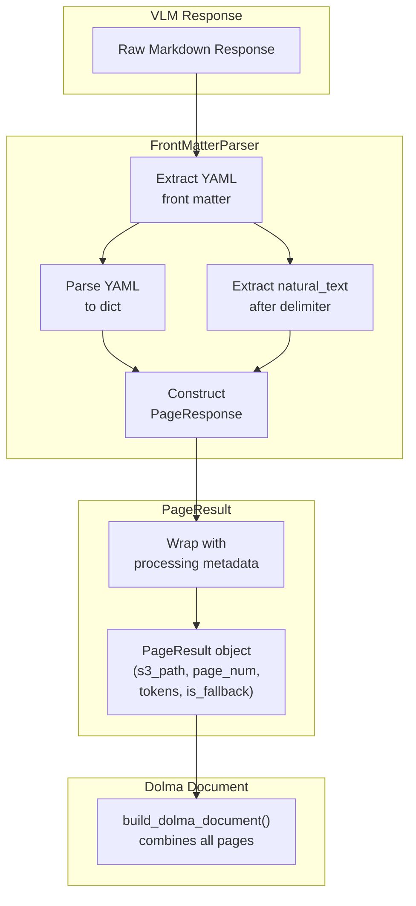
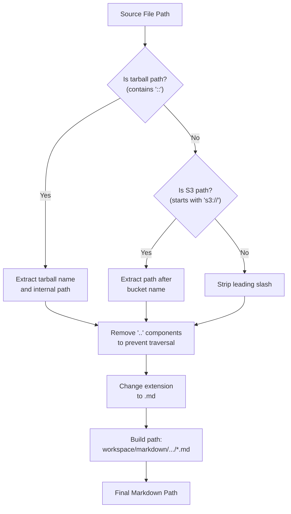
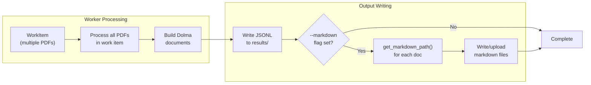

<!-- source: DeepWiki mcp.deepwiki.com · repo allenai/olmocr · page 3.3 Output Formats and Data Models · fetched 2026-10-26 -->

# Output Formats and Data Models

<details>
<summary>Relevant source files</summary>

The following files were used as context for generating this wiki page:

- [CHANGELOG.md](CHANGELOG.md)
- [olmocr/pipeline.py](olmocr/pipeline.py)
- [olmocr/version.py](olmocr/version.py)
- [olmocr/work_queue.py](olmocr/work_queue.py)
- [scripts/release.sh](scripts/release.sh)
- [tests/gnarly_pdfs/edgar_image.pdf](tests/gnarly_pdfs/edgar_image.pdf)
- [tests/test_pipeline.py](tests/test_pipeline.py)
- [tests/test_s3_work_queue.py](tests/test_s3_work_queue.py)

</details>


## Purpose and Scope

This page documents the output formats and data models used in the olmOCR pipeline for document processing results. It covers:

- **Dolma JSONL format**: The primary structured output format for processed documents
- **Markdown file output**: Optional plain text output for human readability
- **PageResponse data model**: Per-page metadata structure extracted from VLM responses
- **Metadata preservation**: Versioning and quality tracking across the pipeline

For information about how PDFs are converted to images for processing, see [PDF Rendering and Image Conversion](#3.1). For the overall pipeline workflow that produces these outputs, see [Pipeline Architecture and Workflow](#2.1).

---

## Dolma JSONL Format

The primary output format for olmOCR is Dolma JSONL (JSON Lines), where each line represents one processed PDF document. This format is designed for large-scale NLP dataset processing and provides structured access to both document text and per-page metadata.

### Document Structure

The `build_dolma_document` function constructs the output document structure from page processing results. Each document is written as a single JSON object per line in files named `output_{work_hash}.jsonl`.

**Basic Document Fields:**

| Field | Type | Description |
|-------|------|-------------|
| `id` | string | SHA-1 hash of the document text for deduplication |
| `text` | string | Concatenated natural text from all pages |
| `source` | string | Always `"olmocr"` to identify the extraction method |
| `added` | string | ISO date when document was processed (YYYY-MM-DD) |
| `created` | string | ISO date when document was processed (YYYY-MM-DD) |
| `metadata` | object | Document-level metadata (see below) |
| `attributes` | object | Per-page attributes arrays (see below) |

**Metadata Object Fields:**

| Field | Type | Description |
|-------|------|-------------|
| `Source-File` | string | Original file path (S3, local, or tarball::internal format) |
| `olmocr-version` | string | Version of olmOCR used for processing |
| `pdf-total-pages` | integer | Total number of pages in the PDF |
| `total-input-tokens` | integer | Sum of input tokens across all pages |
| `total-output-tokens` | integer | Sum of output tokens across all pages |
| `total-fallback-pages` | integer | Number of pages that used pdftotext fallback |

Sources: [olmocr/pipeline.py:544-593](), [olmocr/version.py:1-12]()

### Document Text Construction

The document text is built by concatenating the `natural_text` from each page's `PageResponse`, with newlines between pages (except after the last page). Empty pages (where `natural_text` is `None`) contribute empty strings to the text.



Sources: [olmocr/pipeline.py:544-593]()

### Page Span Tracking

The `pdf_page_numbers` attribute in the `attributes` object contains an array of spans `[start_char, end_char, page_num]` that map character positions in the document text back to their source pages. This enables downstream consumers to identify which page any portion of text came from.

```python
# Example pdf_page_numbers structure for a 3-page document:
[
  [0, 245, 1],      # Page 1: characters 0-245
  [245, 512, 2],    # Page 2: characters 245-512
  [512, 890, 3]     # Page 3: characters 512-890
]
```

Sources: [olmocr/pipeline.py:544-560]()

### Attributes Object

The `attributes` object contains per-page metadata arrays. Each array has one entry per page in the document, allowing per-page quality tracking and analysis:

| Attribute | Type | Description |
|-----------|------|-------------|
| `pdf_page_numbers` | array of [int, int, int] | Character span triplets `[start, end, page_num]` |
| `primary_language` | array of string or null | Detected language code per page (e.g., "en") |
| `is_rotation_valid` | array of boolean | Whether final page orientation is correct |
| `rotation_correction` | array of integer | Rotation applied: 0, 90, 180, or 270 degrees |
| `is_table` | array of boolean | Whether page contains primarily tabular data |
| `is_diagram` | array of boolean | Whether page contains primarily diagrams |



Sources: [olmocr/pipeline.py:584-591]()

### Output File Organization

Dolma documents are written to the workspace `results/` directory:

```
workspace/
├── results/
│   ├── output_abc123def456...jsonl
│   ├── output_789ghi012jkl...jsonl
│   └── ...
└── work_index_list.csv.zstd
```

Each output file corresponds to one work item (a group of PDFs processed together), named by the work hash. The file contains one Dolma document per line for each successfully processed PDF in that work group.

Sources: [olmocr/pipeline.py:652-664]()

---

## PageResponse Data Model

The `PageResponse` class represents the structured metadata extracted from the VLM's response for a single page. It is parsed from YAML front matter in the model's markdown output.

### PageResponse Fields

| Field | Type | Description |
|-------|------|-------------|
| `natural_text` | string or None | Extracted text content from the page |
| `primary_language` | string or None | ISO 639-1 language code (e.g., "en", "fr") |
| `is_rotation_valid` | boolean | Whether the page orientation is correct |
| `rotation_correction` | integer | Suggested rotation: 0, 90, 180, or 270 |
| `is_table` | boolean | Whether page contains primarily tables |
| `is_diagram` | boolean | Whether page contains primarily diagrams |

### Parsing Front Matter

The `FrontMatterParser` extracts the YAML front matter from the VLM's markdown response and parses it into a `PageResponse` object. The front matter is delimited by `---` markers:

```markdown
---
primary_language: en
is_rotation_valid: true
rotation_correction: 0
is_table: false
is_diagram: false
---

This is the natural text content extracted from the page.
Tables and equations are converted to markdown format.
```

The text content after the front matter delimiter becomes the `natural_text` field.

Sources: [olmocr/pipeline.py:353-355](), [olmocr/train/dataloader.py]() (FrontMatterParser)

### PageResult Wrapper

The `PageResult` dataclass wraps a `PageResponse` with additional processing metadata:

```python
@dataclass(frozen=True)
class PageResult:
    s3_path: str              # Original source file path
    page_num: int             # Page number (1-indexed)
    response: PageResponse    # Parsed VLM response
    input_tokens: int         # Tokens in prompt
    output_tokens: int        # Tokens in completion
    is_fallback: bool         # True if pdftotext fallback was used
```

This structure is used internally during pipeline processing and is then transformed into the Dolma format.



Sources: [olmocr/pipeline.py:133-142](), [olmocr/pipeline.py:353-355]()

### Fallback Pages

When page processing fails after all retries, a fallback `PageResponse` is constructed using `pdftotext` extraction. This fallback response sets:

- `natural_text`: Text extracted via `get_anchor_text()` with pdftotext engine
- `primary_language`: `None`
- `is_rotation_valid`: `True` (assumed correct)
- `rotation_correction`: `0`
- `is_table`: `False`
- `is_diagram`: `False`
- Input/output tokens: `0`
- `is_fallback`: `True`

Documents with too many fallback pages (exceeding `max_page_error_rate`) are discarded entirely.

Sources: [olmocr/pipeline.py:405-419](), [olmocr/pipeline.py:499-509]()

---

## Markdown Output

When the `--markdown` flag is enabled, the pipeline writes individual markdown files in addition to Dolma JSONL output. These files contain only the natural text (no metadata) and are organized to mirror the source document structure.

### Markdown Path Construction

The `get_markdown_path` function determines where markdown files are written based on the source file path:



Sources: [olmocr/pipeline.py:89-130]()

### Path Handling Examples

| Source Path | Markdown Output Path |
|-------------|---------------------|
| `s3://bucket/docs/file.pdf` | `workspace/markdown/docs/file.md` |
| `/home/user/docs/file.pdf` | `workspace/markdown/home/user/docs/file.md` |
| `archive.tar.gz::internal/doc.pdf` | `workspace/markdown/archive/internal/doc.md` |
| `docs/../../../etc/passwd.pdf` | `workspace/markdown/docs/etc/passwd.md` (sanitized) |

**Security Note**: The path sanitization removes all `..` components to prevent path traversal attacks. Absolute local paths are made relative to prevent writing outside the workspace.

Sources: [olmocr/pipeline.py:89-130](), [tests/test_pipeline.py:516-571]()

### Writing Markdown Files

Markdown files are written after successful processing of all PDFs in a work item:

1. Extract `natural_text` from each Dolma document
2. Calculate markdown path using `get_markdown_path`
3. Create directory structure if needed
4. Write text content to file (local) or upload to S3

For S3 workspaces, markdown files are uploaded to S3 using temporary local files. For local workspaces, files are written directly.



Sources: [olmocr/pipeline.py:666-696]()

### Markdown Directory Structure

The markdown output preserves the source directory structure:

```
workspace/
├── markdown/
│   ├── bucket1/
│   │   └── papers/
│   │       ├── paper1.md
│   │       └── paper2.md
│   ├── archive/
│   │   └── internal/
│   │       └── doc.md
│   └── data/
│       └── file.md
└── results/
    └── output_*.jsonl
```

This organization makes it easy to locate the markdown output corresponding to any source file.

Sources: [olmocr/pipeline.py:666-696]()

---

## Metadata and Versioning

### Version Tracking

Every Dolma document includes the `olmocr-version` field in its metadata, which records the exact version of olmOCR used to process the document. This version string is defined in `olmocr/version.py` and follows semantic versioning:

```python
VERSION = "{MAJOR}.{MINOR}.{PATCH}{SUFFIX}"
```

The version is used for:
- **Reproducibility**: Knowing which model and code version produced results
- **Quality tracking**: Comparing output quality across versions
- **Reprocessing decisions**: Identifying documents that need reprocessing after updates

Sources: [olmocr/version.py:1-12](), [olmocr/pipeline.py:568]()

### Quality Metrics

Document-level quality metrics are captured in the metadata:

| Metric | Purpose |
|--------|---------|
| `total-input-tokens` | Processing cost tracking |
| `total-output-tokens` | Processing cost tracking |
| `total-fallback-pages` | Quality indicator (higher = lower quality) |
| `pdf-total-pages` | Context for fallback rate calculation |

Combined with per-page `is_fallback` flags in attributes, these metrics enable downstream quality filtering and analysis.

### Source File Preservation

The `Source-File` metadata field preserves the original file location in its complete form:

- **S3 paths**: Full S3 URI including bucket and key
- **Tarball paths**: Format `tarball_path::internal_path` to identify files within archives
- **Local paths**: Absolute or relative path as provided

This enables:
- **Traceability**: Finding the original source document
- **Reprocessing**: Identifying which files to reprocess after errors or updates
- **Deduplication**: Detecting when the same file is processed multiple times

Sources: [olmocr/pipeline.py:566-573]()

### Document ID Generation

The document `id` field is generated as a SHA-1 hash of the document text. This provides:

- **Content-based deduplication**: Identical text content produces identical IDs
- **Deterministic identification**: Same content always generates the same ID
- **Collision resistance**: SHA-1 provides adequate uniqueness for document-scale data

Note that documents with different metadata but identical text will have the same ID, enabling deduplication across processing runs.

Sources: [olmocr/pipeline.py:575-577]()

---

## Summary

The olmOCR pipeline produces two complementary output formats:

1. **Dolma JSONL**: Structured format with full metadata, character-level page spans, and per-page attributes for machine consumption
2. **Markdown files**: Plain text output preserving source directory structure for human readability

The `PageResponse` data model captures the VLM's structured output with language detection, rotation correction, and content classification. Combined with processing metadata (tokens, fallback status), this enables comprehensive quality tracking and downstream analysis.

All outputs include version tracking and source provenance metadata to ensure reproducibility and traceability across large-scale document processing workflows.

---

