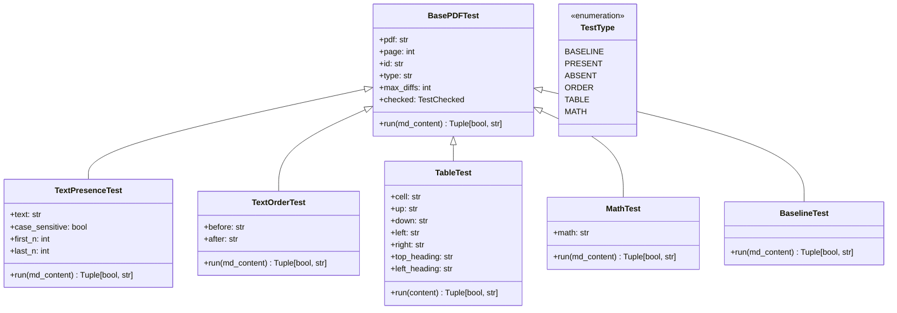
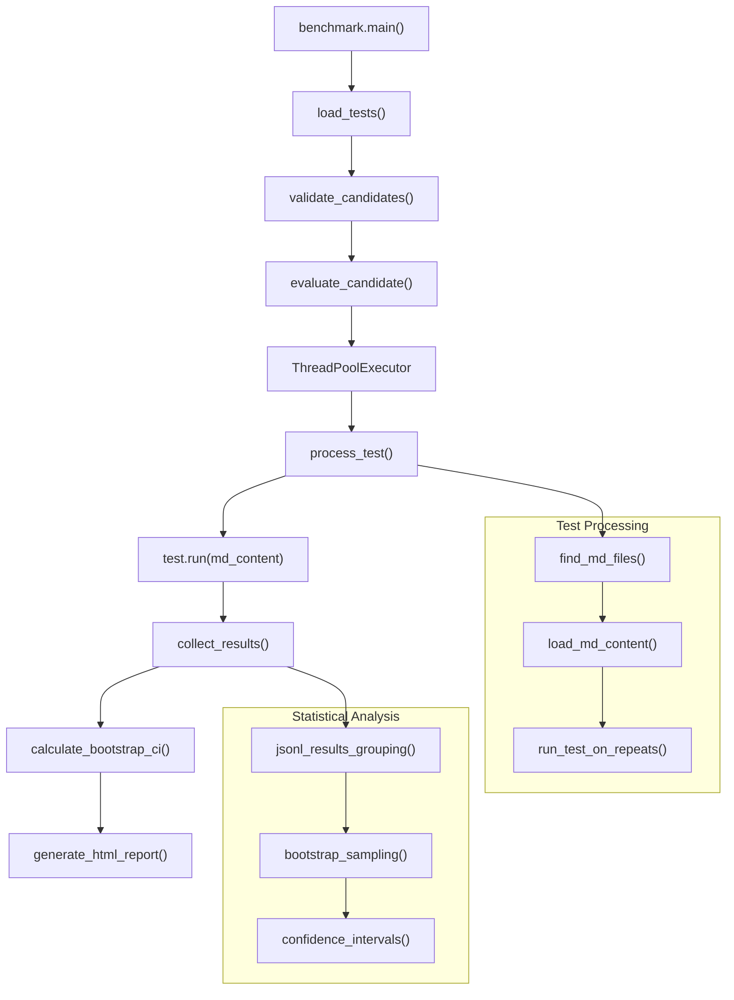
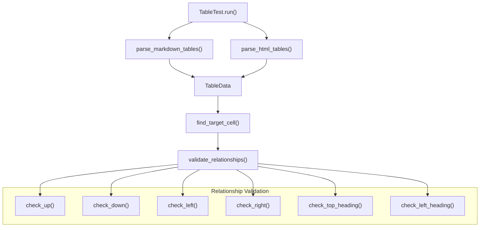
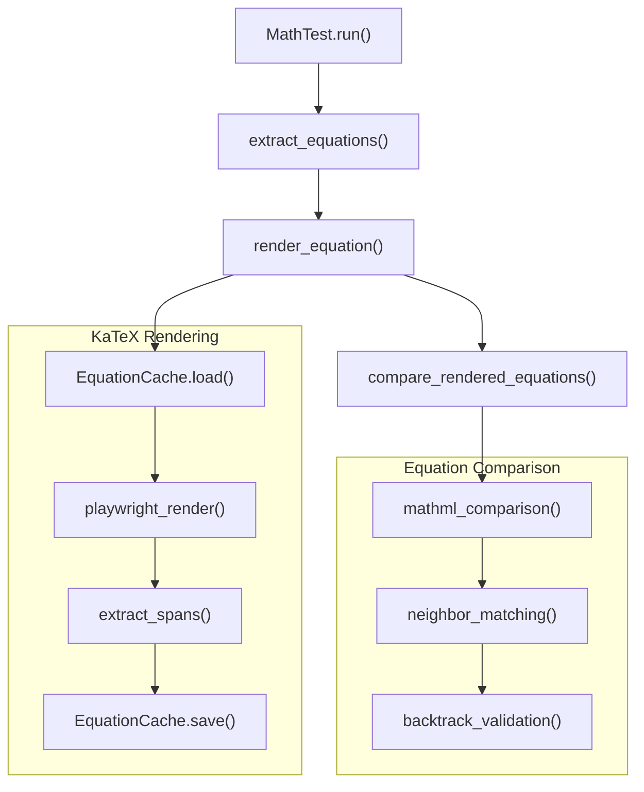
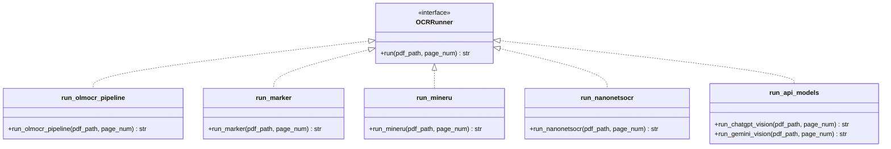
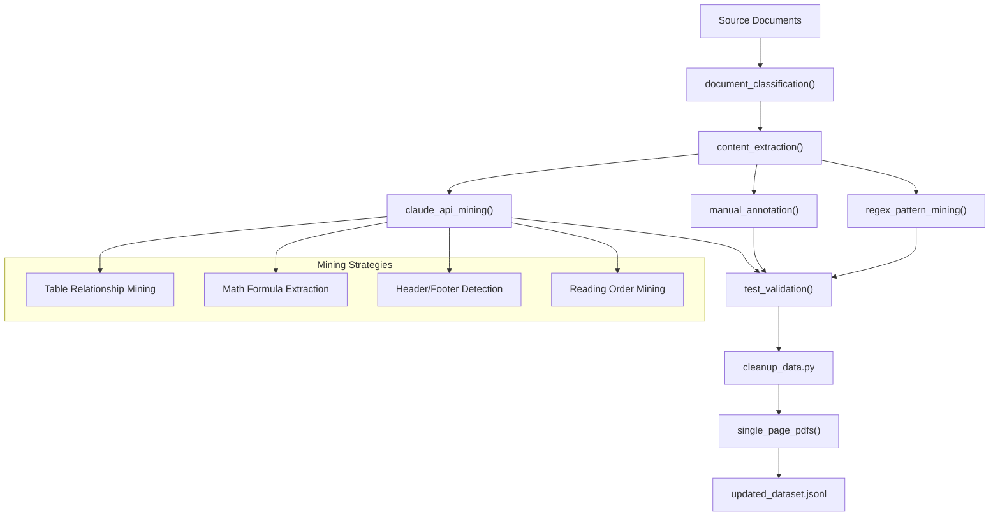

<!-- source: DeepWiki mcp.deepwiki.com · repo allenai/olmocr · page 4 Benchmarking System · fetched 2026-10-26 -->

# Benchmarking System

<details>
<summary>Relevant source files</summary>

The following files were used as context for generating this wiki page:

- [README.md](README.md)
- [olmocr/bench/README.md](olmocr/bench/README.md)
- [olmocr/bench/benchmark.py](olmocr/bench/benchmark.py)
- [olmocr/bench/katex/render.py](olmocr/bench/katex/render.py)
- [olmocr/bench/miners/download_math.py](olmocr/bench/miners/download_math.py)
- [olmocr/bench/miners/mine_math.py](olmocr/bench/miners/mine_math.py)
- [olmocr/bench/report.py](olmocr/bench/report.py)
- [olmocr/bench/runners/run_mistral.py](olmocr/bench/runners/run_mistral.py)
- [olmocr/bench/runners/run_nanonetsocr.py](olmocr/bench/runners/run_nanonetsocr.py)
- [olmocr/bench/runners/run_olmocr_pipeline.py](olmocr/bench/runners/run_olmocr_pipeline.py)
- [olmocr/bench/sample_data/dataset.jsonl](olmocr/bench/sample_data/dataset.jsonl)
- [olmocr/bench/sample_data/pdfs/small_page_size.pdf](olmocr/bench/sample_data/pdfs/small_page_size.pdf)
- [olmocr/bench/sample_data/pdfs/test-graphical-text.pdf](olmocr/bench/sample_data/pdfs/test-graphical-text.pdf)
- [olmocr/bench/tests.py](olmocr/bench/tests.py)
- [olmocr/bench/utils.py](olmocr/bench/utils.py)
- [olmocr/train/README.md](olmocr/train/README.md)
- [scripts/run_mineru_benchmark.sh](scripts/run_mineru_benchmark.sh)
- [tests/test_katex_render.py](tests/test_katex_render.py)

</details>


The olmOCR Benchmarking System is a comprehensive evaluation framework designed to assess and compare OCR system performance across diverse document types and challenges. This system provides over 7,000 test cases spanning 1,400 documents, enabling systematic measurement of OCR accuracy through fact-based, pass/fail tests rather than soft metrics like edit distance.

For information about the core OCR pipeline being tested, see [Core OCR Pipeline](#2). For model training and evaluation workflows, see [Model Training and Fine-tuning](#5).

## Test Framework Architecture

The benchmarking system is built around a hierarchical test framework centered on the `BasePDFTest` class, which provides the foundation for all evaluation types.

### Core Test Framework Hierarchy



Sources: [olmocr/bench/tests.py:93-100](), [olmocr/bench/tests.py:471-514](), [olmocr/bench/tests.py:516-571](), [olmocr/bench/tests.py:573-615](), [olmocr/bench/tests.py:617-850]()

### Test Categories and Document Types

The benchmark evaluates OCR systems across seven distinct document categories, each designed to test specific OCR challenges:

| Category | Code Identifier | Purpose | Test Types |
|----------|----------------|---------|------------|
| ArXiv Papers | `AR` | LaTeX equations and academic formatting | `math`, `present`, `order` |
| Old Scans Math | `OSM` | Historical mathematical documents | `math`, `present` |
| Tables | `TA` | Structured data extraction | `table`, `present` |
| Old Scans | `OS` | Historical documents and typewritten text | `present`, `order`, `absent` |
| Headers/Footers | `HF` | Header/footer filtering | `absent` |
| Multi Column | `MC` | Multi-column layout reading order | `order`, `present` |
| Long Tiny Text | `LTT` | Dense small text extraction | `present` |

Sources: [olmocr/bench/README.md:209-224](), [olmocr/bench/sample_data/dataset.jsonl:1-117]()

## Benchmark Execution Engine

The benchmark execution is orchestrated by the `benchmark.py` module, which manages parallel test execution, result aggregation, and statistical analysis.

### Benchmark Execution Flow



Sources: [olmocr/bench/benchmark.py:162-194](), [olmocr/bench/benchmark.py:33-159](), [olmocr/bench/benchmark.py:275-328]()

### Parallel Test Execution

The system uses `ThreadPoolExecutor` to process tests concurrently, with configurable worker counts based on system capabilities:

```python
with ThreadPoolExecutor(max_workers=min(os.cpu_count() or 1, 64)) as executor:
    futures = [executor.submit(process_test, test) for test in all_tests]
```

Each test execution follows this pattern:
1. Locate corresponding markdown files for the PDF page
2. Load markdown content from multiple repeat generations
3. Execute the test's `run()` method on each repeat
4. Aggregate results across repeats (majority vote)

Sources: [olmocr/bench/benchmark.py:142-157](), [olmocr/bench/benchmark.py:80-137]()

## Test Types and Validation Logic

### Text Presence and Absence Tests

The `TextPresenceTest` class handles both `PRESENT` and `ABSENT` test types using fuzzy matching with configurable thresholds:

```python
threshold = 1.0 - (self.max_diffs / (len(reference_query) if len(reference_query) > 0 else 1))
best_ratio = fuzz.partial_ratio(reference_query, md_content) / 100.0
```

Key features:
- Unicode normalization using NFC form
- Character replacement mapping for fancy quotes, dashes, etc.
- Optional case sensitivity
- Configurable search regions (`first_n`, `last_n` characters)

Sources: [olmocr/bench/tests.py:516-571](), [olmocr/bench/tests.py:113-143]()

### Reading Order Tests

The `TextOrderTest` validates natural reading flow by ensuring one text fragment appears before another:

```python
before_matches = find_near_matches(self.before, md_content, max_l_dist=self.max_diffs)
after_matches = find_near_matches(self.after, md_content, max_l_dist=self.max_diffs)
```

This is critical for multi-column documents and complex layouts where relative positioning matters more than absolute positioning.

Sources: [olmocr/bench/tests.py:573-615]()

### Table Structure Tests

The `TableTest` class validates table relationships through both markdown and HTML table parsing:



The `TableData` class maintains:
- `data`: numpy array of cell contents
- `header_rows`: set of row indices that are headers
- `header_cols`: set of column indices that are headers
- `col_headers`: mapping of column headers with colspan handling
- `row_headers`: mapping of row headers with rowspan handling

Sources: [olmocr/bench/tests.py:21-91](), [olmocr/bench/tests.py:617-850](), [olmocr/bench/tests.py:146-299](), [olmocr/bench/tests.py:301-468]()

### Mathematical Equation Tests

Math tests use KaTeX rendering for equation comparison through the `katex/render.py` module:



The comparison algorithm:
1. Normalizes and compares MathML representations
2. Falls back to spatial neighbor-based matching of rendered symbols
3. Uses backtracking to find valid symbol assignments

Sources: [olmocr/bench/katex/render.py:178-358](), [olmocr/bench/katex/render.py:361-494](), [olmocr/bench/tests.py:852-930]()

## OCR Method Integration

The benchmarking system supports multiple OCR engines through a standardized runner interface in the `runners/` directory:

### OCR Runner Architecture



Each runner handles:
- PDF page extraction and rendering
- Model-specific preprocessing
- OCR execution and postprocessing
- Markdown formatting for benchmark compatibility

Sources: [olmocr/bench/runners/run_mineru.py:11-75](), [olmocr/bench/runners/run_nanonetsocr.py:36-90]()

## Test Generation and Data Mining

The benchmark includes automated test generation capabilities through the `miners/` directory:

### Test Mining Pipeline



The `cleanup_data.py` utility processes multi-page PDFs into single-page test documents:

```python
def extract_single_page_pdfs(source_pdf_dir, target_pdf_dir, pdf_page_tests):
    for pdf_name, page_num in pdf_page_tests.keys():
        reader = PdfReader(source_pdf_path)
        writer = PdfWriter()
        writer.add_page(reader.pages[page_num - 1])
```

Sources: [olmocr/bench/miners/cleanup_data.py:37-86](), [olmocr/bench/miners/cleanup_data.py:89-118]()

## Results Analysis and Reporting

### Statistical Analysis Framework

The benchmark provides robust statistical analysis including bootstrap confidence intervals:

```python
def calculate_bootstrap_ci(scores, n_bootstrap=1000, ci_level=0.95, splits=None):
    # Bootstrap sampling with category-aware splits
    bootstrap_means = []
    for _ in range(n_bootstrap):
        if splits:
            # Sample within each jsonl file category
            sampled_scores = []
            start_idx = 0
            for split_size in splits:
                split_scores = scores[start_idx:start_idx + split_size]
                sampled_split = np.random.choice(split_scores, size=split_size, replace=True)
                sampled_scores.extend(sampled_split)
                start_idx += split_size
        else:
            sampled_scores = np.random.choice(scores, size=len(scores), replace=True)
        bootstrap_means.append(np.mean(sampled_scores))
```

Sources: [olmocr/bench/utils.py:1-50]() (referenced in benchmark.py), [olmocr/bench/benchmark.py:322-327]()

### HTML Report Generation

The `report.py` module generates comprehensive HTML reports with:
- Test-by-test results with pass/fail status
- PDF page renderings alongside markdown output
- Detailed explanations for failed tests
- Interactive browsing of results by candidate and document

```python
def generate_html_report(test_results_by_candidate, pdf_folder, output_file):
    # Render PDF pages as base64 WebP images
    image_data = render_pdf_to_base64webp(pdf_path, page, 1024)
    # Include markdown content from test runs
    md_content = load_markdown_output(candidate, pdf_name, page)
```

Sources: [olmocr/bench/report.py:12-228](), [olmocr/bench/benchmark.py:410-412]()

### Quality Control and Validation

The system includes repeat detection to identify hallucinated or repetitive OCR output:

```python
class RepeatDetector:
    def ngram_repeats(self) -> list[int]:
        # Count consecutive n-gram repetitions at text end
        for size in range(1, self.max_ngram_size + 1):
            target = text[-size:]
            count = 0
            pos = len(text) - size
            while pos >= 0:
                if text[pos : pos + size] == target:
                    count += 1
                    pos -= size
                else:
                    break
```

This helps identify when OCR systems produce repetitive or degraded output that would artificially inflate scores.

Sources: [olmocr/repeatdetect.py:8-47](), [olmocr/bench/tests.py:16]()

---

