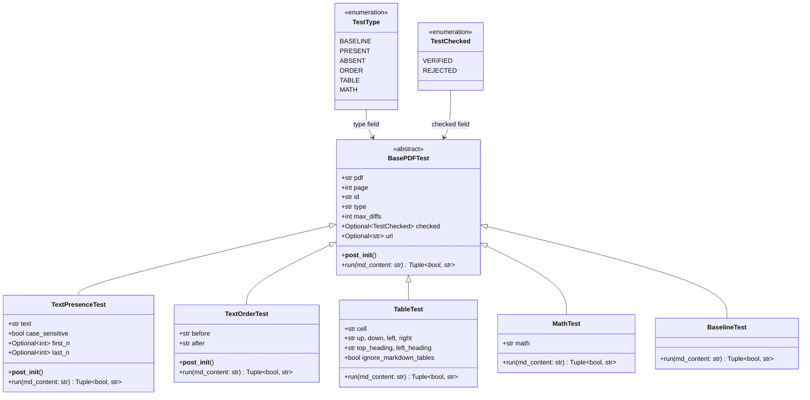
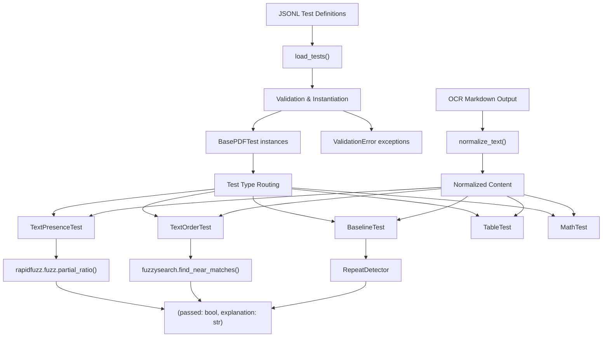
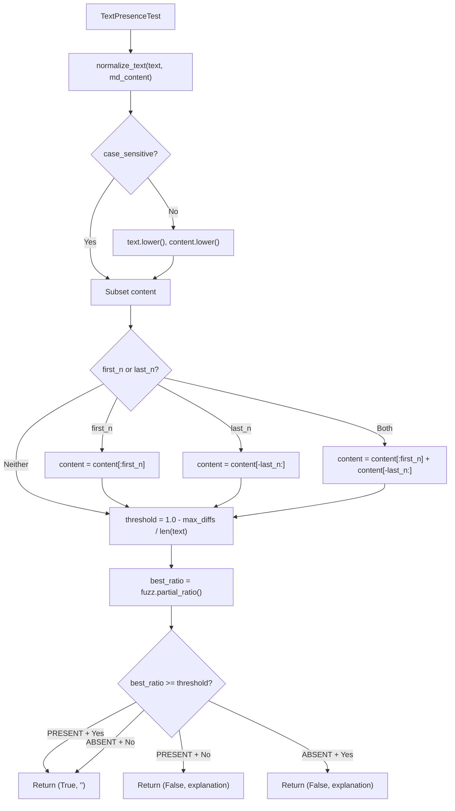
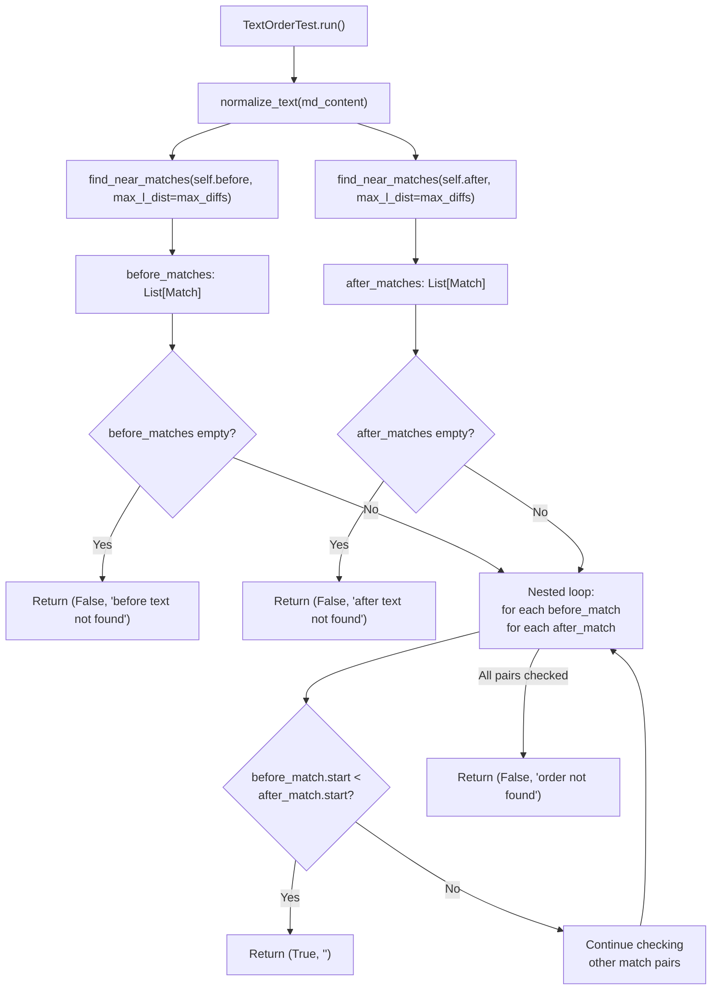
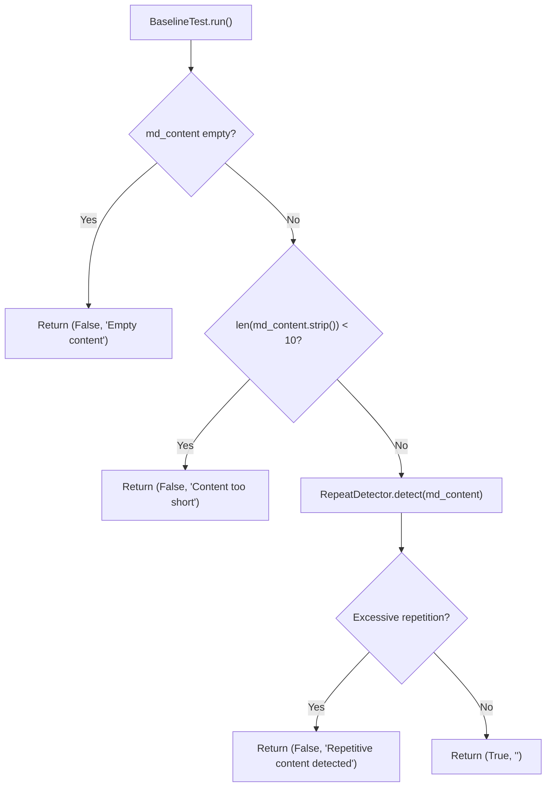

<!-- source: DeepWiki mcp.deepwiki.com · repo allenai/olmocr · page 4.1 Test Framework and Test Types · fetched 2026-10-26 -->

# Test Framework and Test Types

<details>
<summary>Relevant source files</summary>

The following files were used as context for generating this wiki page:

- [olmocr/bench/benchmark.py](olmocr/bench/benchmark.py)
- [olmocr/bench/katex/render.py](olmocr/bench/katex/render.py)
- [olmocr/bench/miners/download_math.py](olmocr/bench/miners/download_math.py)
- [olmocr/bench/miners/mine_math.py](olmocr/bench/miners/mine_math.py)
- [olmocr/bench/report.py](olmocr/bench/report.py)
- [olmocr/bench/runners/run_mistral.py](olmocr/bench/runners/run_mistral.py)
- [olmocr/bench/sample_data/dataset.jsonl](olmocr/bench/sample_data/dataset.jsonl)
- [olmocr/bench/sample_data/pdfs/small_page_size.pdf](olmocr/bench/sample_data/pdfs/small_page_size.pdf)
- [olmocr/bench/sample_data/pdfs/test-graphical-text.pdf](olmocr/bench/sample_data/pdfs/test-graphical-text.pdf)
- [olmocr/bench/tests.py](olmocr/bench/tests.py)
- [olmocr/bench/utils.py](olmocr/bench/utils.py)
- [tests/test_katex_render.py](tests/test_katex_render.py)

</details>


This document describes the core test framework and base test type implementations used in the olmOCR benchmarking system. It covers the `BasePDFTest` interface, test type enumeration, and the concrete implementations for text presence, text order, and baseline quality tests.

For math equation testing, see page 4.2. For table structure testing, see page 4.3. For test generation and mining, see page 4.4. For benchmark orchestration, see page 4.7.

## Test Framework Architecture

The olmOCR test framework is built around an abstract base class `BasePDFTest` with concrete implementations for different test types. Each test validates specific aspects of OCR output by comparing markdown content against expected properties defined in JSONL test files.

### Test Type Hierarchy

Test Type Hierarchy - Class structure showing inheritance relationships


Sources: [olmocr/bench/tests.py:96-108](), [olmocr/bench/tests.py:474-516]()

### Core Framework Components

Test Processing Pipeline - From JSONL definitions to test results


Sources: [olmocr/bench/tests.py:1](), [olmocr/bench/tests.py:116-147](), [olmocr/bench/tests.py:851-891]()

## BasePDFTest Abstract Base Class

The `BasePDFTest` class defines the interface that all test types must implement. It uses Python's `@dataclass` decorator with `kw_only=True` to enforce keyword arguments and includes validation logic in `__post_init__`.

### BasePDFTest Fields

| Field | Type | Description | Required |
|-------|------|-------------|----------|
| `pdf` | `str` | PDF filename being tested | Yes |
| `page` | `int` | Page number (1-indexed) | Yes |
| `id` | `str` | Unique test identifier | Yes |
| `type` | `str` | Test type from `TestType` enum | Yes |
| `max_diffs` | `int` | Maximum edit distance for fuzzy matching | No (default: 0) |
| `checked` | `Optional[TestChecked]` | Verification status (VERIFIED/REJECTED) | No |
| `url` | `Optional[str]` | Source URL for reference | No |

### Validation Rules

The `__post_init__` method enforces validation constraints:

```python
# Key validation checks in BasePDFTest.__post_init__
if not self.pdf:
    raise ValidationError("PDF filename cannot be empty")
if not self.id:
    raise ValidationError("Test ID cannot be empty")
if not isinstance(self.max_diffs, int) or self.max_diffs < 0:
    raise ValidationError("Max diffs must be positive number or 0")
if self.type not in {t.value for t in TestType}:
    raise ValidationError(f"Invalid test type: {self.type}")
```

### Abstract run() Method

All subclasses must implement the `run()` method:

```python
def run(self, md_content: str) -> Tuple[bool, str]:
    """
    Run the test on the provided markdown content.
    
    Returns:
        A tuple (passed, explanation) where 'passed' is True if the test passes,
        and 'explanation' provides details when the test fails.
    """
    raise NotImplementedError("Subclasses must implement the run method")
```

Sources: [olmocr/bench/tests.py:474-516]()

## TextPresenceTest: Present and Absent Text

The `TextPresenceTest` class handles both `PRESENT` and `ABSENT` test types, validating whether specific text content appears or is explicitly absent from OCR output. This is the most common test type for verifying basic OCR accuracy.

### TextPresenceTest Fields

In addition to the base fields, `TextPresenceTest` includes:

| Field | Type | Description | Default |
|-------|------|-------------|---------|
| `text` | `str` | Text string to search for (normalized) | Required |
| `case_sensitive` | `bool` | Whether matching should be case-sensitive | `True` |
| `first_n` | `Optional[int]` | Only search first N characters | `None` |
| `last_n` | `Optional[int]` | Only search last N characters | `None` |

### Text Normalization Pipeline

The `normalize_text()` function ensures consistent matching across different OCR outputs:

Text Normalization Steps

```mermaid
flowchart LR
    Input["Raw Text"] --> BR["Remove <br/> tags → space"]
    BR --> WS["Collapse whitespace → single space"]
    WS --> Bold["Remove **bold** and __bold__"]
    Bold --> Italic["Remove *italic* and _italic_"]
    Italic --> HTML["Remove <b>, <i> tags"]
    HTML --> Unicode["Unicode NFC normalization"]
    Unicode --> Chars["Replace fancy chars<br/>quotes, dashes, etc."]
    Chars --> Output["Normalized Text"]
```


| Normalization Step | Purpose | Implementation |
|-------------------|---------|----------------|
| HTML tag removal | Remove `<br>`, `<br/>`, `<b>`, `<i>` | `re.sub(r"<br/?>", " ", text)` |
| Whitespace collapse | Normalize all whitespace to single spaces | `re.sub(r"\s+", " ", text)` |
| Markdown bold removal | Remove `**text**` and `__text__` | `re.sub(r"\*\*(.*?)\*\*", r"\1", text)` |
| Markdown italic removal | Remove `*text*` and `_text_` | `re.sub(r"\*(.*?)\*", r"\1", text)` |
| Unicode normalization | Consistent character forms (é vs e+accent) | `unicodedata.normalize("NFC", text)` |
| Character replacement | Smart quotes → ASCII quotes, various dashes → hyphen | Dictionary mapping |

Sources: [olmocr/bench/tests.py:116-147]()

### Fuzzy Matching with max_diffs

Tests support configurable fuzzy matching through the `max_diffs` parameter, which specifies the maximum number of character differences allowed:

Fuzzy Matching Logic Flow


The threshold calculation:
```python
threshold = 1.0 - (self.max_diffs / (len(reference_query) if len(reference_query) > 0 else 1))
best_ratio = fuzz.partial_ratio(reference_query, md_content) / 100.0
```

The framework uses `rapidfuzz.fuzz.partial_ratio()` which finds the best matching substring in the content, making it robust to text appearing within larger blocks of content.

Sources: [olmocr/bench/tests.py:519-574]()

### Example TextPresenceTest

```json
{
  "pdf": "multi_column_miss.pdf",
  "page": 1,
  "id": "multi_column_miss_00",
  "type": "present",
  "text": "Corporate social responsibility and the tobacco industry: hope or hype?",
  "max_diffs": 0
}
```

Sources: [olmocr/bench/sample_data/dataset.jsonl:1]()

## TextOrderTest: Relative Text Positioning

The `TextOrderTest` validates that one text fragment appears before another in the document order. This is essential for ensuring proper reading flow and structural understanding, particularly for multi-column layouts where incorrect reading order is a common OCR failure mode.

### TextOrderTest Fields

In addition to base fields, `TextOrderTest` includes:

| Field | Type | Description | Validation |
|-------|------|-------------|------------|
| `before` | `str` | Text expected to appear first (normalized) | Must be non-empty |
| `after` | `str` | Text expected to appear after (normalized) | Must be non-empty |

Both `before` and `after` text undergo normalization via `normalize_text()`. The `max_diffs` parameter controls the edit distance tolerance for locating both text fragments.

### Additional Validation

The `__post_init__` method includes a sanity check:

```python
if self.max_diffs > len(self.before) // 2 or self.max_diffs > len(self.after) // 2:
    raise ValidationError("Max diffs is too large for this test, greater than 50% of the search string")
```

This prevents pathological cases where fuzzy matching would be too permissive.

Sources: [olmocr/bench/tests.py:589-601]()

### Order Validation Algorithm

TextOrderTest Execution Flow


The test uses `fuzzysearch.find_near_matches()` which returns a list of all matches with their positions. The algorithm then checks every pair of (before_match, after_match) to find at least one case where the before text precedes the after text.

Key aspects:
- Both text fragments must be found (with allowed edit distance)
- At least one instance of `before` must precede at least one instance of `after`
- The algorithm handles cases where fragments appear multiple times

Sources: [olmocr/bench/tests.py:602-618]()

### Example TextOrderTest

```json
{
  "pdf": "multi_column_miss.pdf",
  "page": 1,
  "id": "multi_column_miss_10",
  "type": "order",
  "before": "Corporate social responsibility and the tobacco industry: hope or hype?",
  "after": "The unprecedented expansion of power and influence of TNCs",
  "max_diffs": 2
}
```

Sources: [olmocr/bench/sample_data/dataset.jsonl:7]()

## BaselineTest: Document Quality Check

The `BaselineTest` class performs basic quality checks to ensure OCR output meets minimum standards. It is automatically generated for all PDF pages that don't have other tests defined. This test type catches major OCR failures like completely blank output, excessive repetition, or malformed content.

### BaselineTest Implementation

Unlike other test types, `BaselineTest` has no additional fields beyond the base `BasePDFTest` fields. It implements heuristic checks:

Baseline Test Checks


The `RepeatDetector` class analyzes content for patterns that suggest OCR failure, such as the same phrase repeated many times or character sequences that appear with abnormal frequency.

Sources: [olmocr/bench/tests.py:851-891]()

### Automatic Baseline Test Generation

The benchmark orchestration automatically creates baseline tests for all PDF pages:

```python
# From olmocr/bench/benchmark.py
for pdf in pdf_basenames:
    if not any(t.type == "baseline" for t in all_tests if t.pdf == pdf):
        all_tests.append(BaselineTest(
            id=f"{pdf}_baseline", 
            pdf=pdf, 
            page=1, 
            type="baseline"
        ))
```

This ensures every page is tested even if no specific content tests are defined.

Sources: [olmocr/bench/benchmark.py:236-238]()

## Test Data Format

Tests are defined in JSONL format with type-specific fields:

### Common Test Fields

```json
{
  "pdf": "document.pdf",
  "page": 1,
  "id": "unique_test_identifier",
  "type": "present|absent|order|table|math",
  "max_diffs": 0,
  "checked": "verified|rejected",
  "url": "optional_source_url"
}
```

### Type-Specific Extensions

| Test Type | Additional Fields | Example |
|-----------|------------------|---------|
| `present`/`absent` | `text`, `case_sensitive`, `first_n`, `last_n` | `{"text": "Corporate social responsibility", "case_sensitive": false}` |
| `order` | `before`, `after` | `{"before": "Chapter 1", "after": "Chapter 2"}` |
| `table` | `cell`, `up`, `down`, `left`, `right`, `top_heading`, `left_heading` | `{"cell": "3.32T", "top_heading": "Words"}` |
| `math` | `math` | `{"math": "e^{i \\pi}+1=0"}` |

Sources: [olmocr/bench/sample_data/dataset.jsonl:1-117](), [olmocr/bench/tests.py:471-514]()

---

