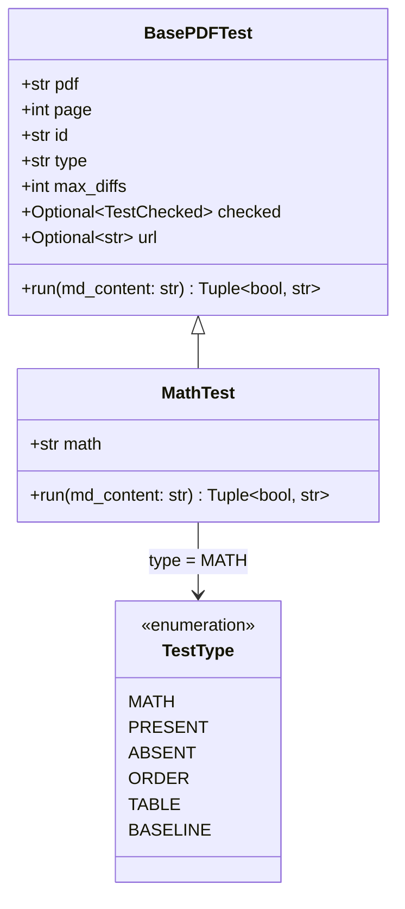
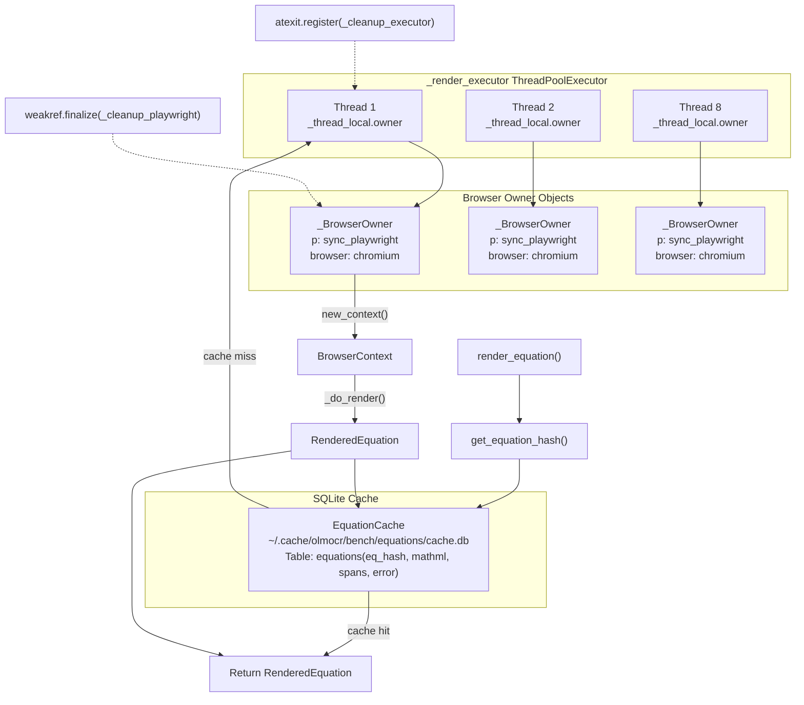
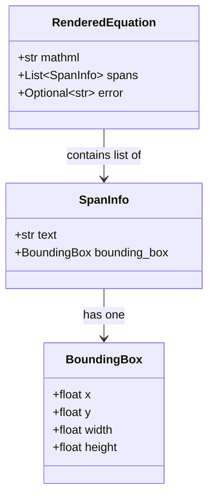
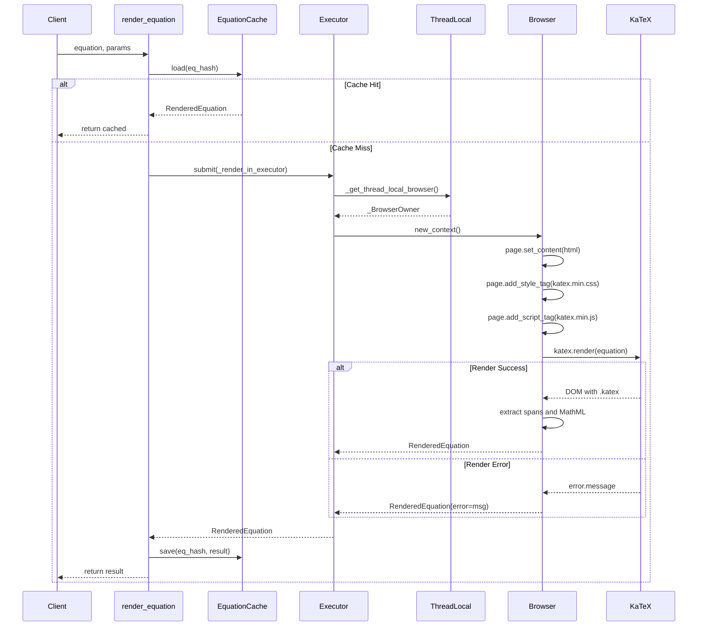
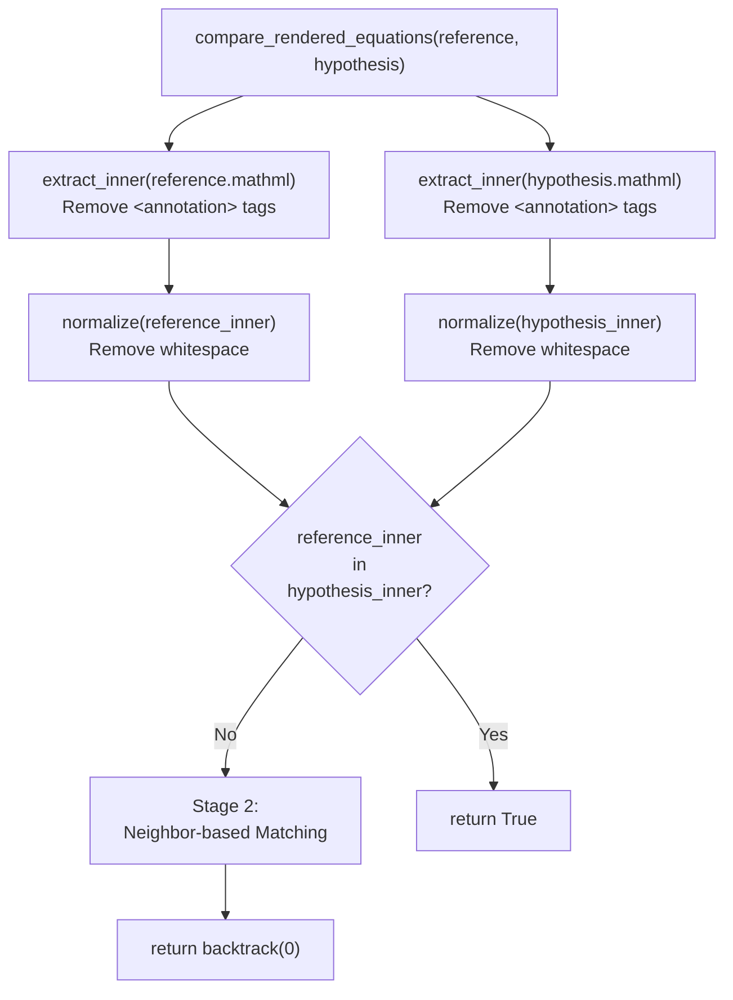
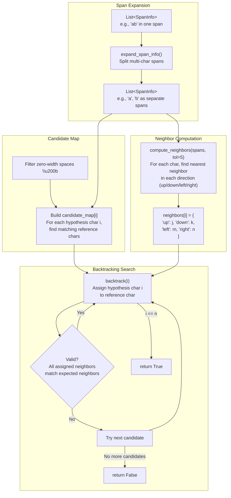
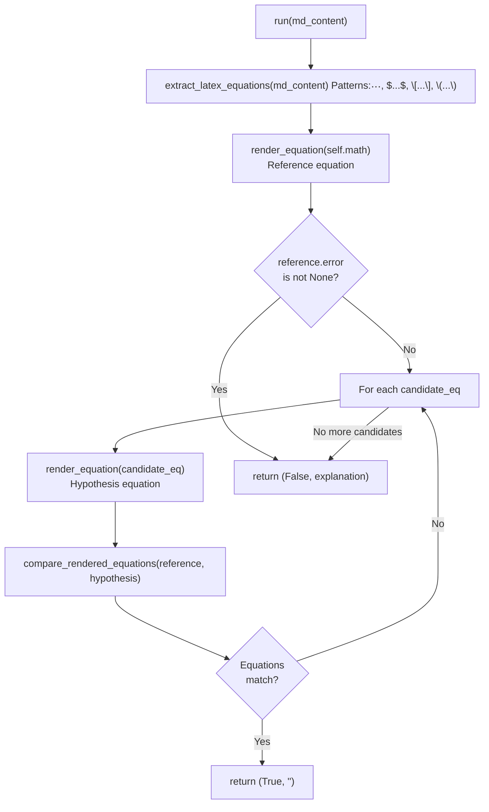
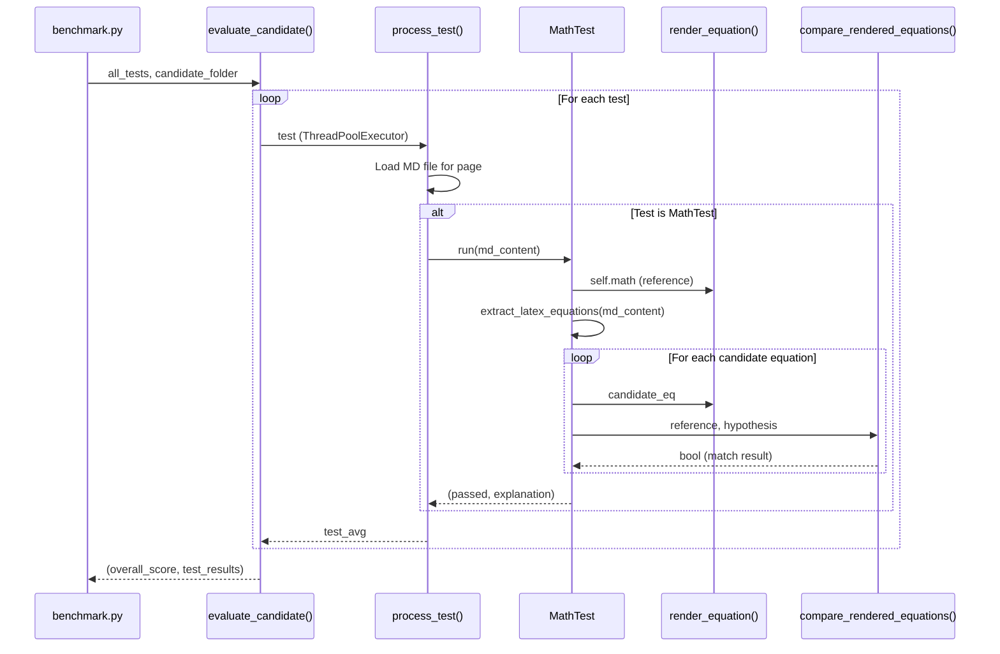
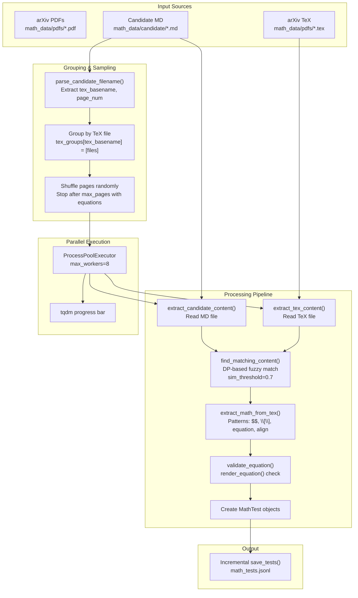

<!-- source: DeepWiki mcp.deepwiki.com · repo allenai/olmocr · page 4.2 Math Testing with KaTeX · fetched 2026-10-26 -->

# Math Testing with KaTeX

<details>
<summary>Relevant source files</summary>

The following files were used as context for generating this wiki page:

- [olmocr/bench/benchmark.py](olmocr/bench/benchmark.py)
- [olmocr/bench/katex/render.py](olmocr/bench/katex/render.py)
- [olmocr/bench/miners/download_math.py](olmocr/bench/miners/download_math.py)
- [olmocr/bench/miners/mine_math.py](olmocr/bench/miners/mine_math.py)
- [olmocr/bench/report.py](olmocr/bench/report.py)
- [olmocr/bench/runners/run_mistral.py](olmocr/bench/runners/run_mistral.py)
- [olmocr/bench/sample_data/dataset.jsonl](olmocr/bench/sample_data/dataset.jsonl)
- [olmocr/bench/sample_data/pdfs/small_page_size.pdf](olmocr/bench/sample_data/pdfs/small_page_size.pdf)
- [olmocr/bench/sample_data/pdfs/test-graphical-text.pdf](olmocr/bench/sample_data/pdfs/test-graphical-text.pdf)
- [olmocr/bench/tests.py](olmocr/bench/tests.py)
- [olmocr/bench/utils.py](olmocr/bench/utils.py)
- [tests/test_katex_render.py](tests/test_katex_render.py)

</details>


## Purpose and Scope

This document describes the **MathTest** system used in the olmOCR benchmarking framework to validate correct extraction and rendering of mathematical equations from PDF documents. The system uses KaTeX rendering with Playwright to compare reference equations against OCR output, employing both MathML comparison and spatial position-based matching algorithms.

For information about other test types (text presence, table structure, etc.), see [Test Framework and Test Types](#4.1). For test mining and generation workflows, see [Test Mining and Generation](#4.4).

## MathTest Class Structure

The `MathTest` class extends `BasePDFTest` and validates that a specific LaTeX equation appears correctly in OCR output.

**Test Definition**



Sources: [olmocr/bench/tests.py:474-517](), [olmocr/bench/tests.py:862-896]()

**JSONL Format**

Math tests are stored in JSONL format with the following structure:

```json
{"pdf": "mathfuncs.pdf", "page": 1, "id": "mathfuncs_03", "type": "math", "math": "e^{i \\pi}+1=0"}
{"pdf": "math_2503_04086.pdf", "page": 1, "id": "math_2503_04086_00", "type": "math", "math": "\\lambda_{g}=\\sum_{s \\in S} \\zeta_{n}^{\\psi(g s)}=\\sum_{i=1}^{k}\\left[\\sum_{s, R s=\\mathcal{I}_{i}} \\zeta_{n}^{\\psi(g s)}\\right]"}
```

The `math` field contains the LaTeX equation to validate. The test passes if the OCR markdown content contains an equivalent rendering of this equation.

Sources: [olmocr/bench/sample_data/dataset.jsonl:68-86]()

## KaTeX Rendering Architecture

### Browser Pool and Thread Management

The rendering system uses a thread pool executor with browser instances maintained per thread to efficiently render equations in parallel.



Sources: [olmocr/bench/katex/render.py:160-228]()

The system maintains:
- **Thread Pool**: Fixed 8 worker threads (`_render_executor`)
- **Thread-Local Storage**: Each thread has its own `_BrowserOwner` instance
- **Weak References**: Automatic cleanup using `weakref.finalize` to close browsers
- **Exit Handler**: `atexit.register` ensures graceful shutdown

### SQLite Cache Implementation

Equation rendering is cached in a SQLite database to avoid redundant computations.

| Column | Type | Purpose |
|--------|------|---------|
| `eq_hash` | TEXT PRIMARY KEY | SHA1 hash of equation + rendering parameters |
| `mathml` | TEXT | Rendered MathML output from KaTeX |
| `spans` | TEXT | JSON array of SpanInfo objects with bounding boxes |
| `error` | TEXT | Error message if rendering failed |

Sources: [olmocr/bench/katex/render.py:34-123]()

**Hash Calculation**

```python
params_str = f"{equation}|{bg_color}|{text_color}|{font_size}"
eq_hash = hashlib.sha1(params_str.encode("utf-8")).hexdigest()
```

The hash includes all rendering parameters to ensure cache hits only occur for identical rendering conditions.

Sources: [olmocr/bench/katex/render.py:152-158]()

### Rendering Data Structures



Sources: [olmocr/bench/katex/render.py:131-150]()

**SpanInfo Extraction**

The rendering process extracts innermost `<span>` elements from the KaTeX DOM output:

```javascript
const spans = Array.from(document.querySelectorAll('span'));
spans.forEach(span => {
    if (span.children.length === 0 && /\S/.test(span.textContent)) {
        const rect = span.getBoundingClientRect();
        list.push({
            text: span.textContent.trim(),
            boundingBox: { x: rect.x, y: rect.y, width: rect.width, height: rect.height }
        });
    }
});
```

This captures character-level positioning information used in the fallback comparison algorithm.

Sources: [olmocr/bench/katex/render.py:328-350]()

### Rendering Process Flow



Sources: [olmocr/bench/katex/render.py:387-421](), [olmocr/bench/katex/render.py:230-384]()

## Equation Comparison Algorithm

The `compare_rendered_equations` function uses a two-stage approach to determine if two equations are equivalent.

### Stage 1: MathML Comparison

The primary comparison method extracts and normalizes MathML content, checking if the reference equation's MathML is contained within the hypothesis equation's MathML.



Sources: [olmocr/bench/katex/render.py:424-452]()

**MathML Extraction Logic**

```python
def extract_inner(mathml: str) -> str:
    soup = BeautifulSoup(mathml, "xml")
    semantics = soup.find("semantics")
    if semantics:
        # Get all children except <annotation> tags
        inner_parts = [str(child) for child in semantics.contents 
                      if getattr(child, "name", None) != "annotation"]
        return "".join(inner_parts)
    return str(soup)
```

This approach handles cases where equations are embedded in `align*` blocks or have trailing punctuation, as the reference equation will be a substring of the larger MathML structure.

Sources: [olmocr/bench/katex/render.py:432-444]()

### Stage 2: Neighbor-Based Spatial Matching

If MathML comparison fails, the algorithm performs character-level spatial matching using a constraint satisfaction approach.



Sources: [olmocr/bench/katex/render.py:454-556]()

**Neighbor Computation Algorithm**

For each character span, the algorithm finds the nearest neighbor in four directions (up, down, left, right) based on center-point distances:

```python
def compute_neighbors(spans, tol=5):
    neighbors = {}
    for i, span in enumerate(spans):
        cx = span.bounding_box.x + span.bounding_box.width / 2
        cy = span.bounding_box.y + span.bounding_box.height / 2
        
        # Find nearest character above within horizontal tolerance
        if ocy < cy and abs(ocx - cx) <= tol:
            dist = cy - ocy
            if up is None or dist < up_dist:
                up = j
                up_dist = dist
        # ... similar for down, left, right
```

The `tol=5` parameter allows for small horizontal/vertical misalignments when determining spatial relationships.

Sources: [olmocr/bench/katex/render.py:482-514]()

**Constraint Satisfaction Backtracking**

The algorithm uses backtracking to find a valid assignment of hypothesis characters to reference characters that preserves spatial relationships:

```python
def backtrack(i):
    if i == n:  # All hypothesis chars assigned
        return True
    
    for cand in candidate_map[i]:  # Try each matching reference char
        if used[cand]:
            continue
        
        # Check if this assignment satisfies neighbor constraints
        for direction in ["up", "down", "left", "right"]:
            hyp_nb = hyp_neighbors[i].get(direction)
            ref_nb = ref_neighbors[cand].get(direction)
            if hyp_nb is not None:
                # If hypothesis has a neighbor in this direction,
                # reference must have the same neighbor
                if hyp_nb in assignment:
                    if assignment[hyp_nb] != ref_nb:
                        valid = False
        
        if valid and backtrack(i + 1):
            return True
    
    return False
```

This ensures that structural relationships (e.g., exponents, fractions) are preserved between the two equations.

Sources: [olmocr/bench/katex/render.py:524-554]()

## MathTest Execution

### Test Run Method

The `MathTest.run()` method extracts LaTeX equations from markdown content and compares each against the reference equation.



Sources: [olmocr/bench/tests.py:862-896]()

**LaTeX Extraction Patterns**

The test extracts equations using multiple regex patterns to handle different LaTeX delimiters:

| Pattern | Type | Example |
|---------|------|---------|
| `\$\$(.*?)\$\$` | Display math (double dollar) | `$$a^2 + b^2 = c^2$$` |
| `\\\[(.*?)\\\]` | Display math (bracket) | `\[E = mc^2\]` |
| `\$(.*?)\$` | Inline math (single dollar) | `$x + y$` |
| `\\\((.*?)\\\)` | Inline math (parenthesis) | `\(F = ma\)` |

Sources: [olmocr/bench/tests.py:862-896]()

### Integration with Benchmark Runner



Sources: [olmocr/bench/benchmark.py:32-159]()

The benchmark runner processes math tests in parallel using a `ThreadPoolExecutor`, with each test running independently against the candidate's markdown output.

## Test Mining from arXiv

The `mine_math.py` script automatically generates math tests by extracting equations from arXiv papers and matching them with OCR output.

### Mining Architecture



Sources: [olmocr/bench/miners/mine_math.py:1-374]()

### Fuzzy Matching Algorithm

The system uses a dynamic programming approach to find the substring of TeX content that best matches the candidate markdown, allowing for small differences due to OCR errors.

**DP Matrix Computation** (implemented with Numba for performance):

```python
@numba.njit
def compute_dp(candidate_arr, text_arr):
    m = candidate_arr.shape[0]  # candidate length
    n = text_arr.shape[0]       # text length
    dp = np.empty((m + 1, n + 1), dtype=np.int32)
    
    # Empty candidate matches anywhere in text (cost 0)
    for j in range(n + 1):
        dp[0, j] = 0
    
    # Empty text requires deleting all candidate chars
    for i in range(1, m + 1):
        dp[i, 0] = i
    
    # Standard edit distance computation
    for i in range(1, m + 1):
        for j in range(1, n + 1):
            cost = 0 if candidate_arr[i-1] == text_arr[j-1] else 1
            dp[i, j] = min(
                dp[i-1, j-1] + cost,  # substitution/match
                dp[i-1, j] + 1,       # deletion
                dp[i, j-1] + 1        # insertion
            )
    
    return dp
```

The algorithm then backtracks to find the best matching substring:

```python
# Find position in text with minimum edit distance
best_end, min_distance = find_best_end(dp, m, n)
similarity = (m - min_distance) / m

if similarity >= sim_threshold:  # Default 0.7
    start_index = backtrack(dp, candidate_arr, text_arr, m, best_end)
    return tex_norm[start_index:best_end]
```

Sources: [olmocr/bench/miners/mine_math.py:114-194]()

### Math Extraction Patterns

The system extracts equations from TeX using comprehensive regex patterns:

| Pattern | Environment | Example |
|---------|-------------|---------|
| `\$\$(.*?)\$\$` | Display math | `$$a^2 + b^2 = c^2$$` |
| `\\begin\{equation\}(.*?)\\end\{equation\}` | Numbered equation | `\begin{equation} E = mc^2 \end{equation}` |
| `\\begin\{align\}(.*?)\\end\{align\}` | Aligned equations | `\begin{align} x &= 1 \\ y &= 2 \end{align}` |
| `\\\[(.*?)\\\]` | Display math bracket | `\[F = ma\]` |
| `\$(.*?)\$` | Inline math | `$\alpha + \beta$` |
| `\\\((.*?)\\\)` | Inline math paren | `\(x^2\)` |

The extraction includes both display and inline math, with starred variants (`equation*`, `align*`) for unnumbered environments.

Sources: [olmocr/bench/miners/mine_math.py:84-112]()

### Validation and Filtering

Before creating test objects, equations are validated through several filters:

1. **Length Filter**: Equations must be > 20 characters to avoid trivial tests
2. **Deduplication**: Remove duplicate equations from the same TeX section
3. **Rendering Validation**: Call `validate_equation()` to ensure KaTeX can render
4. **Limit per Page**: Maximum 10 equations per page to avoid test saturation

```python
# Filter short equations and remove duplicates
math_equations = [(eq_type, eq.strip()) for (eq_type, eq) in math_equations 
                  if len(eq.strip()) > 20]
math_equations = list(set(math_equations))
random.shuffle(math_equations)

for i, (eq_type, equation) in enumerate(math_equations):
    if validate_equation(equation):  # render_equation() != None
        test_id = f"{tex_basename}_pg{page_num}_math_{i:03d}"
        math_test = MathTest(...)
        tests.append(math_test)
        if len(tests) >= 10:
            break
```

Sources: [olmocr/bench/miners/mine_math.py:256-274]()

## Command-Line Interface

**Mining Math Tests**

```bash
python -m olmocr.bench.miners.mine_math \
    --math_data /path/to/math_data \
    --candidate olmocr \
    --max_pages 1 \
    --parallel 8 \
    --sim_threshold 0.7
```

| Argument | Default | Description |
|----------|---------|-------------|
| `--math_data` | Required | Path to math_data folder containing pdfs/ and candidate outputs |
| `--candidate` | Required | Candidate folder name inside math_data |
| `--max_pages` | 1 | Maximum distinct pages with equations per TeX document |
| `--parallel` | 8 | Number of process pool workers |
| `--sim_threshold` | 0.7 | Similarity threshold for fuzzy matching (0.0-1.0) |

The script outputs incrementally to `math_data/math_tests.jsonl` as each TeX group completes processing.

Sources: [olmocr/bench/miners/mine_math.py:319-370]()

**Running Benchmarks with Math Tests**

```bash
python -m olmocr.bench.benchmark \
    --dir /path/to/benchmark_data \
    --candidate olmocr
```

Math tests are automatically loaded from `*.jsonl` files and executed alongside other test types.

Sources: [olmocr/bench/benchmark.py:162-457]()

## Test Case Examples

The test suite includes extensive validation of the equation comparison logic:

**Basic Equivalence**

```python
# Whitespace normalization
test_whitespace_difference():
    eq1 = render_equation("a+b")
    eq2 = render_equation("a + b")
    assert compare_rendered_equations(eq1, eq2) == True

# Align block containment
test_align_block_contains_needle():
    eq_plain = render_equation("a+b")
    eq_align = render_equation("\\begin{align*}a+b\\end{align*}")
    assert compare_rendered_equations(eq_plain, eq_align) == True
```

Sources: [tests/test_katex_render.py:12-25]()

**Advanced Equivalence**

```python
# Tensor notation order
test_tensor_notation_equivalent():
    eq1 = render_equation("T_{ij}^{kl}")
    eq2 = render_equation("T^{kl}_{ij}")
    assert compare_rendered_equations(eq1, eq2) == True

# Summation with \limits
test_equivalent_summation_notation():
    eq1 = render_equation("\\sum_{i=1}^{n} x_i")
    eq2 = render_equation("\\sum\\limits_{i=1}^{n} x_i")
    assert compare_rendered_equations(eq1, eq2) == True
```

Sources: [tests/test_katex_render.py:133-172]()

**Negative Cases**

```python
# Different symbols
test_different_symbol_with_same_appearance():
    eq1 = render_equation("\\phi")
    eq2 = render_equation("\\varphi")
    assert compare_rendered_equations(eq1, eq2) == False

# Different bracket types
test_different_bracket_types():
    eq1 = render_equation("\\left[ a + b \\right]")
    eq2 = render_equation("\\left\\{ a + b \\right\\}")
    assert compare_rendered_equations(eq1, eq2) == False
```

Sources: [tests/test_katex_render.py:174-91]()

---

