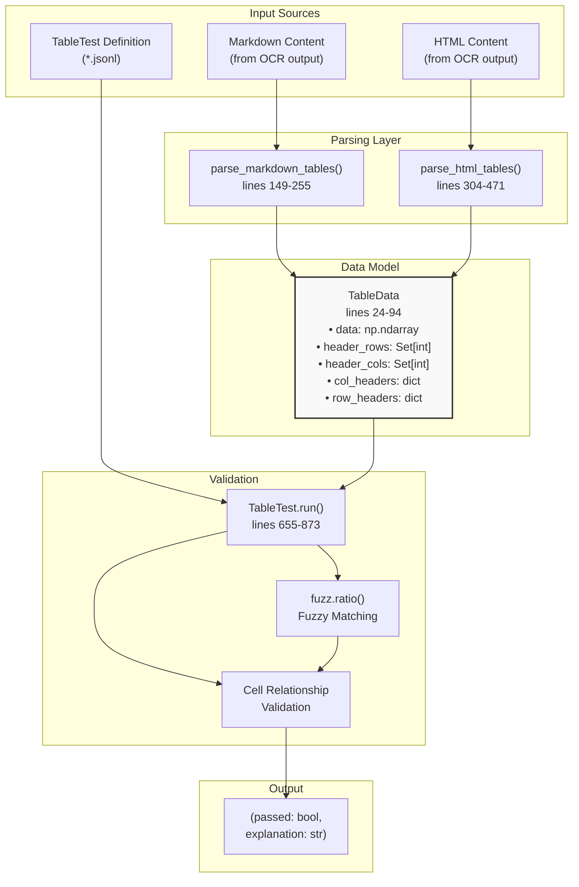
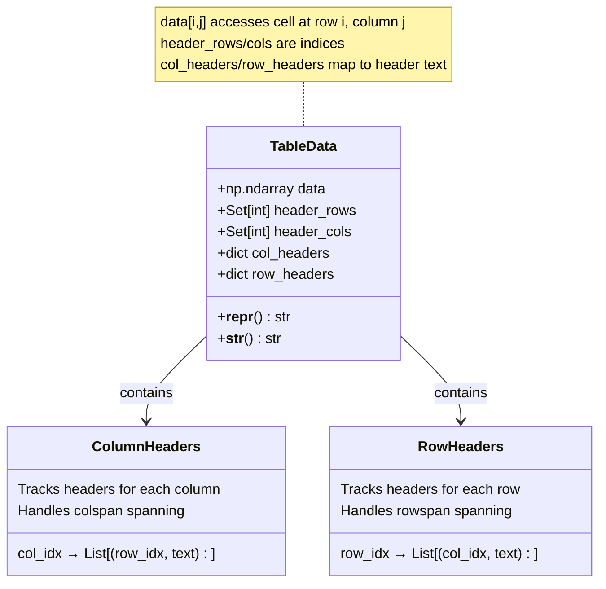
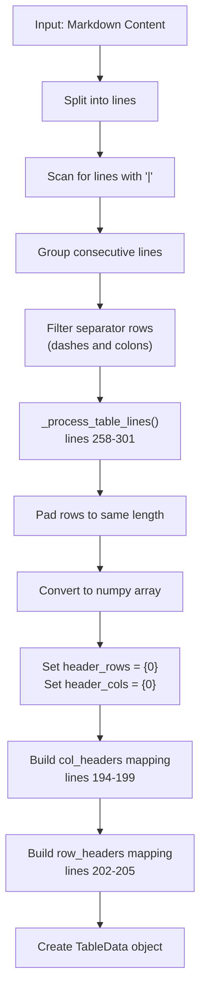
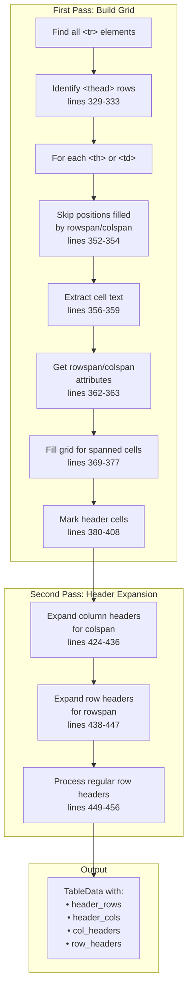
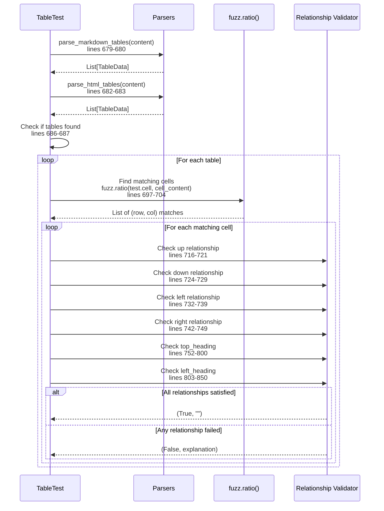
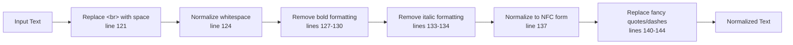
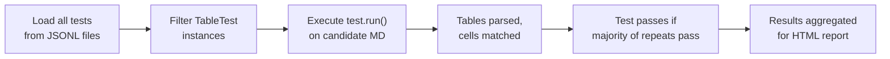

<!-- source: DeepWiki mcp.deepwiki.com · repo allenai/olmocr · page 4.3 Table Testing · fetched 2026-10-26 -->

# Table Testing

<details>
<summary>Relevant source files</summary>

The following files were used as context for generating this wiki page:

- [olmocr/bench/benchmark.py](olmocr/bench/benchmark.py)
- [olmocr/bench/katex/render.py](olmocr/bench/katex/render.py)
- [olmocr/bench/miners/download_math.py](olmocr/bench/miners/download_math.py)
- [olmocr/bench/miners/mine_math.py](olmocr/bench/miners/mine_math.py)
- [olmocr/bench/report.py](olmocr/bench/report.py)
- [olmocr/bench/runners/run_mistral.py](olmocr/bench/runners/run_mistral.py)
- [olmocr/bench/sample_data/dataset.jsonl](olmocr/bench/sample_data/dataset.jsonl)
- [olmocr/bench/sample_data/pdfs/small_page_size.pdf](olmocr/bench/sample_data/pdfs/small_page_size.pdf)
- [olmocr/bench/sample_data/pdfs/test-graphical-text.pdf](olmocr/bench/sample_data/pdfs/test-graphical-text.pdf)
- [olmocr/bench/tests.py](olmocr/bench/tests.py)
- [olmocr/bench/utils.py](olmocr/bench/utils.py)
- [tests/test_katex_render.py](tests/test_katex_render.py)

</details>


## Purpose and Scope

This document describes the Table Testing system within the olmOCR benchmarking framework. Table testing validates that OCR engines correctly preserve table structure, including cell contents, relative positioning, and header relationships. The system supports both Markdown and HTML table formats and handles complex features like `rowspan` and `colspan` attributes.

For information about other test types (text presence, text order, math equations), see [Test Framework and Test Types](#4.1). For information about automated test generation, see [Test Mining and Generation](#4.4).

## System Overview

The table testing system consists of three main components: table parsing, relationship validation, and fuzzy matching. Tests are defined in JSONL files with specifications for target cells and their expected relationships to other cells.



**Sources:** [olmocr/bench/tests.py:24-873]()

## TableData Structure

The `TableData` class stores parsed table information as a NumPy array along with metadata about header positions and relationships. This structure supports efficient querying and validation of cell relationships.



| Field | Type | Purpose |
|-------|------|---------|
| `data` | `np.ndarray` | 2D array containing cell contents as strings |
| `header_rows` | `Set[int]` | Indices of rows identified as headers |
| `header_cols` | `Set[int]` | Indices of columns identified as headers |
| `col_headers` | `dict` | Maps column index to list of `(row, text)` tuples for headers above that column |
| `row_headers` | `dict` | Maps row index to list of `(col, text)` tuples for headers to the left of that row |

**Sources:** [olmocr/bench/tests.py:24-94]()

## Markdown Table Parsing

The Markdown table parser identifies tables by detecting pipe characters (`|`) and processes them line-by-line. It automatically treats the first row as a header row and the first column as a header column.



The parsing process handles several edge cases:

1. **Incomplete tables** at the end of files (no trailing newlines)
2. **Irregular formatting** with inconsistent spacing
3. **Empty cells** represented by consecutive pipes
4. **Variable row lengths** padded with empty strings

**Sources:** [olmocr/bench/tests.py:149-301]()

## HTML Table Parsing with Rowspan/Colspan

HTML table parsing is more complex due to `rowspan` and `colspan` attributes. The parser maintains a grid to track cells filled by spanning elements and properly associates headers with data cells.



### Rowspan/Colspan Handling

The parser uses a `cell_grid` dictionary to track which positions are already filled:

```python
# Example from lines 369-377
for i in range(rowspan):
    for j in range(colspan):
        if i == 0 and j == 0:
            continue  # Skip the main cell position
        if j == 0 and i > 0:  # Cells directly below
            cell_grid[(row_idx + i, col_idx + j)] = cell_text
        else:
            cell_grid[(row_idx + i, col_idx + j)] = ""  # Mark other spans as empty
```

For `<th>` elements, the parser:
1. Marks spanned columns as header columns (lines 382-383)
2. Marks spanned rows as header rows (lines 386-388)
3. Records header text for all spanned columns (lines 391-401)
4. Records header text for all spanned rows (lines 404-408)

**Sources:** [olmocr/bench/tests.py:304-471]()

## TableTest Class

The `TableTest` class validates cell relationships within tables. Tests specify a target cell and optionally define relationships to adjacent cells or header cells.

### Test Definition Schema

| Field | Type | Required | Description |
|-------|------|----------|-------------|
| `cell` | `str` | Yes | Target cell content to locate |
| `up` | `str` | No | Expected content of cell immediately above |
| `down` | `str` | No | Expected content of cell immediately below |
| `left` | `str` | No | Expected content of cell immediately to the left |
| `right` | `str` | No | Expected content of cell immediately to the right |
| `top_heading` | `str` | No | Expected column header text (all the way up) |
| `left_heading` | `str` | No | Expected row header text (all the way left) |
| `ignore_markdown_tables` | `bool` | No | Skip markdown table parsing (default: false) |

### Test Execution Flow



**Sources:** [olmocr/bench/tests.py:620-873]()

## Cell Relationship Validation

The system validates relationships using fuzzy matching with a configurable threshold. The threshold is calculated based on the `max_diffs` parameter in the test definition.

### Fuzzy Matching

```python
# From lines 674-675
threshold = 1.0 - (self.max_diffs / (len(self.cell) if len(self.cell) > 0 else 1))
threshold = max(0.5, threshold)  # Minimum threshold of 0.5
```

For each relationship, the validator compares normalized cell contents using `fuzz.ratio()` from the `rapidfuzz` library, which implements Levenshtein distance-based similarity.

### Adjacent Cell Validation

Adjacent cell checks (up, down, left, right) verify immediate neighbors:

```python
# Example from lines 716-721
if self.up and row_idx > 0:
    up_cell = normalize_text(table_array[row_idx - 1, col_idx])
    up_similarity = fuzz.ratio(self.up, up_cell) / 100.0
    if up_similarity < max(0.5, 1.0 - (self.max_diffs / len(self.up))):
        # Relationship fails
```

### Header Cell Validation

Header validation is more complex, following this priority order:

1. **Check `col_headers` dictionary** - properly handles colspan (lines 759-768)
2. **Fall back to header rows** - checks cells in `header_rows` (lines 771-781)
3. **Last resort** - any non-empty cell above (lines 784-791)

The same logic applies to `left_heading` checks using `row_headers` and `header_cols`.

**Sources:** [olmocr/bench/tests.py:655-850]()

## Text Normalization

All text comparisons use the `normalize_text()` function to handle OCR inconsistencies:



The function handles:
- HTML break tags (`<br>`, `<br/>`)
- Markdown formatting (`**bold**`, `*italic*`, etc.)
- Unicode normalization (NFD → NFC)
- Fancy punctuation (curly quotes, en/em dashes, etc.)

**Sources:** [olmocr/bench/tests.py:116-146]()

## Example Test Definitions

From the sample dataset, here are representative table tests:

### Basic Cell Position Test
```json
{
  "pdf": "olmo2-pg4.pdf",
  "page": 1,
  "id": "olmo2-pg4_table01",
  "type": "table",
  "cell": "3.32T",
  "left": "3.71T"
}
```

### Header Relationship Test
```json
{
  "pdf": "olmo2-pg4.pdf",
  "page": 1,
  "id": "olmo2-pg4_table05",
  "type": "table",
  "cell": "3.32T",
  "top_heading": "Words"
}
```

### Adjacent Cell Test
```json
{
  "pdf": "olmo2-pg4.pdf",
  "page": 1,
  "id": "olmo2-pg4_table03",
  "type": "table",
  "cell": "11.8B",
  "up": "12.2B"
}
```

### Complex Multi-Relationship Test
```json
{
  "pdf": "discoverworld_crazy_table4.pdf",
  "page": 1,
  "id": "olmo2-discoverworld_crazy_table4_t02",
  "type": "table",
  "cell": "0.87",
  "top_heading": "Procedure"
}
```

**Sources:** [olmocr/bench/sample_data/dataset.jsonl:40-63]()

## Integration with Benchmark System

Table tests are executed as part of the broader benchmarking framework. The `evaluate_candidate()` function in `benchmark.py` processes all test types, including table tests:



Tests are considered passing if the majority of repeat executions pass (lines 126 in benchmark.py). Results are aggregated by test type and displayed in the final summary.

**Sources:** [olmocr/bench/benchmark.py:33-159](), [olmocr/bench/report.py:160-175]()

## Performance Considerations

The table testing system includes several optimizations:

1. **NumPy arrays** - Tables stored as NumPy arrays for efficient indexing
2. **Early termination** - Test stops at first matching cell with satisfied relationships
3. **Lazy parsing** - Tables only parsed when needed (not during test definition loading)
4. **Fuzzy matching caching** - Results cached within a single test run
5. **Concurrent execution** - Multiple tests run in parallel via ThreadPoolExecutor

The parser handles edge cases efficiently:
- Empty tables are skipped
- Malformed HTML is gracefully handled with BeautifulSoup
- Grid tracking for rowspan/colspan uses dictionary lookups (O(1))

**Sources:** [olmocr/bench/tests.py:149-873](), [olmocr/bench/benchmark.py:141-156]()

---

