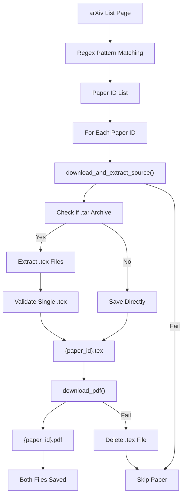
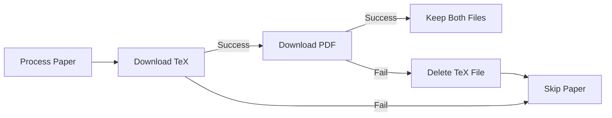
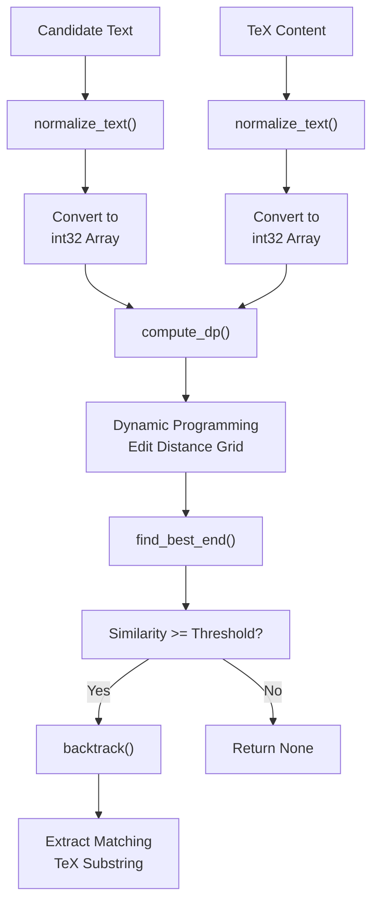
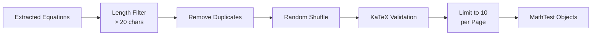
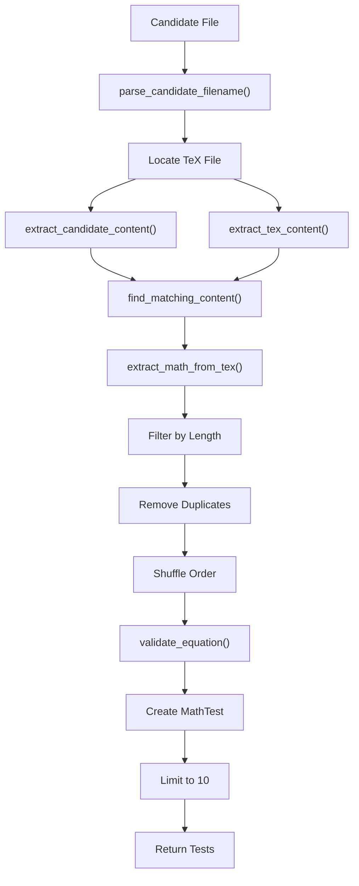
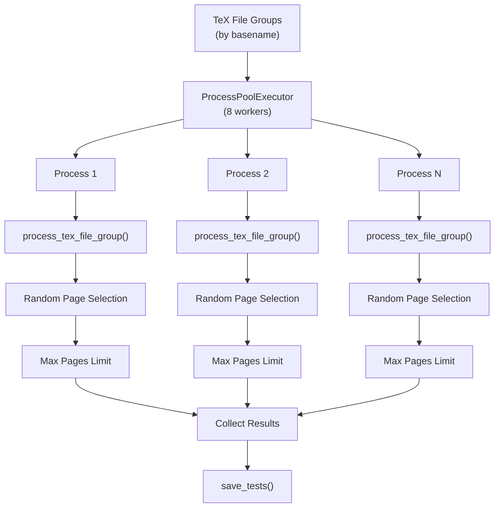

<!-- source: DeepWiki mcp.deepwiki.com · repo allenai/olmocr · page 4.4 Test Mining and Generation · fetched 2026-10-26 -->

# Test Mining and Generation

<details>
<summary>Relevant source files</summary>

The following files were used as context for generating this wiki page:

- [olmocr/bench/benchmark.py](olmocr/bench/benchmark.py)
- [olmocr/bench/katex/render.py](olmocr/bench/katex/render.py)
- [olmocr/bench/miners/download_math.py](olmocr/bench/miners/download_math.py)
- [olmocr/bench/miners/mine_math.py](olmocr/bench/miners/mine_math.py)
- [olmocr/bench/report.py](olmocr/bench/report.py)
- [olmocr/bench/runners/run_mistral.py](olmocr/bench/runners/run_mistral.py)
- [olmocr/bench/sample_data/dataset.jsonl](olmocr/bench/sample_data/dataset.jsonl)
- [olmocr/bench/sample_data/pdfs/small_page_size.pdf](olmocr/bench/sample_data/pdfs/small_page_size.pdf)
- [olmocr/bench/sample_data/pdfs/test-graphical-text.pdf](olmocr/bench/sample_data/pdfs/test-graphical-text.pdf)
- [olmocr/bench/tests.py](olmocr/bench/tests.py)
- [olmocr/bench/utils.py](olmocr/bench/utils.py)
- [tests/test_katex_render.py](tests/test_katex_render.py)

</details>


This document covers automated test generation from arXiv papers. The system downloads paired LaTeX source and PDF files, matches OCR candidate outputs to original TeX content, and extracts mathematical equations to create `MathTest` objects for the olmOCR-Bench evaluation framework.

For information about the test framework structure and test types, see [Test Framework and Test Types](#4.1). For synthetic data generation from HTML templates, see [Synthetic Data Generation](#4.5).

## Overview

The test mining system automates creation of math equation tests from arXiv papers through a three-stage pipeline:

1. **ArXiv Data Collection**: Downloads paired TeX source and PDF files from arXiv papers
2. **TeX-to-Candidate Matching**: Maps OCR candidate outputs to corresponding sections of LaTeX source using edit distance
3. **Equation Extraction**: Extracts and validates mathematical equations from matched content

The system outputs `MathTest` objects in JSONL format for use in benchmark evaluation.

Sources: [olmocr/bench/miners/mine_math.py:1-18]()

## System Architecture

The test mining pipeline processes arXiv papers through matched TeX-PDF pairs:

**Pipeline Overview**


Sources: [olmocr/bench/miners/mine_math.py:1-373](), [olmocr/bench/miners/download_math.py:1-121]()

## ArXiv Data Collection

The `download_math.py` script downloads paired LaTeX source and PDF files from arXiv, ensuring both files exist before proceeding.

**Download Workflow**


### Paper ID Extraction

The script scrapes arXiv list pages using regex pattern `r'href="/pdf/(\d+\.\d+)"'` to find all paper IDs. Example URL:
```
https://arxiv.org/list/math/recent?skip=0&show=2000
```

Sources: [olmocr/bench/miners/download_math.py:90-94]()

### Source Download and Extraction

The `download_and_extract_source()` function handles LaTeX source retrieval:

**TeX Source Handling**
| Archive Type | Processing | Output |
|--------------|-----------|--------|
| `.tar` archive | Extract `.tex` files, require exactly 1 | `{paper_id}.tex` |
| Single file | Save directly | `{paper_id}.tex` |

The function enforces single-file extraction to avoid ambiguity in multi-file papers. Only papers with exactly one `.tex` file are retained.

Sources: [olmocr/bench/miners/download_math.py:19-56]()

### PDF Download

The `download_pdf()` function retrieves PDF files from `https://export.arxiv.org/pdf/{paper_id}.pdf`. If PDF download fails after successful TeX extraction, the system removes the orphaned `.tex` file to maintain paired integrity.

Sources: [olmocr/bench/miners/download_math.py:58-70]()

### Validation Logic

**Paired File Validation**


This ensures `math_data/pdfs/` contains only complete TeX-PDF pairs.

Sources: [olmocr/bench/miners/download_math.py:96-117]()

## Candidate Filename Parsing

OCR candidates follow the naming convention `{tex_basename}_pg{page_num}_repeat{repeat_num}.md`. The `parse_candidate_filename()` function extracts the TeX basename and page number to map candidates to source files.

**Filename Parsing**
```python
# Example: "2503.08675_pg3_repeat1.md"
# Returns: ("2503.08675", 3)
```

The parser uses regex pattern `r"(.+)_pg(\d+)_repeat\d+\.md$"` to extract:
- TeX basename: Used to locate corresponding `.tex` file
- Page number: Identifies which page of the PDF was processed

Sources: [olmocr/bench/miners/mine_math.py:196-208]()

## TeX-to-Candidate Matching

The `find_matching_content()` function uses dynamic programming to find the substring of TeX content that best matches the candidate output, enabling accurate equation extraction even when OCR candidates differ from source text.

**Matching Algorithm**


Sources: [olmocr/bench/miners/mine_math.py:162-194]()

### Dynamic Programming Implementation

The system uses three `@numba.njit` optimized functions for efficient edit distance calculation:

**compute_dp()**
| Parameter | Type | Purpose |
|-----------|------|---------|
| `candidate_arr` | `np.int32` array | Candidate text as character codes |
| `text_arr` | `np.int32` array | TeX content as character codes |
| Returns | `dp` grid | Edit distance matrix |

The DP grid follows standard edit distance rules with costs:
- Substitution/Match: 0 if characters match, 1 otherwise
- Deletion: 1
- Insertion: 1

Empty candidate prefix matches anywhere in text with cost 0, enabling substring matching.

Sources: [olmocr/bench/miners/mine_math.py:114-133]()

**find_best_end()**

Scans the bottom row of the DP grid to find the ending position with minimum edit distance. This identifies where the best match ends in the TeX content.

Sources: [olmocr/bench/miners/mine_math.py:136-144]()

**backtrack()**

Traces back through the DP grid from the best ending position to find the starting position, reconstructing the optimal alignment between candidate and TeX content.

Sources: [olmocr/bench/miners/mine_math.py:147-160]()

### Similarity Thresholding

The matching algorithm computes normalized similarity as:
```
similarity = (candidate_length - edit_distance) / candidate_length
```

Only matches exceeding the configurable `sim_threshold` (default: 0.7) are retained. This filters out poor matches while allowing minor OCR errors.

Sources: [olmocr/bench/miners/mine_math.py:187-194]()

### Text Normalization

The `normalize_text()` function standardizes both candidate and TeX content before matching:

**Normalization Steps**
- Collapse whitespace to single spaces
- Replace fancy quotes with ASCII equivalents
- Normalize dashes and special characters

**Character Replacements**
| Fancy Character | ASCII Replacement |
|----------------|-------------------|
| `'`, `'`, `‚` | `'` |
| `"`, `"`, `„` | `"` |
| `＿` | `_` |
| `–`, `—`, `‑`, `‒` | `-` |

Sources: [olmocr/bench/miners/mine_math.py:51-58]()

## Math Equation Extraction

Once a matching TeX substring is identified, the `extract_math_from_tex()` function extracts all mathematical equations using regex patterns.

**Equation Extraction Patterns**

| Environment Type | Regex Patterns | Example |
|-----------------|----------------|---------|
| **Display Math** | `\$\$(.*?)\$\$` | `$$a^2 + b^2 = c^2$$` |
| | `\\begin\{equation\}(.*?)\\end\{equation\}` | `\begin{equation}E=mc^2\end{equation}` |
| | `\\begin\{align\}(.*?)\\end\{align\}` | `\begin{align}x &= 1\\y &= 2\end{align}` |
| | `\\\[(.*?)\\\]` | `\[F = ma\]` |
| **Inline Math** | `\$(.*?)\$` | `$x^2$` |
| | `\\\((.*?)\\\)` | `\(y=mx+b\)` |

The system processes display math patterns before inline patterns to avoid extracting inline equations from within display environments.

Sources: [olmocr/bench/miners/mine_math.py:84-111]()

### Equation Filtering

Extracted equations undergo multiple filtering steps:

**Filtering Pipeline**


Sources: [olmocr/bench/miners/mine_math.py:256-273]()

### KaTeX Validation

The `validate_equation()` function renders each equation using KaTeX to ensure it can be displayed correctly in test interfaces. Equations that fail to render are excluded from the test set.

**Validation Process**
```python
def validate_equation(equation: str) -> bool:
    rendered = render_equation(equation)
    return rendered is not None
```

The `render_equation()` function from [olmocr/bench/katex/render.py]() uses Playwright and KaTeX to render equations, caching results in SQLite for efficiency.

Sources: [olmocr/bench/miners/mine_math.py:210-217](), [olmocr/bench/katex/render.py:387-422]()

## Test Generation

The `process_candidate_file()` function orchestrates the complete pipeline for a single candidate file:

**Test Generation Flow**


Sources: [olmocr/bench/miners/mine_math.py:219-276]()

### MathTest Construction

For each valid equation, the system creates a `MathTest` object:

**MathTest Fields**
| Field | Value | Description |
|-------|-------|-------------|
| `id` | `{tex_basename}_pg{page}_math_{i:03d}` | Unique test identifier |
| `pdf` | `{tex_basename}.pdf` | Source PDF filename |
| `page` | Page number | Page within PDF |
| `type` | `"math"` | Test type identifier |
| `math` | Equation string | LaTeX equation to validate |

The test ID format enables tracking which source document and page an equation came from.

Sources: [olmocr/bench/miners/mine_math.py:264-271]()

## Parallel Processing

The system uses `ProcessPoolExecutor` for parallel processing across TeX file groups, with random page sampling within each group.

**Parallel Architecture**


Sources: [olmocr/bench/miners/mine_math.py:352-369]()

### TeX File Grouping

Candidate files are grouped by TeX basename. For each group, the system:

1. Groups candidate files by page number
2. Randomly selects one candidate per page
3. Shuffles page order
4. Processes pages sequentially until `max_pages` with valid equations are found

This approach maximizes coverage while limiting processing time per TeX document.

Sources: [olmocr/bench/miners/mine_math.py:278-317]()

### Page Selection Strategy

The `process_tex_file_group()` function implements early stopping:

**Page Processing Logic**
```python
valid_pages = set()
for candidate_file in shuffled_pages:
    result = process_candidate_file(candidate_file, ...)
    if result:
        tests.extend(result)
        page_num = parse_candidate_filename(candidate_file)[1]
        valid_pages.add(page_num)
        if len(valid_pages) >= max_pages:
            break
```

This ensures diverse equation coverage without exhaustively processing every page in long papers.

Sources: [olmocr/bench/miners/mine_math.py:306-315]()

### Incremental Output

Results are saved incrementally using `save_tests()` after each TeX group completes, preventing data loss from partial runs and enabling progress monitoring.

Sources: [olmocr/bench/miners/mine_math.py:364-365]()

## Command-Line Interface

The `mine_math.py` script provides argparse configuration:

**Command-Line Arguments**
| Argument | Type | Default | Description |
|----------|------|---------|-------------|
| `--math_data` | str | Required | Path to math_data folder |
| `--candidate` | str | Required | Candidate folder name |
| `--max_pages` | int | 1 | Max pages with equations per TeX doc |
| `--parallel` | int | 8 | Process pool size |
| `--sim_threshold` | float | 0.7 | Similarity threshold for matching |

**Example Usage**
```bash
python mine_math.py \
    --math_data /path/to/math_data \
    --candidate olmocr \
    --max_pages 3 \
    --parallel 8 \
    --sim_threshold 0.7
```

The script outputs `math_tests.jsonl` in the `math_data` directory containing all generated `MathTest` objects.

Sources: [olmocr/bench/miners/mine_math.py:319-370]()

## Quality Control and Validation

### HTML Template Validation

The system implements multiple validation layers:

1. **Playwright Rendering**: Ensures HTML templates render as single-page PDFs
2. **Scale Factor Adjustment**: Automatically adjusts viewport scaling for proper layout
3. **Table Test Verification**: Validates table relationships against original HTML structure
4. **Content Filtering**: Removes invalid text patterns and duplicate content

### Math Equation Validation  

Math mining applies rigorous validation:

1. **Similarity Thresholding**: Configurable edit distance thresholds for content matching
2. **KaTeX Validation**: Ensures equations render correctly in web interfaces
3. **Length Filtering**: Removes equations shorter than 20 characters
4. **Deduplication**: Eliminates duplicate equations within each source

Sources: [olmocr/bench/synth/mine_html_templates.py:194-258](), [olmocr/bench/miners/mine_math.py:210-217](), [olmocr/bench/synth/mine_html_templates.py:570-599]()

## Statistical Utilities

The mining system includes bootstrap confidence interval calculations for statistical validation of test results through the `calculate_bootstrap_ci()` function in `utils.py`. This supports both simple bootstrap sampling and category-aware resampling that respects test type boundaries.

Sources: [olmocr/bench/utils.py:6-67]()

---

