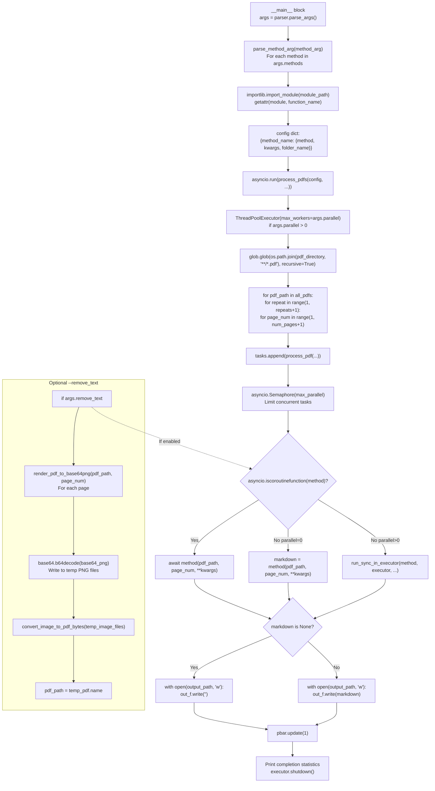
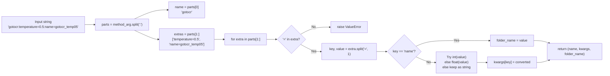
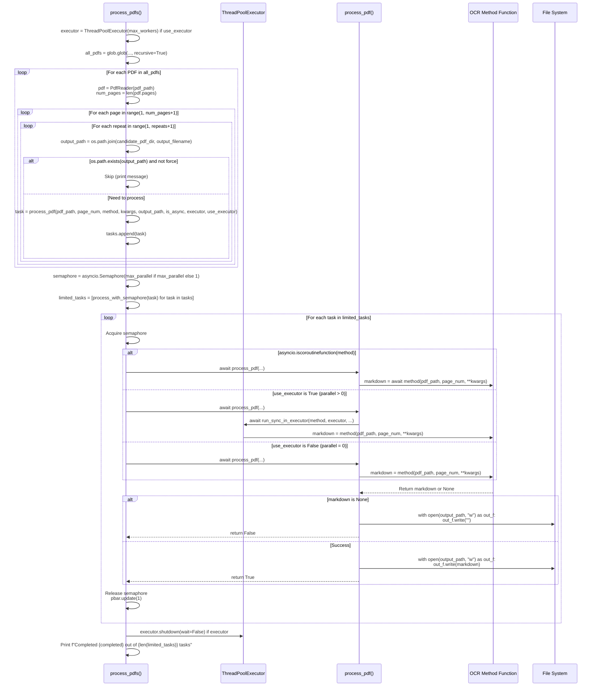
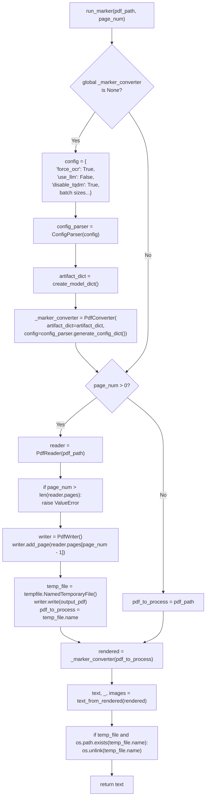
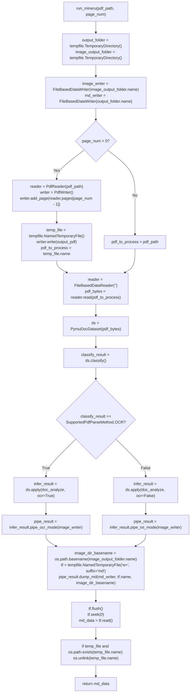
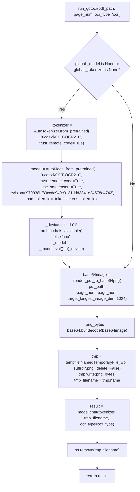
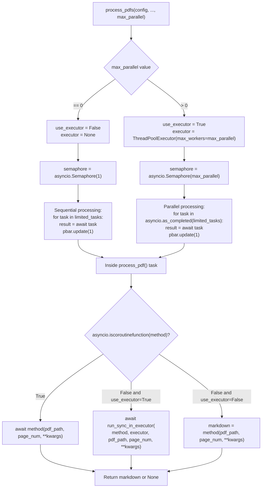
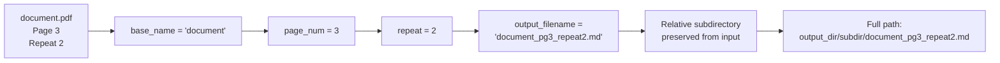
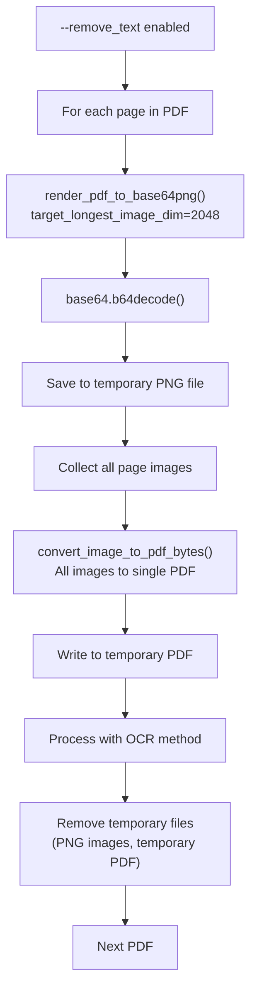

<!-- source: DeepWiki mcp.deepwiki.com · repo allenai/olmocr · page 4.6 Multi-OCR Comparison Framework · fetched 2026-10-26 -->

# Multi-OCR Comparison Framework

<details>
<summary>Relevant source files</summary>

The following files were used as context for generating this wiki page:

- [olmocr/bench/convert.py](olmocr/bench/convert.py)
- [olmocr/bench/runners/run_gotocr.py](olmocr/bench/runners/run_gotocr.py)
- [olmocr/bench/runners/run_marker.py](olmocr/bench/runners/run_marker.py)
- [olmocr/bench/runners/run_mineru.py](olmocr/bench/runners/run_mineru.py)
- [olmocr/repeatdetect.py](olmocr/repeatdetect.py)

</details>


## Purpose and Scope

The `convert.py` module implements a pluggable orchestration framework for running multiple OCR engines on the same set of PDFs with parallel execution and output standardization. It supports 15+ OCR methods including olmOCR, Marker, MinerU, GOT-OCR, ChatGPT, Gemini, and other commercial and open-source engines. The framework provides a unified interface for method registration, dynamic loading, concurrency control, and standardized markdown output generation.

This framework is essential for benchmark evaluation (see page 4.7) and enables systematic comparison of different OCR approaches on identical test sets. For information about the actual benchmark evaluation metrics, see page 4.1. For synthetic test data generation, see page 4.5.

---

## Architecture Overview

The OCR method comparison system follows a plugin-style architecture where each OCR method is implemented as a runner function that conforms to a standard interface. The `convert.py` orchestrator dynamically imports requested methods, manages their execution (either synchronously or asynchronously), and writes standardized output files.

### System Flow

**Diagram: convert.py Execution Flow from CLI to Output**


**Sources:** [olmocr/bench/convert.py:1-287]()

---

## Method Registration System

OCR methods are registered through a centralized mapping that associates method names with their implementation modules and functions. This allows the system to dynamically load only the requested methods at runtime.

### Available Methods Mapping

| Method Name | Module Path | Function Name | Description |
|------------|-------------|---------------|-------------|
| `olmocr_pipeline` | `olmocr.bench.runners.run_olmocr_pipeline` | `run_olmocr_pipeline` | Primary olmOCR system |
| `gotocr` | `olmocr.bench.runners.run_gotocr` | `run_gotocr` | GOT-OCR2.0 model |
| `marker` | `olmocr.bench.runners.run_marker` | `run_marker` | Marker OCR system |
| `mineru` | `olmocr.bench.runners.run_mineru` | `run_mineru` | MinerU/MagicPDF |
| `chatgpt` | `olmocr.bench.runners.run_chatgpt` | `run_chatgpt` | GPT-4o API |
| `gemini` | `olmocr.bench.runners.run_gemini` | `run_gemini` | Google Gemini API |
| `mistral` | `olmocr.bench.runners.run_mistral` | `run_mistral` | Mistral API |
| `docling` | `olmocr.bench.runners.run_docling` | `run_docling` | Docling system |
| `nanonetsocr` | `olmocr.bench.runners.run_nanonetsocr` | `run_nanonetsocr` | Nanonets OCR API |
| `paddlepaddle` | `olmocr.bench.runners.run_paddlepaddle` | `run_paddlepaddle` | PaddleOCR |
| `transformers` | `olmocr.bench.runners.run_transformers` | `run_transformers` | Transformers-based models |
| `server` | `olmocr.bench.runners.run_server` | `run_server` | Generic server endpoint |

### Method Configuration Parsing

**Diagram: parse_method_arg() Configuration String Processing**


The `parse_method_arg()` function at [olmocr/bench/convert.py:18-48]() handles parsing of method configuration strings in the format `method_name[:key=value[:key2=value2...]]`. Parameters are automatically type-converted (integers, floats, or strings). The special `name=folder_name` parameter allows customizing the output directory name.

**Sources:** [olmocr/bench/convert.py:18-48](), [olmocr/bench/convert.py:252-280]()

---

## Running OCR Methods

### Command-Line Interface

```bash
# Basic usage with single method
python -m olmocr.bench.convert olmocr_pipeline --dir ./data

# Multiple methods with parameters
python -m olmocr.bench.convert gotocr marker:force_ocr=True mineru --repeats 3 --parallel 4

# Custom output folder name
python -m olmocr.bench.convert gotocr:name=gotocr_baseline marker:name=marker_hybrid --dir ./benchmark

# Remove embedded text from PDFs (force OCR-only mode)
python -m olmocr.bench.convert olmocr_pipeline --remove_text --parallel 1
```

### Key Command-Line Arguments

| Argument | Type | Default | Description |
|----------|------|---------|-------------|
| `methods` | positional | required | Space-separated list of methods to run |
| `--repeats` | int | 1 | Number of times to repeat conversion for each PDF |
| `--dir` | str | `sample_data` | Data folder containing `/pdfs` subdirectory |
| `--force` | flag | False | Regenerate output files even if they exist |
| `--parallel` | int | 1 | Maximum concurrent tasks (0 = sequential) |
| `--remove_text` | flag | False | Convert PDFs to images first to remove text content |

**Sources:** [olmocr/bench/convert.py:227-249]()

---

## Process Execution Flow

### Task Processing Logic

**Diagram: process_pdfs() Task Execution Sequence**


The `process_pdfs()` function at [olmocr/bench/convert.py:91-224]() manages the execution of all tasks with concurrency control. It uses `asyncio.Semaphore` to limit parallel execution and handles both synchronous and asynchronous methods seamlessly.

**Sources:** [olmocr/bench/convert.py:51-89](), [olmocr/bench/convert.py:91-224]()

---

## Supported OCR Method Implementations

### Marker OCR Runner

The Marker runner at [olmocr/bench/runners/run_marker.py]() implements page-by-page OCR using the Marker library with forced OCR mode enabled to convert inline math to LaTeX. It uses a global singleton `_marker_converter` to avoid repeated model loading.

**Diagram: run_marker() Execution Flow with Model Caching**


**Configuration Parameters:**
- `force_ocr`: Always enabled to convert inline math to LaTeX
- `use_llm`: Set to False for plain Marker without hybrid mode
- `recognition_batch_size`: 256
- `layout_batch_size`: 48
- `detection_batch_size`: 48
- `equation_batch_size`: 64
- `table_rec_batch_size`: 48
- `ocr_error_batch_size`: 64

**Sources:** [olmocr/bench/runners/run_marker.py:1-70]()

### MinerU/MagicPDF Runner

The MinerU runner at [olmocr/bench/runners/run_mineru.py]() uses the MagicPDF library with automatic mode detection (OCR vs. text extraction) based on PDF classification.

**Diagram: run_mineru() with Adaptive OCR/Text Mode Selection**


**Sources:** [olmocr/bench/runners/run_mineru.py:1-75]()

### GOT-OCR Runner

The GOT-OCR runner at [olmocr/bench/runners/run_gotocr.py]() uses the Transformers library with the GOT-OCR2.0 model, rendering PDFs to images before processing.

**Diagram: run_gotocr() with Global Model Caching**


**Parameters:**
- `pdf_path`: Path to PDF file
- `page_num`: Page number to process (1-indexed)
- `ocr_type`: OCR mode (default: "ocr")
- Renders at 1024px longest dimension for efficiency

**Sources:** [olmocr/bench/runners/run_gotocr.py:1-68]()

---

## Parallel Processing and Concurrency

The system supports three execution modes based on the `--parallel` parameter:

### Execution Modes

**Diagram: Parallel Execution Mode Selection in process_pdfs()**


### Synchronous Method Executor

The `run_sync_in_executor()` function at [olmocr/bench/convert.py:51-55]() wraps synchronous OCR methods to run in a thread pool, allowing them to be awaited in the asyncio event loop without blocking.

**Key Implementation Details:**
- When `--parallel 0`, synchronous methods are called directly without any executor
- When `--parallel > 0`, synchronous methods run in a `ThreadPoolExecutor` with the specified number of workers
- Async methods (like external API calls) always run directly in the asyncio event loop
- The semaphore controls maximum concurrent tasks regardless of execution mode

**Sources:** [olmocr/bench/convert.py:51-55](), [olmocr/bench/convert.py:91-224]()

---

## Output Format and Directory Structure

### Output Organization

The system creates a standardized output structure that preserves the relative directory structure of input PDFs:

```
data_directory/
├── pdfs/
│   ├── arxiv_data/
│   │   ├── document1.pdf
│   │   └── document2.pdf
│   └── html_data/
│       └── document3.pdf
└── {method_folder_name}/
    ├── arxiv_data/
    │   ├── document1_pg1_repeat1.md
    │   ├── document1_pg2_repeat1.md
    │   ├── document1_pg1_repeat2.md
    │   └── document2_pg1_repeat1.md
    └── html_data/
        └── document3_pg1_repeat1.md
```

### Output File Naming Convention



### File Content Handling

The system has specific error handling for OCR failures:

| Condition | File Content | Purpose |
|-----------|--------------|---------|
| Successful OCR | Full markdown text | Normal output |
| Method returns `None` | Empty file | Mark as error, not skipped |
| Exception during processing | Empty file | Mark as error, not skipped |

Empty files are written explicitly to distinguish between errors and files that haven't been processed yet (useful when running with `--force` flag).

**Sources:** [olmocr/bench/convert.py:58-88](), [olmocr/bench/convert.py:113-178]()

---

## Integration with Benchmark Evaluation

The `convert.py` framework generates standardized markdown outputs that are consumed by the benchmark evaluation system. The output format matches the expected naming convention (`{pdf_name}_pg{N}_repeat{M}.md`) and directory structure required by the test framework (see page 4.1).

For conversion of olmOCR pipeline workspace outputs (JSONL format) to the benchmark markdown format, and for orchestration of full benchmark runs on Beaker infrastructure, see page 4.7 (Benchmark Orchestration and Evaluation).

---

## Text Removal Mode

The `--remove_text` flag provides a special mode that converts PDFs to images before processing, removing any embedded text content. This forces pure vision-based OCR and disables document anchoring for olmOCR.



**Use Cases:**
- Testing pure vision-based OCR without text extraction fallback
- Comparing OCR quality when document structure is unavailable
- Benchmarking scenarios where PDFs have corrupted or inaccessible text layers

**Sources:** [olmocr/bench/convert.py:128-161]()

---

