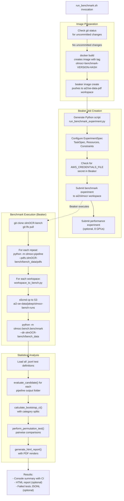
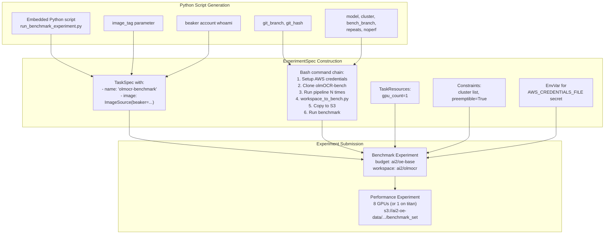
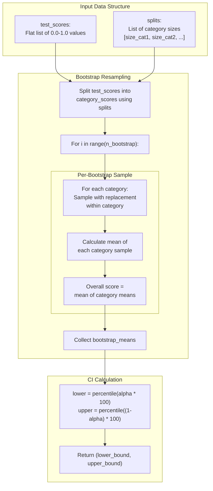
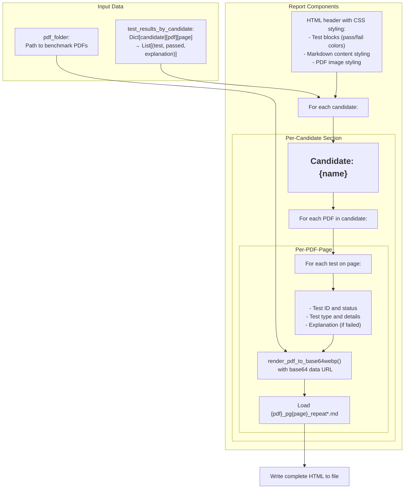

<!-- source: DeepWiki mcp.deepwiki.com · repo allenai/olmocr · page 4.7 Benchmark Orchestration and Evaluation · fetched 2026-10-26 -->

# Benchmark Orchestration and Evaluation

<details>
<summary>Relevant source files</summary>

The following files were used as context for generating this wiki page:

- [olmocr/bench/benchmark.py](olmocr/bench/benchmark.py)
- [olmocr/bench/katex/render.py](olmocr/bench/katex/render.py)
- [olmocr/bench/miners/download_math.py](olmocr/bench/miners/download_math.py)
- [olmocr/bench/miners/mine_math.py](olmocr/bench/miners/mine_math.py)
- [olmocr/bench/miners/mine_tables_gpt_simple.py](olmocr/bench/miners/mine_tables_gpt_simple.py)
- [olmocr/bench/report.py](olmocr/bench/report.py)
- [olmocr/bench/runners/run_mistral.py](olmocr/bench/runners/run_mistral.py)
- [olmocr/bench/sample_data/dataset.jsonl](olmocr/bench/sample_data/dataset.jsonl)
- [olmocr/bench/sample_data/pdfs/small_page_size.pdf](olmocr/bench/sample_data/pdfs/small_page_size.pdf)
- [olmocr/bench/sample_data/pdfs/test-graphical-text.pdf](olmocr/bench/sample_data/pdfs/test-graphical-text.pdf)
- [olmocr/bench/scripts/rotate_pdfs.py](olmocr/bench/scripts/rotate_pdfs.py)
- [olmocr/bench/scripts/rotate_pdfs_random.sh](olmocr/bench/scripts/rotate_pdfs_random.sh)
- [olmocr/bench/scripts/workspace_to_bench.py](olmocr/bench/scripts/workspace_to_bench.py)
- [olmocr/bench/tests.py](olmocr/bench/tests.py)
- [olmocr/bench/utils.py](olmocr/bench/utils.py)
- [scripts/run_benchmark.sh](scripts/run_benchmark.sh)
- [tests/test_katex_render.py](tests/test_katex_render.py)

</details>


This page documents the end-to-end orchestration of benchmark runs, from Docker image creation through result evaluation and statistical analysis. This covers the automation scripts that coordinate multiple system components to produce comprehensive benchmark results with confidence intervals.

For information about individual test types and the test framework, see [Test Framework and Test Types](#4.1). For details on multi-OCR comparison capabilities, see [Multi-OCR Comparison Framework](#4.6).

## Purpose and Workflow

The benchmark orchestration system automates the complete evaluation pipeline:

1. **Build and deploy** Docker images to Beaker
2. **Execute the OCR pipeline** on benchmark PDFs (with optional repeats)
3. **Convert workspace outputs** to the benchmark directory structure
4. **Run evaluation** against all test definitions
5. **Compute statistical metrics** including bootstrap confidence intervals
6. **Generate HTML reports** for visual inspection

This orchestration handles both the main benchmark suite and separate performance testing jobs.

Sources: [scripts/run_benchmark.sh:1-346]()

## End-to-End Orchestration Flow



Sources: [scripts/run_benchmark.sh:1-346](), [olmocr/bench/benchmark.py:1-458]()

## The run_benchmark.sh Script

The `run_benchmark.sh` script is the primary entry point for executing benchmarks. It handles Docker image creation, Beaker job submission, and experiment configuration.

### Command-Line Interface

| Parameter | Description | Default |
|-----------|-------------|---------|
| `--model` | Custom model name to test | (uses default model) |
| `--cluster` | Specific Beaker cluster | `ai2/ceres-cirrascale`, `ai2/jupiter-cirrascale-2` |
| `--benchbranch` | Branch of olmOCR-bench to use | `main` |
| `--beaker-image` | Skip Docker build, use existing Beaker image | (builds new image) |
| `--repeats` | Number of pipeline runs for averaging | `1` |
| `--noperf` | Skip performance test job | (performance test enabled) |

Sources: [scripts/run_benchmark.sh:19-58]()

### Version and Git Metadata

The script extracts version and git information to tag Docker images uniquely:

```python
# Get version from version.py
VERSION=$($PYTHON -c 'import olmocr.version; print(olmocr.version.VERSION)')

# Get first 10 characters of git hash
GIT_HASH=$(git rev-parse HEAD | cut -c1-10)

# Create full image tag
IMAGE_TAG="olmocr-benchmark-${VERSION}-${GIT_HASH}"
```

Sources: [scripts/run_benchmark.sh:83-101]()

### Beaker Experiment Configuration



The script generates a Python script at runtime that uses the Beaker Python SDK to create experiments:

- **Benchmark Experiment**: Processes the full olmOCR-bench dataset with 1 GPU
- **Performance Experiment**: Runs a fixed performance test set with 8 GPUs (1 on titan-cirrascale) to measure throughput without interference

Sources: [scripts/run_benchmark.sh:120-308]()

### Pipeline Execution Loop

For the main benchmark, the script executes the pipeline multiple times based on the `--repeats` parameter:

```python
# Run pipeline multiple times based on repeats
for i in range(1, repeats + 1):
    workspace_dir = f"./localworkspace{i}"
    pipeline_cmd = f"python -m olmocr.pipeline {workspace_dir} --markdown --pdfs ./olmOCR-bench/bench_data/pdfs/**/*.pdf"
    if model:
        pipeline_cmd += f" --model {model}"
    commands.append(pipeline_cmd)

# Process all workspaces with workspace_to_bench.py
for i in range(1, repeats + 1):
    workspace_dir = f"localworkspace{i}/"
    workspace_to_bench_cmd = f"python olmocr/bench/scripts/workspace_to_bench.py {workspace_dir} olmOCR-bench/bench_data/olmocr --bench-path ./olmOCR-bench/ --repeat-index {i}"
    commands.append(workspace_to_bench_cmd)
```

Sources: [scripts/run_benchmark.sh:189-210]()

## Workspace to Benchmark Conversion

The `workspace_to_bench.py` script converts pipeline outputs from the Dolma JSONL format to the markdown files expected by the benchmark system.

### Conversion Process

```mermaid
flowchart LR
    subgraph "Input Structure"
        Workspace["localworkspace/<br/>results/*.jsonl"]
        JSONLEntry["JSONL entry with:<br/>- text (markdown)<br/>- metadata.Source-File"]
    end
    
    subgraph "Processing"
        LoadJSONL["load_jsonl_files()<br/>Parse all .jsonl files"]
        ParseEntries["parse_jsonl_entries()<br/>Extract text and source"]
        ExtractPath["get_subdir_and_pdf_name()<br/>Parse Source-File path"]
        GroupByPDF["Group entries by<br/>(subdir, pdf_name)"]
    end
    
    subgraph "Output Structure"
        CreateMD["create_markdown_files()<br/>Write {pdf}_pg1_repeat{N}.md"]
        FindMissing["find_missing_pdfs()<br/>Check for missing outputs"]
        CreateBlank["create_blank_markdown_files()<br/>Empty .md for missing"]
    end
    
    subgraph "Benchmark Directory"
        BenchDir["olmOCR-bench/bench_data/olmocr/<br/>subdir/{pdf}_pg1_repeat1.md"]
    end
    
    Workspace --> LoadJSONL
    JSONLEntry --> ParseEntries
    LoadJSONL --> ParseEntries
    ParseEntries --> ExtractPath
    ExtractPath --> GroupByPDF
    GroupByPDF --> CreateMD
    CreateMD --> FindMissing
    FindMissing --> CreateBlank
    CreateBlank --> BenchDir
```



### Path Extraction Logic

The script parses the `Source-File` metadata field to determine the output location:

```python
def get_subdir_and_pdf_name(source_file_path):
    """Extract subdirectory and PDF filename from source file path."""
    path_parts = Path(source_file_path).parts
    
    pdfs_index = path_parts.index("pdfs")
    if pdfs_index + 1 < len(path_parts):
        subdir = path_parts[pdfs_index + 1]
        pdf_name = Path(source_file_path).stem
        return subdir, pdf_name
    
    return None, None
```

For example, `s3://bucket/pdfs/math/paper123.pdf` becomes:
- `subdir`: `math`
- `pdf_name`: `paper123`
- Output: `bench_data/olmocr/math/paper123_pg1_repeat1.md`

Sources: [olmocr/bench/scripts/workspace_to_bench.py:55-69]()

### Handling Missing Files

The script creates blank markdown files for PDFs that exist in the benchmark but failed to process:

```python
def find_missing_pdfs(pdf_sources, created_files, base_bench_path):
    """Find PDFs that exist in directories but are missing from JSONL data."""
    missing_pdfs = []
    
    for subdir in subdirs:
        pdf_dir = Path(base_bench_path) / "bench_data" / "pdfs" / subdir
        pdf_files = list(pdf_dir.glob("*.pdf"))
        
        for pdf_file in pdf_files:
            pdf_name = pdf_file.stem
            if (subdir, pdf_name) not in created_files:
                missing_pdfs.append({
                    "pdf_name": pdf_name,
                    "full_path": pdf_file,
                    "subdir": subdir
                })
    
    return missing_pdfs
```

This ensures all benchmark tests can run even if some pipeline runs failed.

Sources: [olmocr/bench/scripts/workspace_to_bench.py:110-143]()

## Benchmark Execution

The `benchmark.py` module orchestrates test execution across all candidates and computes aggregate statistics.

### Main Execution Flow

```mermaid
flowchart TB
    subgraph "Initialization"
        ParseArgs["argparse: dir, force, candidate,<br/>skip_baseline, bootstrap_samples,<br/>sample, test_report, output_failed"]
        FindJSONL["Find all .jsonl test files"]
        LoadTests["load_tests() for each .jsonl"]
        AddBaseline["Add BaselineTest for each<br/>PDF if not present"]
        SampleTests["Random sample N tests<br/>(if --sample specified)"]
    end
    
    subgraph "Candidate Processing"
        FindCandidates["List subdirectories<br/>(except 'pdfs')"]
        EvaluateCandidate["evaluate_candidate()<br/>For each candidate folder"]
        
        subgraph "Per-Candidate Evaluation"
            ValidateMD["Check for {pdf}_pg{page}_repeat*.md<br/>files for each test"]
            ProcessTests["ThreadPoolExecutor:<br/>process_test() concurrently"]
            RunTest["test.run(md_content)<br/>Returns (passed, explanation)"]
            AverageRepeats["Average across repeats:<br/>test_avg = repeat_passes / num_repeats"]
            CollectScores["Collect all_test_scores<br/>for bootstrapping"]
        end
    end
    
    subgraph "Statistical Analysis"
        GroupByJSONL["Group results by<br/>source .jsonl file"]
        CategoryScores["Calculate per-category<br/>pass rates"]
        BootstrapCI["calculate_bootstrap_ci()<br/>with category splits"]
        OverallScore["Mean of per-category scores"]
    end
    
    subgraph "Output Generation"
        PrintSummary["Print summary with CI<br/>for each candidate"]
        HTMLReport["generate_html_report()<br/>(if --test_report)"]
        FailedJSONL["save_tests() for failed tests<br/>(if --output_failed)"]
    end
    
    ParseArgs --> FindJSONL
    FindJSONL --> LoadTests
    LoadTests --> AddBaseline
    AddBaseline --> SampleTests
    SampleTests --> FindCandidates
    
    FindCandidates --> EvaluateCandidate
    EvaluateCandidate --> ValidateMD
    ValidateMD --> ProcessTests
    ProcessTests --> RunTest
    RunTest --> AverageRepeats
    AverageRepeats --> CollectScores
    
    CollectScores --> GroupByJSONL
    GroupByJSONL --> CategoryScores
    CategoryScores --> BootstrapCI
    BootstrapCI --> OverallScore
    
    OverallScore --> PrintSummary
    PrintSummary --> HTMLReport
    HTMLReport --> FailedJSONL
```



Sources: [olmocr/bench/benchmark.py:162-457]()

### Test Evaluation with Threading

The `evaluate_candidate()` function uses a thread pool to evaluate tests concurrently:

```python
def evaluate_candidate(
    candidate_folder: str, 
    all_tests: List[BasePDFTest], 
    pdf_basenames: List[str], 
    force: bool = False
) -> Tuple[float, int, List[str], List[str], Dict, List[float], Dict]:
    """
    For the candidate folder (pipeline tool output), validate that it contains 
    at least one .md file for every PDF in the pdf folder.
    Then, run each rule against all corresponding .md files concurrently 
    and average the results.
    """
    # Map each PDF to its corresponding MD repeats
    pdf_to_md_files = {}
    
    # ... validation logic ...
    
    # Process tests concurrently
    with ThreadPoolExecutor(max_workers=min(os.cpu_count() or 1, 64)) as executor:
        futures = [executor.submit(process_test, test) for test in all_tests]
        for future in tqdm(as_completed(futures), total=len(futures), 
                          desc=f"Evaluating tests for {candidate_name}", unit="test"):
            test_avg, test_failure, test_type, errors, _ = future.result()
            all_test_scores.append(test_avg)
            # ... aggregate results ...
```

Sources: [olmocr/bench/benchmark.py:33-159]()

### Repeat Handling

For each test, the system averages results across all available repeats:

```python
def process_test(test: BasePDFTest) -> Tuple[float, str, str, List[str], Tuple[bool, str]]:
    # Filter MD files for the specific page corresponding to the test
    page_md_files = [f for f in md_files if re.search(rf"_pg{test.page}_", os.path.basename(f))]
    
    repeat_passes = 0
    num_repeats = 0
    explanations = []
    
    for md_path in page_md_files:
        num_repeats += 1
        # ... read markdown content ...
        passed, explanation = test.run(md_content)
        if passed:
            repeat_passes += 1
        else:
            explanations.append(explanation)
    
    test_avg = repeat_passes / num_repeats if num_repeats > 0 else 0.0
    final_passed = test_avg > 0.5  # Majority vote
    
    return (test_avg, test_failure, test.type, local_errors, (final_passed, final_explanation))
```

This ensures that random failures in individual runs don't dominate the evaluation.

Sources: [olmocr/bench/benchmark.py:80-137]()

## Statistical Analysis

The benchmark system computes bootstrap confidence intervals and performs permutation tests to assess statistical significance.

### Bootstrap Confidence Intervals



The `calculate_bootstrap_ci()` function respects category structure to avoid biasing results toward categories with more tests:

```python
def calculate_bootstrap_ci(
    test_scores: List[float], 
    n_bootstrap: int = 1000, 
    ci_level: float = 0.95, 
    splits: List[int] = None
) -> Tuple[float, float]:
    """
    Calculate bootstrap confidence interval for test scores, 
    respecting category splits.
    
    Args:
        splits: List of sizes for each category. If provided, resampling 
                will be done within each category independently, and the 
                overall score will be the average of per-category scores.
    """
    scores = np.array(test_scores)
    
    if splits is None:
        # Simple case - traditional bootstrap
        bootstrap_means = []
        for _ in range(n_bootstrap):
            sample = np.random.choice(scores, size=len(scores), replace=True)
            bootstrap_means.append(np.mean(sample))
    else:
        # Split scores into categories
        category_scores = []
        start_idx = 0
        for split_size in splits:
            category_scores.append(scores[start_idx:start_idx + split_size])
            start_idx += split_size
        
        # Bootstrap respecting category structure
        bootstrap_means = []
        for _ in range(n_bootstrap):
            category_means = []
            for cat_scores in category_scores:
                if len(cat_scores) > 0:
                    cat_sample = np.random.choice(cat_scores, size=len(cat_scores), replace=True)
                    category_means.append(np.mean(cat_sample))
            
            if category_means:
                bootstrap_means.append(np.mean(category_means))
    
    # Calculate CI
    alpha = (1 - ci_level) / 2
    lower_bound = np.percentile(bootstrap_means, alpha * 100)
    upper_bound = np.percentile(bootstrap_means, (1 - alpha) * 100)
    
    return (lower_bound, upper_bound)
```

Sources: [olmocr/bench/utils.py:6-68]()

### Permutation Testing

The `perform_permutation_test()` function determines if the difference between two candidates is statistically significant:

```python
def perform_permutation_test(
    scores_a: List[float], 
    scores_b: List[float], 
    n_permutations: int = 10000, 
    splits_a: List[int] = None, 
    splits_b: List[int] = None
) -> Tuple[float, float]:
    """
    Perform a permutation test to determine if there's a significant 
    difference between two sets of test scores.
    
    Returns:
        Tuple of (observed_difference, p_value)
    """
    # Calculate observed difference using category structure
    mean_a = mean_of_category_means(scores_a, splits_a)
    mean_b = mean_of_category_means(scores_b, splits_b)
    observed_diff = mean_a - mean_b
    
    # For category-based permutation test, maintain category structure
    count_greater_or_equal = 0
    for _ in range(n_permutations):
        # For each category pair, shuffle and redistribute
        perm_categories_a = []
        perm_categories_b = []
        
        for cat_a, cat_b in zip(categories_a, categories_b):
            combined = np.concatenate([cat_a, cat_b])
            np.random.shuffle(combined)
            
            perm_categories_a.append(combined[:len(cat_a)])
            perm_categories_b.append(combined[len(cat_a):])
        
        # Calculate difference maintaining category structure
        perm_mean_a = mean_of_category_means(perm_a, splits_a)
        perm_mean_b = mean_of_category_means(perm_b, splits_b)
        perm_diff = perm_mean_a - perm_mean_b
        
        if abs(perm_diff) >= abs(observed_diff):
            count_greater_or_equal += 1
    
    p_value = count_greater_or_equal / n_permutations
    return (observed_diff, p_value)
```

Sources: [olmocr/bench/utils.py:70-194]()

### Category-Aware Scoring

The benchmark computes the overall score as the average of per-JSONL-file pass rates, ensuring each category contributes equally:

```python
# Group results by jsonl file
jsonl_results = {}
for test in all_tests:
    jsonl_file = test_to_jsonl.get(test.id, "unknown")
    
    if jsonl_file not in jsonl_results:
        jsonl_results[jsonl_file] = {"total": 0, "passed": 0, "scores": []}
    
    jsonl_results[jsonl_file]["total"] += 1
    # ... accumulate results ...

# Calculate per-category pass rates
jsonl_pass_rates = []
for jsonl_file, results in jsonl_results.items():
    if results["total"] > 0:
        pass_rate = results["passed"] / results["total"]
        jsonl_pass_rates.append(pass_rate)

# Overall score is average of per-category pass rates
new_overall_score = sum(jsonl_pass_rates) / len(jsonl_pass_rates) if jsonl_pass_rates else 0.0
```

This prevents categories with many tests from dominating the overall score.

Sources: [olmocr/bench/benchmark.py:288-382]()

## HTML Report Generation

The `generate_html_report()` function creates a visual report with PDF renders and markdown content for inspection.

### Report Structure



### Test Type Rendering

The report includes context-specific details for each test type:

| Test Type | Displayed Information |
|-----------|----------------------|
| `present` | "Text to find: {text}" |
| `absent` | "Text should not appear: {text}" |
| `order` | "Text order: {before} should appear before {after}" |
| `table` | Cell value, up/down/left/right neighbors, top/left headings |
| `math` | LaTeX equation |
| `baseline` | Generic quality check information |

Sources: [olmocr/bench/report.py:148-178]()

### PDF Rendering Integration

The report uses `render_pdf_to_base64webp()` to embed PDF pages directly:

```python
# Render PDF page
pdf_path = os.path.join(pdf_folder, pdf_name)
try:
    html += """        <h4>PDF Render:</h4>\n"""
    image_data = render_pdf_to_base64webp(pdf_path, page, 1024)
    html += f"""        \n"""
except Exception as e:
    html += f"""        <p>Error rendering PDF: {str(e)}</p>\n"""
```

This allows visual inspection of the source material alongside the OCR output.

Sources: [olmocr/bench/report.py:188-195]()

### Markdown Content Display

The report loads and displays the markdown output for each test:

```python
# Get the Markdown content for this page
md_content = None
try:
    md_base = os.path.splitext(pdf_name)[0]
    md_files = list(glob.glob(os.path.join(
        os.path.dirname(pdf_folder), 
        candidate, 
        f"{md_base}_pg{page}_repeat*.md"
    )))
    if md_files:
        md_file_path = md_files[0]  # Use first repeat as example
        with open(md_file_path, "r", encoding="utf-8") as f:
            md_content = f.read()
except Exception as e:
    md_content = f"Error loading Markdown content: {str(e)}"

if md_content:
    html += """        <h4>Markdown Content:</h4>\n"""
    html += f"""        <div class="markdown-content">{md_content}</div>\n"""
```

Sources: [olmocr/bench/report.py:198-211]()

## Command-Line Interface Summary

The complete benchmark orchestration supports the following workflow:

```bash
# 1. Run benchmark with default model
./scripts/run_benchmark.sh

# 2. Run with custom model and 3 repeats
./scripts/run_benchmark.sh --model my-model --repeats 3

# 3. Run on specific cluster without performance test
./scripts/run_benchmark.sh --cluster ai2/titan-cirrascale --noperf

# 4. Use existing Beaker image
./scripts/run_benchmark.sh --beaker-image jakep/olmocr-benchmark-0.3.3-780bc7d934

# After completion, the benchmark.py results are in Beaker logs
# You can also run benchmark.py locally on the results:

# 5. Run benchmark evaluation locally
python -m olmocr.bench.benchmark --dir ./olmOCR-bench/bench_data

# 6. Generate HTML report and output failed tests
python -m olmocr.bench.benchmark \
    --dir ./olmOCR-bench/bench_data \
    --test_report results.html \
    --output_failed failed_tests.jsonl

# 7. Run on specific candidate with sampling
python -m olmocr.bench.benchmark \
    --dir ./olmOCR-bench/bench_data \
    --candidate olmocr \
    --sample 100 \
    --bootstrap_samples 5000
```

Sources: [scripts/run_benchmark.sh:1-17](), [olmocr/bench/benchmark.py:163-194]()

---

