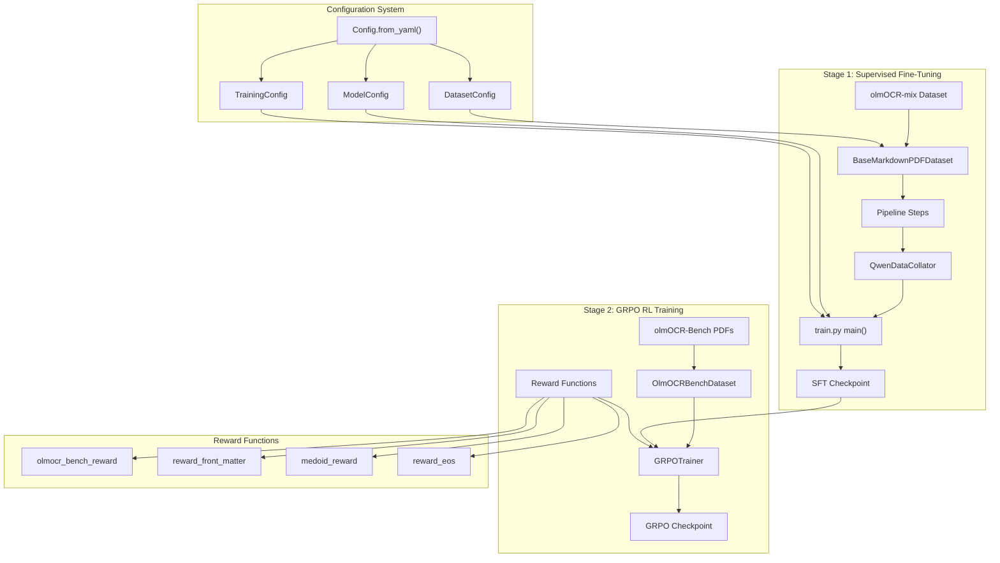
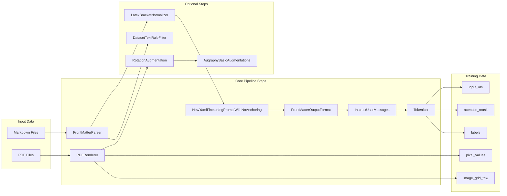
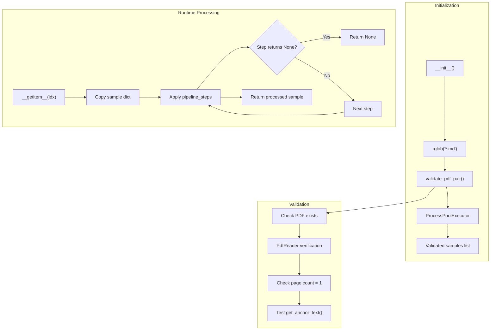
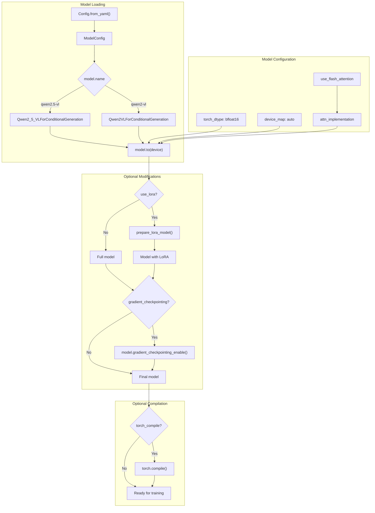
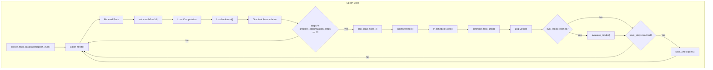
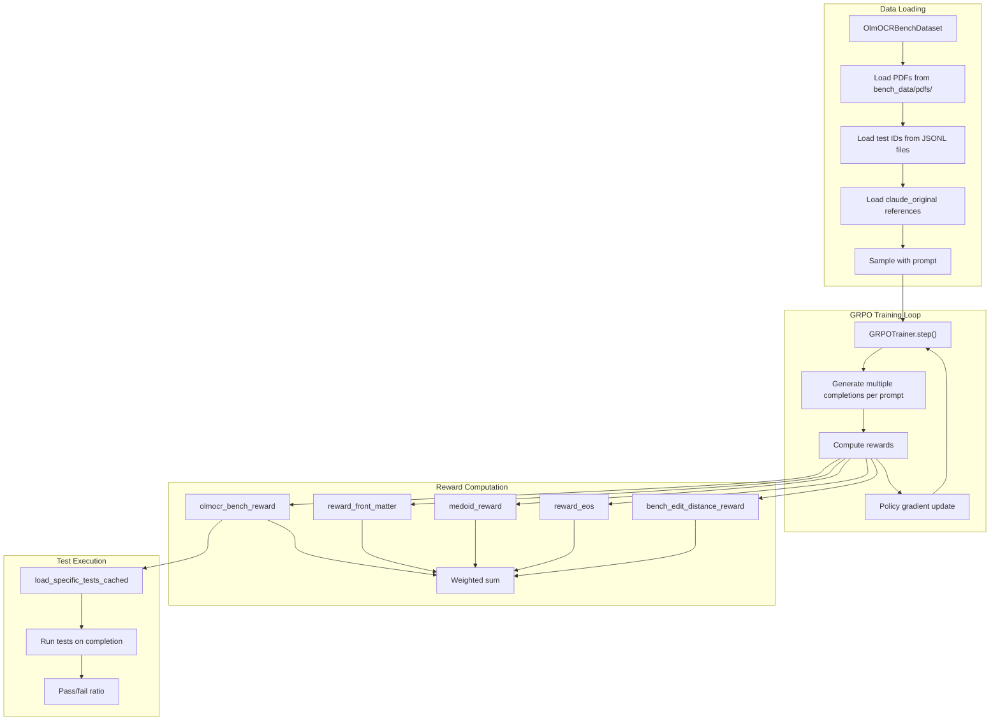
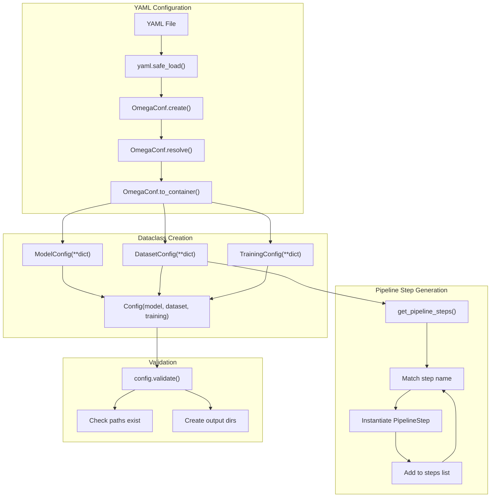

<!-- source: DeepWiki mcp.deepwiki.com · repo allenai/olmocr · page 5 Model Training and Fine-tuning · fetched 2026-10-26 -->

# Model Training and Fine-tuning

<details>
<summary>Relevant source files</summary>

The following files were used as context for generating this wiki page:

- [.dockerignore](.dockerignore)
- [.github/ISSUE_TEMPLATE/feature_request.yml](.github/ISSUE_TEMPLATE/feature_request.yml)
- [.github/actions/setup-venv/action.yml](.github/actions/setup-venv/action.yml)
- [.github/dependabot.yml](.github/dependabot.yml)
- [README.md](README.md)
- [olmocr/bench/README.md](olmocr/bench/README.md)
- [olmocr/bench/runners/run_nanonetsocr.py](olmocr/bench/runners/run_nanonetsocr.py)
- [olmocr/bench/runners/run_olmocr_pipeline.py](olmocr/bench/runners/run_olmocr_pipeline.py)
- [olmocr/train/README.md](olmocr/train/README.md)
- [olmocr/train/config.py](olmocr/train/config.py)
- [olmocr/train/configs/v0.4.0/qwen25_vl_olmocrv4_rotation_1epoch_localtest.yaml](olmocr/train/configs/v0.4.0/qwen25_vl_olmocrv4_rotation_1epoch_localtest.yaml)
- [olmocr/train/dataloader.py](olmocr/train/dataloader.py)
- [olmocr/train/grpo_train.py](olmocr/train/grpo_train.py)
- [olmocr/train/muon.py](olmocr/train/muon.py)
- [olmocr/train/train.py](olmocr/train/train.py)
- [scripts/run_mineru_benchmark.sh](scripts/run_mineru_benchmark.sh)
- [scripts/train/grpotrainer-beaker.sh](scripts/train/grpotrainer-beaker.sh)
- [tests/test_grpo.py](tests/test_grpo.py)

</details>


This section covers the complete model training pipeline for fine-tuning vision language models on document understanding tasks. The training system consists of two main stages:

1. **Supervised Fine-Tuning (SFT)**: Base training on markdown-PDF pairs using `train.py`
2. **GRPO Reinforcement Learning**: Policy optimization using benchmark-based rewards via `grpo_train.py`

For information about using pre-trained models for inference, see page 2. For evaluation and benchmarking of trained models, see page 4.

## Training Architecture Overview

The training system is built around a modular pipeline architecture that processes markdown-PDF pairs through configurable transformation steps. The complete training flow includes data preparation, supervised fine-tuning, and optional reinforcement learning with policy optimization.

### Two-Stage Training Architecture



The training system supports both single-stage SFT and the full two-stage pipeline. The `train.py` script handles SFT with support for AdamW and Muon optimizers, while `grpo_train.py` implements Group Relative Policy Optimization with multiple reward functions.

**Sources:** [olmocr/train/train.py:292-577](), [olmocr/train/grpo_train.py:766-920]()

### Pipeline Processing Flow



Each sample flows through a configurable sequence of `PipelineStep` implementations defined in the YAML configuration. The `BaseMarkdownPDFDataset` validates PDF-markdown pairs and applies the pipeline steps sequentially, returning `None` if any step filters out the sample.

**Sources:** [olmocr/train/dataloader.py:102-188](), [olmocr/train/config.py:366-491]()

## Training Data Pipeline

### Dataset Format and Preparation

The training system requires markdown-PDF pairs where each PDF is a single page. The `prepare_olmocrmix.py` script downloads and organizes the olmOCR-mix dataset from HuggingFace:

| Component | Implementation | Key Functionality |
|-----------|----------------|-------------------|
| `prepare_olmocr_mix()` | Main preparation function | Downloads dataset, extracts tarballs, creates symlinks |
| `extract_tarball()` | Parallel extraction | Uses `ProcessPoolExecutor` for efficient PDF extraction from .tar.gz files |
| Symlink Creation | File linking | Creates symlinks from markdown files to PDFs to maintain folder hierarchy |

The resulting structure has paired files:
```
data/
├── document1.pdf
├── document1.md
├── document2.pdf
├── document2.md
```

Each markdown file contains YAML frontmatter with metadata (`primary_language`, `is_rotation_valid`, `rotation_correction`, `is_table`, `is_diagram`) followed by the document text.

**Sources:** [olmocr/data/prepare_olmocrmix.py:1-194](), [olmocr/train/README.md:18-77]()

### BaseMarkdownPDFDataset Architecture

The `BaseMarkdownPDFDataset` class orchestrates the data loading and validation process:



The dataset performs parallel validation using `ProcessPoolExecutor` with 8 workers, checking that each PDF has exactly one page and can be processed by the anchoring system. At runtime, `__getitem__` applies the configured pipeline steps sequentially, returning `None` if any step filters the sample.

**Sources:** [olmocr/train/dataloader.py:102-188](), [olmocr/train/dataloader.py:50-89]()

### PipelineStep Implementation Pattern

All pipeline steps inherit from the abstract `PipelineStep` dataclass:

```python
@dataclass(frozen=True, slots=True)
class PipelineStep(ABC):
    @abstractmethod
    def __call__(self, sample: Sample) -> Optional[Sample]:
        """Process a sample and return the modified sample, or None to skip."""
        ...
```

Steps receive a `sample` dictionary and either:
1. Return the modified sample with additional fields
2. Return `None` to filter out the sample

This pattern enables flexible composition of processing steps through YAML configuration.

**Sources:** [olmocr/train/dataloader.py:92-99]()

### Core Pipeline Steps

The training pipeline includes parsing, rendering, prompting, formatting, and tokenization steps:

| Step Name | Implementation | Key Functionality |
|-----------|----------------|-------------------|
| `FrontMatterParser` | [dataloader.py:190-286]() | Extracts YAML frontmatter, validates fields, creates `PageResponse` dataclass |
| `PDFRenderer` | [dataloader.py:288-305]() | Calls `render_pdf_to_base64png()`, decodes to PIL Image, adds to sample |
| `NewYamlFinetuningPromptWithNoAnchoring` | [dataloader.py:342-348]() | Calls `build_no_anchoring_v4_yaml_prompt()` for instruction text |
| `FrontMatterOutputFormat` | [dataloader.py:352-372]() | Formats `PageResponse` as YAML frontmatter + text |
| `InstructUserMessages` | [dataloader.py:728-759]() | Creates vision-language message format with role/content structure |
| `Tokenizer` | [dataloader.py:761-878]() | Calls `processor.apply_chat_template()`, handles label masking with `masking_index` |

**Deprecated/Optional Steps:**

- `StaticLengthDocumentAnchoring` ([dataloader.py:307-317]()): Legacy document anchoring, not used in current models
- `FinetuningPrompt` ([dataloader.py:319-326]()): Legacy prompting, replaced by YAML prompt

**Sources:** [olmocr/train/dataloader.py:190-878]()

### Augmentation and Normalization Steps

Image and text augmentation steps enhance training robustness:

| Step Name | Implementation | Key Functionality |
|-----------|----------------|-------------------|
| `RotationAugmentation` | [dataloader.py:439-498]() | Rotates image by 90/180/270°, updates `is_rotation_valid` and `rotation_correction` fields |
| `AugraphyBasicAugmentations` | [dataloader.py:880-1012]() | Applies Augraphy library augmentations: `DirtyDrum`, `DirtyRollers`, `LightingGradient`, `Jpeg` |
| `LatexBracketNormalizer` | [dataloader.py:397-437]() | Converts `$$...$$` → `\[...\]` and `$...$` → `\(...\)` |
| `ReformatLatexBoldItalic` | [dataloader.py:1014-1110]() | Converts `\textbf{...}` → `**...**` and `\textit{...}` → `*...*` |

The augmentation steps use probability parameters to control application rate (typically 0.5 for rotation, 0.5 for Augraphy).

**Sources:** [olmocr/train/dataloader.py:397-1110]()

### Filtering and Quality Control Steps

Filtering steps remove problematic samples during training:

| Step Name | Implementation | Filter Criteria |
|-----------|----------------|-----------------|
| `FilterOutRotatedDocuments` | [dataloader.py:500-521]() | Returns `None` if `is_rotation_valid` is False or `rotation_correction != 0` |
| `DatasetTextRuleFilter` | [dataloader.py:523-766]() | Filters markdown tables, malformed HTML, LaTeX commands, math symbols outside tables |

The `DatasetTextRuleFilter` implements multiple sub-checks:
- `_contains_markdown_table()`: Detects pipe-separated tables
- `_contains_math_symbols()`: Checks for math symbols outside `<table>` tags
- `_contains_latex_tables()`: Detects `\begin{table}` or `\begin{tabular}`
- `_contains_latex_formatting_outside_math()`: Detects LaTeX commands outside math delimiters

**Sources:** [olmocr/train/dataloader.py:500-766]()

### Tokenization and Output Formatting

The final steps convert processed samples to training format:

**`Tokenizer` Step Process:**
1. Calls `processor.apply_chat_template(messages, add_generation_prompt=False)` to get text
2. Calls `processor(text=[text], images=[image], padding=False, return_tensors="np")` 
3. Creates labels by copying `input_ids` and masking user message tokens with `masking_index` (-100)
4. Only tokens after the final `end_of_message_token` (typically `<|im_end|>`) are unmasked for training

The `InstructUserMessages` step formats data into the vision-language instruction format with `role` and `content` fields, supporting both text-first and image-first ordering via the `prompt_first` parameter.

**Sources:** [olmocr/train/dataloader.py:728-878]()

## Supervised Fine-Tuning

### Model Initialization and Configuration

The `train.py` script supports Qwen2-VL and Qwen2.5-VL models with flexible configuration:



The `prepare_lora_model()` function wraps the model with PEFT LoRA adapters, supporting configurable rank, alpha, dropout, and target modules. The system prints trainable parameter counts to verify the configuration.

**Sources:** [olmocr/train/train.py:292-439]()

### Optimizer Configuration

The training system supports two optimizer types through the `training.optim` config field:

**AdamW Configuration ([train.py:446-463]()):**
- Parameters grouped by `no_decay` list (`["bias", "LayerNorm.weight"]`)
- Decay group uses `weight_decay`, no-decay group has `weight_decay=0.0`
- Hyperparameters: `learning_rate`, `adam_beta1`, `adam_beta2`, `adam_epsilon`

**Muon Configuration ([train.py:464-498]()):**
- Separates parameters by dimensionality and name:
  - `hidden_matrix_params`: 2D params excluding embed/head
  - `embed_params`: Parameters with "embed" in name
  - `scalar_params`: Parameters with `ndim < 2`
  - `head_params`: Parameters with "lm_head" in name
- Uses `SingleDeviceMuonWithAuxAdam` combining Muon for hidden matrices with Adam for others
- Learning rate multipliers configurable via `muon_lr_multiplier_head`, `muon_lr_multiplier_embed`, `muon_lr_multiplier_scalar`

| Parameter Group | Muon Multiplier | Example LR (base=2e-5) |
|-----------------|-----------------|------------------------|
| Hidden matrices | 1.0 | 2e-5 |
| LM head | `muon_lr_multiplier_head` (default 11.0) | 2.2e-4 |
| Embeddings | `muon_lr_multiplier_embed` (default 30.0) | 6e-4 |
| Scalars | `muon_lr_multiplier_scalar` (default 2.0) | 4e-5 |

**Sources:** [olmocr/train/train.py:441-500](), [olmocr/train/muon.py:232-291]()

### Training Loop Implementation

The main training loop in `train.py` implements a custom training schedule with gradient accumulation:



**Key Training Loop Features:**

1. **Epoch-specific shuffling**: `create_train_dataloader()` creates a new generator per epoch with seed `data_seed + epoch_num`
2. **Mixed precision**: Uses `torch.amp.autocast` with bfloat16 for forward pass
3. **Gradient accumulation**: Accumulates gradients over `gradient_accumulation_steps` before optimizer step
4. **Gradient clipping**: Applies `max_grad_norm` before optimizer step
5. **Learning rate scheduling**: Steps scheduler after each optimizer update
6. **Periodic evaluation**: Evaluates on all eval datasets at `eval_steps` intervals
7. **Checkpoint saving**: Saves model, optimizer, scheduler, and training state at `save_steps` intervals

**Sources:** [olmocr/train/train.py:501-577](), [olmocr/train/train.py:252-290]()

### Data Collation

The `QwenDataCollator` handles batch preparation for vision-language models:

```python
class QwenDataCollator:
    def __init__(self, max_token_len: Optional[int] = None):
        self.max_token_len = max_token_len
    
    def __call__(self, examples):
        # Filters None values
        # Converts numpy arrays to tensors
        # Trims to max_token_len if specified
        # Stacks into batched tensors
```

The collator:
1. Filters out `None` samples (filtered by pipeline steps)
2. Converts numpy arrays to PyTorch tensors
3. Optionally trims sequences to `max_token_len`
4. Stacks `input_ids`, `attention_mask`, `labels`, `pixel_values`, `image_grid_thw` into batch tensors

**Sources:** [olmocr/train/train.py:79-132]()

### Checkpoint Management and Model Preparation

The checkpoint system provides comprehensive state preservation and model preparation utilities:

**`save_checkpoint()` ([train.py:134-174]()):**
- Creates `checkpoint-{global_step}` directory
- Saves model via `model.save_pretrained()`
- Saves optimizer state to `optimizer.pt`
- Saves scheduler state to `scheduler.pt`
- Saves training state (epoch, global_step, samples_seen, best_metric) to `training_state.pt`
- Enforces `save_total_limit` by removing oldest checkpoints

**`load_checkpoint()` ([train.py:176-214]()):**
- Detects LoRA checkpoints via `adapter_config.json` presence
- For LoRA: loads base model then wraps with `PeftModel.from_pretrained()`
- For full models: loads directly with `from_pretrained()`
- Restores optimizer, scheduler, and training state

**Model Preparation for Inference:**

After training, the `prepare_checkpoint.py` script prepares models for deployment:
1. Merges LoRA adapters into base model if applicable
2. Adjusts `config.json` and `generation_config.json`
3. Optionally performs model souping (averaging multiple checkpoints)

The `compress_checkpoint.py` script quantizes models to FP8 using VLLM's quantization configs, reducing memory usage by ~50% with minimal performance impact.

**Sources:** [olmocr/train/train.py:134-214](), [olmocr/train/README.md:106-126]()

## GRPO Reinforcement Learning

### GRPO Training Architecture

The `grpo_train.py` script implements Group Relative Policy Optimization using the TRL library's `GRPOTrainer`:



The GRPO trainer generates multiple completions per prompt, computes weighted rewards from multiple sources, and updates the policy to maximize expected reward.

**Sources:** [olmocr/train/grpo_train.py:766-920]()

### OlmOCRBenchDataset

The `OlmOCRBenchDataset` loads PDF pages from olmOCR-bench format data:

**Initialization ([grpo_train.py:65-209]()):**
1. Finds `pdfs/` folder in `bench_data_folder`
2. Scans all `.jsonl` files for test definitions
3. Groups tests by unique PDF+page combination
4. Optionally loads `claude_original` markdown references from `claude_original/` folder
5. Validates `claude_original` via `FrontMatterParser` to ensure correct format

**Sample Format:**
```python
{
    "prompt": [{"role": "user", "content": [{"type": "text", ...}, {"type": "image"}]}],
    "pdf_path": str,
    "jsonl_file": str,
    "test_ids": List[str],
    "image": PIL.Image,
    "claude_original": Optional[str]
}
```

The dataset aggregates all test IDs for each PDF page, enabling comprehensive evaluation of each generated completion against multiple test cases.

**Sources:** [olmocr/train/grpo_train.py:65-256]()

### Reward Functions

The GRPO training system uses multiple weighted reward functions:

**`olmocr_bench_reward` ([grpo_train.py:710-764]()):**
- Loads tests via `load_specific_tests_cached()` with LRU caching
- Uses `ThreadPoolExecutor` for parallel test execution
- Runs each test with `test.run(completion)` 
- Returns proportion of tests passed (0.0 to 1.0)

**`reward_front_matter` ([grpo_train.py:479-576]()):**
- Parses completion frontmatter with `FrontMatterParser`
- Base score 0.5 for successful parsing
- Adds 0.1 per matching field vs `claude_original` (5 fields: `primary_language`, `is_rotation_valid`, `rotation_correction`, `is_table`, `is_diagram`)
- Maximum score 1.0

**`medoid_reward` ([grpo_train.py:405-477]()):**
- Computes pairwise Levenshtein distances between completions
- Finds medoid (completion with minimum average distance)
- Assigns 1.0 to medoid, 1.0 - normalized_distance to others

**`reward_eos` ([grpo_train.py:670-708]()):**
- Checks if `completion_ids[-1] == eos_token_id`
- Returns 1.0 if EOS is last token, 0.0 otherwise

**`bench_edit_distance_reward` ([grpo_train.py:360-403]()):**
- Computes `fuzz.ratio()` between completion and `claude_original`
- Returns similarity ratio between 0.0 and 1.0

**Reward Weighting:**
The final reward is a weighted sum specified via command-line arguments:
```bash
--reward_bench 1.0 --reward_front_matter 1.0 --reward_eos 1.0
```

**Sources:** [olmocr/train/grpo_train.py:360-764]()

### GRPO Training Configuration

The `grpo_train.py` script accepts extensive command-line arguments for configuration:

| Argument | Default | Description |
|----------|---------|-------------|
| `--train_bench_data_folder` | Required | Path to olmOCR-bench format data with PDFs and JSONL files |
| `--eval_bench_data_folder` | Optional | Separate eval data (defaults to train folder) |
| `--model_name` | `Qwen/Qwen2.5-VL-7B-Instruct` | Base model or SFT checkpoint to load |
| `--output_dir` | `outputs/grpo_test` | Checkpoint save location |
| `--learning_rate` | `2e-6` | Learning rate for policy updates |
| `--num_train_epochs` | 1 | Number of training epochs |
| `--gradient_accumulation_steps` | 8 | Gradient accumulation for larger effective batch size |
| `--loss_type` | `bnpo` | Loss formulation (`bnpo`, `grpo`, `exo`) |
| `--beta` | 0.0 | KL coefficient for reference model regularization |
| `--importance_sampling_level` | `token` | Importance sampling at `token` or `sequence` level |

**Example Training Command:**
```bash
python -m olmocr.train.grpo_train \
  --train_bench_data_folder /data/olmOCR-synthmix-1025/bench_data \
  --model_name /path/to/sft_checkpoint \
  --reward_bench 1.0 --reward_front_matter 1.0 --reward_eos 1.0 \
  --beta 0.01 --learning_rate 2e-6
```

**Sources:** [olmocr/train/grpo_train.py:775-852](), [olmocr/train/README.md:129-157]()

## Training Configurations and Recipes

### Configuration System Architecture



The configuration system uses OmegaConf for YAML parsing with interpolation support, then creates type-safe dataclasses. The `get_pipeline_steps()` method instantiates pipeline steps from the YAML configuration.

**Sources:** [olmocr/train/config.py:297-365]()

### Example Training Configuration

The system supports comprehensive configuration through YAML files:

#### Core Training Settings
```yaml
training:
  output_dir: /path/to/outputs
  num_train_epochs: 1
  per_device_train_batch_size: 1
  gradient_accumulation_steps: 32
  learning_rate: 2e-5
  lr_scheduler_type: linear
  warmup_ratio: 0.1
  optim: adamw_torch
  torch_compile: true
```

#### Pipeline Configuration
```yaml
pipeline:
  - name: FrontMatterParser
    front_matter_class: PageResponse
  - name: PDFRenderer
    target_longest_image_dim: 1288
  - name: RotationAugmentation
    probability: 0.002
  - name: Tokenizer
    masking_index: -100
    end_of_message_token: "<|im_end|>"
```

**Sources:** [olmocr/train/configs/qwen25_vl_olmocrv3_rotation_localtest.yaml:1-107]()

### Integration with Inference Pipeline

The training system integrates with the main inference pipeline through shared components:

| Component | Training Use | Inference Use |
|-----------|--------------|---------------|
| `PageResponse` | Target format for training data | Output format from inference |
| `render_pdf_to_base64png` | Image generation for training | Page rendering for processing |
| `get_anchor_text` | Document anchoring in training | Context generation for inference |
| `FrontMatterParser` | Training data parsing | Result format parsing |

This integration ensures that trained models are compatible with the production inference pipeline, maintaining consistency between training and deployment environments.

**Sources:** [olmocr/pipeline.py:269-271](), [olmocr/train/dataloader.py:269-277]()

---

