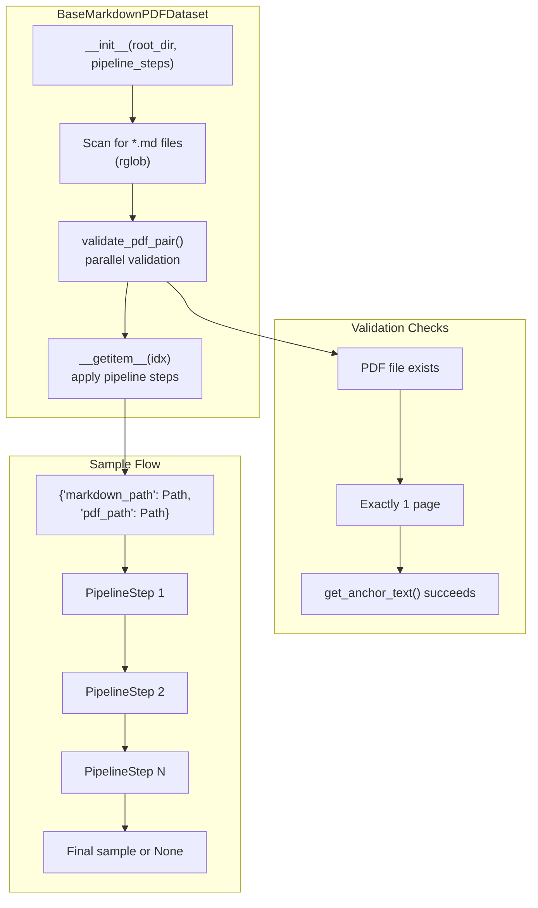
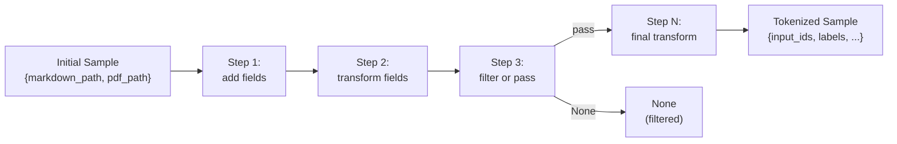
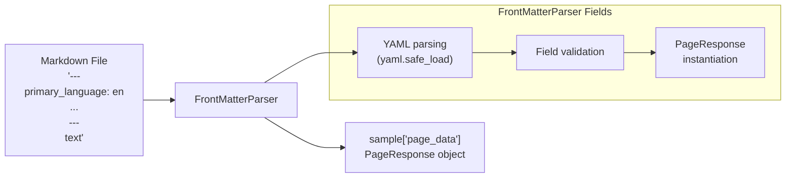
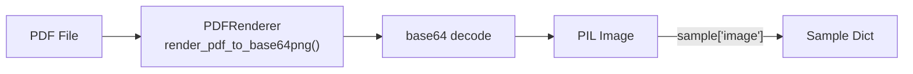
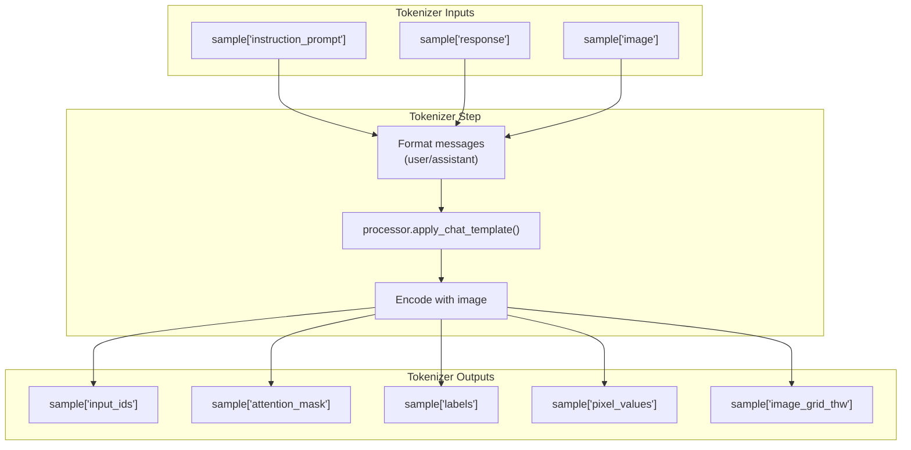
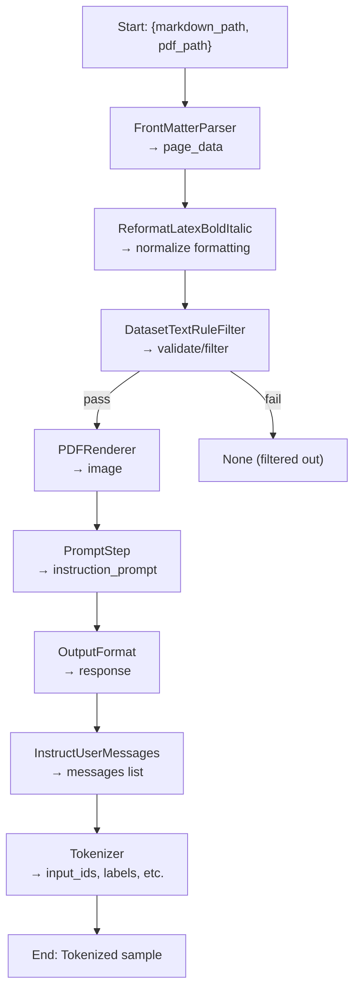
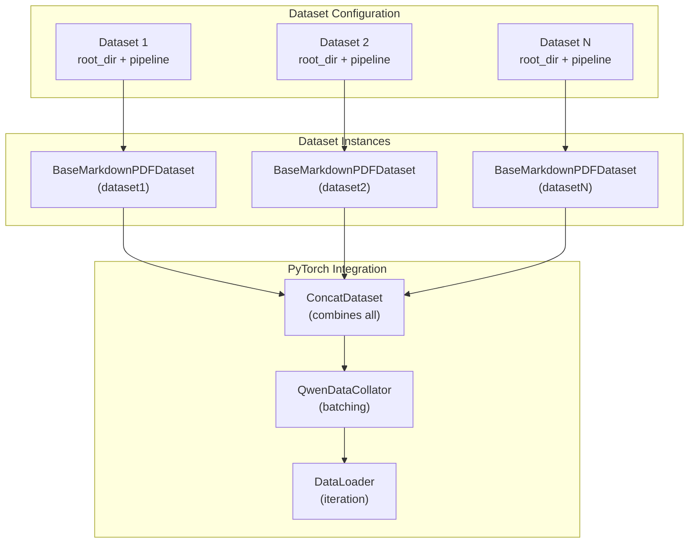

<!-- source: DeepWiki mcp.deepwiki.com · repo allenai/olmocr · page 5.1 Training Data Pipeline · fetched 2026-10-26 -->

# Training Data Pipeline

<details>
<summary>Relevant source files</summary>

The following files were used as context for generating this wiki page:

- [olmocr/train/config.py](olmocr/train/config.py)
- [olmocr/train/configs/v0.4.0/qwen25_vl_olmocrv4_rotation_1epoch_localtest.yaml](olmocr/train/configs/v0.4.0/qwen25_vl_olmocrv4_rotation_1epoch_localtest.yaml)
- [olmocr/train/dataloader.py](olmocr/train/dataloader.py)
- [olmocr/train/muon.py](olmocr/train/muon.py)
- [olmocr/train/train.py](olmocr/train/train.py)

</details>


## Purpose and Scope

This document describes the training data pipeline in olmOCR, which transforms raw markdown-PDF pairs into tokenized training samples ready for model consumption. The pipeline is built around the `BaseMarkdownPDFDataset` class and a modular `PipelineStep` architecture that applies sequential transformations to each sample.

For information about data augmentation and filtering techniques, see [Data Augmentation and Filtering](#5.2). For the supervised fine-tuning process that consumes this pipeline's output, see [Supervised Fine-Tuning](#5.3). For dataset and pipeline configuration details, see [Training Configurations and Recipes](#5.5).

---

## Dataset Architecture

### BaseMarkdownPDFDataset

The `BaseMarkdownPDFDataset` class serves as the foundation for all training datasets. It loads markdown files with corresponding single-page PDF files, validates them in parallel, and applies a configurable sequence of pipeline steps.

**Key Responsibilities:**
- Recursively scan directories for `.md` files
- Validate that each markdown file has a corresponding `.pdf` file
- Verify PDFs are single-page and support document anchoring
- Apply pipeline steps sequentially to transform samples
- Filter out invalid or skipped samples



**Sources:** [olmocr/train/dataloader.py:102-188]()

The validation process uses `ProcessPoolExecutor` with 8 workers to parallelize PDF validation checks. Each validation ensures the PDF can be read, has exactly one page, and supports document anchoring via `get_anchor_text()`.

**Sources:** [olmocr/train/dataloader.py:50-90](), [olmocr/train/dataloader.py:121-162]()

---

## PipelineStep Architecture

### Abstract Base Class

All pipeline transformations inherit from the `PipelineStep` abstract base class, which defines a single method `__call__` that processes a sample dictionary.

```python
@dataclass(frozen=True, slots=True)
class PipelineStep(ABC):
    """Abstract base class for pipeline steps."""
    
    @abstractmethod
    def __call__(self, sample: Sample) -> Optional[Sample]:
        """Process a sample and return the modified sample, or None to skip this sample."""
        ...
```

**Sources:** [olmocr/train/dataloader.py:92-99]()

### Pipeline Execution Model

When `BaseMarkdownPDFDataset.__getitem__()` is called, it executes the pipeline steps sequentially:

1. Start with a basic sample: `{'markdown_path': Path, 'pdf_path': Path}`
2. Apply each pipeline step in order
3. If any step returns `None`, the entire sample is skipped (filtered out)
4. Each step can read from and write to the sample dictionary
5. Return the final transformed sample or `None`



**Sources:** [olmocr/train/dataloader.py:166-187]()

---

## Core Pipeline Steps

### Data Loading and Parsing

#### FrontMatterParser

Extracts and parses YAML front matter from markdown files. The front matter contains metadata about the document including language, rotation status, and content structure.



**Configuration:**
- `front_matter_class`: Optional dataclass type (typically `PageResponse`)

**Key Fields Extracted:**
- `primary_language`: Document language
- `is_rotation_valid`: Whether rotation is correct
- `rotation_correction`: Degrees to rotate (0, 90, 180, 270)
- `is_table`: Whether page contains tables
- `is_diagram`: Whether page contains diagrams
- `natural_text`: The main text content

**Sources:** [olmocr/train/dataloader.py:190-286]()

#### PDFRenderer

Converts PDF pages to images using poppler-utils via `render_pdf_to_base64png()`. The image is stored in PIL Image format for further processing.



**Configuration:**
- `target_longest_image_dim`: Target size for longest dimension (default: 1024)

**Sources:** [olmocr/train/dataloader.py:288-304](), [olmocr/data/renderpdf.py]()

---

### Prompting and Anchoring

#### StaticLengthDocumentAnchoring

Extracts raw text from the PDF using PDFReport engine to create document anchoring context. This provides the model with extracted text that can help with OCR accuracy.

**Configuration:**
- `target_anchor_text_len`: Target length for extracted text (default: 6000 characters)

**Output:**
- `sample['anchor_text']`: Extracted text string

**Sources:** [olmocr/train/dataloader.py:307-316](), [olmocr/prompts/anchor.py]()

#### Prompting Steps

Three prompt variants are available:

1. **FinetuningPrompt**: Basic prompt with document anchoring
   ```python
   sample['instruction_prompt'] = build_finetuning_prompt(sample['anchor_text'])
   ```
   **Sources:** [olmocr/train/dataloader.py:319-325]()

2. **NewYamlFinetuningPromptWithAnchoring**: Includes anchor text and requests YAML front matter output
   **Sources:** [olmocr/train/dataloader.py:328-339]()

3. **NewYamlFinetuningPromptWithNoAnchoring**: No anchor text, only requests YAML front matter output
   **Sources:** [olmocr/train/dataloader.py:342-348]()

---

### Output Formatting

#### FrontMatterOutputFormat

Formats the `PageResponse` object into YAML front matter format with markdown body.

**Output Example:**
```yaml
---
primary_language: en
is_rotation_valid: true
rotation_correction: 0
is_table: false
is_diagram: false
---
Document text content here...
```

**Sources:** [olmocr/train/dataloader.py:351-371]()

#### JSONOutputFormat

Alternative format that outputs structured JSON instead of YAML.

**Sources:** [olmocr/train/dataloader.py:374-394]()

---

### Normalization Steps

#### LatexBracketNormalizer

Normalizes LaTeX math delimiters to a consistent format:
- `$$...$$` → `\[...\]` (display math)
- `$...$` → `\(...\)` (inline math)

This normalization happens by creating a new `PageResponse` object since the dataclass is frozen.

**Sources:** [olmocr/train/dataloader.py:397-436]()

#### ReformatLatexBoldItalic

Converts LaTeX text formatting commands to markdown equivalents:
- `\textbf{...}` → `**...**` (bold)
- `\textit{...}` → `*...*` (italic)

The step preserves math equations by replacing them with placeholders during conversion, then restoring them afterward. It handles nested braces correctly.

**Sources:** [olmocr/train/dataloader.py:937-1035]()

---

### Tokenization

#### Tokenizer

Applies the Qwen processor's tokenizer to convert text and images into model inputs. This is typically the final step in the pipeline.



**Configuration:**
- `processor`: The AutoProcessor instance from transformers
- `masking_index`: Value for masked tokens in labels (default: -100)
- `end_of_message_token`: Token marking message boundaries (default: `<|im_end|>`)

**Label Masking:**
The tokenizer masks the instruction portion of the input, so the model only learns to predict the response. This is done by finding the `end_of_message_token` that marks the end of the user message and setting all previous tokens to `masking_index`.

**Sources:** [olmocr/train/dataloader.py:1057-1157]()

---

## Complete Pipeline Flow

### Typical Training Pipeline

A standard training pipeline follows this sequence:



**Sources:** [olmocr/train/configs/v0.4.0/qwen25_vl_olmocrv4_rotation_1epoch_localtest.yaml:32-48]()

### Pipeline Configuration

Pipelines are configured via YAML and instantiated through the `Config.get_pipeline_steps()` method:

```yaml
pipeline:
  - name: FrontMatterParser
    front_matter_class: PageResponse
  - name: ReformatLatexBoldItalic
  - name: DatasetTextRuleFilter
  - name: PDFRenderer
    target_longest_image_dim: 1288
  - name: NewYamlFinetuningPromptWithNoAnchoring
  - name: FrontMatterOutputFormat
  - name: InstructUserMessages
    prompt_first: true
  - name: Tokenizer
    masking_index: -100
    end_of_message_token: "<|im_end|>"
```

The `get_pipeline_steps()` method instantiates each step based on its name and configuration parameters.

**Sources:** [olmocr/train/config.py:366-491](), [olmocr/train/configs/v0.4.0/qwen25_vl_olmocrv4_rotation_1epoch_localtest.yaml:32-48]()

---

## Dataset Integration

### Multi-Dataset Training

Training can combine multiple datasets, each with its own pipeline configuration:



**Sources:** [olmocr/train/train.py:356-372]()

### QwenDataCollator

The `QwenDataCollator` handles batching of samples, including:
- Converting numpy arrays to tensors
- Filtering out `None` values (filtered samples)
- Truncating to `max_token_len` if specified
- Stacking tensors with proper padding

**Sources:** [olmocr/train/train.py:79-131]()

### DataLoader Configuration

Training and evaluation use separate dataloaders with different configurations:

**Training DataLoader:**
- Shuffled with epoch-specific seed
- Drops incomplete batches (`drop_last=True`)
- Uses worker seed initialization for reproducibility

**Evaluation DataLoader:**
- No shuffling
- Keeps all batches (`drop_last=False`)

**Sources:** [olmocr/train/train.py:252-289](), [olmocr/train/train.py:550-560]()

---

## Sample Data Structure Evolution

The following table shows how the sample dictionary evolves through a typical pipeline:

| After Step | Keys Added | Example Values |
|------------|-----------|----------------|
| Initial | `markdown_path`, `pdf_path` | `Path('/data/doc.md')`, `Path('/data/doc.pdf')` |
| FrontMatterParser | `markdown_content`, `page_data` | YAML text, `PageResponse(...)` |
| PDFRenderer | `image` | `PIL.Image` object |
| StaticLengthDocumentAnchoring | `anchor_text` | `"Extracted text from PDF..."` |
| FinetuningPrompt | `instruction_prompt` | `"Attached is one page..."` |
| FrontMatterOutputFormat | `response` | `"---\nprimary_language: en\n..."` |
| InstructUserMessages | `messages` | `[{'role': 'user', 'content': ...}, ...]` |
| Tokenizer | `input_ids`, `attention_mask`, `labels`, `pixel_values`, `image_grid_thw` | Numpy arrays/tensors |

**Sources:** [olmocr/train/dataloader.py:102-188](), [olmocr/train/dataloader.py:1057-1157]()

---

## Error Handling and Validation

### PDF Validation

During dataset initialization, each PDF is validated in parallel. Invalid PDFs are logged with reasons:

**Validation Failures:**
- PDF file missing or broken symlink
- Multiple pages (only single-page PDFs accepted)
- Failed to load with PdfReader
- Document anchoring extraction fails

**Sources:** [olmocr/train/dataloader.py:50-90]()

### Pipeline Filtering

Pipeline steps can filter out samples by returning `None`. Common filtering scenarios:

1. **DatasetTextRuleFilter**: Removes samples with markdown tables, malformed HTML, invalid math equations, or LaTeX commands outside math mode
2. **FilterOutRotatedDocuments**: Removes samples with incorrect rotation
3. **Tokenizer**: Can filter if tokenization fails

**Sources:** [olmocr/train/dataloader.py:500-520](), [olmocr/train/dataloader.py:523-934]()

### Collator Handling

The `QwenDataCollator` handles `None` samples gracefully by filtering them out before batching. If all samples in a batch are `None`, it returns `None` and the training loop skips that batch.

**Sources:** [olmocr/train/train.py:85-120](), [olmocr/train/train.py:632-634]()

---

