<!-- source: DeepWiki mcp.deepwiki.com · repo allenai/olmocr · page 5.2 Data Augmentation and Filtering · fetched 2026-10-26 -->

# Data Augmentation and Filtering

<details>
<summary>Relevant source files</summary>

The following files were used as context for generating this wiki page:

- [olmocr/train/config.py](olmocr/train/config.py)
- [olmocr/train/configs/v0.4.0/qwen25_vl_olmocrv4_rotation_1epoch_localtest.yaml](olmocr/train/configs/v0.4.0/qwen25_vl_olmocrv4_rotation_1epoch_localtest.yaml)
- [olmocr/train/dataloader.py](olmocr/train/dataloader.py)
- [olmocr/train/muon.py](olmocr/train/muon.py)
- [olmocr/train/train.py](olmocr/train/train.py)
- [tests/gnarly_pdfs/failing_anchor_pg4.pdf](tests/gnarly_pdfs/failing_anchor_pg4.pdf)
- [tests/test_dataloader.py](tests/test_dataloader.py)

</details>


This document describes the data augmentation and filtering pipeline steps used during model training to improve data quality and diversity. These steps are part of the `BaseMarkdownPDFDataset` processing pipeline that transforms raw markdown-PDF pairs into training samples.

For information about the overall training data pipeline architecture, see [Training Data Pipeline](#5.1). For supervised fine-tuning that uses these processed samples, see [Supervised Fine-Tuning](#5.3).

## Purpose and Scope

The augmentation and filtering system serves three primary functions:

1. **Augmentation**: Artificially increases training data diversity by applying random transformations (rotation, image degradation)
2. **Filtering**: Removes samples that contain problematic content (rotated documents, malformed tables, unsupported LaTeX)
3. **Normalization**: Standardizes representation (LaTeX bracket styles, text formatting) for consistency

All steps implement the `PipelineStep` abstract base class and can return `None` to skip a sample during training.

## Pipeline Step Architecture

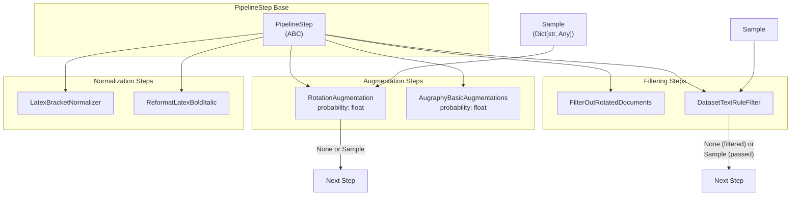

**Pipeline Step Interface**

Sources: [olmocr/train/dataloader.py:92-99]()

Each pipeline step must implement the `__call__` method that takes a sample dictionary and returns either:
- The modified sample dictionary (continue processing)
- `None` (skip this sample entirely)

The sample dictionary accumulates fields as it passes through steps, with typical fields including:
- `markdown_path`: Path to markdown file
- `pdf_path`: Path to PDF file
- `page_data`: Parsed PageResponse object
- `image`: PIL Image after rendering
- `anchor_text`: Document anchoring text

## Data Flow Through Augmentation and Filtering

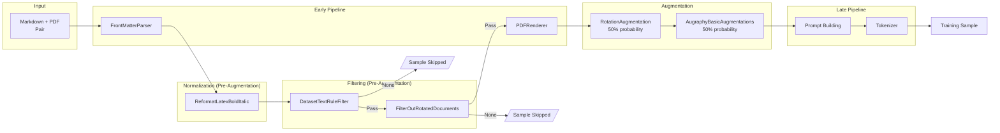

**Typical Ordering**

Sources: [olmocr/train/configs/v0.4.0/qwen25_vl_olmocrv4_rotation_1epoch_localtest.yaml:32-48]()

In practice, the typical ordering is:
1. Parse front matter (`FrontMatterParser`)
2. Normalize text formatting (`ReformatLatexBoldItalic`)
3. Filter problematic content (`DatasetTextRuleFilter`)
4. Filter rotation issues (`FilterOutRotatedDocuments` - optional)
5. Render PDF to image (`PDFRenderer`)
6. Apply augmentations (`RotationAugmentation`, `AugraphyBasicAugmentations`)
7. Continue with prompting and tokenization

## Augmentation Steps

### RotationAugmentation

The `RotationAugmentation` step randomly rotates images to teach the model rotation correction.

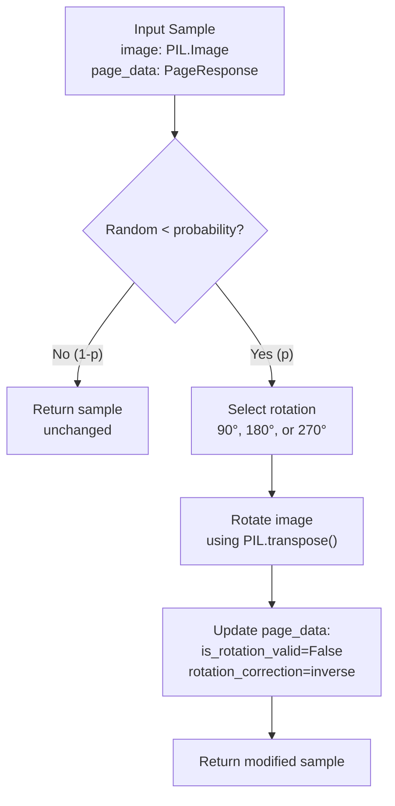

**Implementation Details**

Sources: [olmocr/train/dataloader.py:440-497]()

The augmentation works as follows:

1. **Probability Check**: With configured probability (default 0.5), decides whether to apply rotation
2. **Random Rotation**: Randomly selects 90, 180, or 270 degrees clockwise rotation
3. **Image Transform**: Applies rotation using PIL's `Image.transpose()` method
4. **Metadata Update**: Updates the `PageResponse` object:
   - Sets `is_rotation_valid=False` to indicate rotation is incorrect
   - Sets `rotation_correction` to the inverse rotation needed to fix it
   - Example: 90° rotation applied → 270° correction needed

**Usage Example**

| Configuration | Effect |
|--------------|--------|
| `probability: 0.5` | 50% of samples get rotated |
| `probability: 0.002` | 0.2% of samples get rotated (sparse augmentation) |
| `probability: 0.0` | No rotation augmentation |

Sources: [olmocr/train/config.py:134-138]()

### AugraphyBasicAugmentations

The `AugraphyBasicAugmentations` step applies realistic document image degradations using the Augraphy library.

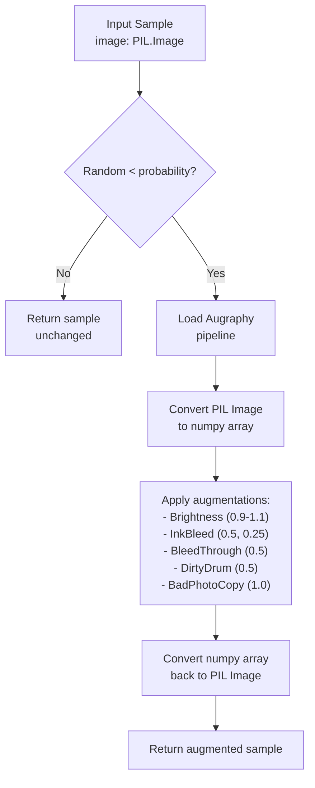

**Augmentation Pipeline**

Sources: [olmocr/train/dataloader.py:1044-1198]()

The following augmentations are applied sequentially when triggered:

| Augmentation | Probability | Parameters | Effect |
|-------------|-------------|------------|---------|
| `Brightness` | 1.0 | range=(0.9, 1.1) | Varies overall image brightness |
| `InkBleed` | 0.5 | intensity_range=(0.1, 0.3), kernel_size=(5,5) | Simulates ink bleeding through paper |
| `BleedThrough` | 0.5 | intensity_range=(0.1, 0.3) | Simulates content from back of page |
| `DirtyDrum` | 0.5 | Multiple frequency/amplitude params | Adds periodic scanning artifacts |
| `BadPhotoCopy` | 1.0 | noise_type=0, noise_side="random" | Simulates photocopy noise |

**Configuration**

The step is configured with a single probability value that determines whether any augmentation is applied at all:

```yaml
- name: AugraphyBasicAugmentations
  probability: 0.5  # 50% chance of applying augmentation pipeline
```

Sources: [olmocr/train/config.py:142-147]()

## Filtering Steps

### FilterOutRotatedDocuments

Removes samples where the document has rotation issues detected in the metadata.

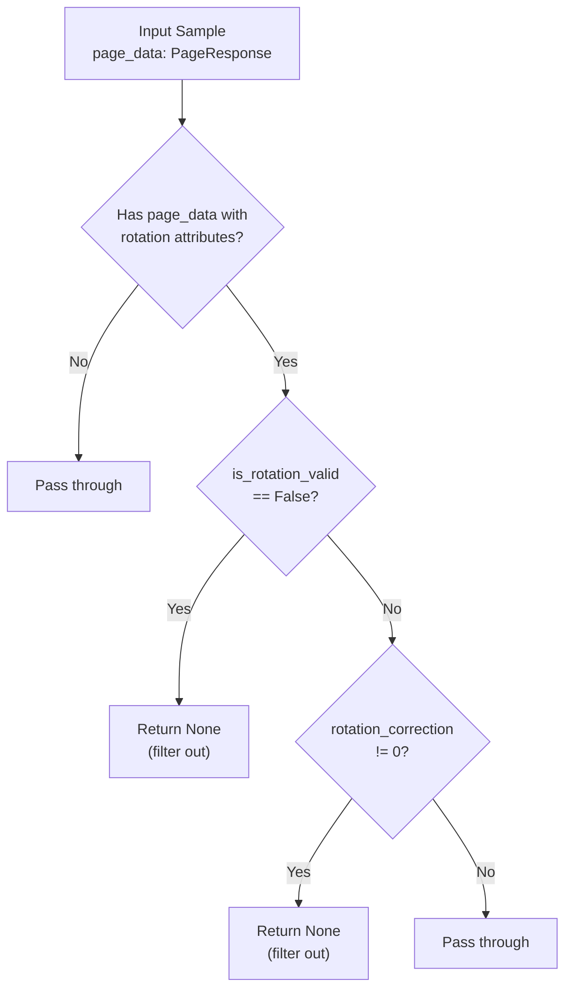

**Filtering Logic**

Sources: [olmocr/train/dataloader.py:501-521]()

This filter removes samples where:
- `is_rotation_valid` is `False` (document orientation is incorrect)
- `rotation_correction` is not `0` (rotation correction is needed)

This is typically used when training on clean, properly-oriented documents and you want to exclude naturally-rotated documents. Note that this filter should typically be applied *before* `RotationAugmentation` to avoid filtering out intentionally augmented samples.

**Configuration**

```yaml
- name: FilterOutRotatedDocuments
  enabled: true  # or false to disable
```

Sources: [olmocr/train/config.py:120-123]()

### DatasetTextRuleFilter

Filters out samples with problematic text content that would be difficult to train on or represent edge cases.

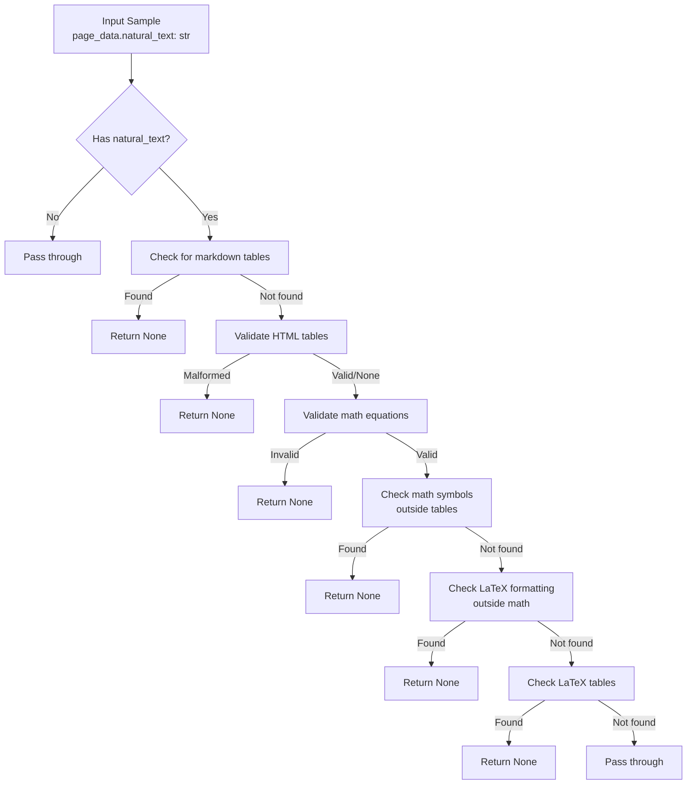

**Filtering Rules**

Sources: [olmocr/train/dataloader.py:524-934]()

The filter checks for and removes samples containing:

| Rule | Detection Method | Reason for Filtering |
|------|------------------|---------------------|
| Markdown tables | Pipe-separated table patterns with header separators | Not supported in output format |
| Malformed HTML tables | HTML parser validation, mismatched tags | Would cause parsing errors |
| Invalid math equations | KaTeX rendering test | Would fail to render correctly |
| Math symbols outside tables | Unicode symbol detection (∈, ∉, ⊂, etc.) | Indicates complex mathematical content |
| LaTeX formatting outside math | Detection of `\textit`, `\textbf`, `\begin{itemize}`, etc. | Indicates source LaTeX not properly converted |
| LaTeX table environments | Detection of `\begin{table}`, `\begin{tabular}` | Source LaTeX not properly processed |

**Math Symbol Detection**

Sources: [olmocr/train/dataloader.py:558-639]()

The filter detects over 40 mathematical Unicode symbols including:
- Set theory: ∈, ∉, ⊂, ⊃, ⊆, ⊇, ∅, ∪, ∩
- Logic: ∀, ∃, ¬
- Calculus: ∂, ∇, ∫, ∬, ∭, ∮, ∑, ∏
- Relations: ⊥, ≅, ≊, ≋

These symbols outside of HTML table cells indicate complex mathematical content that may be difficult to represent accurately.

**LaTeX Command Detection**

Sources: [olmocr/train/dataloader.py:662-728]()

The filter detects LaTeX commands outside of math equations including:
- Lists: `\begin{itemize}`, `\begin{enumerate}`, `\item`
- Figures: `\begin{figure}`, `\includegraphics`, `\caption`
- Formatting: `\textit`, `\textbf`
- Math environments: `\begin{equation}`, `\begin{align}`, `\frac`
- Citations: `\cite`

**Configuration**

```yaml
- name: DatasetTextRuleFilter
  enabled: true
```

Sources: [olmocr/train/config.py:127-130]()

## Normalization Steps

### LatexBracketNormalizer

Normalizes LaTeX equation delimiters to a consistent format.

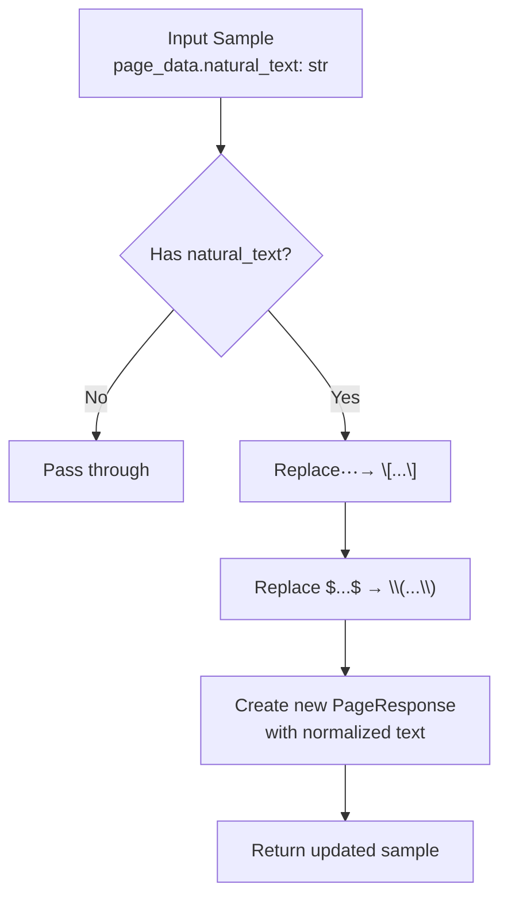

**Normalization Rules**

Sources: [olmocr/train/dataloader.py:398-436]()

The normalizer performs the following transformations:

| Input Format | Output Format | Type |
|-------------|--------------|------|
| `$$...$$` | `\[...\]` | Display math |
| `$...$` | `\(...\)` | Inline math |

The transformation is done using regex patterns with the `re.DOTALL` flag to handle multi-line equations. Display math is processed first to avoid incorrectly matching the inner `$` symbols.

**Example**

```
Input:  "The equation $x^2 + y^2 = z^2$ and $$\int_0^\infty e^{-x^2} dx$$"
Output: "The equation \(x^2 + y^2 = z^2\) and \[\int_0^\infty e^{-x^2} dx\]"
```

**Configuration**

```yaml
- name: LatexBracketNormalizer
  enabled: true
```

Sources: [olmocr/train/config.py:88-91]()

### ReformatLatexBoldItalic

Converts LaTeX text formatting commands to Markdown equivalents outside of math equations.

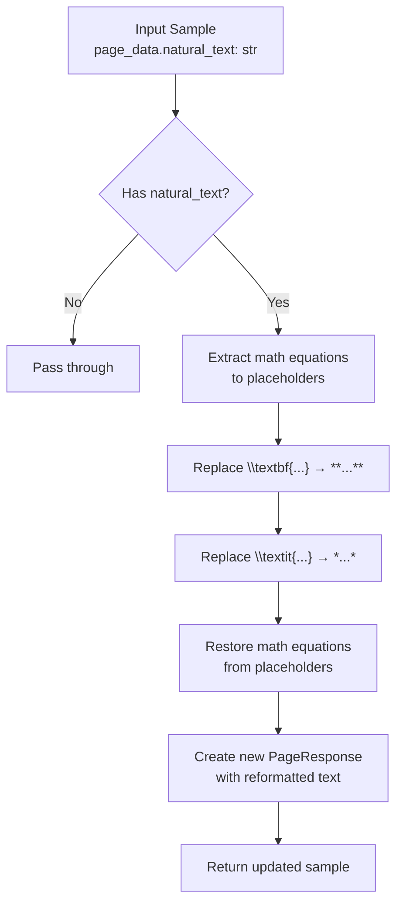

**Transformation Logic**

Sources: [olmocr/train/dataloader.py:938-1042]()

The normalizer performs the following steps:

1. **Math Preservation**: Extracts all math equations using patterns:
   - `$$...$$` (display math)
   - `\(...\)` (inline math with parentheses)
   - `\[...\]` (display math with brackets)
   
2. **LaTeX to Markdown**: Converts text formatting commands:
   - `\textbf{content}` → `**content**` (bold)
   - `\textit{content}` → `*content*` (italic)
   
3. **Math Restoration**: Restores the original math equations

The conversion handles nested braces correctly by tracking brace depth.

**Example**

```
Input:  "The \textbf{important} equation is $\textbf{F} = ma$ where \textit{m} is mass."
Output: "The **important** equation is $\textbf{F} = ma$ where *m* is mass."
```

Note that `\textbf{F}` inside the math equation is preserved, while `\textbf{important}` outside is converted.

**Configuration**

```yaml
- name: ReformatLatexBoldItalic
  enabled: true
```

Sources: [olmocr/train/config.py:95-98]()

## Configuration and Integration

### YAML Configuration Structure

Pipeline steps are configured in training configuration files using YAML:

```yaml
dataset:
  train:
    - name: dataset_name
      root_dir: /path/to/data
      pipeline:
        - name: FrontMatterParser
          front_matter_class: PageResponse
        - name: ReformatLatexBoldItalic
        - name: DatasetTextRuleFilter
        - name: FilterOutRotatedDocuments
        - name: PDFRenderer
          target_longest_image_dim: 1288
        - name: RotationAugmentation
          probability: 0.002
        - name: AugraphyBasicAugmentations
          probability: 0.5
        - name: NewYamlFinetuningPromptWithNoAnchoring
        - name: FrontMatterOutputFormat
        - name: Tokenizer
          masking_index: -100
```

Sources: [olmocr/train/configs/v0.4.0/qwen25_vl_olmocrv4_rotation_1epoch_localtest.yaml:29-60]()

### Pipeline Step Instantiation

The `Config.get_pipeline_steps()` method instantiates pipeline steps from configuration:

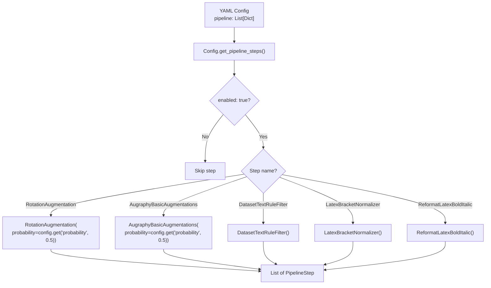

Sources: [olmocr/train/config.py:366-491]()

The instantiation process:
1. Iterates through pipeline configuration list
2. Checks if step is enabled (default: true)
3. Matches step name to implementation class
4. Extracts parameters from configuration dictionary
5. Instantiates the step with appropriate parameters
6. Returns list of instantiated `PipelineStep` objects

### Integration with Dataset Loading

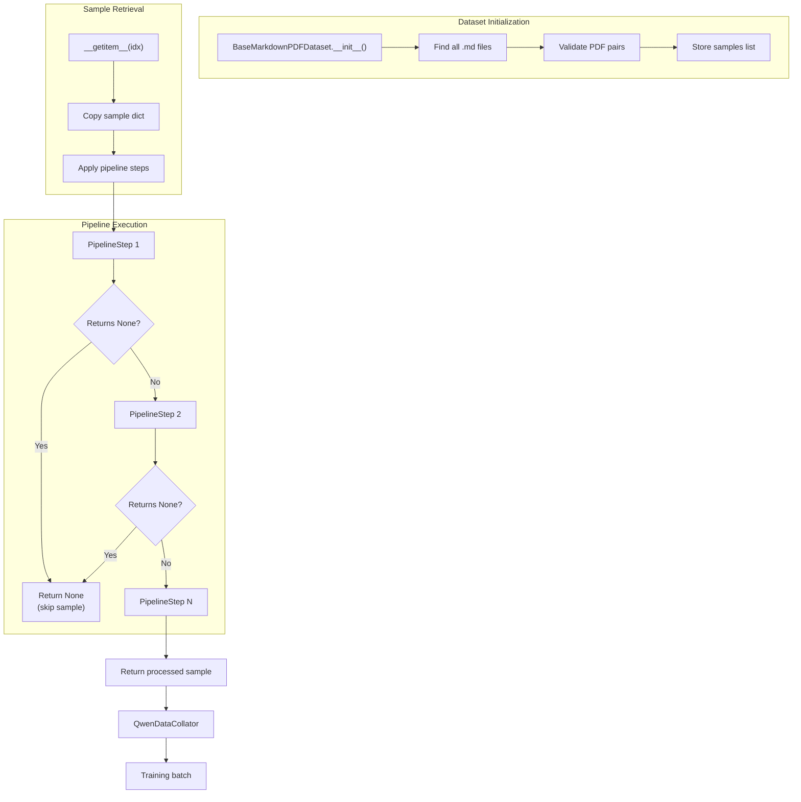

Sources: [olmocr/train/dataloader.py:102-187](), [olmocr/train/train.py:79-131]()

The integration flow:

1. **Initialization**: `BaseMarkdownPDFDataset` receives pipeline steps list and stores it
2. **Sample Retrieval**: When `__getitem__()` is called, it applies all pipeline steps sequentially
3. **Filtering**: If any step returns `None`, the entire sample is skipped (returns `None`)
4. **Collation**: `QwenDataCollator` filters out `None` samples before batching

## Testing

The test suite validates augmentation and filtering behavior:

```mermaid
graph TB
    subgraph "Test Categories"
        TestFilt["DatasetTextRuleFilter Tests"]
        TestRot["FilterOutRotatedDocuments Tests"]
        TestLatex["LatexBracketNormalizer Tests"]
        TestFmt["ReformatLatexBoldItalic Tests"]
    end
    
    subgraph "Test Scenarios"
        TestFilt --> MarkdownTables["Markdown table detection"]
        TestFilt --> HTMLValidation["HTML table validation"]
        TestFilt --> MathEquations["Math equation validation"]
        TestFilt --> MathSymbols["Math symbol detection"]
        TestFilt --> LatexCommands["LaTeX command detection"]
        
        TestRot --> ValidRotation["Valid rotation passes"]
        TestRot --> InvalidRotation["Invalid rotation filtered"]
        
        TestLatex --> DollarConvert["$ to \\( conversion"]
        TestLatex --> DoubleDollarConvert["$$ to \\[ conversion"]
        
        TestFmt --> BoldConvert["\\textbf to ** conversion"]
        TestFmt --> ItalicConvert["\\textit to * conversion"]
        TestFmt --> MathPreserve["Math equation preservation"]
    end
```

Sources: [tests/test_dataloader.py:18-738]()

Key test coverage includes:
- Markdown table detection with various formats
- Malformed HTML table rejection
- Math equation rendering validation
- Mathematical symbol detection
- LaTeX command detection outside equations
- Rotation filtering logic
- LaTeX delimiter normalization
- Text formatting conversion with math preservation

---

