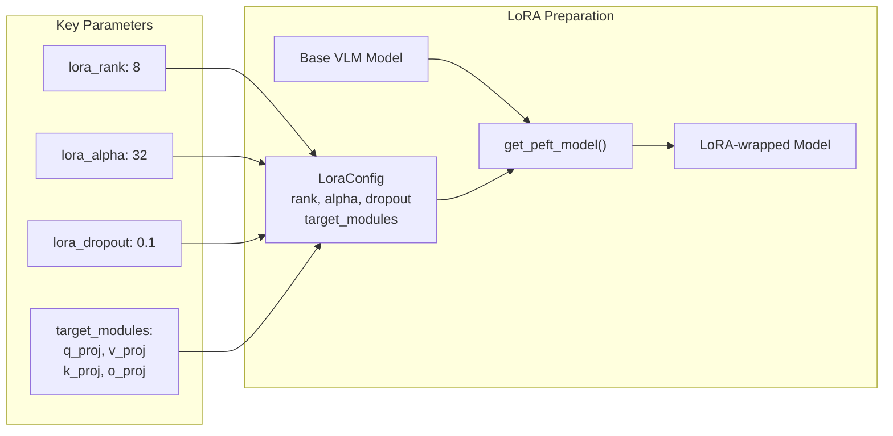
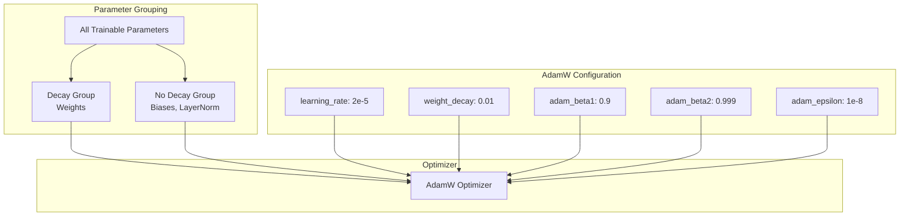
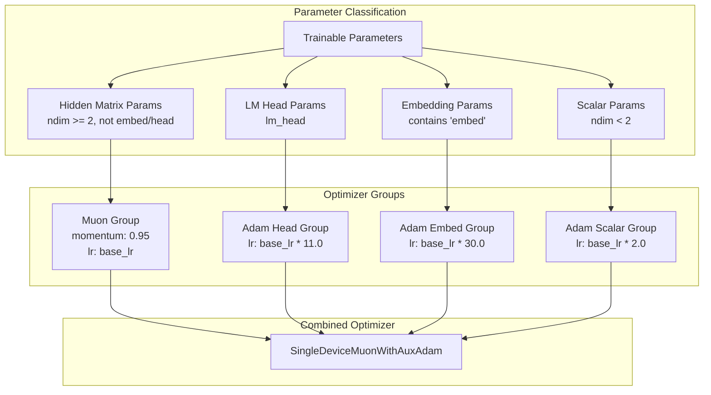
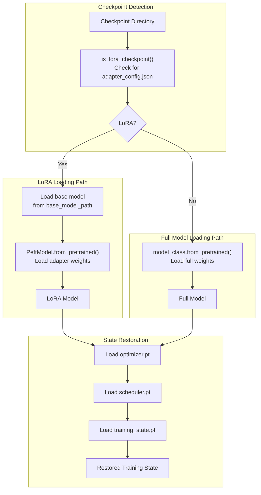
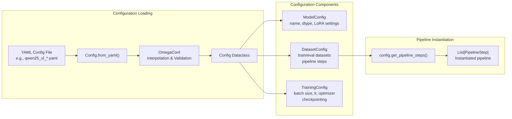

<!-- source: DeepWiki mcp.deepwiki.com · repo allenai/olmocr · page 5.3 Supervised Fine-Tuning · fetched 2026-10-26 -->

# Supervised Fine-Tuning

<details>
<summary>Relevant source files</summary>

The following files were used as context for generating this wiki page:

- [olmocr/train/config.py](olmocr/train/config.py)
- [olmocr/train/configs/v0.4.0/qwen25_vl_olmocrv4_rotation_1epoch_localtest.yaml](olmocr/train/configs/v0.4.0/qwen25_vl_olmocrv4_rotation_1epoch_localtest.yaml)
- [olmocr/train/dataloader.py](olmocr/train/dataloader.py)
- [olmocr/train/muon.py](olmocr/train/muon.py)
- [olmocr/train/train.py](olmocr/train/train.py)

</details>


## Purpose and Scope

Supervised Fine-Tuning (SFT) is the primary training method for adapting vision-language models (VLMs) to the OCR task. The SFT training loop takes pairs of PDF images and their corresponding markdown ground truth text, and trains the model to predict the text output given the image input.

This page covers the implementation of the supervised training loop in [olmocr/train/train.py](), including model initialization, optimizer configuration, the training loop mechanics, checkpointing, and evaluation. For information about how training data is prepared and loaded, see page 5.1. For reinforcement learning training with GRPO, see page 5.4. For model configuration options and training recipes, see page 5.5.

---

## Training Script Architecture

The SFT system is implemented in [olmocr/train/train.py]() as a custom training loop using PyTorch. Unlike HuggingFace Trainer-based approaches, this implementation provides fine-grained control over training mechanics including gradient accumulation, checkpointing, and multi-epoch data shuffling.

```mermaid
graph TB
    subgraph "Entry Point"
        MainFunc["main()<br/>train.py:292"]
    end
    
    subgraph "Configuration Loading"
        ConfigLoad["Config.from_yaml()<br/>config.py:298"]
        ConfigValidate["config.validate()<br/>config.py:338"]
    end
    
    subgraph "Model Setup"
        LoadProcessor["AutoProcessor.from_pretrained()<br/>train.py:320"]
        LoadModel["Qwen2_5_VLForConditionalGeneration<br/>train.py:334-341"]
        ApplyLoRA["prepare_lora_model()<br/>train.py:39-71"]
        EnableGradCheck["gradient_checkpointing_enable()<br/>train.py:354"]
    end
    
    subgraph "Dataset Creation"
        CreateTrainDS["BaseMarkdownPDFDataset<br/>train.py:364"]
        CreateEvalDS["BaseMarkdownPDFDataset<br/>train.py:385"]
        ConcatDS["ConcatDataset<br/>train.py:371"]
    end
    
    subgraph "Training Components"
        SetupOptim["AdamW or Muon<br/>train.py:446-500"]
        SetupScheduler["get_scheduler()<br/>train.py:509-515"]
        DataCollator["QwenDataCollator<br/>train.py:79-131"]
        CreateDataLoader["create_train_dataloader()<br/>train.py:252-289"]
    end
    
    subgraph "Training Loop"
        TrainLoop["Training Loop<br/>train.py:610-711"]
        GradAccum["Gradient Accumulation<br/>train.py:638-660"]
        Logging["Log Metrics<br/>train.py:669-682"]
        Evaluation["evaluate_model()<br/>train.py:216-249"]
        Checkpointing["save_checkpoint()<br/>train.py:134-173"]
    end
    
    MainFunc --> ConfigLoad
    ConfigLoad --> ConfigValidate
    ConfigValidate --> LoadProcessor
    LoadProcessor --> LoadModel
    LoadModel --> ApplyLoRA
    ApplyLoRA --> EnableGradCheck
    EnableGradCheck --> CreateTrainDS
    CreateTrainDS --> CreateEvalDS
    CreateEvalDS --> ConcatDS
    ConcatDS --> SetupOptim
    SetupOptim --> SetupScheduler
    SetupScheduler --> DataCollator
    DataCollator --> CreateDataLoader
    CreateDataLoader --> TrainLoop
    TrainLoop --> GradAccum
    GradAccum --> Logging
    Logging --> Evaluation
    Evaluation --> Checkpointing
    Checkpointing --> TrainLoop
```



**Sources:** [olmocr/train/train.py:1-732]()

---

## Model Initialization

### Base Model Loading

The training script supports multiple Qwen VLM variants, automatically detecting the model architecture based on the model name string:

| Model Family | Class | Detection Pattern |
|--------------|-------|-------------------|
| Qwen2.5-VL | `Qwen2_5_VLForConditionalGeneration` | "qwen2.5-vl" or "olmocr-2-7b-1025" |
| Qwen2-VL | `Qwen2VLForConditionalGeneration` | "qwen2-vl" |

Models are loaded with configurable initialization parameters including `torch_dtype`, `device_map`, `attn_implementation` (for flash attention), and `trust_remote_code` flags.

**Sources:** [olmocr/train/train.py:324-341]()

### LoRA Configuration

LoRA (Low-Rank Adaptation) allows parameter-efficient fine-tuning by training small adapter matrices rather than full model weights. The `prepare_lora_model()` function wraps the base model with PEFT LoRA adapters:



The function also handles optional `modules_to_save` for training additional non-LoRA layers and ensures proper model configuration for checkpoint saving.

**Sources:** [olmocr/train/train.py:39-71](), [olmocr/train/config.py:189-195]()

---

## Optimizer Configuration

### AdamW Optimizer

The default optimizer is AdamW with weight decay handling for different parameter groups:



Parameters containing "bias" or "LayerNorm.weight" are excluded from weight decay to prevent regularization of these critical components.

**Sources:** [olmocr/train/train.py:446-463]()

### Muon Optimizer

Muon (MomentUm Orthogonalized by Newton-schulz) is an alternative optimizer that applies orthogonalization to weight matrices. The implementation uses `SingleDeviceMuonWithAuxAdam` which combines Muon for hidden layer weights with AdamW for embeddings, scalars, and the LM head:



Different learning rate multipliers are applied to different parameter types based on empirical findings about optimal step sizes for various components.

**Sources:** [olmocr/train/train.py:464-498](), [olmocr/train/muon.py:232-290]()

---

## Data Collation

The `QwenDataCollator` handles batching of samples from the dataset, converting numpy arrays to tensors and optionally truncating sequences:

| Field | Type | Processing |
|-------|------|------------|
| `input_ids` | LongTensor | Convert from numpy, truncate to max_token_len |
| `attention_mask` | LongTensor | Convert from numpy, truncate to max_token_len |
| `labels` | LongTensor | Convert from numpy, truncate to max_token_len |
| `pixel_values` | FloatTensor | Convert from numpy, stack into batch |
| `image_grid_thw` | LongTensor | Convert from numpy, stack into batch |

The collator filters out `None` samples (which may be returned by dataset filtering steps) and returns `None` if all samples in a batch are filtered out.

**Sources:** [olmocr/train/train.py:79-131]()

---

## Training Loop

### Epoch-Based Data Shuffling

The training loop implements proper multi-epoch training with different data shuffling for each epoch. The `create_train_dataloader()` function at [olmocr/train/train.py:252-289]() creates a new DataLoader with an epoch-specific random seed to ensure each epoch has a different shuffle order. This is critical for multi-epoch training as it prevents the model from overfitting to specific batch orderings.

The seed generation logic uses the configured `data_seed` plus the current epoch number:

```python
epoch_generator.manual_seed(config.training.data_seed + epoch_num)
```

When resuming from a checkpoint, the training loop recreates the dataloader with the correct epoch number, then skips the appropriate number of batches to resume from the exact position within that epoch. This ensures reproducible training across interruptions.

**Sources:** [olmocr/train/train.py:252-289](), [olmocr/train/train.py:541-548](), [olmocr/train/train.py:582-605]()

### Gradient Accumulation and Updates

The training loop accumulates gradients across multiple micro-batches before performing an optimizer step:

```mermaid
sequenceDiagram
    participant Loop as "Training Loop"
    participant Model as "VLM Model"
    participant Optimizer as "Optimizer"
    participant Scheduler as "LR Scheduler"
    
    loop For each batch
        Loop->>Model: Forward pass with autocast(bfloat16)
        Model-->>Loop: Loss
        Loop->>Loop: loss / gradient_accumulation_steps
        Loop->>Model: loss.backward()
        Loop->>Loop: Increment samples_seen
        
        alt samples_seen % samples_per_step == 0
            Loop->>Model: clip_grad_norm_(max_grad_norm)
            Loop->>Optimizer: optimizer.step()
            Loop->>Scheduler: lr_scheduler.step()
            Loop->>Optimizer: optimizer.zero_grad()
            Loop->>Loop: Increment global_step
        end
        
        alt global_step % logging_steps == 0
            Loop->>Loop: Log metrics to WandB
        end
        
        alt global_step % eval_steps == 0
            Loop->>Loop: Evaluate on eval datasets
        end
        
        alt global_step % save_steps == 0
            Loop->>Loop: Save checkpoint
        end
    end
```

The loop tracks both `samples_seen` (total training samples processed) and `global_step` (number of optimizer updates) for accurate resumption and scheduling. The condition for performing an optimizer step is:

```python
if samples_seen % samples_per_step == 0 or samples_seen >= max_train_samples:
```

where `samples_per_step = per_device_train_batch_size * gradient_accumulation_steps`. This ensures gradient updates occur at the correct intervals and that a final update is performed at the end of training even if it doesn't align with a perfect accumulation boundary.

**Sources:** [olmocr/train/train.py:610-711](), [olmocr/train/train.py:503-506](), [olmocr/train/train.py:651-660]()

### Mixed Precision Training

All forward passes use automatic mixed precision (AMP) with bfloat16:

```python
with autocast(device_type="cuda", enabled=True, dtype=torch.bfloat16):
    outputs = model(**batch)
```

This reduces memory usage and accelerates training on modern GPUs while maintaining numerical stability.

**Sources:** [olmocr/train/train.py:638-640]()

---

## Checkpointing System

### Checkpoint Saving

The `save_checkpoint()` function persists the complete training state to enable resumption:

| Component | File | Contents |
|-----------|------|----------|
| Model weights | `adapter_config.json`, `adapter_model.bin` (LoRA) or model shards | Full model or LoRA adapter weights |
| Optimizer state | `optimizer.pt` | Momentum buffers, learning rate state |
| Scheduler state | `scheduler.pt` | Current learning rate schedule position |
| Training state | `training_state.pt` | `epoch`, `global_step`, `samples_seen`, `best_metric` |

Checkpoints are automatically pruned based on `save_total_limit` to prevent excessive disk usage.

**Sources:** [olmocr/train/train.py:134-173]()

### Checkpoint Loading and Resumption

The `load_checkpoint()` function handles both full checkpoints and LoRA checkpoints:



When resuming, the training loop skips already-processed batches within the current epoch to resume from the exact position:

```python
batches_to_skip = samples_to_skip // config.training.per_device_train_batch_size
for _ in range(batches_to_skip):
    next(epoch_iterator)
```

**Sources:** [olmocr/train/train.py:176-213](), [olmocr/train/train.py:582-605]()

---

## Evaluation

The `evaluate_model()` function runs the model on all configured evaluation datasets and computes average loss:

```mermaid
graph TB
    subgraph "Evaluation Process"
        EvalStart["evaluate_model()"]
        ModelEval["model.eval()"]
        
        subgraph "Per Dataset"
            DatasetLoop["For each eval dataset"]
            BatchLoop["For each batch"]
            Forward["Forward pass (no_grad)"]
            AccumLoss["Accumulate loss"]
            AvgLoss["Average loss"]
        end
        
        CombineLoss["Combine losses<br/>across datasets"]
        LogMetrics["Log to WandB"]
        ModelTrain["model.train()"]
    end
    
    EvalStart --> ModelEval
    ModelEval --> DatasetLoop
    DatasetLoop --> BatchLoop
    BatchLoop --> Forward
    Forward --> AccumLoss
    AccumLoss --> AvgLoss
    AvgLoss --> CombineLoss
    CombineLoss --> LogMetrics
    LogMetrics --> ModelTrain
```



Evaluation metrics are logged with dataset-specific keys (e.g., `eval_processed_00_documents_eval_s2pdf_loss`) and an overall `eval_loss` computed as the average across all datasets.

**Sources:** [olmocr/train/train.py:216-249]()

---

## Configuration System Integration

Training configuration is managed through YAML files parsed into dataclass structures:



Example configuration structure:

```yaml
model:
  name: Qwen/Qwen2.5-VL-7B-Instruct
  use_lora: true
  lora_rank: 8
  
dataset:
  train:
    - root_dir: /path/to/training/data
      pipeline: [...]
  eval:
    - root_dir: /path/to/eval/data
      pipeline: [...]

training:
  num_train_epochs: 1
  learning_rate: 2e-5
  optim: adamw_torch
  save_steps: 500
```

**Sources:** [olmocr/train/config.py:275-491](), [olmocr/train/configs/v0.4.0/qwen25_vl_olmocrv4_rotation_1epoch_localtest.yaml:1-107]()

---

## Torch Compile Optimization

The training script optionally compiles the model using `torch.compile()` for accelerated training:

```python
model = torch.compile(
    model,
    backend=config.training.torch_compile_backend,  # "inductor"
    mode=config.training.torch_compile_mode,        # "default"
    fullgraph=config.training.torch_compile_fullgraph,
    dynamic=config.training.torch_compile_dynamic,
)
```

Compilation happens after model initialization but before the training loop, and can provide significant speedups on compatible hardware.

**Sources:** [olmocr/train/train.py:429-439]()

---

## Weights & Biases Integration

Training metrics are logged to Weights & Biases (WandB) when configured:

| Metric | Description | Log Frequency |
|--------|-------------|---------------|
| `train_loss` | Average training loss | Every `logging_steps` |
| `learning_rate` | Current learning rate | Every `logging_steps` |
| `epoch` | Current epoch (fractional) | Every `logging_steps` |
| `samples_seen` | Total samples processed | Every `logging_steps` |
| `eval_{dataset}_loss` | Loss on specific eval dataset | Every `eval_steps` |
| `eval_loss` | Average eval loss across datasets | Every `eval_steps` |

WandB initialization happens at the start of training with project name and run name from the configuration.

**Sources:** [olmocr/train/train.py:315-317](), [olmocr/train/train.py:669-682]()

---

