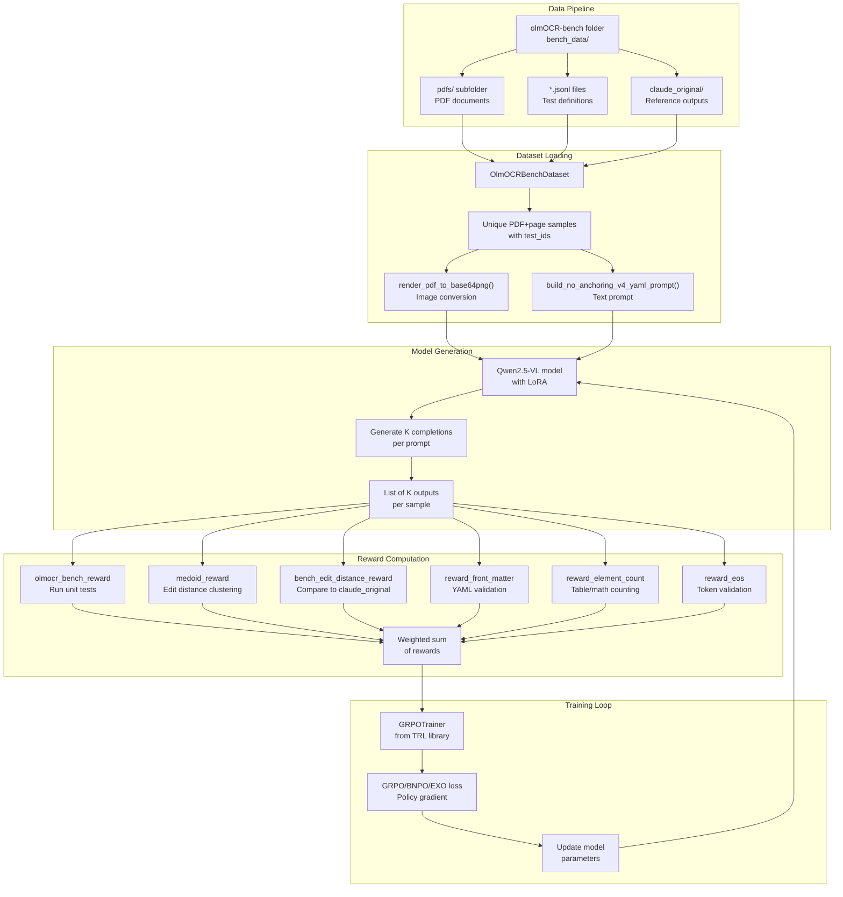
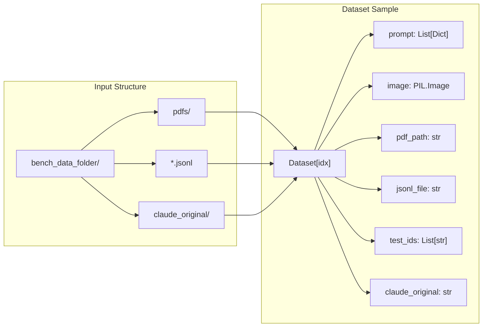
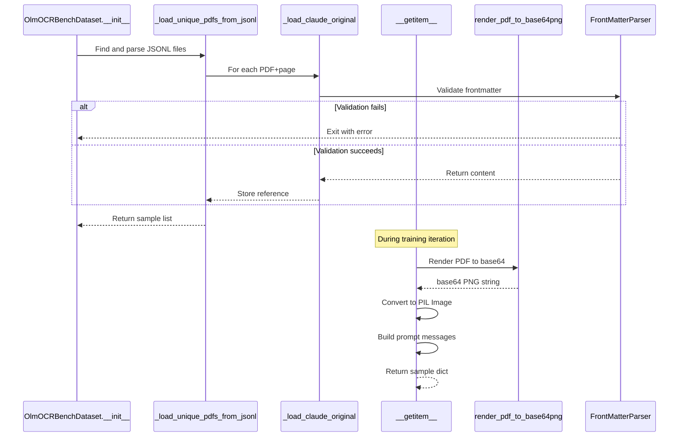
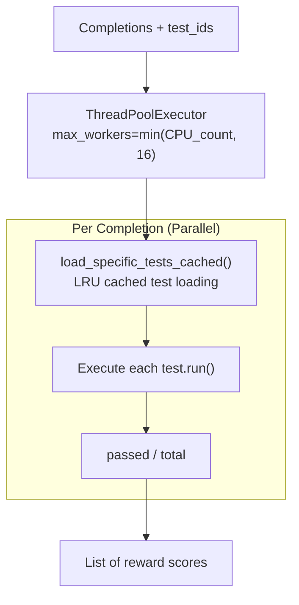
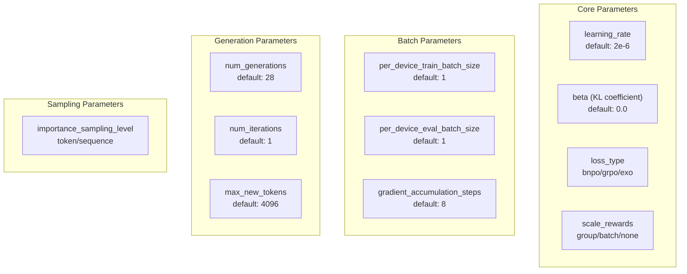
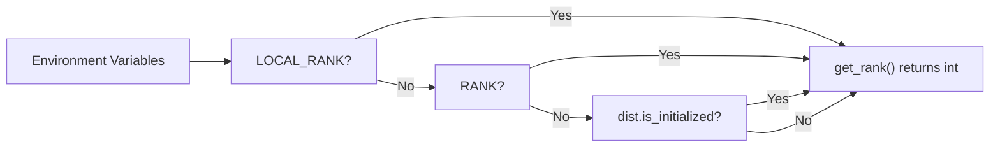
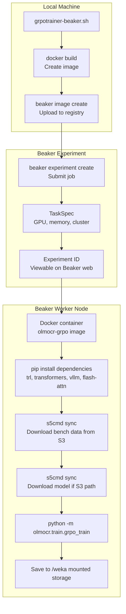

<!-- source: DeepWiki mcp.deepwiki.com · repo allenai/olmocr · page 5.4 GRPO Reinforcement Learning · fetched 2026-10-26 -->

# GRPO Reinforcement Learning

<details>
<summary>Relevant source files</summary>

The following files were used as context for generating this wiki page:

- [.dockerignore](.dockerignore)
- [.github/ISSUE_TEMPLATE/feature_request.yml](.github/ISSUE_TEMPLATE/feature_request.yml)
- [.github/actions/setup-venv/action.yml](.github/actions/setup-venv/action.yml)
- [.github/dependabot.yml](.github/dependabot.yml)
- [olmocr/train/grpo_train.py](olmocr/train/grpo_train.py)
- [scripts/train/grpotrainer-beaker.sh](scripts/train/grpotrainer-beaker.sh)
- [tests/test_grpo.py](tests/test_grpo.py)

</details>


## Purpose and Scope

This document covers the GRPO (Group Relative Policy Optimization) reinforcement learning training system for fine-tuning vision language models on OCR tasks. GRPO is a policy gradient method that optimizes the model based on multiple reward signals computed from benchmark tests, text similarity metrics, and structural validation. This page focuses on the dataset loader, reward function implementations, and training setup.

For supervised fine-tuning using direct target outputs, see [Supervised Fine-Tuning](#5.2). For data preparation pipelines that feed both training methods, see [Training Data Preparation](#5.1). For hyperparameters and training recipes, see [Model Configurations and Recipes](#5.4).

---

## System Architecture

The GRPO training system operates on benchmark data in the olmOCR-bench format, generating multiple completions per prompt and computing rewards based on various quality signals. The system uses the TRL library's `GRPOTrainer` to optimize the policy.



**Sources:** [olmocr/train/grpo_train.py:1-1438]()

---

## OlmOCRBenchDataset

The `OlmOCRBenchDataset` class loads training data from the olmOCR-bench format, which consists of PDF files and JSONL test definition files. Each sample represents a unique PDF page with associated test cases.

### Data Structure



**Sources:** [olmocr/train/grpo_train.py:65-256]()

### Key Methods

| Method | Purpose | Returns |
|--------|---------|---------|
| `__init__` | Initialize dataset, load PDF list from JSONL files | None |
| `_load_unique_pdfs_from_jsonl` | Parse JSONL files to extract unique PDF+page combinations | `List[Dict[str, Any]]` |
| `_load_claude_original` | Load reference markdown for a PDF page if available | `Optional[str]` |
| `__getitem__` | Render PDF page to image and return formatted sample | `Dict[str, Any]` |
| `__len__` | Return number of unique PDF+page samples | `int` |

**Sources:** [olmocr/train/grpo_train.py:65-256]()

### Sample Loading Process

The dataset loading follows this sequence:



**Sources:** [olmocr/train/grpo_train.py:65-256]()

### Claude Original Files

The `claude_original` folder contains reference markdown outputs for training PDFs. These are used by reward functions to compute similarity metrics. The dataset validates that all claude_original files have valid frontmatter and will exit if parsing fails.

**File path construction:** For a PDF at `pdfs/s2pdf/pdf_00017_page2.pdf` on page 0, the corresponding claude_original file is at `claude_original/s2pdf/pdf_00017_page2_pg1_repeat1.md`.

**Sources:** [olmocr/train/grpo_train.py:97-149]()

---

## Reward Functions

GRPO training uses multiple reward functions that can be combined with configurable weights. Each reward function evaluates the quality of generated completions from different perspectives.

### Reward Function Catalog

| Function Name | Weight Argument | Score Range | Purpose |
|---------------|-----------------|-------------|---------|
| `olmocr_bench_reward` | `--reward_bench` | 0.0 - 1.0 | Proportion of benchmark tests passed |
| `medoid_reward` | `--reward_medoid` | 0.0 - 1.0 | Similarity to cluster medoid (consistency) |
| `bench_edit_distance_reward` | `--reward_bench_edit_distance` | 0.0 - 1.0 | Fuzzy match ratio to claude_original |
| `reward_front_matter` | `--reward_front_matter` | 0.0 - 1.0 | Frontmatter validity + field matching |
| `reward_element_count` | `--reward_element_count` | 0.0 - 1.0 | Table and math equation count matching |
| `reward_eos` | `--reward_eos` | 0.0 or 1.0 | Whether EOS token is last token |

**Sources:** [olmocr/train/grpo_train.py:296-764](), [olmocr/train/grpo_train.py:932-995]()

### olmocr_bench_reward

Runs benchmark unit tests on each completion and returns the proportion of tests that pass. Tests are loaded from JSONL files using the cached `load_specific_tests_cached` function.



**Key implementation details:**
- Uses `ThreadPoolExecutor` for parallel evaluation [olmocr/train/grpo_train.py:754-761]()
- Tests are cached with `@lru_cache(maxsize=1024)` to avoid re-parsing [olmocr/train/grpo_train.py:258-293]()
- Uses `load_single_test` from `olmocr.bench.tests` to properly parse test definitions [olmocr/train/grpo_train.py:284]()

**Sources:** [olmocr/train/grpo_train.py:710-763]()

### medoid_reward

Computes the medoid (most central completion) based on pairwise Levenshtein distances, then rewards completions based on their distance to the medoid. This encourages consistency across generated outputs.

**Algorithm:**
1. Compute pairwise Levenshtein distances between all completions
2. Find medoid: completion with minimum average distance to others
3. Reward = `1.0 - normalized_distance_to_medoid`

**Sources:** [olmocr/train/grpo_train.py:405-476]()

### bench_edit_distance_reward

Computes fuzzy string similarity between each completion and its corresponding `claude_original` reference using `rapidfuzz.fuzz.ratio`. Returns normalized ratio in [0, 1].

**Sources:** [olmocr/train/grpo_train.py:360-402]()

### reward_front_matter

Validates that completions have properly formatted YAML frontmatter and optionally compares field values to claude_original.

**Scoring scheme:**
- 0.0: Cannot parse frontmatter
- 0.5: Valid frontmatter (base reward)
- +0.1 per matching field (up to 5 fields)
- Maximum: 1.0

**Compared fields:**
- `primary_language`
- `is_rotation_valid`
- `rotation_correction`
- `is_table`
- `is_diagram`

**Sources:** [olmocr/train/grpo_train.py:479-575]()

### reward_element_count

Counts HTML tables and LaTeX math equations in both completion and claude_original, then scores based on matches:
- 1.0: Both table count and math count match
- 0.5: One count matches
- 0.0: Neither matches

**Regex patterns used:**
- Tables: `r"<table\b[^>]*>.*?</table>"`
- Math: `r"\$\$(.+?)\$\$"`, `r"\\\((.+?)\\\)"`, `r"\\\[(.+?)\\\]"`

**Sources:** [olmocr/train/grpo_train.py:578-667]()

### reward_eos

Binary reward checking if the EOS token ID is the last token in the completion token sequence. Used to encourage proper completion termination.

**Sources:** [olmocr/train/grpo_train.py:670-707]()

---

## Training Configuration

The GRPO training system uses the TRL library's `GRPOTrainer` with configurable loss types and reward scaling strategies.

### GRPOConfig Parameters



**Sources:** [olmocr/train/grpo_train.py:775-856](), [olmocr/train/grpo_train.py:996-1040]()

### Loss Formulations

The training supports three loss types via `--loss_type`:

| Loss Type | Description |
|-----------|-------------|
| `bnpo` | Batch Normalized Policy Optimization (default) |
| `grpo` | Group Relative Policy Optimization |
| `exo` | Expected Output Policy Optimization |

**Sources:** [olmocr/train/grpo_train.py:799]()

### Reward Scaling Strategies

Controlled by `--scale_rewards`:

| Strategy | Behavior |
|----------|----------|
| `group` | Scale by standard deviation within each generation group (default) |
| `batch` | Scale by standard deviation across entire batch |
| `none` | No scaling applied |

**Sources:** [olmocr/train/grpo_train.py:800-806]()

---

## Distributed Training Setup

GRPO training supports distributed execution across multiple GPUs using PyTorch's distributed training infrastructure.

### Rank Detection

The system detects the process rank from environment variables:



**Functions:**
- `get_rank()`: Returns current process rank [olmocr/train/grpo_train.py:44-57]()
- `is_main_process()`: Returns True only for rank 0 [olmocr/train/grpo_train.py:60-62]()

**Sources:** [olmocr/train/grpo_train.py:44-62]()

### WandB Initialization

Only the main process (rank 0) initializes Weights & Biases logging to avoid conflicts:

```python
if is_main_process():
    wandb.init(project=args.wandb_project, name=args.wandb_run_name, config=vars(args))
    report_to = ["wandb"]
else:
    report_to = []  # No reporting for non-main processes
```

**Sources:** [olmocr/train/grpo_train.py:865-871]()

---

## Running GRPO Training

### Command-Line Interface

The training script is invoked via `python -m olmocr.train.grpo_train` with the following key arguments:

**Required arguments:**
```bash
--train_bench_data_folder <path>  # Path to bench data folder with JSONL and pdfs/
```

**Model and output:**
```bash
--model_name <model_id>           # HuggingFace model or S3 path
--output_dir <path>               # Checkpoint output directory
```

**Training hyperparameters:**
```bash
--learning_rate <float>           # Default: 2e-6
--num_train_epochs <int>          # Default: 1
--per_device_train_batch_size <int>  # Default: 1
--gradient_accumulation_steps <int>  # Default: 8
--warmup_steps <int>              # Default: 100
--seed <int>                      # Default: 42
```

**Generation parameters:**
```bash
--num_iterations <int>            # Default: 1
--num_generations <int>           # Default: 28
```

**Reward function selection (optional weights):**
```bash
--reward_bench [weight]           # Enable benchmark test reward
--reward_medoid [weight]          # Enable medoid reward
--reward_bench_edit_distance [weight]  # Enable edit distance reward
--reward_front_matter [weight]    # Enable frontmatter reward
--reward_element_count [weight]   # Enable element count reward
--reward_eos [weight]             # Enable EOS token reward
```

**Sources:** [olmocr/train/grpo_train.py:775-858]()

### Example Usage

```bash
# Basic training with benchmark reward only
python -m olmocr.train.grpo_train \
    --train_bench_data_folder /data/olmOCR-bench/bench_data \
    --model_name Qwen/Qwen2.5-VL-7B-Instruct \
    --output_dir outputs/grpo_experiment \
    --reward_bench 1.0

# Multi-reward training
python -m olmocr.train.grpo_train \
    --train_bench_data_folder /data/olmOCR-bench/bench_data \
    --model_name Qwen/Qwen2.5-VL-7B-Instruct \
    --output_dir outputs/grpo_multi_reward \
    --reward_bench 1.0 \
    --reward_front_matter 0.5 \
    --reward_element_count 0.5 \
    --reward_eos 0.3 \
    --num_generations 32 \
    --learning_rate 1e-6
```

**Sources:** [olmocr/train/grpo_train.py:766-1438]()

---

## Beaker Deployment

The `grpotrainer-beaker.sh` script orchestrates GRPO training on Beaker's distributed infrastructure.

### Deployment Architecture



**Sources:** [scripts/train/grpotrainer-beaker.sh:1-254]()

### Script Arguments

**Beaker-specific options:**
```bash
--skip-docker-build    # Skip Docker image building step
--preemptible         # Use preemptible instances for lower cost
--name <exp_name>     # Experiment name (used in output directory)
```

All other arguments are forwarded to `python -m olmocr.train.grpo_train`.

**Sources:** [scripts/train/grpotrainer-beaker.sh:10-50]()

### Example Beaker Usage

```bash
# Basic Beaker training
./scripts/train/grpotrainer-beaker.sh \
    --name grpo_experiment_1 \
    --model_name Qwen/Qwen2.5-VL-7B-Instruct \
    --reward_bench 1.0 \
    --num_generations 28

# Training with S3 model path
./scripts/train/grpotrainer-beaker.sh \
    --name grpo_from_checkpoint \
    --model_name s3://ai2-oe-training/models/olmocr-checkpoint-123 \
    --reward_bench 1.0 \
    --reward_front_matter 0.5

# Skip rebuild if image already exists
./scripts/train/grpotrainer-beaker.sh \
    --skip-docker-build \
    --preemptible \
    --name quick_experiment \
    --max_train_samples 100
```

**Sources:** [scripts/train/grpotrainer-beaker.sh:1-254]()

### Resource Allocation

The Beaker task specification allocates:
- **GPU:** 1 GPU per task
- **Shared memory:** 10 GiB for inter-process communication
- **Cluster:** `ai2/titan-cirrascale` (default)
- **Storage:** Mounts to Weka filesystems for data and checkpoint storage
- **Priority:** Normal (configurable to preemptible)

**Sources:** [scripts/train/grpotrainer-beaker.sh:207-224]()

### Environment Variables

Key environment variables set in Beaker tasks:

| Variable | Purpose |
|----------|---------|
| `LOG_FILTER_TYPE=local_rank0_only` | Reduce log verbosity in distributed training |
| `OMP_NUM_THREADS=8` | OpenMP thread count |
| `AWS_ACCESS_KEY_ID` | S3 access credentials (from secret) |
| `AWS_SECRET_ACCESS_KEY` | S3 secret key (from secret) |
| `WANDB_API_KEY` | Weights & Biases authentication (from secret) |

**Sources:** [scripts/train/grpotrainer-beaker.sh:213-220]()

### Data Synchronization

The script automatically syncs required data from S3:

```bash
# Benchmark data
s5cmd sync 's3://ai2-oe-data/jakep/olmocr/olmOCR-bench-snapshot-082225/*' /data/olmOCR-bench/

# GRPO data mixes
s5cmd sync 's3://ai2-oe-data/jakep/grpo_data_mixes/*' /data/jakep/grpo_data_mixes/

# Model checkpoints (if --model_name is S3 path)
s5cmd sync 's3://path/to/model/*' '/data/models/checkpoint_name/'
```

**Sources:** [scripts/train/grpotrainer-beaker.sh:126-150]()

---

## Testing

The test suite validates dataset loading, reward computation, and data parsing functionality.

### Test Coverage

| Test Class | Purpose | Key Tests |
|------------|---------|-----------|
| `TestGRPODataloader` | Dataset functionality | Unique PDF loading, test ID aggregation, sample format |
| `TestOlmOCRBenchReward` | Benchmark reward function | Test execution, caching, parallel processing |
| `TestRewardFrontMatter` | Frontmatter reward function | YAML validation, field matching, score computation |
| `TestIntegrationWithRealData` | Integration with real bench data | End-to-end validation (skipped if data unavailable) |

**Sources:** [tests/test_grpo.py:1-732]()

### Running Tests

```bash
# Run all GRPO tests
pytest tests/test_grpo.py -v

# Run specific test class
pytest tests/test_grpo.py::TestGRPODataloader -v

# Run with coverage
pytest tests/test_grpo.py --cov=olmocr.train.grpo_train
```

**Sources:** [tests/test_grpo.py:1-732]()

---

