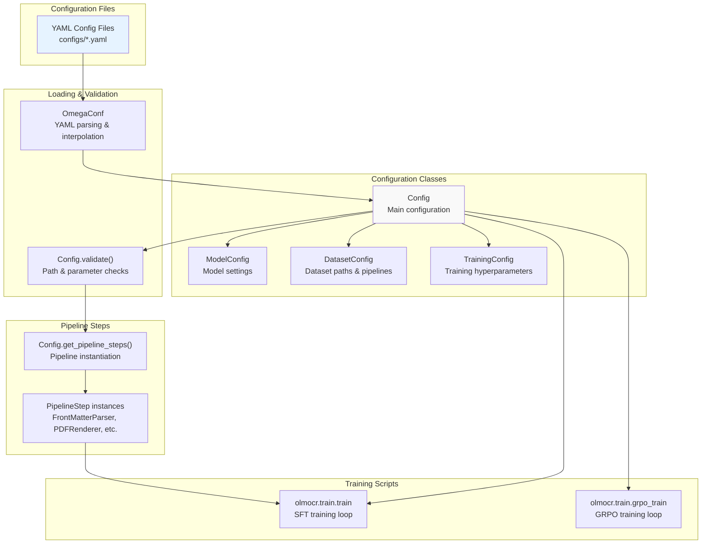
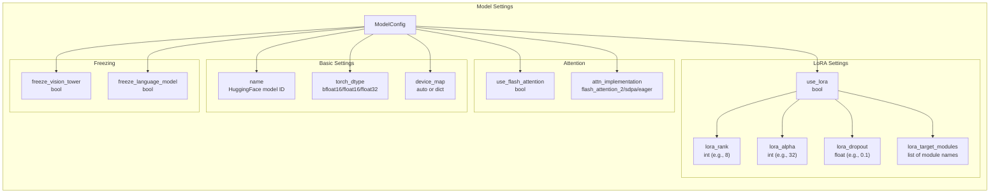
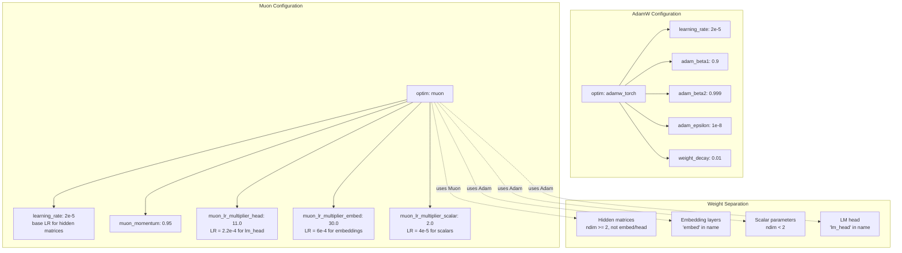
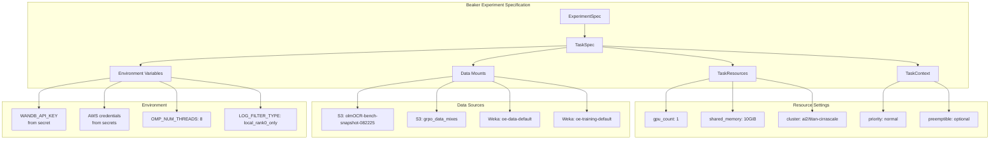

<!-- source: DeepWiki mcp.deepwiki.com · repo allenai/olmocr · page 5.5 Training Configurations and Recipes · fetched 2026-10-26 -->

# Training Configurations and Recipes

<details>
<summary>Relevant source files</summary>

The following files were used as context for generating this wiki page:

- [.dockerignore](.dockerignore)
- [.github/ISSUE_TEMPLATE/feature_request.yml](.github/ISSUE_TEMPLATE/feature_request.yml)
- [.github/actions/setup-venv/action.yml](.github/actions/setup-venv/action.yml)
- [.github/dependabot.yml](.github/dependabot.yml)
- [olmocr/train/config.py](olmocr/train/config.py)
- [olmocr/train/configs/v0.4.0/qwen25_vl_olmocrv4_rotation_1epoch_localtest.yaml](olmocr/train/configs/v0.4.0/qwen25_vl_olmocrv4_rotation_1epoch_localtest.yaml)
- [olmocr/train/dataloader.py](olmocr/train/dataloader.py)
- [olmocr/train/grpo_train.py](olmocr/train/grpo_train.py)
- [olmocr/train/muon.py](olmocr/train/muon.py)
- [olmocr/train/train.py](olmocr/train/train.py)
- [scripts/train/grpotrainer-beaker.sh](scripts/train/grpotrainer-beaker.sh)
- [tests/test_grpo.py](tests/test_grpo.py)

</details>


This page documents the YAML-based configuration system used for supervised fine-tuning (SFT) and GRPO training, along with example training recipes for different model sizes and objectives. For information about the data pipeline steps themselves, see [Training Data Pipeline](#5.1). For SFT training details, see [Supervised Fine-Tuning](#5.3). For GRPO training details, see [GRPO Reinforcement Learning](#5.4).

## Configuration System Architecture

The training system uses a YAML-based configuration framework implemented through Python dataclasses, providing type-safe, validated configurations that support interpolation and hierarchical organization.



**Sources:** [olmocr/train/config.py:1-507]()

### Configuration Class Hierarchy

The configuration system is built on nested dataclasses that map directly to YAML structure:

| Class | Purpose | Key Fields |
|-------|---------|------------|
| `Config` | Top-level configuration | `model`, `dataset`, `training`, `project_name`, `run_name` |
| `ModelConfig` | Model initialization | `name`, `torch_dtype`, `use_lora`, `lora_rank`, `use_flash_attention` |
| `DatasetConfig` | Dataset sources | `train` (list), `eval` (list) |
| `TrainingConfig` | Training parameters | `learning_rate`, `num_train_epochs`, `optim`, `gradient_accumulation_steps` |
| `PipelineStepConfig` | Pipeline step settings | `name`, `enabled`, step-specific parameters |

The configuration is loaded from YAML using `Config.from_yaml()` which performs interpolation and validation:

```python
config = Config.from_yaml("olmocr/train/configs/example_config.yaml")
config.validate()  # Checks paths exist, parameters are valid
```

**Sources:** [olmocr/train/config.py:12-273](), [olmocr/train/config.py:297-325]()

## YAML Configuration Structure

### Basic Configuration Template

```yaml
# Project metadata
project_name: olmocr-training
run_name: experiment-name

# Model configuration
model:
  name: Qwen/Qwen2.5-VL-7B-Instruct
  trust_remote_code: true
  torch_dtype: bfloat16
  use_flash_attention: true
  attn_implementation: flash_attention_2
  use_lora: false

# Dataset configuration
dataset:
  train:
    - name: dataset-1
      root_dir: /path/to/dataset
      pipeline:
        - name: FrontMatterParser
          front_matter_class: PageResponse
        - name: PDFRenderer
          target_longest_image_dim: 1288
        - name: Tokenizer
          masking_index: -100
  
  eval:
    - name: eval-dataset-1
      root_dir: /path/to/eval/dataset
      pipeline: # Same as train pipeline

# Training configuration
training:
  output_dir: ./outputs
  num_train_epochs: 1
  per_device_train_batch_size: 1
  gradient_accumulation_steps: 32
  learning_rate: 2e-5
  lr_scheduler_type: linear
  warmup_ratio: 0.1
  optim: adamw_torch
```

**Sources:** [olmocr/train/configs/v0.4.0/qwen25_vl_olmocrv4_rotation_1epoch_localtest.yaml:1-107]()

### Model Configuration Options



**Model configuration parameters:**

| Parameter | Type | Description | Default |
|-----------|------|-------------|---------|
| `name` | str | HuggingFace model identifier | `Qwen/Qwen2.5-VL-7B-Instruct` |
| `torch_dtype` | str | Model precision | `auto` |
| `device_map` | str/dict | Device placement strategy | `auto` |
| `use_flash_attention` | bool | Enable flash attention | `True` |
| `attn_implementation` | str | Attention backend | `None` |
| `use_lora` | bool | Apply LoRA fine-tuning | `False` |
| `lora_rank` | int | LoRA rank | `8` |
| `lora_alpha` | int | LoRA alpha scaling | `32` |
| `lora_dropout` | float | LoRA dropout rate | `0.1` |
| `lora_target_modules` | list[str] | Modules to apply LoRA | `["q_proj", "v_proj", "k_proj", "o_proj"]` |

**Sources:** [olmocr/train/config.py:168-196]()

### Dataset Configuration

Each dataset entry specifies a root directory containing markdown-PDF pairs and a pipeline of transformation steps:

```yaml
dataset:
  train:
    - name: s2pdf-documents
      root_dir: /path/to/processed_00_documents_train_s2pdf/
      pipeline: &basic_pipeline
        - name: FrontMatterParser
          front_matter_class: PageResponse
        - name: ReformatLatexBoldItalic
        - name: DatasetTextRuleFilter
        - name: PDFRenderer
          target_longest_image_dim: 1288
        - name: NewYamlFinetuningPromptWithNoAnchoring
        - name: FrontMatterOutputFormat
        - name: InstructUserMessages
          prompt_first: true
        - name: Tokenizer
          masking_index: -100
    
    - name: iabooks
      root_dir: /path/to/processed_01_books_train_iabooks/
      pipeline: *basic_pipeline  # YAML anchor reference
  
  eval:
    - name: s2pdf-eval
      root_dir: /path/to/processed_00_documents_eval_s2pdf/
      pipeline: *basic_pipeline
```

The `&basic_pipeline` and `*basic_pipeline` syntax uses YAML anchors to avoid duplication.

**Sources:** [olmocr/train/config.py:160-165](), [olmocr/train/configs/v0.4.0/qwen25_vl_olmocrv4_rotation_1epoch_localtest.yaml:27-59]()

### Pipeline Step Configuration

```mermaid
graph TB
    subgraph "Available Pipeline Steps"
        FrontMatter["FrontMatterParser<br/>Parse YAML frontmatter"]
        Renderer["PDFRenderer<br/>Render to image"]
        Anchoring["StaticLengthDocumentAnchoring<br/>Extract PDF text"]
        PromptOld["FinetuningPrompt<br/>Old prompt format"]
        PromptAnchor["NewYamlFinetuningPromptWithAnchoring<br/>Prompt with anchor text"]
        PromptNoAnchor["NewYamlFinetuningPromptWithNoAnchoring<br/>Prompt without anchor"]
        OutputFrontMatter["FrontMatterOutputFormat<br/>Format as YAML frontmatter"]
        OutputJSON["JSONOutputFormat<br/>Format as JSON"]
        InstructMsg["InstructUserMessages<br/>Create chat messages"]
        LatexNorm["LatexBracketNormalizer<br/>Normalize LaTeX delimiters"]
        LatexBold["ReformatLatexBoldItalic<br/>Reformat bold/italic"]
        Tokenize["Tokenizer<br/>Tokenize with processor"]
        TokenFlip["RandomTokenFlipper<br/>Random token corruption"]
        FilterRotate["FilterOutRotatedDocuments<br/>Remove rotated pages"]
        FilterText["DatasetTextRuleFilter<br/>Filter by text rules"]
        AugRotate["RotationAugmentation<br/>Random rotation"]
        AugAugraphy["AugraphyBasicAugmentations<br/>Image augmentations"]
    end
    
    subgraph "Configuration Pattern"
        StepConfig["Pipeline Step Config<br/>{name, enabled, params}"]
    end
    
    StepConfig --> FrontMatter
    StepConfig --> Renderer
    StepConfig --> Anchoring
    StepConfig --> PromptOld
    StepConfig --> PromptAnchor
    StepConfig --> PromptNoAnchor
    StepConfig --> OutputFrontMatter
    StepConfig --> OutputJSON
    StepConfig --> InstructMsg
    StepConfig --> LatexNorm
    StepConfig --> LatexBold
    StepConfig --> Tokenize
    StepConfig --> TokenFlip
    StepConfig --> FilterRotate
    StepConfig --> FilterText
    StepConfig --> AugRotate
    StepConfig --> AugAugraphy
```



**Common pipeline step parameters:**

| Step Name | Key Parameters | Description |
|-----------|----------------|-------------|
| `FrontMatterParser` | `front_matter_class` | Parse YAML frontmatter (use `PageResponse`) |
| `PDFRenderer` | `target_longest_image_dim` | Render PDF to image (typical: 1288) |
| `StaticLengthDocumentAnchoring` | `target_anchor_text_len` | Extract anchor text (typical: 6000) |
| `Tokenizer` | `masking_index`, `end_of_message_token` | Tokenize inputs and labels |
| `RotationAugmentation` | `probability` | Randomly rotate images (typical: 0.5) |
| `AugraphyBasicAugmentations` | `probability` | Apply image augmentations (typical: 0.5) |
| `InstructUserMessages` | `prompt_first` | Create chat message format |

**Sources:** [olmocr/train/config.py:20-147](), [olmocr/train/config.py:366-491]()

### Training Configuration Parameters

```yaml
training:
  # Output and logging
  output_dir: ./outputs
  logging_steps: 10
  logging_first_step: true
  report_to: [wandb]
  
  # Training schedule
  num_train_epochs: 1
  evaluation_strategy: steps
  eval_steps: 500
  save_strategy: steps
  save_steps: 500
  save_total_limit: 3
  
  # Batch size and accumulation
  per_device_train_batch_size: 1
  per_device_eval_batch_size: 1
  gradient_accumulation_steps: 32
  
  # Learning rate and scheduler
  learning_rate: 2e-5
  lr_scheduler_type: linear  # linear, cosine, constant, constant_with_warmup
  warmup_ratio: 0.1
  
  # Optimization
  optim: adamw_torch  # adamw_torch or muon
  adam_beta1: 0.9
  adam_beta2: 0.999
  adam_epsilon: 1e-8
  weight_decay: 0.01
  max_grad_norm: 1.0
  
  # Muon optimizer settings (if optim: muon)
  muon_momentum: 0.95
  muon_lr_multiplier_head: 11.0
  muon_lr_multiplier_embed: 30.0
  muon_lr_multiplier_scalar: 2.0
  
  # Memory optimization
  gradient_checkpointing: false
  gradient_checkpointing_kwargs:
    use_reentrant: false
  collator_max_token_len: 8192
  
  # Torch compile (experimental)
  torch_compile: false
  torch_compile_backend: inductor
  torch_compile_mode: default
  
  # Reproducibility
  seed: 42
  data_seed: 42
  
  # Data loading
  dataloader_num_workers: 16
  dataloader_drop_last: true
```

**Sources:** [olmocr/train/config.py:198-272]()

## Training Hyperparameter Recipes

### Optimizer Configuration

The training system supports two optimizers with different characteristics:



**AdamW optimizer usage:**
- Standard choice for most training
- Single learning rate for all parameters
- Supports LoRA training
- Typical LR: `2e-5` to `5e-5`

**Muon optimizer usage:**
- Specialized for hidden weight matrices
- Better convergence properties for large models
- Different learning rates for different parameter types
- Does NOT support LoRA training
- Base LR (hidden matrices): `2e-5`
- Head LR multiplier: `11.0` (effective: `2.2e-4`)
- Embedding LR multiplier: `30.0` (effective: `6e-4`)
- Scalar LR multiplier: `2.0` (effective: `4e-5`)

**Sources:** [olmocr/train/train.py:446-500](), [olmocr/train/muon.py:1-291]()

### Learning Rate Scheduler Recipes

| Scheduler Type | Configuration | Best For | Warmup |
|----------------|---------------|----------|--------|
| `linear` | `lr_scheduler_type: linear`<br/>`warmup_ratio: 0.1` | Short training runs (1-3 epochs) | 10% of steps |
| `cosine` | `lr_scheduler_type: cosine`<br/>`warmup_ratio: 0.05` | Longer training (5+ epochs) | 5% of steps |
| `constant_with_warmup` | `lr_scheduler_type: constant_with_warmup`<br/>`warmup_ratio: 0.05` | Fine-tuning pre-trained models | 5% of steps |
| `constant` | `lr_scheduler_type: constant` | Short experiments, debugging | None |

**Sources:** [olmocr/train/train.py:509-515]()

### Batch Size and Gradient Accumulation

Effective batch size = `per_device_train_batch_size × gradient_accumulation_steps × num_gpus`

**Recommended configurations:**

| GPU Memory | Per-Device Batch | Grad Accumulation | Effective Batch | Notes |
|------------|------------------|-------------------|-----------------|-------|
| 24 GB (RTX 3090/4090) | 1 | 32 | 32 | Typical for single GPU |
| 40 GB (A100) | 1 | 64 | 64 | Can use larger models |
| 80 GB (A100-80GB) | 2 | 32 | 64 | More efficient |
| Multi-GPU (8x A100) | 1 | 8 | 64 | Distributed training |

**Memory optimization settings:**
```yaml
training:
  per_device_train_batch_size: 1
  gradient_accumulation_steps: 32
  gradient_checkpointing: true  # Enable if OOM
  gradient_checkpointing_kwargs:
    use_reentrant: false
  collator_max_token_len: 8192  # Truncate long sequences
```

**Sources:** [olmocr/train/train.py:502-506](), [olmocr/train/config.py:203-230]()

## GRPO Training Configuration

GRPO training uses command-line arguments instead of YAML configuration files. The training script accepts both training-specific and reward function parameters.

```mermaid
graph TB
    subgraph "GRPO Command-Line Arguments"
        BaseArgs["Base Arguments"]
        RewardArgs["Reward Function Arguments"]
        VLLMArgs["VLLM Arguments"]
    end
    
    subgraph "Base Training Parameters"
        Model["--model_name<br/>Model checkpoint"]
        DataTrain["--train_bench_data_folder<br/>Training benchmark data"]
        DataEval["--eval_bench_data_folder<br/>Evaluation benchmark data"]
        Output["--output_dir<br/>Checkpoint directory"]
        LR["--learning_rate<br/>Learning rate (default: 2e-6)"]
        Epochs["--num_train_epochs<br/>Number of epochs (default: 1)"]
        BatchSize["--per_device_train_batch_size<br/>Batch size per device"]
        GradAccum["--gradient_accumulation_steps<br/>Gradient accumulation"]
        NumGen["--num_generations<br/>Samples per prompt (default: 28)"]
        NumIter["--num_iterations<br/>GRPO iterations (default: 1)"]
    end
    
    subgraph "Reward Functions"
        RwdBench["--reward_bench [weight]<br/>Test pass rate reward"]
        RwdMedoid["--reward_medoid [weight]<br/>Edit distance to medoid"]
        RwdEditDist["--reward_bench_edit_distance [weight]<br/>Similarity to claude_original"]
        RwdFrontMatter["--reward_front_matter [weight]<br/>Frontmatter validation"]
        RwdElemCount["--reward_element_count [weight]<br/>Table/math count matching"]
        RwdEOS["--reward_eos [weight]<br/>EOS token check"]
    end
    
    subgraph "GRPO Algorithm Parameters"
        LossType["--loss_type<br/>bnpo/grpo/exo (default: bnpo)"]
        ScaleRewards["--scale_rewards<br/>group/batch/none (default: group)"]
        Beta["--beta<br/>KL coefficient (default: 0.0)"]
        ImpSampling["--importance_sampling_level<br/>token/sequence (default: token)"]
    end
    
    BaseArgs --> Model
    BaseArgs --> DataTrain
    BaseArgs --> DataEval
    BaseArgs --> Output
    BaseArgs --> LR
    BaseArgs --> Epochs
    BaseArgs --> BatchSize
    BaseArgs --> GradAccum
    BaseArgs --> NumGen
    BaseArgs --> NumIter
    
    RewardArgs --> RwdBench
    RewardArgs --> RwdMedoid
    RewardArgs --> RwdEditDist
    RewardArgs --> RwdFrontMatter
    RewardArgs --> RwdElemCount
    RewardArgs --> RwdEOS
    
    VLLMArgs --> LossType
    VLLMArgs --> ScaleRewards
    VLLMArgs --> Beta
    VLLMArgs --> ImpSampling
```



### GRPO Command-Line Examples

**Basic GRPO training:**
```bash
python -m olmocr.train.grpo_train \
  --model_name Qwen/Qwen2.5-VL-7B-Instruct \
  --train_bench_data_folder /path/to/olmOCR-bench/bench_data \
  --output_dir ./outputs/grpo-test \
  --learning_rate 2e-6 \
  --num_train_epochs 1 \
  --per_device_train_batch_size 1 \
  --gradient_accumulation_steps 8 \
  --num_generations 28 \
  --reward_bench 1.0 \
  --reward_front_matter 0.5
```

**GRPO with multiple reward functions:**
```bash
python -m olmocr.train.grpo_train \
  --model_name /path/to/sft-checkpoint \
  --train_bench_data_folder /data/olmOCR-bench/bench_data \
  --output_dir /weka/grpo-checkpoints \
  --learning_rate 2e-6 \
  --reward_bench 1.0 \
  --reward_medoid 0.5 \
  --reward_front_matter 0.3 \
  --reward_eos 0.2 \
  --loss_type bnpo \
  --scale_rewards group \
  --num_generations 28
```

**Sources:** [olmocr/train/grpo_train.py:775-857]()

### GRPO Reward Function Weights

The GRPO training supports multiple weighted reward functions that can be combined:

| Reward Function | CLI Flag | Weight Range | Purpose |
|----------------|----------|--------------|---------|
| `olmocr_bench_reward` | `--reward_bench` | 0.5-2.0 | Test pass rate on benchmark tests |
| `medoid_reward` | `--reward_medoid` | 0.3-1.0 | Consistency with other generations |
| `bench_edit_distance_reward` | `--reward_bench_edit_distance` | 0.5-1.0 | Similarity to `claude_original` |
| `reward_front_matter` | `--reward_front_matter` | 0.2-0.5 | Frontmatter validity and correctness |
| `reward_element_count` | `--reward_element_count` | 0.2-0.5 | Table/math element count matching |
| `reward_eos` | `--reward_eos` | 0.1-0.3 | Proper EOS token generation |

**Typical reward weight recipe:**
```bash
--reward_bench 1.0 \              # Primary objective: pass tests
--reward_medoid 0.5 \             # Encourage consistency
--reward_front_matter 0.3 \       # Ensure valid output format
--reward_eos 0.2                  # Encourage proper termination
```

**Sources:** [olmocr/train/grpo_train.py:710-848](), [olmocr/train/grpo_train.py:360-708]()

### GRPO Algorithm Parameters

| Parameter | CLI Flag | Default | Options | Description |
|-----------|----------|---------|---------|-------------|
| Loss Type | `--loss_type` | `bnpo` | `bnpo`, `grpo`, `exo` | GRPO loss formulation |
| Reward Scaling | `--scale_rewards` | `group` | `group`, `batch`, `none` | How to normalize rewards |
| KL Coefficient | `--beta` | `0.0` | float | Reference model KL penalty weight |
| Importance Sampling | `--importance_sampling_level` | `token` | `token`, `sequence` | Granularity of importance ratios |
| Generations per Prompt | `--num_generations` | `28` | int | Samples to generate per prompt |
| Iterations | `--num_iterations` | `1` | int | Number of GRPO iterations |

**Sources:** [olmocr/train/grpo_train.py:799-857]()

## Beaker Deployment Scripts

Both SFT and GRPO training can be deployed to Beaker infrastructure using wrapper scripts that handle Docker image building, resource allocation, and data synchronization.

### GRPO Beaker Deployment

The `grpotrainer-beaker.sh` script wraps GRPO training for Beaker execution:

```bash
./scripts/train/grpotrainer-beaker.sh \
  --name experiment-name \
  --model_name s3://path/to/sft-checkpoint \
  --learning_rate 2e-6 \
  --reward_bench 1.0 \
  --reward_front_matter 0.3 \
  --num_generations 28
```

**Beaker-specific options:**
- `--skip-docker-build`: Skip Docker image build step
- `--preemptible`: Use preemptible instances for cost savings
- `--name NAME`: Experiment name (used in output directory)

The script automatically:
1. Builds Docker image tagged with version and git hash
2. Pushes image to Beaker workspace `ai2/oe-data-pdf`
3. Syncs benchmark data from S3 to `/data/olmOCR-bench`
4. Syncs model checkpoint from S3 if model path starts with `s3://`
5. Creates Beaker experiment with GPU resources
6. Saves checkpoints to `/weka/oe-training-default/jakep/olmocr-grpo-checkpoints/{name}-{workload_id}`

**Sources:** [scripts/train/grpotrainer-beaker.sh:1-254]()

### Beaker Resource Configuration



**Sources:** [scripts/train/grpotrainer-beaker.sh:95-237]()

## Example Training Recipes

### Recipe 1: Qwen2.5-VL 7B SFT (1 Epoch)

Full-precision supervised fine-tuning on mixed document dataset:

```yaml
project_name: olmocr-qwen-vl-training
run_name: qwen2.5-vl-7b-sft-1epoch

model:
  name: Qwen/Qwen2.5-VL-7B-Instruct
  torch_dtype: bfloat16
  use_flash_attention: true
  attn_implementation: flash_attention_2
  use_lora: false

dataset:
  train:
    - name: s2pdf-documents
      root_dir: /path/to/processed_00_documents_train_s2pdf/
      pipeline: &sft_pipeline
        - name: FrontMatterParser
          front_matter_class: PageResponse
        - name: ReformatLatexBoldItalic
        - name: DatasetTextRuleFilter
        - name: PDFRenderer
          target_longest_image_dim: 1288
        - name: NewYamlFinetuningPromptWithNoAnchoring
        - name: FrontMatterOutputFormat
        - name: InstructUserMessages
          prompt_first: true
        - name: Tokenizer
          masking_index: -100
    - name: iabooks
      root_dir: /path/to/processed_01_books_train_iabooks/
      pipeline: *sft_pipeline

  eval:
    - name: s2pdf-eval
      root_dir: /path/to/processed_00_documents_eval_s2pdf/
      pipeline: *sft_pipeline

training:
  output_dir: ./outputs/sft
  num_train_epochs: 1
  per_device_train_batch_size: 1
  gradient_accumulation_steps: 32
  learning_rate: 2e-5
  lr_scheduler_type: linear
  warmup_ratio: 0.1
  optim: adamw_torch
  weight_decay: 0.01
  max_grad_norm: 1.0
  gradient_checkpointing: false
  collator_max_token_len: 8192
  evaluation_strategy: steps
  eval_steps: 500
  save_strategy: steps
  save_steps: 500
  save_total_limit: 5
  report_to: [wandb]
  seed: 300
  data_seed: 301
```

**Key characteristics:**
- Full model fine-tuning (no LoRA)
- Mixed dataset (documents + books)
- Linear LR schedule with 10% warmup
- Effective batch size: 32
- Regular evaluation every 500 steps

**Sources:** [olmocr/train/configs/v0.4.0/qwen25_vl_olmocrv4_rotation_1epoch_localtest.yaml:1-107]()

### Recipe 2: LoRA Fine-Tuning (Low Memory)

Parameter-efficient fine-tuning for limited GPU memory:

```yaml
model:
  name: Qwen/Qwen2.5-VL-7B-Instruct
  torch_dtype: bfloat16
  use_flash_attention: true
  use_lora: true
  lora_rank: 8
  lora_alpha: 32
  lora_dropout: 0.1
  lora_target_modules:
    - q_proj
    - v_proj
    - k_proj
    - o_proj

training:
  per_device_train_batch_size: 1
  gradient_accumulation_steps: 16
  learning_rate: 5e-5  # Higher LR for LoRA
  lr_scheduler_type: cosine
  warmup_ratio: 0.05
  optim: adamw_torch
  gradient_checkpointing: true
  collator_max_token_len: 6144  # Reduce max length
```

**Key characteristics:**
- LoRA with rank 8 (fewer trainable parameters)
- Higher learning rate (LoRA typically needs 2-3x higher LR)
- Gradient checkpointing enabled for memory savings
- Shorter max token length
- Effective batch size: 16

**Sources:** [olmocr/train/config.py:189-195](), [olmocr/train/train.py:343-345]()

### Recipe 3: Muon Optimizer Training

Using Muon optimizer for potentially better convergence:

```yaml
training:
  optim: muon
  learning_rate: 2e-5  # Base LR for hidden matrices
  muon_momentum: 0.95
  muon_lr_multiplier_head: 11.0    # Head LR = 2.2e-4
  muon_lr_multiplier_embed: 30.0   # Embed LR = 6e-4
  muon_lr_multiplier_scalar: 2.0   # Scalar LR = 4e-5
  weight_decay: 0.01
  per_device_train_batch_size: 1
  gradient_accumulation_steps: 32
  lr_scheduler_type: linear
  warmup_ratio: 0.1
  gradient_checkpointing: false  # Muon needs more memory
```

**Key characteristics:**
- Muon for hidden weight matrices, Adam for embeddings/scalars/head
- Different learning rates for different parameter types
- NOT compatible with LoRA
- Requires more GPU memory than AdamW

**Sources:** [olmocr/train/train.py:464-498](), [olmocr/train/muon.py:232-290]()

### Recipe 4: GRPO with Multi-Reward Training

GRPO training using multiple reward signals:

```bash
python -m olmocr.train.grpo_train \
  --model_name /path/to/sft-checkpoint-5000 \
  --train_bench_data_folder /data/olmOCR-bench/bench_data \
  --eval_bench_data_folder /data/olmOCR-bench/bench_data \
  --output_dir ./outputs/grpo-multi-reward \
  --learning_rate 2e-6 \
  --num_train_epochs 1 \
  --per_device_train_batch_size 1 \
  --gradient_accumulation_steps 8 \
  --num_generations 28 \
  --num_iterations 1 \
  --reward_bench 1.0 \
  --reward_medoid 0.5 \
  --reward_front_matter 0.3 \
  --reward_eos 0.2 \
  --loss_type bnpo \
  --scale_rewards group \
  --beta 0.0 \
  --wandb_project olmocr-grpo
```

**Key characteristics:**
- Four reward functions with different weights
- Primary reward: benchmark test pass rate (1.0)
- Secondary rewards: consistency, format validity, EOS
- BNPO loss formulation
- Group-wise reward scaling
- No reference model KL penalty

**Sources:** [olmocr/train/grpo_train.py:775-931]()

### Recipe 5: GRPO with Claude Original Reference

GRPO training with claude_original edit distance reward:

```bash
python -m olmocr.train.grpo_train \
  --model_name /path/to/sft-checkpoint \
  --train_bench_data_folder /data/olmOCR-bench/bench_data_with_claude \
  --output_dir ./outputs/grpo-claude-ref \
  --learning_rate 2e-6 \
  --num_generations 28 \
  --reward_bench 1.0 \
  --reward_bench_edit_distance 0.8 \
  --reward_front_matter 0.3 \
  --reward_element_count 0.4 \
  --loss_type bnpo
```

**Key characteristics:**
- Uses `claude_original` files as reference
- Edit distance reward encourages similarity to ground truth
- Element count reward ensures correct table/math element counts
- Requires benchmark data with `claude_original/` folder

**Sources:** [olmocr/train/grpo_train.py:86-149](), [olmocr/train/grpo_train.py:360-403](), [olmocr/train/grpo_train.py:578-667]()

---

