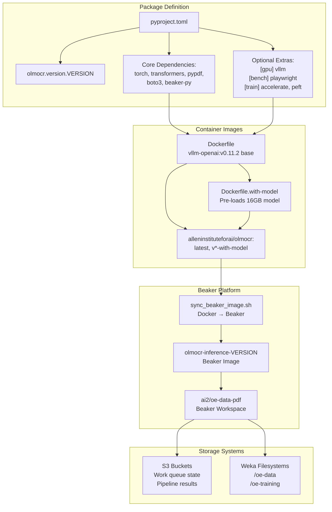
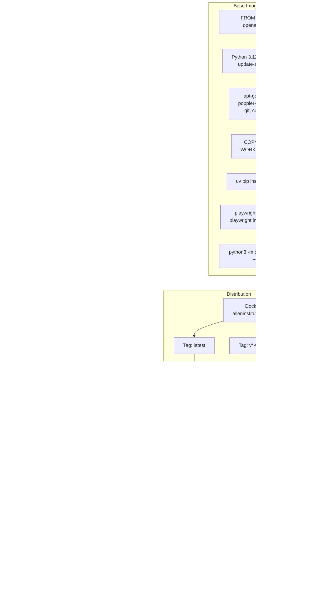
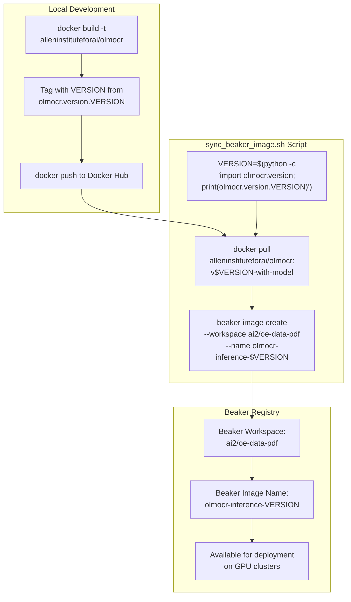
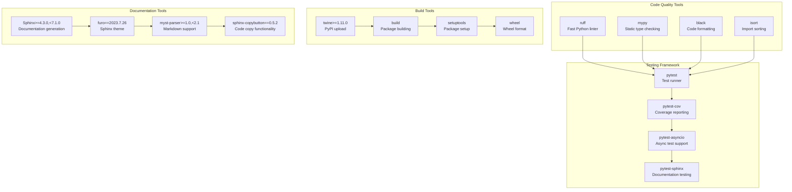
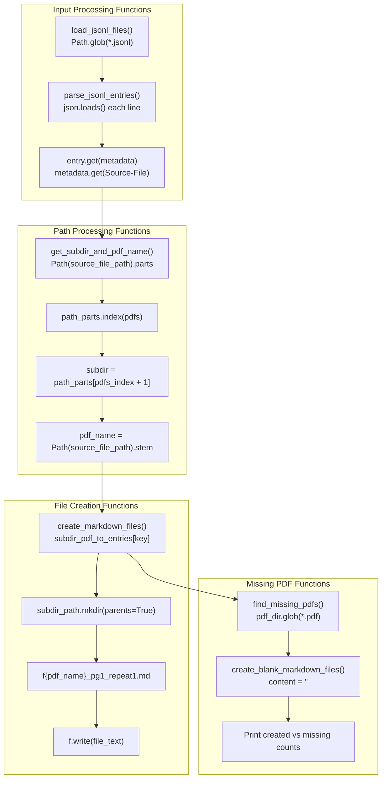
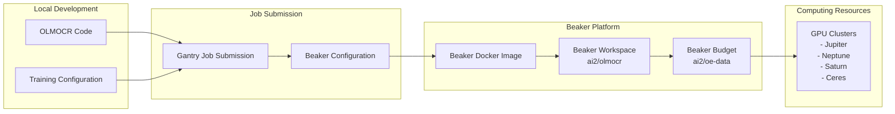
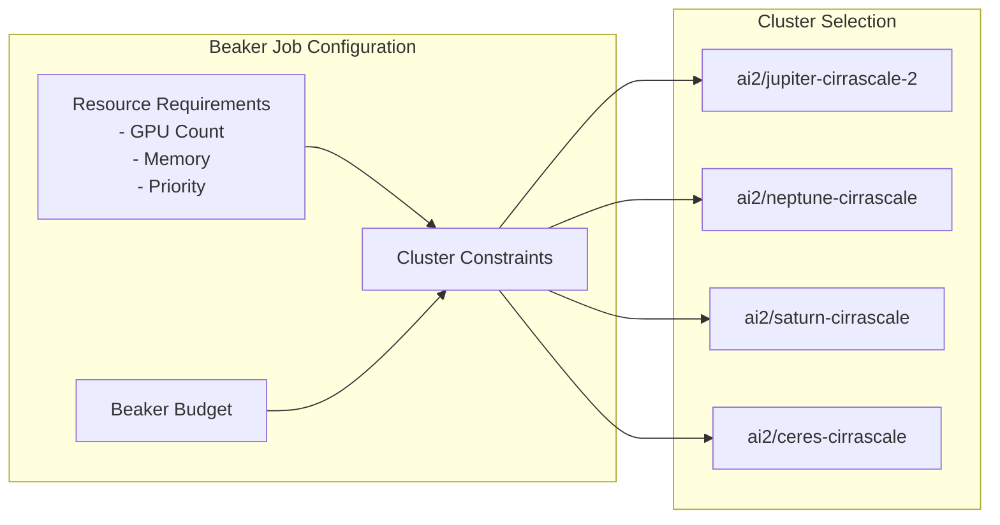
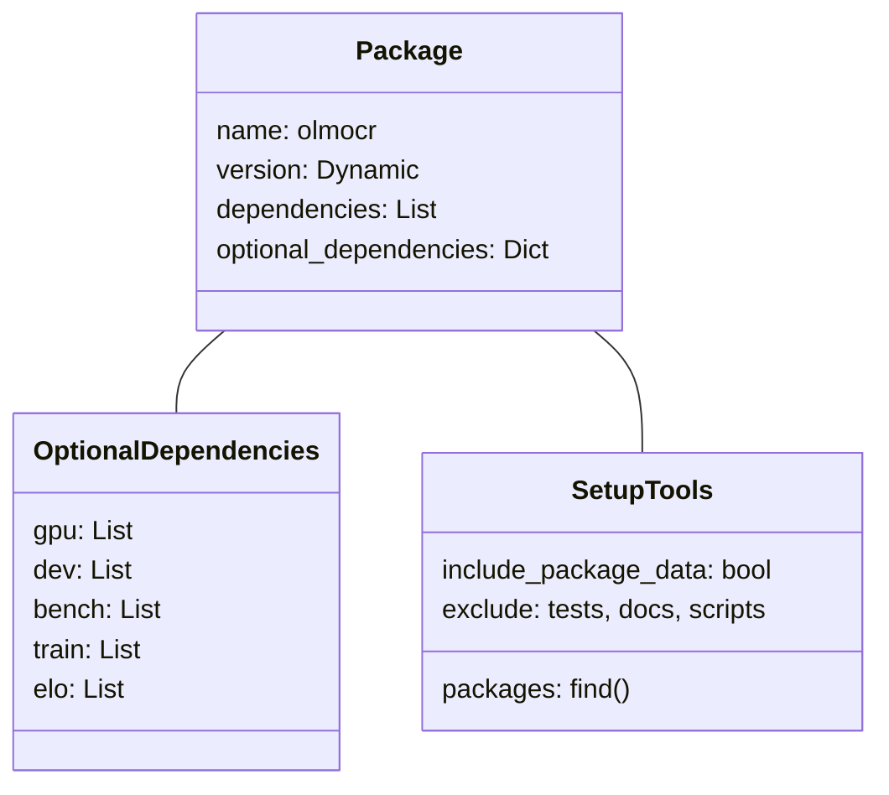

<!-- source: DeepWiki mcp.deepwiki.com · repo allenai/olmocr · page 6 Infrastructure and Deployment · fetched 2026-10-26 -->

# Infrastructure and Deployment

<details>
<summary>Relevant source files</summary>

The following files were used as context for generating this wiki page:

- [Dockerfile](Dockerfile)
- [Dockerfile.with-model](Dockerfile.with-model)
- [pyproject.toml](pyproject.toml)
- [scripts/sync_beaker_image.sh](scripts/sync_beaker_image.sh)
- [tests/gnarly_pdfs/guidebook_failed_pages.pdf](tests/gnarly_pdfs/guidebook_failed_pages.pdf)

</details>


This page documents the containerization, distributed execution, and deployment infrastructure for olmOCR. The system uses Docker containers built on the vLLM base image, integrates with AI2's Beaker platform for distributed GPU workloads, and leverages S3 and Weka filesystems for data storage and coordination.

The infrastructure supports multiple deployment scenarios: local development with Docker, distributed pipeline execution on Beaker, multi-GPU model training, and production inference with pre-loaded model images.

## Overview

The olmOCR deployment infrastructure consists of four main components:

1. **Project Configuration** (page 6.1): Package definition in `pyproject.toml` with dependency groups for core, GPU, development, benchmarking, and training
2. **Docker Images** (page 6.2): Two-tier containerization strategy with base `Dockerfile` and model-preloaded `Dockerfile.with-model`
3. **Beaker Platform** (page 6.3-6.4): Integration with AI2's Beaker for distributed execution, resource allocation, and image synchronization via `sync_beaker_image.sh`
4. **Storage Systems** (page 6.5): S3 for work queue coordination and results, Weka filesystems for high-performance training data access

**Infrastructure Component Overview**



Sources:
- [pyproject.toml:1-200]()
- [Dockerfile:1-59]()
- [Dockerfile.with-model:1-30]()
- [scripts/sync_beaker_image.sh:1-15]()

## Docker Container Strategy

olmOCR uses a two-tier Docker containerization strategy for efficient deployment. The base image provides a complete development and benchmarking environment, while the model-preloaded variant eliminates runtime model downloads for production deployments.

**Docker Image Build and Distribution Flow**



The base `Dockerfile` builds on `vllm/vllm-openai:v0.11.2` and installs system dependencies for PDF processing (poppler-utils, fonts) and browser automation (Playwright with Chromium). The `Dockerfile.with-model` variant pre-downloads a 16GB vision-language model into `/opt/models`, eliminating the startup delay in production environments.

Sources:
- [Dockerfile:1-59]()
- [Dockerfile.with-model:1-30]()
- [scripts/sync_beaker_image.sh:1-15]()

**Package Dependency Organization**

The package dependencies in `pyproject.toml` are organized into functional groups:

| Dependency Group | Key Packages | Purpose |
|------------------|--------------|---------|
| Core | `torch>=2.7.0`, `transformers==4.57.3`, `pypdf>=5.2.0`, `boto3`, `beaker-py` | Base functionality for PDF processing and cloud integration |
| `[gpu]` | `vllm==0.11.2` | GPU-accelerated inference via vLLM server |
| `[bench]` | `playwright`, `openai`, `anthropic`, `flask`, `fuzzysearch` | Benchmarking, synthetic data generation, and OCR comparison |
| `[train]` | `accelerate`, `peft`, `trl`, `wandb`, `augraphy` | Model training with LoRA fine-tuning and augmentation |
| `[dev]` | `ruff`, `mypy`, `black`, `pytest`, `sphinx` | Development tools and documentation generation |

The build process uses `uv` package manager with `UV_INDEX_STRATEGY=unsafe-best-match` to resolve setuptools dependencies efficiently.

Sources:
- [pyproject.toml:22-43]()
- [pyproject.toml:52-111]()
- [Dockerfile:50-51]()

## Beaker Platform Integration

The olmOCR system integrates with AI2's Beaker platform for distributed GPU execution. The `beaker-py` package provides programmatic access to Beaker's job submission, image management, and workspace coordination features.

**Beaker Image Synchronization Workflow**



The `sync_beaker_image.sh` script automates the process of registering Docker images with Beaker. It extracts the version number from `olmocr.version.VERSION`, pulls the model-preloaded image from Docker Hub, and creates a Beaker image in the `ai2/oe-data-pdf` workspace with the naming convention `olmocr-inference-VERSION`.

Sources:
- [scripts/sync_beaker_image.sh:1-15]()
- [pyproject.toml:42]()

**Distributed Execution Architecture**

olmOCR jobs on Beaker typically use 1 GPU per worker for inference workloads, while training jobs may use multi-GPU configurations. The pipeline integrates with Beaker through:

- **beaker-py**: Python API for job submission and monitoring
- **boto3**: S3 access for work queue coordination and result storage
- **vLLM Server**: Each worker runs a local vLLM server for model inference
- **WorkQueue**: Distributed task coordination using S3 or local file backends

Beaker jobs are configured with resource requirements (GPU count, memory), cluster constraints (e.g., `ai2/jupiter-cirrascale-2`), and priority settings. The Docker images contain all dependencies needed for execution, eliminating environment setup at runtime.

Sources:
- [pyproject.toml:38-42]()
- [Dockerfile:1-59]()

## 6.3 CI/CD and Automation

olmOCR uses automated workflows for testing, building, and package distribution. The system includes development tools, testing frameworks, and package configuration for automated releases.

### Development Automation Tools

**Code Quality and Testing**



### Configuration Management

**Tool Configuration in pyproject.toml**

```mermaid
graph TB
    subgraph "Code Formatting Configuration"
        BLACK_CONFIG["[tool.black]<br/>line-length = 160"]
        ISORT_CONFIG["[tool.isort]<br/>profile = black"]
        RUFF_CONFIG["[tool.ruff]<br/>target-version = py311"]
    end
    
    subgraph "Type Checking Configuration"
        MYPY_CONFIG["[tool.mypy]<br/>ignore_missing_imports = true"]
        PYRIGHT_CONFIG["[tool.pyright]<br/>reportPrivateImportUsage = false"]
        CHECK_UNTYPED["check_untyped_defs = true"]
    end
    
    subgraph "Test Configuration"
        PYTEST_CONFIG["[tool.pytest.ini_options]<br/>testpaths = tests/"]
        PYTHON_CLASSES["python_classes = Test*, *Test"]
        LOG_CONFIG["log_level = DEBUG"]
        NONCI_MARKER["markers = nonci"]
    end
    
    subgraph "Package Exclusions"
        EXCLUDE_TESTS["exclude = *.tests, tests.*"]
        EXCLUDE_DOCS["exclude = docs*"]
        EXCLUDE_SCRIPTS["exclude = scripts*"]
    end
    
    BLACK_CONFIG --> ISORT_CONFIG
    ISORT_CONFIG --> RUFF_CONFIG
    MYPY_CONFIG --> PYRIGHT_CONFIG
    PYRIGHT_CONFIG --> CHECK_UNTYPED
    PYTEST_CONFIG --> PYTHON_CLASSES
    PYTHON_CLASSES --> LOG_CONFIG
    LOG_CONFIG --> NONCI_MARKER
    EXCLUDE_TESTS --> EXCLUDE_DOCS
    EXCLUDE_DOCS --> EXCLUDE_SCRIPTS
```



Sources:
- [pyproject.toml:57-82]()
- [pyproject.toml:141-195]()
- [pyproject.toml:116-124]()

### Benchmark Workflow Automation

**Workspace to Benchmark Conversion**

The `workspace_to_bench.py` script automates the conversion from pipeline output to benchmark format:



**Key Functions and Data Flow**

| Function | Input | Output | Purpose |
|----------|-------|---------|----------|
| `load_jsonl_files()` | `input_dir` | `List[Path]` | Find all .jsonl files in directory |
| `parse_jsonl_entries()` | `jsonl_files` | `all_entries, pdf_sources` | Extract text and metadata from JSONL |
| `get_subdir_and_pdf_name()` | `source_file_path` | `subdir, pdf_name` | Parse path structure from Source-File |
| `create_markdown_files()` | `entries, output_dir` | `created_files` | Generate .md files in subdir structure |
| `find_missing_pdfs()` | `pdf_sources, created_files` | `missing_pdfs` | Compare against benchmark dataset |
| `create_blank_markdown_files()` | `missing_pdfs, output_dir` | None | Generate empty .md for missing PDFs |

Sources:
- [olmocr/bench/scripts/workspace_to_bench.py:14-210]()
- [olmocr/bench/scripts/workspace_to_bench.py:55-68]()
- [olmocr/bench/scripts/workspace_to_bench.py:71-107]()
- [olmocr/bench/scripts/workspace_to_bench.py:110-167]()

### Package Release Automation

The package is configured for automated building and distribution using modern Python packaging standards:

```mermaid
graph TB
    subgraph "Build System Configuration"
        BUILD_BACKEND["setuptools.build_meta<br/>pyproject.toml line 3"]
        REQUIRES["setuptools, wheel<br/>pyproject.toml line 2"]
        PACKAGE_DISCOVERY["setuptools.packages.find<br/>pyproject.toml line 116"]
    end
    
    subgraph "Version Management"
        DYNAMIC_VERSION["dynamic = [version]<br/>pyproject.toml line 9"]
        VERSION_ATTR["olmocr.version.VERSION<br/>pyproject.toml line 139"]
        PYTHON_REQUIRES["requires-python = >=3.11<br/>pyproject.toml line 21"]
    end
    
    subgraph "Package Data Inclusion"
        INCLUDE_DATA["include-package-data = true<br/>pyproject.toml line 127"]
        PY_TYPED["py.typed<br/>Type information"]
        VIEWER_HTML["viewer/*.html<br/>Web interface templates"]
        EVAL_HTML["eval/*.html<br/>Evaluation templates"]
        KATEX_JS["bench/katex/*.js<br/>Math rendering"]
        KATEX_CSS["bench/katex/*.css<br/>Math styling"]
    end
    
    subgraph "Distribution Metadata"
        CLASSIFIERS["Development Status :: 3 - Alpha<br/>Apache License"]
        AUTHORS["Allen Institute for AI<br/>jakep@allenai.org"]
        URLS["Homepage, Repository, Changelog<br/>GitHub links"]
    end
    
    BUILD_BACKEND --> REQUIRES
    REQUIRES --> PACKAGE_DISCOVERY
    DYNAMIC_VERSION --> VERSION_ATTR
    VERSION_ATTR --> PYTHON_REQUIRES
    INCLUDE_DATA --> PY_TYPED
    PY_TYPED --> VIEWER_HTML
    VIEWER_HTML --> EVAL_HTML
    EVAL_HTML --> KATEX_JS
    KATEX_JS --> KATEX_CSS
    CLASSIFIERS --> AUTHORS
    AUTHORS --> URLS
```



Sources:
- [pyproject.toml:1-5]()
- [pyproject.toml:116-140]()
- [pyproject.toml:129-136]()
- [pyproject.toml:11-20]()
- [pyproject.toml:46-50]()

## Beaker and Gantry Integration

OLMOCR uses AI2's Beaker platform for executing GPU-intensive workloads and Gantry for managing training jobs.



Sources:
- [.github/workflows/main.yml:116-119]()
- [scripts/build-docker.sh:8-9]()

### Resource Management

Beaker jobs are configured with specific resource requirements and cluster constraints:



Sources:
- [.github/workflows/main.yml:146-153]()

## Package Configuration

OLMOCR is packaged as a Python package with specific dependencies for different use cases:

| Feature Group | Description | Key Dependencies |
|---------------|-------------|------------------|
| Core | Basic OLMOCR functionality | pypdf, pypdfium2, Pillow, boto3, torch |
| GPU | GPU acceleration support | sgl-kernel, sglang |
| Dev | Development tools | ruff, mypy, black, pytest |
| Bench | Benchmarking tools | tinyhost, flask, google-genai, mistralai |
| Train | Model training support | torch, accelerate, peft, wandb, transformers |
| Elo | Analytics tools | numpy, scipy, pandas, matplotlib |

Sources:
- [pyproject.toml:21-42]()
- [pyproject.toml:52-116]()

The package is configured in pyproject.toml and uses setuptools for building. The version is dynamically obtained from olmocr.version.VERSION.



Sources:
- [pyproject.toml:5-137]()

## Deployment Guide

### Building Docker Images

To build a Docker image for inference:

1. Ensure you're in the root directory of the OLMOCR repository
2. Run the build-docker.sh script:

```
./scripts/build-docker.sh
```

This will:
- Determine the current OLMOCR version
- Build a Docker image tagged with that version
- Push the image to Beaker with the name `olmocr-inference-<VERSION>`

Sources:
- [scripts/build-docker.sh]()

### Running on Beaker

To run an OLMOCR job on Beaker:

1. Ensure you have a Beaker account and the Beaker CLI installed
2. Create a Beaker specification file that references the OLMOCR Docker image:

```yaml
version: v2
description: OLMOCR Pipeline Job
tasks:
  - name: olmocr
    image:
      beaker: ai2/olmocr-inference-<VERSION>
    context:
      priority: normal
      preemptible: true
    resources:
      gpuCount: 1
    constraints:
      cluster:
        - ai2/jupiter-cirrascale-2
    command: ["python", "-m", "olmocr.pipeline", "--pdfs", "s3://path/to/pdfs"]
```

3. Submit the job using the Beaker CLI:

```
beaker experiment create -f spec.yaml
```

Sources:
- [.github/workflows/main.yml:135-162]()

## Package Installation

OLMOCR can be installed from PyPI:

```
pip install olmocr
```

For GPU support, install with the gpu extra:

```
pip install "olmocr[gpu]"
```

For development:

```
pip install "olmocr[dev]"
```

Sources:
- [pyproject.toml:52-116]()

---

