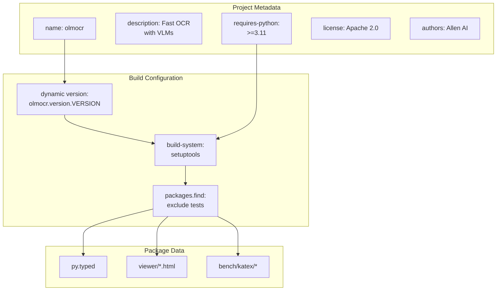
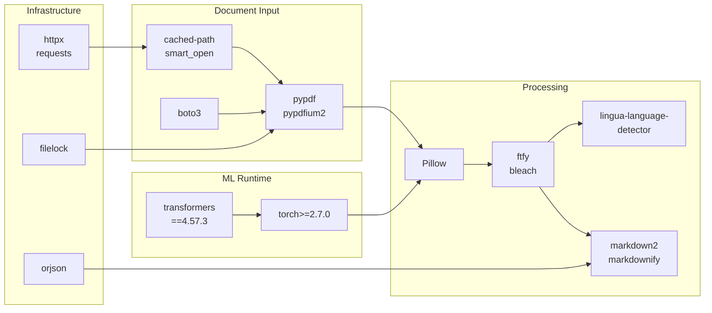
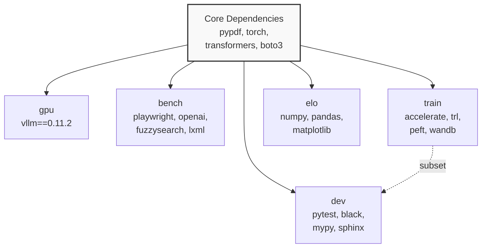
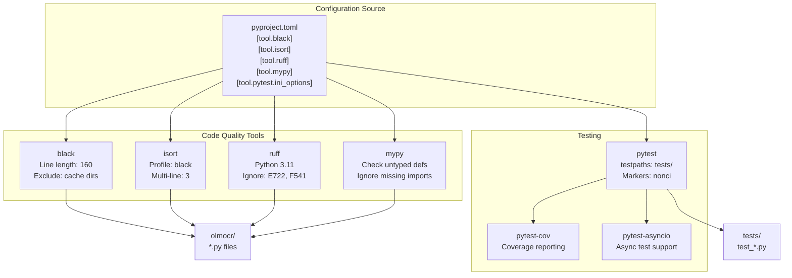
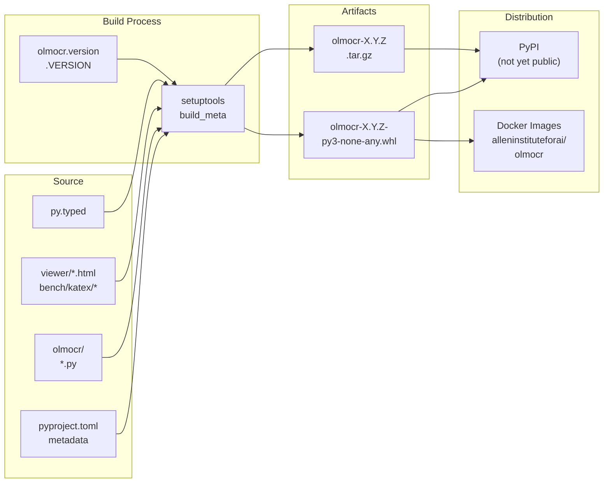
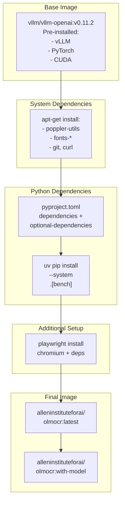

<!-- source: DeepWiki mcp.deepwiki.com · repo allenai/olmocr · page 6.1 Project Configuration and Dependencies · fetched 2026-10-26 -->

# Project Configuration and Dependencies

<details>
<summary>Relevant source files</summary>

The following files were used as context for generating this wiki page:

- [Dockerfile](Dockerfile)
- [Dockerfile.with-model](Dockerfile.with-model)
- [pyproject.toml](pyproject.toml)

</details>


## Purpose and Scope

This document covers the project configuration as defined in [pyproject.toml](). It describes the build system, core and optional dependencies, and development tooling configuration (linters, type checkers, test framework). The olmOCR project uses modern Python packaging standards with multiple optional dependency groups to support different use cases.

For Docker containerization details, see [Docker Images and Containerization](#6.2). For deployment infrastructure, see [Beaker Platform Integration](#6.3).

---

## Project Metadata and Build System

The olmOCR project is configured as a standard Python package using setuptools as the build backend [pyproject.toml:1-3](). The project metadata defines olmOCR as:

- **Name**: `olmocr`
- **Description**: "Fast, efficient, and high quality OCR powered by open visual language models"
- **License**: Apache Software License 2.0
- **Python Requirement**: `>=3.11`
- **Development Status**: Alpha (3)
- **Primary Maintainer**: Allen Institute for Artificial Intelligence

The version is dynamically sourced from `olmocr.version.VERSION` [pyproject.toml:143](), allowing programmatic version management. The package includes typed stubs (`py.typed`) and non-Python assets such as HTML viewers, evaluation templates, and KaTeX rendering resources [pyproject.toml:134-140]().

**Dependency Resolution Strategy**

The project uses the "unsafe-best-match" UV index strategy during Docker builds [Dockerfile:50]() to resolve setuptools dependency conflicts, which is necessary due to the complex dependency tree involving vLLM, transformers, and PyTorch.

### Project Metadata Structure



**Sources**: [pyproject.toml:5-50](), [pyproject.toml:120-143]()

---

## Core Dependencies

The core dependencies [pyproject.toml:22-43]() support the fundamental pipeline operations and are installed with the base package:

| Category | Packages | Purpose |
|----------|----------|---------|
| **PDF Processing** | `pypdf>=5.2.0`, `pypdfium2`, `poppler-utils` (system) | PDF parsing, rendering, and manipulation |
| **Caching & Storage** | `cached-path`, `smart_open`, `boto3`, `zstandard` | Remote file access, S3 integration, compression |
| **Image Processing** | `Pillow`, `pypdfium2` | Image manipulation and PDF-to-image conversion |
| **Text Processing** | `ftfy`, `bleach`, `markdown2`, `markdownify` | Text normalization, sanitization, format conversion |
| **Language Detection** | `lingua-language-detector` | Non-English document filtering |
| **ML Framework** | `torch>=2.7.0`, `transformers==4.57.3` | Core deep learning infrastructure, model loading |
| **Infrastructure** | `filelock`, `orjson`, `requests`, `httpx`, `cryptography` | Concurrency, serialization, networking, security |
| **Deployment** | `beaker-py` | Beaker platform integration |

**Critical Version Pins**

- **transformers==4.57.3**: Exact pin ensures compatibility with Qwen2.5-VL models
- **torch>=2.7.0**: Minimum version required for FP8 quantization support

### Core Dependency Flow



**Sources**: [pyproject.toml:22-43](), [Dockerfile:29-35]()

---

## Optional Dependency Groups

olmOCR defines five optional dependency groups that can be installed separately based on deployment needs. These are specified using PEP 621 `[project.optional-dependencies]` syntax.

### Installation Examples

```bash
# Core only
pip install olmocr

# With GPU inference support
pip install "olmocr[gpu]"

# Full development environment
pip install "olmocr[dev,bench,train]"

# All extras
pip install "olmocr[gpu,dev,bench,train,elo]"
```

### GPU Dependencies (`gpu`)

The `gpu` extra [pyproject.toml:53-55]() installs vLLM for efficient inference:

- **vllm==0.11.2**: Exact pin for OpenAI-compatible inference server with PagedAttention

This group is used in production inference deployments. The base Docker image [Dockerfile:1]() builds from `vllm/vllm-openai:v0.11.2`, which pre-installs vLLM and CUDA dependencies.

### Development Dependencies (`dev`)

The `dev` extra [pyproject.toml:57-84]() provides a comprehensive development toolchain:

| Category | Packages | Purpose |
|----------|----------|---------|
| **Code Quality** | `ruff`, `mypy`, `black`, `isort` | Linting, type checking, formatting |
| **Testing** | `pytest`, `pytest-sphinx`, `pytest-cov`, `pytest-asyncio` | Test framework and plugins |
| **Documentation** | `Sphinx>=4.3.0`, `furo`, `myst-parser`, `sphinx-copybutton`, `sphinx-autobuild`, `sphinx-autodoc-typehints` | Documentation generation |
| **Packaging** | `twine>=1.11.0`, `build`, `setuptools`, `wheel`, `packaging` | Distribution and versioning |
| **Training Deps** | `peft`, `datasets`, `wandb`, `trl`, `omegaconf`, `spacy` | Subset of training tools for local development |

Note that `dev` includes some training dependencies (`peft`, `datasets`, `wandb`, `trl`) for convenience during local development and testing, though the full `train` extra is required for actual training runs.

### Benchmarking Dependencies (`bench`)

The `bench` extra [pyproject.toml:86-99]() supports the evaluation framework (see [Benchmarking System](#4)):

| Package | Purpose |
|---------|---------|
| `tinyhost` | Local HTTP server for test result visualization |
| `fuzzysearch`, `rapidfuzz`, `sequence_align` | Fuzzy string matching for TextPresenceTest |
| `syntok` | Sentence tokenization for text order testing |
| `openai`, `google-genai`, `anthropic`, `mistralai` | Multi-provider LLM API clients for synthetic generation |
| `playwright` | Headless browser for KaTeX math rendering and HTML-to-PDF |
| `lxml` | HTML/XML parsing for table testing |
| `flask` | Web server for interactive evaluation |

The bench extra is installed in the Docker image [Dockerfile:51]() to support benchmark execution within containers.

### Training Dependencies (`train`)

The `train` extra [pyproject.toml:101-111]() provides the full training stack (see [Model Training and Fine-tuning](#5)):

- **torch**, **torchvision**: Deep learning framework (also in core, but explicit here)
- **accelerate**: Multi-GPU training coordination
- **trl**: Transformer Reinforcement Learning library for GRPO
- **peft**: Parameter-Efficient Fine-Tuning (LoRA adapters)
- **wandb**: Experiment tracking and visualization
- **omegaconf**: YAML configuration management
- **einops**: Tensor manipulation utilities
- **augraphy**: Document augmentation pipeline

### ELO Rating Dependencies (`elo`)

The `elo` extra [pyproject.toml:113-118]() supports human evaluation analysis:

- **numpy**, **scipy**: Statistical computations
- **pandas**: Data manipulation
- **matplotlib**: Visualization

This group is used for calculating ELO ratings from pairwise comparison experiments.

### Dependency Group Relationships



**Sources**: [pyproject.toml:52-118]()

---

## Tool Configuration

The pyproject.toml includes standardized configuration for development tools, ensuring consistent code quality across contributors.

### Code Formatting with Black

Black configuration [pyproject.toml:145-159]():

- **Line Length**: 160 characters (wider than default 88 to accommodate long type hints)
- **Target Files**: `.py` and `.pyi` (Python and stub files)
- **Exclusions**: `__pycache__`, `.git`, `.mypy_cache`, `.pytest_cache`, `.vscode`, `.venv`, `dist`, `doc`

Usage: `black olmocr/`

### Import Sorting with isort

Isort configuration [pyproject.toml:161-163]():

- **Profile**: `black` (ensures compatibility with Black's formatting)
- **Multi-line Output**: Mode 3 (vertical hanging indent)

Usage: `isort olmocr/`

### Linting with Ruff

Ruff configuration [pyproject.toml:169-176]():

- **Line Length**: 160 characters (matches Black)
- **Target Version**: Python 3.11
- **Exclusions**: `olmocr/train/molmo` (vendored code), `tests/*`
- **Ignored Rules**:
  - `E722`: Bare except statements (intentionally allowed for robustness)
  - `F541`: F-strings without placeholders
- **Per-File Ignores**: `F401` (unused imports) in `__init__.py` files

Ruff is significantly faster than Flake8 and serves as a drop-in replacement.

Usage: `ruff check olmocr/`

### Type Checking with mypy

Mypy configuration [pyproject.toml:178-186]():

- **ignore_missing_imports**: `true` (tolerates missing stubs for third-party libraries)
- **check_untyped_defs**: `true` (type-checks functions without annotations)
- **Exclusions**: `olmocr/train/molmo/` (vendored Molmo code), `tests/*`
- **Test Overrides**: `strict_optional = false` for test files (allows more flexible mocking)

Usage: `mypy olmocr/`

### Testing with pytest

Pytest configuration [pyproject.toml:188-199]():

| Setting | Value | Purpose |
|---------|-------|---------|
| `testpaths` | `tests/` | Test discovery location |
| `python_classes` | `Test*`, `*Test` | Test class naming patterns |
| `log_level` | `DEBUG` | Verbose logging during tests |
| `markers` | `nonci: mark test as not intended for CI runs` | Custom marker for expensive tests |
| `addopts` | `-m 'not nonci'` | Exclude non-CI tests by default |

The `nonci` marker allows marking integration tests or performance tests that should only run locally:

```python
@pytest.mark.nonci
def test_full_pipeline_on_large_pdf():
    ...
```

Usage: `pytest` (excludes nonci), `pytest -m ''` (runs all)

### Tool Configuration Flow



**Sources**: [pyproject.toml:145-199]()

---

## Package Distribution and Data Files

### Package Discovery

The setuptools package finder [pyproject.toml:120-128]() excludes test and documentation directories from distribution:

- Excluded patterns: `*.tests`, `*.tests.*`, `tests.*`, `tests`, `docs*`, `scripts*`
- This ensures only the `olmocr` package is included in built wheels

### Non-Python Package Data

The package includes non-code assets [pyproject.toml:134-140]():

| Pattern | Contents | Purpose |
|---------|----------|---------|
| `py.typed` | Empty marker file | Indicates type stub availability for mypy |
| `viewer/*.html` | HTML templates | Interactive pipeline output viewer |
| `eval/*.html` | HTML templates | Benchmark result visualization |
| `bench/katex/*.js` | KaTeX JavaScript | Math equation rendering in MathTest |
| `bench/katex/*.css` | KaTeX stylesheets | Math formatting |

These files are automatically included in the wheel distribution via `include-package-data = true` [pyproject.toml:131]().

### Distribution Workflow



**Sources**: [pyproject.toml:120-143]()

---

## Docker Integration

While Docker configuration is detailed in [Docker Images and Containerization](#6.2), the relationship to pyproject.toml is relevant:

The base Dockerfile [Dockerfile:51]() installs olmOCR with the bench extra:

```bash
uv pip install --system --no-cache ".[bench]"
```

This provides:
- Core dependencies for pipeline execution
- Benchmarking tools (playwright, fuzzysearch, etc.)
- vLLM is inherited from the base image `vllm/vllm-openai:v0.11.2`

The with-model variant [Dockerfile.with-model:2]() builds from `alleninstituteforai/olmocr:latest` and pre-downloads models using the transformers cache, leveraging the core dependencies.

### Dependency Installation in Docker



**Sources**: [Dockerfile:1](), [Dockerfile:46-54](), [Dockerfile.with-model:2]()

---

## Version Management

The dynamic version [pyproject.toml:143]() is sourced from [olmocr/version.py]():

```python
# olmocr/version.py
VERSION = "X.Y.Z"
```

This allows programmatic access to the version:

```python
from olmocr.version import VERSION
print(f"olmOCR {VERSION}")
```

During builds, setuptools reads this attribute via `setuptools.dynamic.version`.

**Sources**: [pyproject.toml:143]()

---

## Summary

The olmOCR project configuration demonstrates a well-structured Python package with:

1. **Modular Dependencies**: Five optional groups (gpu, dev, bench, train, elo) enable tailored installations
2. **Standardized Tooling**: Black, isort, ruff, mypy, and pytest configurations ensure code quality
3. **Container-First Design**: Dependencies align with Docker-based deployment workflows
4. **Type Safety**: Includes `py.typed` and mypy configuration for static analysis
5. **Non-Code Assets**: Bundles HTML templates and JavaScript libraries for runtime functionality

The configuration supports multiple deployment scenarios: lightweight core-only installations, full-featured development environments, GPU-accelerated inference, and distributed training.

**Sources**: [pyproject.toml:1-200](), [Dockerfile:1-59](), [Dockerfile.with-model:1-30]()

---

