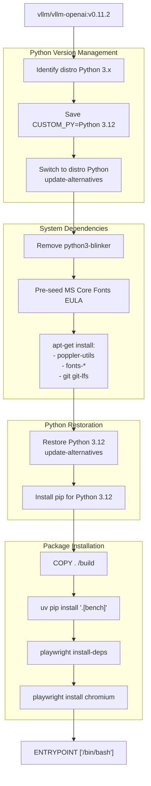
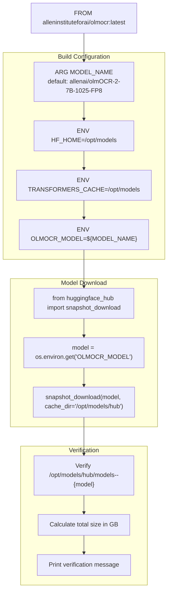

<!-- source: DeepWiki mcp.deepwiki.com · repo allenai/olmocr · page 6.2 Docker Images and Containerization · fetched 2026-10-26 -->

# Docker Images and Containerization

<details>
<summary>Relevant source files</summary>

The following files were used as context for generating this wiki page:

- [Dockerfile](Dockerfile)
- [Dockerfile.with-model](Dockerfile.with-model)
- [pyproject.toml](pyproject.toml)

</details>


## Purpose and Scope

This page documents the Docker containerization strategy for olmOCR, focusing on the two image variants, their build processes, system dependencies, and runtime configurations. The images are built on the `vllm/vllm-openai:v0.11.2` base image and include all necessary dependencies for OCR processing.

For information about project configuration and dependencies, see page 6.1. For deploying these containers to Beaker infrastructure, see page 6.3. For local development environment setup, see page 7.1.
</thinking>

---

## Overview

olmOCR provides two Docker image variants to support different deployment scenarios:

| Image Variant | Repository | Base Size | Total Size | Use Case |
|---------------|------------|-----------|------------|----------|
| Base | `alleninstituteforai/olmocr` | ~8GB | ~8GB | Runtime model downloads, flexible model selection |
| With-Model | `alleninstituteforai/olmocr:*-with-model` | ~8GB | ~24GB | Pre-cached model, faster cold starts on distributed infrastructure |

Both images are built on `vllm/vllm-openai:v0.11.2`, which provides GPU-accelerated inference capabilities through the vLLM framework.

Sources: [Dockerfile:1](), [Dockerfile.with-model:2]()

---

## Base Image Structure

The base `Dockerfile` implements a multi-stage build process that extends the vLLM OpenAI-compatible inference server with olmOCR-specific dependencies.

### Build Process Overview



**Diagram: Base Dockerfile Build Stages**

### Python Version Management

The vLLM base image includes multiple Python versions. olmOCR requires Python 3.12, but APT package installation scripts require the distribution's default Python. The Dockerfile implements a version switching mechanism:

1. **Identify Distribution Python**: Locates the system Python (e.g., Python 3.10) [Dockerfile:7]()
2. **Save Target Version**: Stores `CUSTOM_PY=/usr/bin/python3.12` for later restoration [Dockerfile:4]()
3. **Temporary Switch**: Uses `update-alternatives` to set distribution Python as default [Dockerfile:17-21]()
4. **Restoration**: After APT operations complete, switches back to Python 3.12 [Dockerfile:37-42]()

This approach ensures compatibility with both APT's Python-based scripts and olmOCR's Python 3.12 requirement.

Sources: [Dockerfile:3-43]()

### System Dependencies

The Dockerfile installs several categories of system packages:

| Category | Packages | Purpose |
|----------|----------|---------|
| PDF Processing | `poppler-utils` | Provides `pdftoppm` and `pdftotext` utilities |
| Core Fonts | `fonts-crosextra-caladea`, `fonts-crosextra-carlito`, `gsfonts` | Standard fonts for PDF rendering |
| Microsoft Fonts | `ttf-mscorefonts-installer` | Arial, Times New Roman, etc. for document compatibility |
| Font Tools | `lcdf-typetools` | Font manipulation utilities |
| Development | `git`, `git-lfs`, `curl`, `wget`, `unzip` | Version control and file handling |
| APT Support | `python3-apt`, `update-notifier-common` | APT scripting support |

The Microsoft Core Fonts installation requires EULA acceptance, which is automated using `debconf-set-selections` [Dockerfile:25]():

```bash
echo "ttf-mscorefonts-installer msttcorefonts/accepted-mscorefonts-eula select true" | \
    debconf-set-selections
```

The installation uses `DEBIAN_FRONTEND=noninteractive` to prevent interactive prompts [Dockerfile:26]().

Sources: [Dockerfile:22-35]()

### Package and Dependency Installation

The build process installs olmOCR and its dependencies:

1. **Set Work Directory**: Uses `/build` as the build context [Dockerfile:46-47]()
2. **Copy Source**: Copies the entire repository into the image [Dockerfile:47]()
3. **Configure UV**: Sets `UV_INDEX_STRATEGY="unsafe-best-match"` to resolve setuptools dependencies [Dockerfile:50]()
4. **Install Package**: Installs olmOCR with the `bench` extra, which includes Playwright and evaluation tools [Dockerfile:51]()

```bash
uv pip install --system --no-cache ".[bench]"
```

The `--system` flag installs into the system Python site-packages, and `--no-cache` reduces image size by not storing the pip cache [Dockerfile:51]().

Sources: [Dockerfile:46-51]()

### Playwright Setup

Playwright provides browser automation for HTML rendering and KaTeX math equation evaluation:

1. **Install Browser Dependencies**: Installs system packages required by Chromium [Dockerfile:53]()
2. **Install Chromium Browser**: Downloads and installs the Chromium browser binary [Dockerfile:54]()

These commands add approximately 500MB to the image size but are essential for the `MathTest` and synthetic data generation components.

Sources: [Dockerfile:53-54]()

### Entrypoint Configuration

The base vLLM image uses a custom entrypoint for the OpenAI-compatible server. The olmOCR Dockerfile overrides this to allow interactive shell access:

```dockerfile
ENTRYPOINT ["/bin/bash"]
```

This enables users to:
- Start the vLLM server manually with custom configurations
- Run olmOCR pipeline commands directly
- Debug issues interactively
- Execute benchmark scripts

Sources: [Dockerfile:59]()

### Verification

The build includes a verification step to ensure the package installed correctly:

```bash
RUN python3 -m olmocr.pipeline --help
```

This command validates that:
- Python 3.12 is correctly configured
- The olmOCR package is importable
- The pipeline module's CLI is functional

Sources: [Dockerfile:56]()

---

## With-Model Image Variant

The `Dockerfile.with-model` builds on the base image to pre-download and cache the olmOCR model, eliminating runtime model downloads.

### Build Structure



**Diagram: With-Model Image Build Process**

### Configuration Parameters

The with-model variant accepts a build argument to specify which model to pre-download:

```dockerfile
ARG MODEL_NAME=allenai/olmOCR-2-7B-1025-FP8
```

This can be overridden at build time:

```bash
docker build -f Dockerfile.with-model \
    --build-arg MODEL_NAME=allenai/olmOCR-other-variant \
    -t olmocr:custom-model .
```

Sources: [Dockerfile.with-model:6]()

### Cache Directory Configuration

Three environment variables configure Hugging Face's caching behavior:

| Variable | Value | Purpose |
|----------|-------|---------|
| `HF_HOME` | `/opt/models` | Hugging Face library base directory |
| `TRANSFORMERS_CACHE` | `/opt/models` | Transformers library cache location |
| `OLMOCR_MODEL` | `${MODEL_NAME}` | Model identifier for verification |

By setting these to a fixed location, the model remains cached in the image layers and doesn't require re-download between container restarts [Dockerfile.with-model:9-11]().

Sources: [Dockerfile.with-model:9-11]()

### Model Download Process

The download is performed during the Docker build:

```python
from huggingface_hub import snapshot_download
import os

model = os.environ.get('OLMOCR_MODEL')
print(f'Downloading model: {model}')
snapshot_download(model, cache_dir='/opt/models/hub')
print(f'Model {model} successfully downloaded and cached in image')
```

The `snapshot_download()` function:
- Downloads all model files (weights, config, tokenizer)
- Stores them in `/opt/models/hub/models--{repo_id}/`
- Uses Hugging Face's caching mechanism for deduplication
- Typically downloads ~16GB for FP8 quantized models

Sources: [Dockerfile.with-model:15-20]()

### Verification Step

After download, the build verifies the model presence and size:

```python
model = os.environ.get('OLMOCR_MODEL').replace('/', '--')
model_path = f'/opt/models/hub/models--{model}'

assert os.path.exists(model_path), f'Model not found at {model_path}'

size = sum(os.path.getsize(os.path.join(dp, f)) 
           for dp, dn, fn in os.walk(model_path) 
           for f in fn) / (1024**3)
print(f'Model size: {size:.2f} GB')
```

This verification:
- Confirms the model directory exists
- Calculates total size across all files
- Prints size in GB for build logs
- Fails the build if the model is missing

Sources: [Dockerfile.with-model:23-28]()

### Performance Trade-offs

| Aspect | Base Image | With-Model Image |
|--------|------------|------------------|
| Image Size | ~8GB | ~24GB |
| First Startup Time | 5-10 minutes (model download) | <1 minute |
| Storage Requirements | Lower | Higher |
| Network Usage | High on first run | Low (one-time image pull) |
| Best For | Development, single runs | Production, distributed jobs |

The with-model variant is particularly beneficial on distributed infrastructure like Beaker, where multiple workers would otherwise download the same model simultaneously, creating network congestion [Dockerfile.with-model:14]().

Sources: [Dockerfile.with-model:1-30]()

---

## Usage Patterns

### Running the Base Image

The base image requires specifying a model at runtime:

```bash
# Start vLLM server with specific model
docker run --gpus all -p 8000:8000 \
    alleninstituteforai/olmocr:latest \
    -c "python -m vllm.entrypoints.openai.api_server \
        --model allenai/olmOCR-2-7B-1025-FP8 \
        --port 8000"

# Run pipeline directly
docker run --gpus all -v /data:/data \
    alleninstituteforai/olmocr:latest \
    -c "python -m olmocr.pipeline \
        --model allenai/olmOCR-2-7B-1025-FP8 \
        /data/input.pdf"
```

The model will be downloaded from Hugging Face on first run, which takes 5-10 minutes for a 16GB model.

Sources: [Dockerfile:59]()

### Running the With-Model Image

The with-model image includes a pre-downloaded model and can start immediately:

```bash
# Start vLLM server with pre-loaded model
docker run --gpus all -p 8000:8000 \
    alleninstituteforai/olmocr:latest-with-model \
    -c "python -m vllm.entrypoints.openai.api_server \
        --model $OLMOCR_MODEL \
        --port 8000"

# Run pipeline with pre-loaded model
docker run --gpus all -v /data:/data \
    alleninstituteforai/olmocr:latest-with-model \
    -c "python -m olmocr.pipeline \
        --model $OLMOCR_MODEL \
        /data/input.pdf"
```

The `$OLMOCR_MODEL` environment variable is set at build time and points to the pre-cached model.

Sources: [Dockerfile.with-model:11]()

### Building Custom Images

To build images locally:

```bash
# Build base image
docker build -t olmocr:local -f Dockerfile .

# Build with-model image with custom model
docker build -t olmocr:custom-model \
    --build-arg MODEL_NAME=allenai/olmOCR-other-model \
    -f Dockerfile.with-model .
```

The build process requires:
- Docker with BuildKit enabled
- Internet access for package and model downloads
- ~30GB free disk space for with-model builds

Sources: [Dockerfile:1](), [Dockerfile.with-model:6]()

---

## Image Tagging Strategy

Both Docker images use semantic versioning with multiple tag variants:

### Base Image Tags

For version `v0.4.7`:
- `alleninstituteforai/olmocr:v0.4.7`
- `alleninstituteforai/olmocr:0.4.7`
- `alleninstituteforai/olmocr:0.4`
- `alleninstituteforai/olmocr:latest`

### With-Model Image Tags

For version `v0.4.7`:
- `alleninstituteforai/olmocr:v0.4.7-with-model`
- `alleninstituteforai/olmocr:0.4.7-with-model`
- `alleninstituteforai/olmocr:0.4-with-model`
- `alleninstituteforai/olmocr:latest-with-model`

This tagging strategy allows users to:
- Pin to exact versions: `v0.4.7`
- Track minor versions: `0.4`
- Use latest stable: `latest`
- Choose between variants: with or without `-with-model` suffix

Sources: [.github/workflows/main.yml:254-284]()

---

