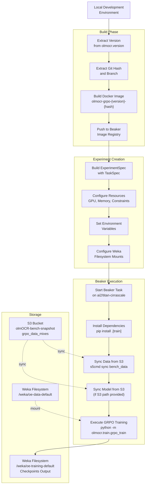
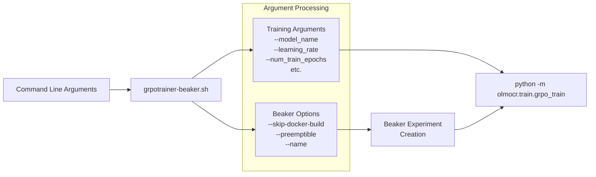
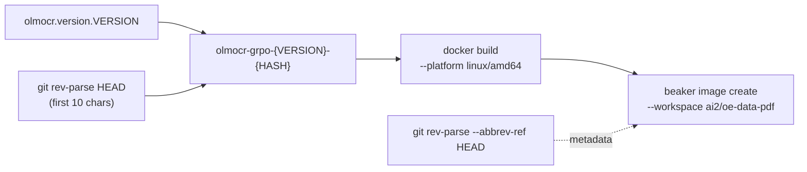
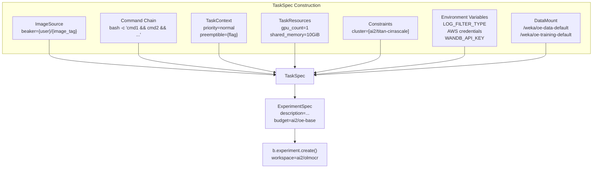
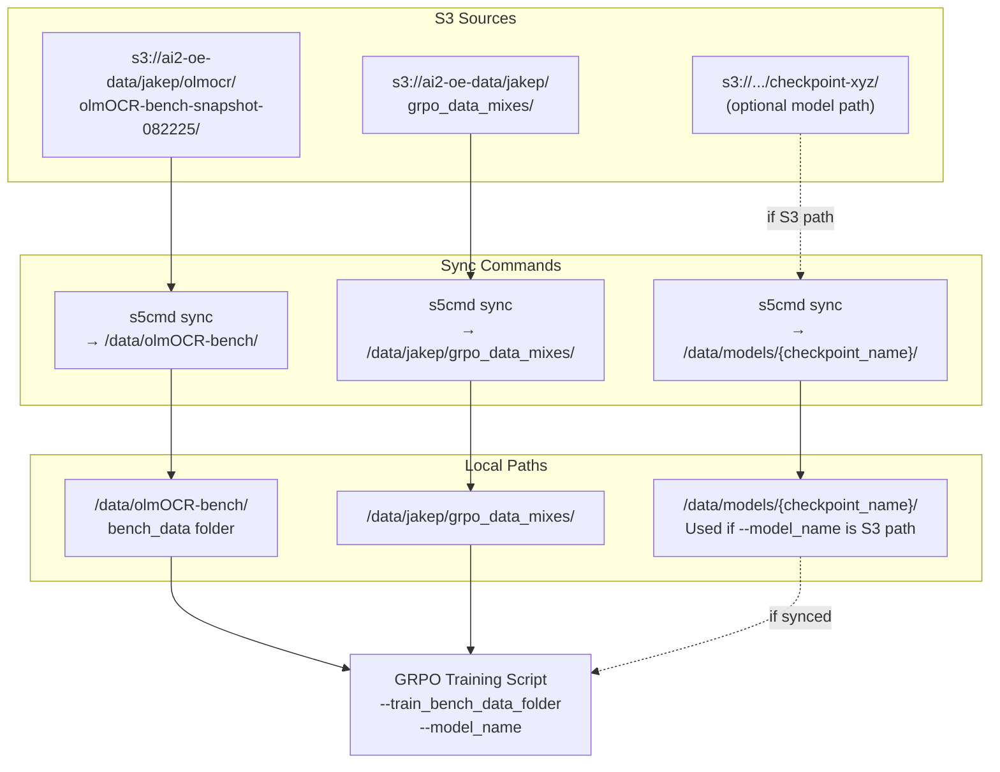
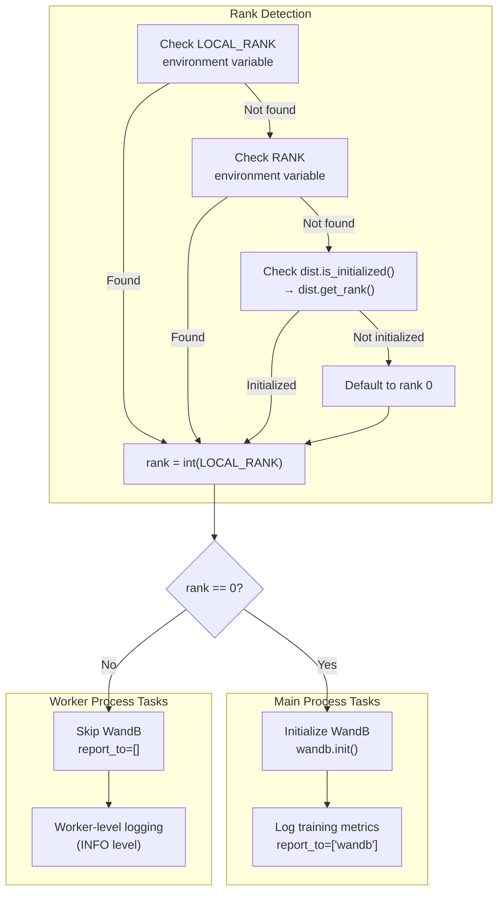
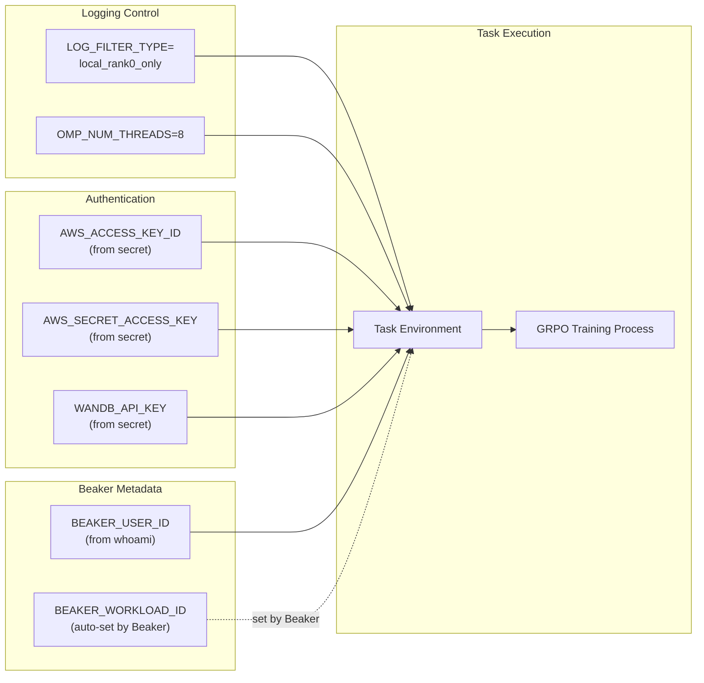
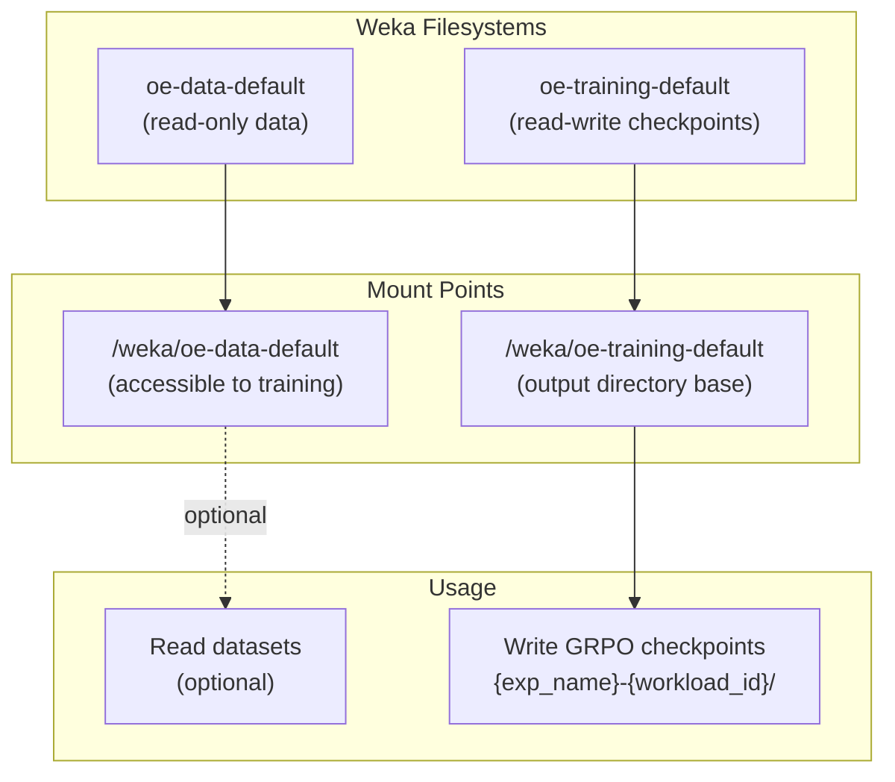
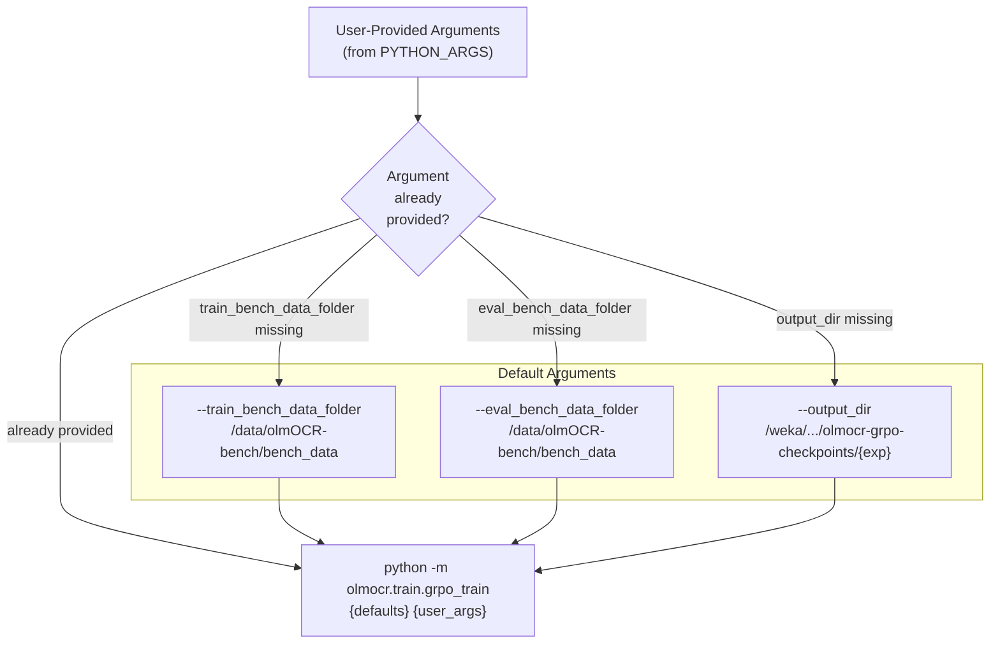
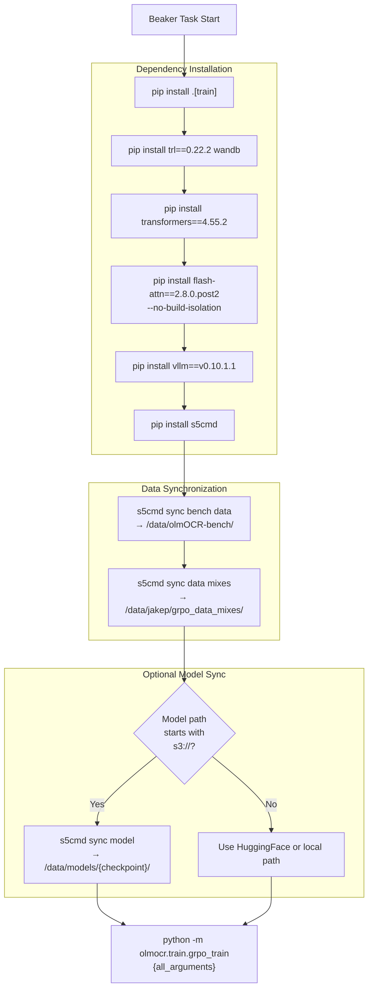

<!-- source: DeepWiki mcp.deepwiki.com · repo allenai/olmocr · page 6.4 Distributed Training on Beaker · fetched 2026-10-26 -->

# Distributed Training on Beaker

<details>
<summary>Relevant source files</summary>

The following files were used as context for generating this wiki page:

- [.dockerignore](.dockerignore)
- [.github/ISSUE_TEMPLATE/feature_request.yml](.github/ISSUE_TEMPLATE/feature_request.yml)
- [.github/actions/setup-venv/action.yml](.github/actions/setup-venv/action.yml)
- [.github/dependabot.yml](.github/dependabot.yml)
- [olmocr/train/grpo_train.py](olmocr/train/grpo_train.py)
- [scripts/beaker/jupiter-ib.sh](scripts/beaker/jupiter-ib.sh)
- [scripts/train/grpotrainer-beaker.sh](scripts/train/grpotrainer-beaker.sh)
- [tests/test_grpo.py](tests/test_grpo.py)

</details>


## Purpose and Scope

This page documents the deployment infrastructure for running distributed GRPO training on the Beaker platform. It covers the [`grpotrainer-beaker.sh`](scripts/train/grpotrainer-beaker.sh:1-254)() deployment script, multi-GPU setup, NCCL configuration for high-speed networking, and Weka filesystem integration.

For the underlying GRPO training algorithm and reward functions, see [GRPO Reinforcement Learning](#5.4). For general Beaker platform integration patterns, see [Beaker Platform Integration](#6.3). For Docker image configuration, see [Docker Images and Containerization](#6.2).

---

## Deployment Architecture

The GRPO training deployment follows a multi-stage workflow that orchestrates Docker image builds, data synchronization, and distributed training execution on Beaker.

### High-Level Deployment Flow



**Sources:** [scripts/train/grpotrainer-beaker.sh:1-254]()

---

## Deployment Script Components

The [`grpotrainer-beaker.sh`](scripts/train/grpotrainer-beaker.sh:1-254)() script orchestrates the complete deployment workflow, from Docker image building to Beaker experiment submission.

### Command-Line Interface

The script accepts both Beaker-specific options and training arguments that are forwarded to the Python training script:

| Option | Type | Description |
|--------|------|-------------|
| `--skip-docker-build` | Flag | Skip Docker image build (use existing image) |
| `--preemptible` | Flag | Use preemptible instances for cost savings |
| `--name NAME` | String | Experiment name (used in output directory path) |
| All other args | Various | Forwarded to `python -m olmocr.train.grpo_train` |

The script separates Beaker-specific options from training arguments:



**Sources:** [scripts/train/grpotrainer-beaker.sh:13-45]()

### Version Tagging and Image Management

The script constructs a unique Docker image tag from the package version and git commit:



The version extraction uses Python introspection, while git information provides reproducibility:

**Sources:** [scripts/train/grpotrainer-beaker.sh:60-88]()

### Beaker Experiment Specification

The script generates a Python program that creates the Beaker experiment using the Beaker SDK. This approach allows complex logic for S3 model path handling and dynamic output directory construction:



**Sources:** [scripts/train/grpotrainer-beaker.sh:95-238]()

---

## Data Synchronization Strategy

The deployment performs multi-stage data synchronization using `s5cmd` for efficient parallel S3 transfers.

### Synchronization Stages



The script automatically detects S3 model paths and converts them to local paths after syncing:

| Model Path Type | Action | Local Path |
|----------------|--------|------------|
| S3 path (`s3://...`) | Sync to `/data/models/{checkpoint_name}/` | `/data/models/{checkpoint_name}/` |
| HuggingFace ID | No sync required | Original path |
| Local path | No sync required | Original path |

**Sources:** [scripts/train/grpotrainer-beaker.sh:124-154]()

---

## Multi-GPU Training Configuration

The GRPO training script uses PyTorch distributed training with automatic rank detection and process coordination.

### Distributed Process Management



The rank detection logic in [`grpo_train.py`](olmocr/train/grpo_train.py:44-62)() ensures compatibility with different distributed training launchers:

**Sources:** [olmocr/train/grpo_train.py:44-62](), [olmocr/train/grpo_train.py:864-871]()

### NCCL Network Configuration

For InfiniBand-enabled clusters, the deployment can use optimized NCCL settings. The [`jupiter-ib.sh`](scripts/beaker/jupiter-ib.sh:1-2)() script provides the configuration:

| Environment Variable | Value | Purpose |
|---------------------|-------|---------|
| `NCCL_DEBUG` | `INFO` | Enable detailed NCCL logging |
| `NCCL_SOCKET_IFNAME` | `ib` | Use InfiniBand network interface |
| `NCCL_IB_HCA` | `^=mlx5_bond_0` | Exclude specific HCA to avoid conflicts |

This configuration enables high-bandwidth, low-latency communication between GPUs across nodes.

**Sources:** [scripts/beaker/jupiter-ib.sh:1-2]()

---

## Resource Allocation

The Beaker task specification defines compute resources and constraints for training jobs.

### Task Resources Configuration

```mermaid
flowchart TB
    subgraph "TaskResources"
        GPU["gpu_count = 1<br/>(per task)"]
        SharedMem["shared_memory = 10GiB<br/>(for dataloaders)"]
    end
    
    subgraph "TaskContext"
        Priority["priority = Priority.normal"]
        Preempt["preemptible = {flag}<br/>(from --preemptible)"]
    end
    
    subgraph "Constraints"
        Cluster["cluster = [ai2/titan-cirrascale]<br/>(GPU cluster)"]
    end
    
    subgraph "Budget"
        Budget["budget = ai2/oe-base<br/>(billing account)"]
    end
    
    TaskSpec["TaskSpec"]
    
    GPU --> TaskSpec
    SharedMem --> TaskSpec
    Priority --> TaskSpec
    Preempt --> TaskSpec
    Cluster --> TaskSpec
    Budget -.experiment level.-> TaskSpec
```

The single-GPU-per-task design allows for:
- Simple resource allocation
- Independent task scheduling
- Easy scaling by launching multiple experiments
- Cost-effective preemptible instance usage

**Sources:** [scripts/train/grpotrainer-beaker.sh:207-211]()

---

## Environment Configuration

The deployment configures multiple environment variables for logging, authentication, and distributed training.

### Environment Variables



**Key Environment Variables:**

| Variable | Source | Purpose |
|----------|--------|---------|
| `LOG_FILTER_TYPE` | Static | Reduce duplicate logs in distributed training |
| `OMP_NUM_THREADS` | Static | Control OpenMP threading for CPU operations |
| `AWS_ACCESS_KEY_ID` | Secret: `ALLENNLP_AWS_ACCESS_KEY_ID` | S3 access for data sync |
| `AWS_SECRET_ACCESS_KEY` | Secret: `ALLENNLP_AWS_SECRET_ACCESS_KEY` | S3 authentication |
| `WANDB_API_KEY` | Secret: `JAKE_WANDB_API_KEY` | Weights & Biases logging |
| `BEAKER_USER_ID` | `beaker account whoami` | User identification |
| `BEAKER_WORKLOAD_ID` | Beaker runtime | Unique task identifier for output paths |

**Sources:** [scripts/train/grpotrainer-beaker.sh:214-220]()

---

## Weka Filesystem Integration

The deployment mounts two Weka filesystems for high-performance data access and checkpoint storage.

### Filesystem Mount Structure



### Output Directory Construction

The script builds hierarchical output directories using experiment metadata:

```python
# Pseudo-code from grpotrainer-beaker.sh:169-179
output_dir = "/weka/oe-training-default/jakep/olmocr-grpo-checkpoints"

if exp_name and BEAKER_WORKLOAD_ID:
    output_dir = f"{output_dir}/{exp_name}-{BEAKER_WORKLOAD_ID}"
elif BEAKER_WORKLOAD_ID:
    output_dir = f"{output_dir}/{BEAKER_WORKLOAD_ID}"
elif exp_name:
    output_dir = f"{output_dir}/{exp_name}"
```

This creates unique directories for each training run:
- `/weka/oe-training-default/jakep/olmocr-grpo-checkpoints/my-experiment-01abc123/`
- `/weka/oe-training-default/jakep/olmocr-grpo-checkpoints/01abc123/`

**Sources:** [scripts/train/grpotrainer-beaker.sh:169-179](), [scripts/train/grpotrainer-beaker.sh:221-224]()

---

## Training Command Assembly

The deployment script dynamically constructs the training command by merging default paths with user-provided arguments.

### Command Construction Logic



The script checks for three critical arguments and provides defaults if not specified:

| Argument | Default Path | Condition |
|----------|--------------|-----------|
| `--train_bench_data_folder` | `/data/olmOCR-bench/bench_data` | If not in user args |
| `--eval_bench_data_folder` | `/data/olmOCR-bench/bench_data` | If not in user args |
| `--output_dir` | `/weka/oe-training-default/jakep/olmocr-grpo-checkpoints/{exp}-{workload_id}` | If not in user args |

**Sources:** [scripts/train/grpotrainer-beaker.sh:163-179](), [scripts/train/grpotrainer-beaker.sh:182-185]()

---

## Execution Workflow

The complete deployment workflow chains multiple setup steps before training execution.

### Command Chain Structure



All steps are chained with `&&` to ensure failure at any stage aborts the workflow. The complete command structure from [`grpotrainer-beaker.sh`](scripts/train/grpotrainer-beaker.sh:115-185)() demonstrates this pattern.

**Sources:** [scripts/train/grpotrainer-beaker.sh:115-185](), [scripts/train/grpotrainer-beaker.sh:199-202]()

---

## Usage Examples

### Basic GRPO Training

```bash
./scripts/train/grpotrainer-beaker.sh \
    --model_name Qwen/Qwen2.5-VL-7B-Instruct \
    --num_train_epochs 1 \
    --learning_rate 2e-6
```

### Training with S3 Checkpoint

```bash
./scripts/train/grpotrainer-beaker.sh \
    --model_name s3://bucket/path/to/checkpoint-1000 \
    --reward_bench 1.0 \
    --reward_front_matter 0.5
```

### Preemptible Training with Named Experiment

```bash
./scripts/train/grpotrainer-beaker.sh \
    --preemptible \
    --name "grpo-qwen7b-exp1" \
    --model_name Qwen/Qwen2.5-VL-7B-Instruct \
    --max_train_samples 100
```

### Skip Docker Build (Use Existing Image)

```bash
./scripts/train/grpotrainer-beaker.sh \
    --skip-docker-build \
    --model_name Qwen/Qwen2.5-VL-7B-Instruct
```

**Sources:** [scripts/train/grpotrainer-beaker.sh:28-37]()

---

