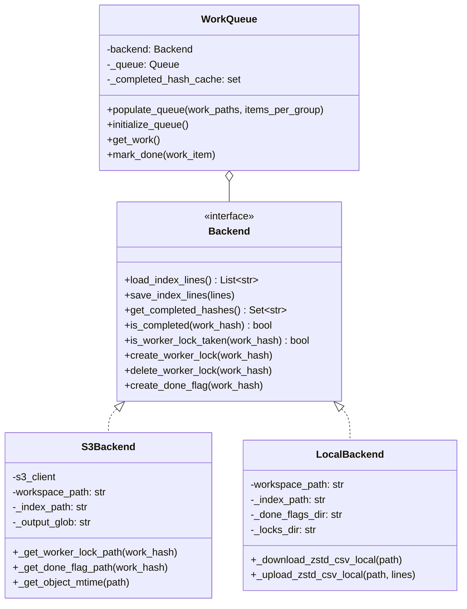
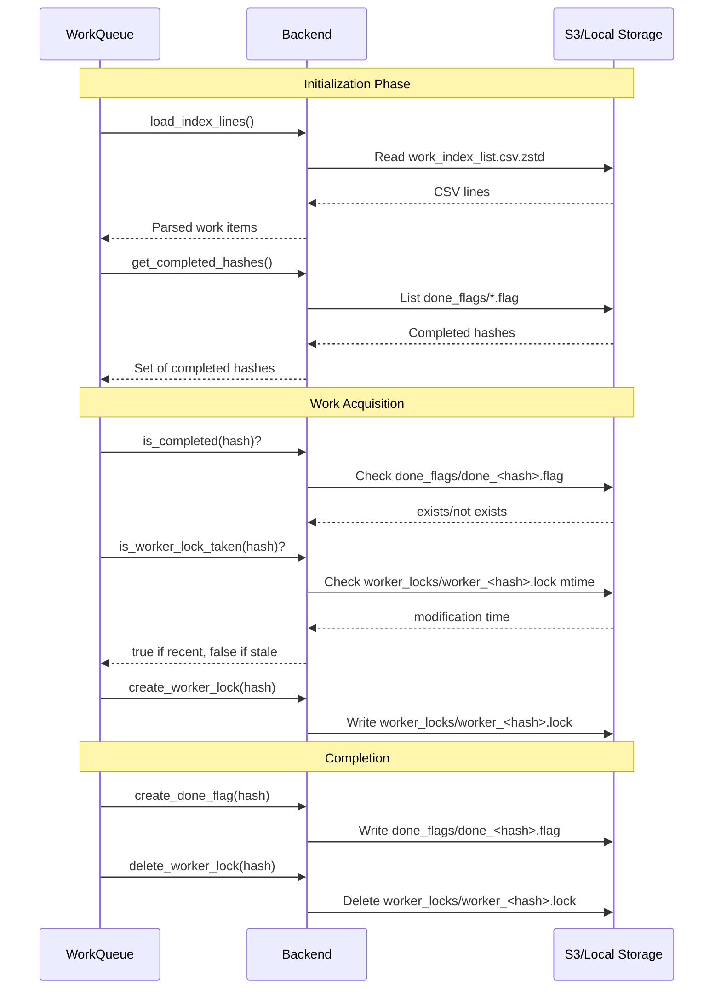
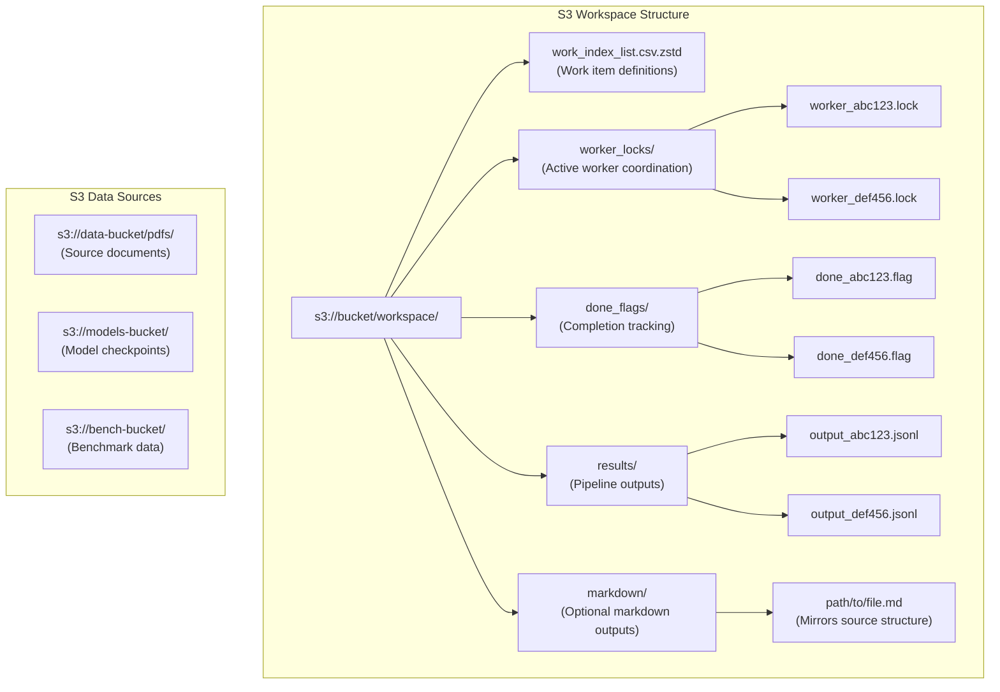
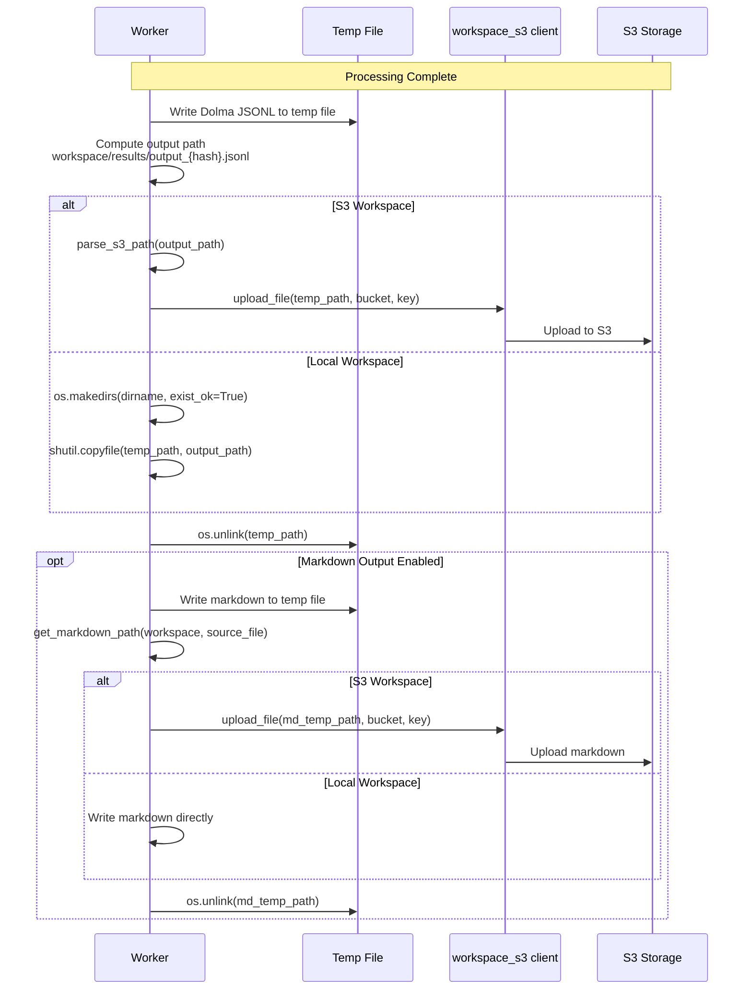
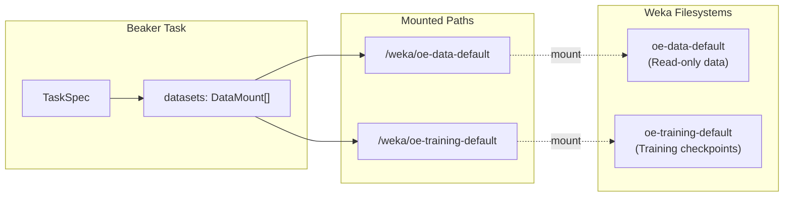
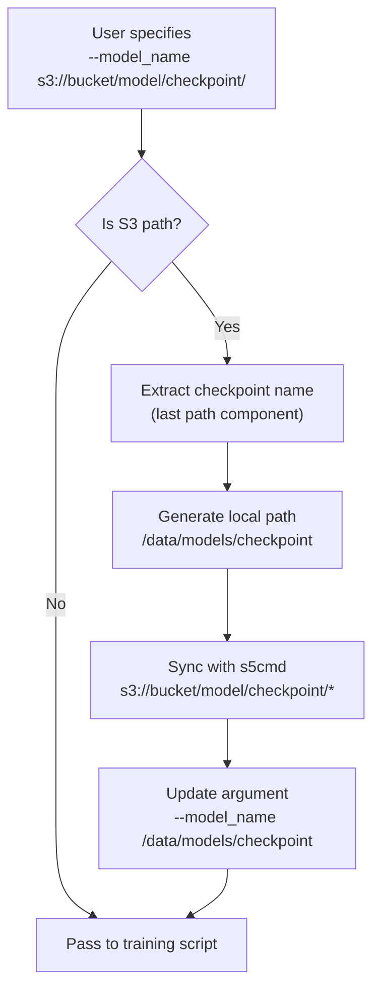

<!-- source: DeepWiki mcp.deepwiki.com · repo allenai/olmocr · page 6.5 Storage and Data Management · fetched 2026-10-26 -->

# Storage and Data Management

<details>
<summary>Relevant source files</summary>

The following files were used as context for generating this wiki page:

- [.dockerignore](.dockerignore)
- [.github/ISSUE_TEMPLATE/feature_request.yml](.github/ISSUE_TEMPLATE/feature_request.yml)
- [.github/actions/setup-venv/action.yml](.github/actions/setup-venv/action.yml)
- [.github/dependabot.yml](.github/dependabot.yml)
- [CHANGELOG.md](CHANGELOG.md)
- [olmocr/pipeline.py](olmocr/pipeline.py)
- [olmocr/train/grpo_train.py](olmocr/train/grpo_train.py)
- [olmocr/version.py](olmocr/version.py)
- [olmocr/work_queue.py](olmocr/work_queue.py)
- [scripts/release.sh](scripts/release.sh)
- [scripts/train/grpotrainer-beaker.sh](scripts/train/grpotrainer-beaker.sh)
- [tests/gnarly_pdfs/edgar_image.pdf](tests/gnarly_pdfs/edgar_image.pdf)
- [tests/test_grpo.py](tests/test_grpo.py)
- [tests/test_pipeline.py](tests/test_pipeline.py)
- [tests/test_s3_work_queue.py](tests/test_s3_work_queue.py)

</details>


This document covers the storage architecture and data management strategies used throughout olmOCR. It describes the pluggable storage backends, work queue coordination mechanisms, and data synchronization patterns that enable distributed processing and training.

For information about the work queue processing logic, see [Work Queue and Distributed Processing](#2.2). For deployment infrastructure details, see [Infrastructure and Deployment](#6).

---

## Overview of Storage Architecture

olmOCR uses a multi-tiered storage architecture designed to support different workloads:

| Storage Type | Primary Use Cases | Access Pattern |
|-------------|-------------------|----------------|
| **S3** | Work queue state, pipeline results, PDF sources, model checkpoints | Distributed read/write |
| **Weka filesystems** | Training checkpoints, high-throughput training data | High-performance parallel I/O |
| **Local filesystem** | Development, testing, temporary processing | Direct file access |

The system abstracts storage operations through a `Backend` interface, allowing the same code to operate against different storage systems without modification.

Sources: [olmocr/pipeline.py:74-76](), [olmocr/work_queue.py:38-80](), [scripts/train/grpotrainer-beaker.sh:221-224]()

---

## Storage Backend Abstraction



The `Backend` interface defines storage operations needed for work queue coordination. This abstraction enables:
- **Development**: Use `LocalBackend` for testing without S3 dependencies
- **Production**: Use `S3Backend` for distributed processing across multiple workers
- **Consistency**: Same work queue logic regardless of storage backend

Sources: [olmocr/work_queue.py:38-80](), [olmocr/work_queue.py:233-348](), [olmocr/work_queue.py:351-432]()

---

## Work Queue State Management

### Directory Structure

Both backends maintain the same logical directory structure:

```
workspace/
├── work_index_list.csv.zstd    # Master list of work items
├── worker_locks/               # Active worker lock files
│   ├── worker_<hash1>.lock
│   └── worker_<hash2>.lock
├── done_flags/                 # Completion markers
│   ├── done_<hash3>.flag
│   └── done_<hash4>.flag
└── results/                    # Output documents (pipeline only)
    └── output_<hash>.jsonl
```

### State Management Flow



### Lock Timeout and Staleness

Worker locks include staleness detection to handle worker failures:
- Default timeout: 1800 seconds (30 minutes)
- Locks older than timeout are considered stale
- Stale locks can be overwritten by new workers
- Prevents permanent blocking from crashed workers

Sources: [olmocr/work_queue.py:82-231](), [olmocr/work_queue.py:304-313](), [olmocr/work_queue.py:400-409]()

---

## S3 Storage Architecture

### Global S3 Clients

The pipeline uses two separate S3 clients to support different AWS accounts:

```python
# Global s3 clients for the whole script
workspace_s3 = boto3.client("s3")  # For work queue and results
pdf_s3 = boto3.client("s3")         # For source PDFs
```

This separation allows:
- Workspace in one AWS account (e.g., team workspace)
- Source data in another AWS account (e.g., shared data bucket)

Sources: [olmocr/pipeline.py:74-76]()

### S3 Path Conventions



### S3Backend Implementation Details

The `S3Backend` implements storage operations using boto3:

| Operation | S3 API Call | Path Pattern |
|-----------|------------|--------------|
| Check completion | `head_object()` | `workspace/done_flags/done_{hash}.flag` |
| Check lock | `head_object()` | `workspace/worker_locks/worker_{hash}.lock` |
| Create lock | `put_object()` | `workspace/worker_locks/worker_{hash}.lock` |
| Create done flag | `put_object()` | `workspace/done_flags/done_{hash}.flag` |
| Delete lock | `delete_object()` | `workspace/worker_locks/worker_{hash}.lock` |
| Load index | `get_object()` | `workspace/work_index_list.csv.zstd` |
| Save index | `put_object()` | `workspace/work_index_list.csv.zstd` |

The backend uses `head_object()` to check file existence and modification times without downloading file contents, minimizing data transfer.

Sources: [olmocr/work_queue.py:351-432]()

### Writing Results to S3



The system uses temporary files as an intermediate step before uploading to ensure atomic writes and cleanup on failure.

Sources: [olmocr/pipeline.py:650-695]()

---

## Weka Filesystem Integration

Weka filesystems provide high-performance shared storage for training workloads. They are mounted into Beaker jobs via `DataMount` specifications.

### Weka Mount Configuration



### GRPO Training Storage Pattern

The GRPO training deployment demonstrates the combined use of S3 and Weka:

```bash
# Sync benchmark data from S3 to local disk
mkdir -p /data/olmOCR-bench
s5cmd sync 's3://ai2-oe-data/jakep/olmocr/olmOCR-bench-snapshot-082225/*' \
    /data/olmOCR-bench/

# Sync model checkpoint from S3 to local disk (if needed)
mkdir -p /data/models
s5cmd sync 's3://path/to/checkpoint/*' '/data/models/checkpoint/'

# Write training outputs to Weka for persistence
python -m olmocr.train.grpo_train \
    --output_dir /weka/oe-training-default/jakep/olmocr-grpo-checkpoints/...
```

### Storage Usage Patterns

| Data Type | Storage Location | Rationale |
|-----------|-----------------|-----------|
| **Benchmark data** | S3 → Local disk | Small dataset, synced once at job start |
| **Model checkpoints (input)** | S3 → Local disk | Large files, local access faster |
| **Training outputs** | Weka filesystem | Persistent, survives job termination |
| **Temporary data** | `/data` (ephemeral disk) | Job-local, automatic cleanup |

The pattern of syncing from S3 to local disk optimizes for:
1. **Fast access**: Local disk I/O faster than S3 for repeated reads
2. **Bandwidth**: Pay S3 transfer cost once, not per epoch
3. **Reliability**: Immune to S3 throttling during training

Sources: [scripts/train/grpotrainer-beaker.sh:123-180](), [scripts/train/grpotrainer-beaker.sh:221-224]()

---

## Data Synchronization Patterns

### S5cmd for Efficient S3 Transfers

The system uses `s5cmd` instead of AWS CLI for S3 synchronization:

```bash
# S5cmd sync is faster than aws s3 sync for many small files
s5cmd sync 's3://source-bucket/prefix/*' '/local/destination/'
```

Benefits of s5cmd:
- **Parallel transfers**: Multiple concurrent connections
- **Wildcard support**: Native glob pattern matching
- **Performance**: Optimized for high-throughput transfers

Sources: [scripts/train/grpotrainer-beaker.sh:122-129]()

### Model Path Translation

The GRPO training script handles S3 model paths transparently:



This allows users to specify S3 paths directly while ensuring local access during training.

Sources: [scripts/train/grpotrainer-beaker.sh:135-157]()

---

## Local Storage Backend

### LocalBackend Implementation

The `LocalBackend` provides identical semantics to `S3Backend` using the local filesystem:

```python
# Directory structure
workspace/
├── work_index_list.csv.zstd
├── worker_locks/
│   └── worker_{hash}.lock
└── done_flags/
    └── done_{hash}.flag
```

### Zstandard Compression

Both backends use zstandard compression for the work index:

```python
def _upload_zstd_csv_local(self, local_path: str, lines: List[str]) -> None:
    data = "\n".join(lines).encode("utf-8")
    cctx = zstandard.ZstdCompressor()
    compressed_data = cctx.compress(data)
    
    with open(local_path, "wb") as f:
        f.write(compressed_data)
```

Compression reduces storage and transfer costs, especially for large work indexes with many items.

Sources: [olmocr/work_queue.py:233-348](), [olmocr/work_queue.py:260-270]()

### Lock File Semantics

Lock files use modification time (`mtime`) to determine staleness:

```python
async def is_worker_lock_taken(self, work_hash: str, 
                                worker_lock_timeout_secs: int = 1800) -> bool:
    lock_path = self._get_worker_lock_path(work_hash)
    lock_mtime = await self._get_object_mtime(lock_path)
    
    if not lock_mtime:
        return False
    
    now = datetime.datetime.now(datetime.timezone.utc)
    return (now - lock_mtime).total_seconds() <= worker_lock_timeout_secs
```

Both backends implement identical staleness logic, ensuring consistent behavior across storage types.

Sources: [olmocr/work_queue.py:304-313](), [olmocr/work_queue.py:400-409]()

---

## Path Sanitization and Security

### Preventing Path Traversal

The `get_markdown_path` function sanitizes file paths to prevent directory traversal attacks:

```python
# Sanitize path: remove any .. components to prevent path traversal
parts = relative_path.split("/")
safe_parts = [p for p in parts if p and p != ".."]
relative_path = "/".join(safe_parts)
```

This ensures that source file paths like `../../etc/passwd.pdf` cannot escape the workspace directory.

### Absolute Path Handling

Absolute local paths are converted to relative paths within the workspace:

```python
# For local files, strip leading slash to make it relative
relative_path = source_file.lstrip("/")
```

This prevents markdown output from being written outside the workspace directory when processing absolute paths like `/home/user/documents/file.pdf`.

Sources: [olmocr/pipeline.py:89-130]()

---

## Storage Configuration Summary

| Component | S3 Usage | Weka Usage | Local Usage |
|-----------|----------|------------|-------------|
| **Pipeline work queue** | ✓ State coordination | - | ✓ Development |
| **Pipeline results** | ✓ JSONL outputs | - | ✓ Development |
| **Training checkpoints** | ✓ Source/backup | ✓ Active training | - |
| **Benchmark data** | ✓ Source | - | ✓ Synced to job |
| **Model inference** | ✓ Model downloads | - | ✓ Cached locally |

The multi-tiered approach optimizes for:
1. **Durability**: S3 as source of truth
2. **Performance**: Weka for high-throughput training I/O
3. **Cost**: Local caching reduces S3 bandwidth charges
4. **Flexibility**: Backend abstraction supports development and production

Sources: [olmocr/pipeline.py:1-936](), [olmocr/work_queue.py:1-433](), [scripts/train/grpotrainer-beaker.sh:1-254]()

---

