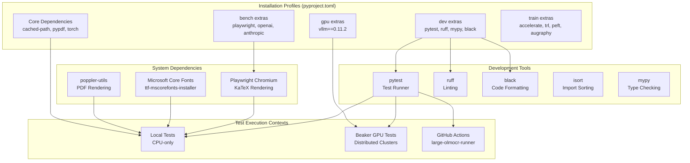
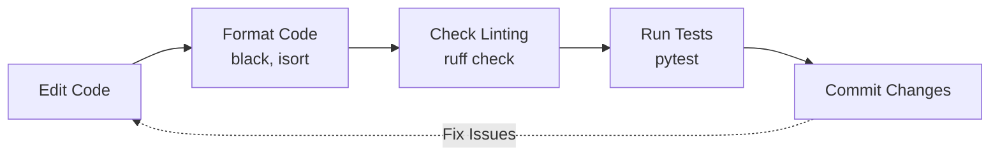
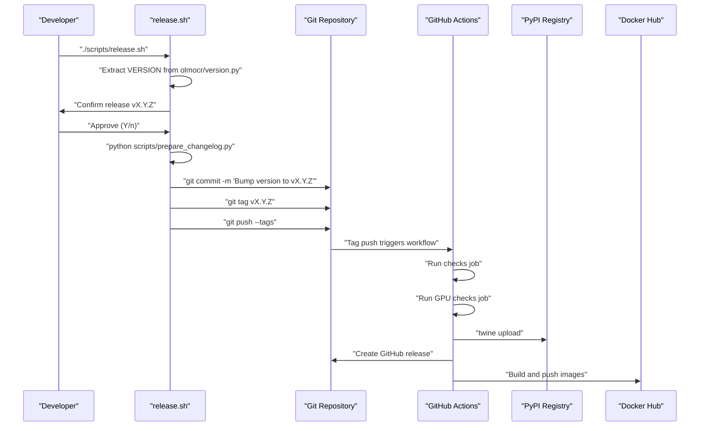

<!-- source: DeepWiki mcp.deepwiki.com · repo allenai/olmocr · page 7 Development and Testing · fetched 2026-10-26 -->

# Development and Testing

<details>
<summary>Relevant source files</summary>

The following files were used as context for generating this wiki page:

- [Dockerfile](Dockerfile)
- [Dockerfile.with-model](Dockerfile.with-model)
- [README.md](README.md)
- [olmocr/bench/README.md](olmocr/bench/README.md)
- [olmocr/bench/runners/run_nanonetsocr.py](olmocr/bench/runners/run_nanonetsocr.py)
- [olmocr/bench/runners/run_olmocr_pipeline.py](olmocr/bench/runners/run_olmocr_pipeline.py)
- [olmocr/train/README.md](olmocr/train/README.md)
- [pyproject.toml](pyproject.toml)
- [scripts/run_mineru_benchmark.sh](scripts/run_mineru_benchmark.sh)

</details>


This document provides an overview of the development workflow, testing practices, and contribution guidelines for the olmOCR codebase. For detailed environment setup instructions, see [Local Development Setup](#7.1). For comprehensive testing documentation, see [Testing Infrastructure](#7.2).

---

## Development Environment Overview

The olmOCR development environment consists of multiple installation profiles, development tools, and testing contexts that ensure code quality across different execution scenarios.



**Diagram: Development Environment Components and Dependencies**

The development environment supports:
- **Multiple installation profiles** for different use cases (core, GPU, development, benchmarking, training)
- **Automated code quality tools** (ruff, black, isort, mypy)
- **Comprehensive testing** via pytest for unit tests and custom benchmark framework
- **CI/CD integration** through GitHub Actions and Beaker platform

For detailed setup instructions, see [Local Development Setup](#7.1).

Sources: [pyproject.toml:1-200](), [Dockerfile:1-59]()

---

## Quick Start for Contributors

**Prerequisites:**
- Python 3.11 or later
- Git for version control
- Optional: Docker for containerized development

**Basic Setup:**

```bash
# Clone repository
git clone https://github.com/allenai/olmocr.git
cd olmocr

# Create virtual environment
python3.11 -m venv .venv
source .venv/bin/activate

# Install development dependencies
pip install -e ".[dev]"

# Install system dependencies (Ubuntu/Debian)
sudo apt-get install -y poppler-utils fonts-crosextra-caladea fonts-crosextra-carlito gsfonts ttf-mscorefonts-installer

# Verify installation
python -m olmocr.pipeline --help

# Run tests
pytest -v tests/
```

For GPU development, benchmarking setup, or training environment configuration, see [Local Development Setup](#7.1).

Sources: [README.md:186-214](), [pyproject.toml:52-84]()

---

## Development Workflow

### Code Development Cycle

The standard development workflow follows a cycle of editing, formatting, linting, testing, and committing:



**Diagram: Development Iteration Cycle**

**Recommended Commands:**

```bash
# 1. Make code changes
vim olmocr/some_module.py

# 2. Format code automatically
black .
isort .

# 3. Check linting (catches common errors)
ruff check .

# 4. Run relevant tests
pytest -v tests/

# 5. Run specific test if debugging
pytest -v tests/test_specific.py::TestClass::test_method

# 6. Commit changes with descriptive message
git add .
git commit -m "Fix rotation detection for 180-degree pages"
```

**Code Quality Standards:**
- Line length: 160 characters (configured in `pyproject.toml`)
- Import sorting: black-compatible profile
- Type hints: Checked for untyped defs (mypy)
- Test coverage: All new features should include tests

For detailed testing procedures, see [Testing Infrastructure](#7.2).

Sources: [pyproject.toml:145-186](), [.github/workflows/main.yml:41-60]()

### Release Process

The release process is semi-automated through the `scripts/release.sh` script:



**Diagram: Release Process Flow**

**Version Management:**

Version is defined in `olmocr/version.py`:

```python
_MAJOR = "0"
_MINOR = "4"
_PATCH = "7"
_SUFFIX = ""  # e.g., "rc1" for release candidates

VERSION = f"{_MAJOR}.{_MINOR}.{_PATCH}{_SUFFIX}"
```

**Release Steps:**

1. Update version in `olmocr/version.py`
2. Run `./scripts/release.sh` which:
   - Validates version string
   - Updates `CHANGELOG.md`
   - Creates git commit and tag
   - Pushes tag to trigger CI/CD
3. GitHub Actions automatically:
   - Runs full test suite (CPU and GPU tests)
   - Builds Python package
   - Publishes to PyPI
   - Creates GitHub release
   - Builds and pushes Docker images

Sources: [scripts/release.sh:1-79](), [olmocr/version.py:1-12](), [.github/workflows/main.yml:163-321]()

---

## Docker Development

The project maintains two Docker image variants for different use cases:

### Base Image (Dockerfile)

**Base Image:** `vllm/vllm-openai:v0.11.2`

**Key Components:**
- Python 3.12 runtime
- VLLM inference engine (v0.11.2)
- olmOCR package with bench dependencies
- System fonts (Microsoft Core Fonts, Caladea, Carlito)
- Playwright + Chromium for KaTeX rendering

**Size:** ~10-15 GB

**Use Case:** Dynamic model loading at runtime, suitable for development and testing

**Building:**
```bash
docker build -f Dockerfile -t olmocr:latest .
```

Sources: [Dockerfile:1-59]()

### With-Model Image (Dockerfile.with-model)

**Base Image:** `alleninstituteforai/olmocr:latest`

**Additional Components:**
- Pre-downloaded model cached in `/opt/models/hub`
- Environment variables: `HF_HOME=/opt/models`, `TRANSFORMERS_CACHE=/opt/models`

**Default Model:** `allenai/olmOCR-2-7B-1025-FP8` (configurable via build arg)

**Size:** ~26-31 GB (includes 16GB model)

**Use Case:** Production deployment, eliminates runtime download latency

**Building with Custom Model:**
```bash
docker build \
    --build-arg MODEL_NAME=allenai/olmOCR-7B-0825-FP8 \
    -f Dockerfile.with-model \
    -t olmocr-custom:latest .
```

**Running Locally:**
```bash
docker run --gpus all \
    -v $(pwd):/workspace \
    alleninstituteforai/olmocr:latest-with-model \
    -c "python -m olmocr.pipeline /workspace/output --markdown --pdfs /workspace/sample.pdf"
```

Sources: [Dockerfile.with-model:1-30](), [README.md:316-355]()

---

## Contribution Guidelines

### Pull Request Checklist

Before submitting a pull request:

1. **Code Quality:**
   - Format code: `black .` and `isort .`
   - Check linting: `ruff check .`
   - Fix any reported issues

2. **Testing:**
   - Add tests for new features
   - Ensure existing tests pass: `pytest -v tests/`
   - For benchmark changes, verify: `python -m olmocr.bench.benchmark --dir olmocr/bench/sample_data`

3. **Documentation:**
   - Update docstrings for new/modified functions
   - Add comments for complex logic
   - Update README.md if adding user-facing features

4. **Commit Messages:**
   - Use descriptive commit messages
   - Reference issue numbers when applicable

5. **CI Checks:**
   - Verify all GitHub Actions checks pass
   - Address any failing tests or linting issues

### Code Review Process

Pull requests are reviewed by project maintainers. Typical review cycle:

1. Automated CI checks run (linting, tests, docs)
2. Maintainer reviews code for:
   - Correctness and functionality
   - Code quality and style
   - Test coverage
   - Documentation completeness
3. Reviewer provides feedback or approves
4. Author addresses feedback
5. Once approved and CI passes, maintainer merges

---

## Testing Best Practices

For comprehensive testing documentation, see [Testing Infrastructure](#7.2).

**Key Testing Principles:**

1. **Unit Tests:** Test individual components in isolation
2. **Integration Tests:** Test component interactions
3. **Benchmark Tests:** Evaluate OCR quality on real documents
4. **Statistical Rigor:** Use bootstrap confidence intervals for benchmark scores

**Test Organization:**
- Unit tests: `tests/` directory (pytest framework)
- Benchmark tests: `olmocr/bench/` directory (custom framework)
- Test data: `olmocr/bench/sample_data/` and `tests/gnarly_pdfs/`

**Running Tests:**
```bash
# Unit tests
pytest -v tests/

# Benchmark tests
python -m olmocr.bench.benchmark --dir olmocr/bench/sample_data

# Specific test file
pytest -v tests/test_katex_render.py

# Tests with specific marker
pytest -v -m "not nonci" tests/
```

For details on test types, statistical analysis, and benchmark test generation, see [Testing Infrastructure](#7.2).

Sources: [pyproject.toml:188-199](), [olmocr/bench/README.md:1-323]()

---

This completes the Development and Testing documentation. For deployment and production usage, see [Infrastructure and Deployment](#6). For details on the benchmark evaluation system, see [Benchmarking System](#4).

---

