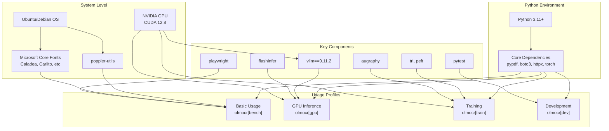
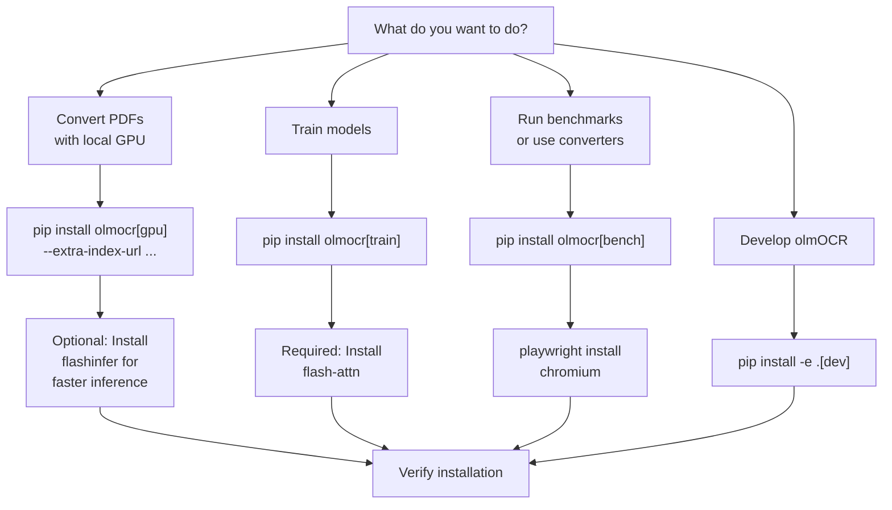
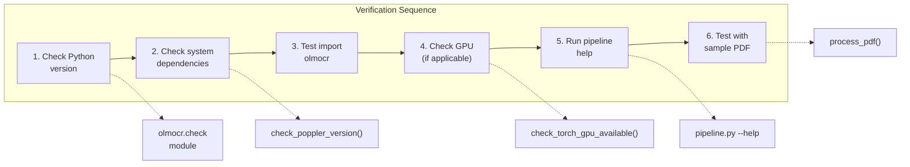

<!-- source: DeepWiki mcp.deepwiki.com · repo allenai/olmocr · page 7.1 Local Development Setup · fetched 2026-10-26 -->

# Local Development Setup

<details>
<summary>Relevant source files</summary>

The following files were used as context for generating this wiki page:

- [Dockerfile](Dockerfile)
- [Dockerfile.with-model](Dockerfile.with-model)
- [README.md](README.md)
- [olmocr/bench/README.md](olmocr/bench/README.md)
- [olmocr/bench/runners/run_nanonetsocr.py](olmocr/bench/runners/run_nanonetsocr.py)
- [olmocr/bench/runners/run_olmocr_pipeline.py](olmocr/bench/runners/run_olmocr_pipeline.py)
- [olmocr/train/README.md](olmocr/train/README.md)
- [pyproject.toml](pyproject.toml)
- [scripts/run_mineru_benchmark.sh](scripts/run_mineru_benchmark.sh)

</details>


## Purpose and Scope

This page documents the steps required to set up a local development environment for olmOCR. It covers system prerequisites, Python environment configuration, dependency installation, and verification steps for different use cases. This guide assumes you want to run olmOCR locally for development, testing, or small-scale usage.

For distributed execution on compute clusters, see [Distributed Execution on Beaker](#6.2). For Docker-based deployment, see [Containerization and Build System](#6.1).

---

## System Architecture: Development Dependencies

The following diagram illustrates how different development profiles depend on core system components and Python packages:



**Sources:** [pyproject.toml:21-119](), [README.md:186-214]()

---

## Hardware and Operating System Requirements

### Minimum Requirements

| Component | Requirement | Purpose |
|-----------|-------------|---------|
| **Operating System** | Ubuntu 20.04+ or Debian 11+ | System dependencies availability |
| **Python** | 3.11 or 3.12 | Core runtime requirement |
| **Disk Space** | 30 GB free | Model cache and dependencies |
| **RAM** | 16 GB | Basic operations |

### GPU Requirements (For Inference)

| Component | Minimum | Recommended | Notes |
|-----------|---------|-------------|-------|
| **GPU** | 15 GB VRAM | 24+ GB VRAM | RTX 4090, L40S, A100, H100 tested |
| **CUDA** | 12.8 | 12.8 | Required for vLLM |
| **Driver** | 535.x+ | Latest | NVIDIA proprietary driver |

**Sources:** [README.md:188-190](), [Dockerfile:1-6]()

---

## System Dependencies Installation

### Ubuntu/Debian Setup

The following system packages are required for PDF rendering and document processing:

```bash
sudo apt-get update
sudo apt-get install -y \
    poppler-utils \
    ttf-mscorefonts-installer \
    msttcorefonts \
    fonts-crosextra-caladea \
    fonts-crosextra-carlito \
    gsfonts \
    lcdf-typetools
```

**Package Roles:**
- `poppler-utils`: Provides `pdftoppm` and `pdftotext` for PDF rendering
- `ttf-mscorefonts-installer`: Microsoft TrueType core fonts for document rendering
- `fonts-crosextra-*`: Additional fonts for better document compatibility
- `gsfonts`: Ghostscript fonts for PostScript/PDF operations

**Sources:** [README.md:194-198](), [Dockerfile:26-35](), [.github/workflows/main.yml:70-73]()

---

## Python Environment Setup

### Creating an Isolated Environment

It is **strongly recommended** to use a clean Python environment due to complex dependency requirements:

```bash
# Using conda (recommended)
conda create -n olmocr python=3.11
conda activate olmocr

# OR using venv
python3.11 -m venv olmocr-env
source olmocr-env/bin/activate
```

**Why isolation matters:** The `vllm` package and its dependencies (torch, transformers) have specific version requirements that can conflict with other packages. Starting with a fresh environment prevents dependency resolution issues.

**Sources:** [README.md:200-204](), [pyproject.toml:21]()

---

## Installation Profiles

The olmOCR package provides different installation profiles via optional dependency groups defined in `pyproject.toml`:

### Installation Profile Decision Tree



**Sources:** [pyproject.toml:52-118](), [README.md:206-214]()

### Profile 1: Benchmarking Only (CPU)

For running benchmarks without performing OCR conversions:

```bash
pip install olmocr[bench]

# Install Playwright browser for math rendering tests
playwright install chromium
```

**Included capabilities:**
- Run `olmocr.bench.benchmark` against OCR outputs
- Use benchmark test generation tools
- Access `olmocr.bench.convert` runners (Marker, MinerU, etc.)
- No GPU required

**Key dependencies:** `playwright`, `openai`, `anthropic`, `syntok`, `rapidfuzz`

**Sources:** [pyproject.toml:86-99](), [olmocr/bench/README.md:278-291]()

### Profile 2: GPU Inference

For converting PDFs using local GPU:

```bash
# Install with GPU dependencies
pip install olmocr[gpu] --extra-index-url https://download.pytorch.org/whl/cu128

# Optional but recommended: Install FlashInfer for faster inference
pip install https://download.pytorch.org/whl/cu128/flashinfer/flashinfer_python-0.2.5%2Bcu128torch2.7-cp38-abi3-linux_x86_64.whl
```

**Included capabilities:**
- Run `python -m olmocr.pipeline` with local VLLM server
- Process PDFs using GPU acceleration
- Full OCR pipeline functionality

**Key dependencies:** `vllm==0.11.2`, `torch>=2.7.0`

**Sources:** [README.md:209-214](), [pyproject.toml:53-55]()

### Profile 3: Model Training

For training or fine-tuning OCR models:

```bash
pip install olmocr[train]

# Install transformers with specific version
pip install transformers==4.52.4

# Install flash-attention for training efficiency
pip install flash-attn>=2.8.0.post2 --no-build-isolation
```

**Included capabilities:**
- Run `olmocr.train.train` for supervised fine-tuning
- Run `olmocr.train.grpo_train` for RL training
- Use data preparation tools (`prepare_olmocrmix`, `prepare_workspace`)
- Apply data augmentation with `augraphy`

**Key dependencies:** `trl`, `peft`, `accelerate`, `augraphy`, `omegaconf`

**Sources:** [pyproject.toml:101-111](), [olmocr/train/README.md:9-15]()

### Profile 4: Development

For contributing to the olmOCR codebase:

```bash
# Clone repository
git clone https://github.com/allenai/olmocr.git
cd olmocr

# Install in editable mode with dev dependencies
pip install -e .[dev]
```

**Included capabilities:**
- All functionality from other profiles
- Code quality tools: `ruff`, `mypy`, `black`, `isort`
- Testing framework: `pytest`, `pytest-asyncio`, `pytest-cov`
- Documentation building: `Sphinx`, `myst-parser`
- Building and releasing: `build`, `twine`, `wheel`

**Key dependencies:** Full development toolchain

**Sources:** [pyproject.toml:57-84](), [.github/workflows/main.yml:41-60]()

---

## Core Dependencies and Their Roles

The following table maps key Python packages to their functional roles in the codebase:

| Package | Version Constraint | Used By | Purpose |
|---------|-------------------|---------|---------|
| `pypdf` | >=5.2.0 | `olmocr.pipeline` | PDF reading and page counting [pipeline.py:30]() |
| `pypdfium2` | Latest | `olmocr.data.anchor` | Alternative PDF text extraction engine |
| `boto3` | Latest | `olmocr.pipeline`, `olmocr.s3_utils` | AWS S3 operations [pipeline.py:25,81-82]() |
| `httpx` | Latest | `olmocr.pipeline` | HTTP client for VLLM API [pipeline.py:26]() |
| `torch` | >=2.7.0 | All GPU operations | Deep learning framework |
| `transformers` | ==4.57.3 | Model loading | HuggingFace model interface [pipeline.py:28]() |
| `vllm` | ==0.11.2 | `olmocr.pipeline` | VLLM inference server [pipeline.py:657-694]() |
| `lingua-language-detector` | Latest | `olmocr.filter.filter` | Language detection for filtering |
| `Pillow` | Latest | `olmocr.data.renderpdf` | Image processing [pipeline.py:29]() |
| `markdownify` | Latest | `olmocr.data.buildsilver` | HTML to Markdown conversion |
| `playwright` | Latest | `olmocr.bench` | Headless browser for math rendering |
| `beaker-py` | Latest | Distributed execution | Beaker cluster integration [pipeline.py:875-887]() |

**Sources:** [pyproject.toml:22-43](), [pipeline.py:1-53]()

---

## Verification Steps

### Component Verification Diagram



**Sources:** [olmocr/pipeline.py:33-36]()

### 1. Verify Python Version

```bash
python --version
# Should output: Python 3.11.x or Python 3.12.x
```

### 2. Verify System Dependencies

```bash
# Check poppler-utils
pdftoppm -v
# Should output version information without errors

# Check pdftotext
pdftotext -v
# Should output version information
```

The `olmocr.check` module provides programmatic verification:

```python
from olmocr.check import check_poppler_version
check_poppler_version()
# Raises exception if poppler is not available or version is too old
```

**Sources:** [olmocr/pipeline.py:33-35]()

### 3. Verify Package Installation

```bash
python -c "import olmocr; print(olmocr.version.VERSION)"
# Should output version number like: 0.4.7
```

### 4. Verify GPU Access (If Applicable)

```bash
python -c "from olmocr.check import check_torch_gpu_available; check_torch_gpu_available()"
# Should complete without errors if GPU is available
```

This function checks:
- PyTorch CUDA availability
- GPU device count
- GPU memory

**Sources:** [olmocr/pipeline.py:35-36]()

### 5. Verify Pipeline Entry Point

```bash
python -m olmocr.pipeline --help
# Should display help text with all command-line options
```

This verifies:
- Package installation is correct
- Entry point is registered
- Core imports work

**Sources:** [README.md:359-418](), [Dockerfile:56]()

### 6. Test with Sample PDF

```bash
# Download sample PDF
curl -o test-sample.pdf https://olmocr.allenai.org/papers/olmocr_3pg_sample.pdf

# Test CPU-only operations (rendering, anchor text extraction)
python -c "
from olmocr.data.renderpdf import render_pdf_to_base64png
from olmocr.prompts.anchor import get_anchor_text
result = render_pdf_to_base64png('test-sample.pdf', 1)
print(f'Rendered page, got {len(result)} base64 chars')
text = get_anchor_text('test-sample.pdf', 1)
print(f'Extracted anchor text: {len(text)} chars')
"
```

For GPU inference verification:

```bash
# Run full pipeline on sample (requires GPU)
python -m olmocr.pipeline ./test-workspace --markdown --pdfs test-sample.pdf
# Should create ./test-workspace/results/ with JSONL output
# And ./test-workspace/markdown/ with markdown output
```

**Sources:** [README.md:216-248](), [olmocr/bench/runners/run_olmocr_pipeline.py:42-96]()

---

## Common Setup Issues and Solutions

### Issue: `vllm` Installation Fails

**Symptoms:**
```
ERROR: Could not find a version that satisfies the requirement vllm==0.11.2
```

**Solutions:**
1. Ensure CUDA 12.8 is installed: `nvcc --version`
2. Use the correct PyTorch index URL: `--extra-index-url https://download.pytorch.org/whl/cu128`
3. Check Python version is 3.11 or 3.12
4. Verify GPU compute capability is supported (7.0+)

**Sources:** [README.md:210](), [pyproject.toml:54]()

### Issue: `poppler-utils` Not Found

**Symptoms:**
```
FileNotFoundError: [Errno 2] No such file or directory: 'pdftoppm'
```

**Solution:**
```bash
sudo apt-get update
sudo apt-get install poppler-utils
```

Verify with: `pdftoppm -v`

**Sources:** [olmocr/pipeline.py:34](), [Dockerfile:29]()

### Issue: Font Rendering Problems

**Symptoms:**
- PDFs render with missing or incorrect characters
- Tables appear misaligned

**Solution:**
```bash
# Accept EULA non-interactively
echo "ttf-mscorefonts-installer msttcorefonts/accepted-mscorefonts-eula select true" | sudo debconf-set-selections

# Install Microsoft core fonts
sudo apt-get install -y ttf-mscorefonts-installer fonts-crosextra-caladea fonts-crosextra-carlito
```

**Sources:** [Dockerfile:24-35](), [README.md:196-197]()

### Issue: `playwright` Browser Not Found

**Symptoms:**
```
playwright._impl._api_types.Error: Executable doesn't exist
```

**Solution:**
```bash
playwright install chromium
# If permission errors:
playwright install-deps
playwright install chromium
```

**Sources:** [olmocr/bench/README.md:289-290](), [.github/workflows/main.yml:34]()

### Issue: Out of Memory During Training

**Symptoms:**
```
torch.cuda.OutOfMemoryError: CUDA out of memory
```

**Solutions:**
1. Reduce batch size in training config
2. Enable gradient checkpointing
3. Use smaller LoRA rank
4. Use FP8 quantization for base model
5. Reduce `max_model_len` for VLLM

**Training config locations:**
- `olmocr/train/configs/v0.4.0/*.yaml`

**Sources:** [olmocr/train/README.md:79-98]()

### Issue: Import Errors After Installation

**Symptoms:**
```
ImportError: cannot import name 'X' from 'olmocr'
```

**Solution:**
```bash
# Reinstall in editable mode
pip uninstall olmocr
pip install -e .

# Or non-editable
pip install --force-reinstall olmocr[gpu]
```

**Sources:** [.github/workflows/main.yml:104-107]()

---

## Directory Structure for Local Development

When working with olmOCR locally, the following directory structure is typical:

```
~/olmocr-dev/
├── olmocr/                          # Git repository (if developing)
│   ├── olmocr/                      # Python package
│   │   ├── pipeline.py              # Main pipeline [pipeline.py:1-937]()
│   │   ├── train/                   # Training code
│   │   ├── bench/                   # Benchmarking code
│   │   └── data/                    # Data processing utilities
│   ├── tests/                       # Test suite
│   ├── scripts/                     # Helper scripts
│   └── pyproject.toml               # Package configuration
├── workspaces/                      # Pipeline workspaces
│   ├── workspace1/
│   │   ├── results/                 # JSONL outputs
│   │   └── markdown/                # Markdown outputs (if --markdown)
│   └── workspace2/
├── training-data/                   # Training datasets
│   ├── document1.pdf
│   ├── document1.md
│   └── ...
└── models/                          # Downloaded/trained models
    ├── olmOCR-2-7B-1025-FP8/
    └── custom-finetune/
```

**Workspace structure** is managed by [olmocr.pipeline:95-128]() and [olmocr.work_queue]().

**Sources:** [olmocr/pipeline.py:95-128](), [olmocr/train/README.md:22-31]()

---

## Environment Variables

Several environment variables affect olmOCR behavior during development:

| Variable | Purpose | Default | Set By |
|----------|---------|---------|--------|
| `BEAKER_ASSIGNED_CPU_COUNT` | CPU workers for PDF rendering | `cpu_count() - 2` | Beaker platform [pipeline.py:88]() |
| `HF_HOME` | HuggingFace cache directory | `~/.cache/huggingface` | User |
| `TRANSFORMERS_CACHE` | Transformers cache | `~/.cache/huggingface` | User |
| `OMP_NUM_THREADS` | OpenMP thread count | `1` | VLLM server [pipeline.py:693]() |
| `CUDA_VISIBLE_DEVICES` | GPU visibility | All GPUs | User |
| `VLLM_WORKER_MULTIPROC_METHOD` | VLLM multiprocessing | `spawn` | vLLM |

**Example configuration:**

```bash
# Use specific GPU
export CUDA_VISIBLE_DEVICES=0

# Custom model cache location
export HF_HOME=/data/models
export TRANSFORMERS_CACHE=/data/models

# Limit CPU workers
export BEAKER_ASSIGNED_CPU_COUNT=8
```

**Sources:** [olmocr/pipeline.py:88,693](), [Dockerfile.with-model:9-11]()

---

## Next Steps After Setup

Once your environment is configured:

1. **For OCR Usage:** See [Pipeline Architecture](#2.1) for running PDF conversions
2. **For Benchmarking:** See [Test Framework and Types](#4.1) for evaluation workflows  
3. **For Training:** See [Training Data Preparation](#5.1) and [Supervised Fine-Tuning](#5.2)
4. **For Testing:** See [Testing Framework](#7.2) for running the test suite
5. **For Cluster Deployment:** See [Distributed Execution on Beaker](#6.2)

**Sources:** All wiki structure pages

---

