<!-- source: DeepWiki mcp.deepwiki.com · repo allenai/olmocr · page 7.2 Testing Infrastructure · fetched 2026-10-26 -->

# Testing Infrastructure

<details>
<summary>Relevant source files</summary>

The following files were used as context for generating this wiki page:

- [Dockerfile](Dockerfile)
- [Dockerfile.with-model](Dockerfile.with-model)
- [olmocr/bench/benchmark.py](olmocr/bench/benchmark.py)
- [olmocr/bench/katex/render.py](olmocr/bench/katex/render.py)
- [olmocr/bench/miners/download_math.py](olmocr/bench/miners/download_math.py)
- [olmocr/bench/miners/mine_math.py](olmocr/bench/miners/mine_math.py)
- [olmocr/bench/report.py](olmocr/bench/report.py)
- [olmocr/bench/runners/run_mistral.py](olmocr/bench/runners/run_mistral.py)
- [olmocr/bench/sample_data/dataset.jsonl](olmocr/bench/sample_data/dataset.jsonl)
- [olmocr/bench/sample_data/pdfs/small_page_size.pdf](olmocr/bench/sample_data/pdfs/small_page_size.pdf)
- [olmocr/bench/sample_data/pdfs/test-graphical-text.pdf](olmocr/bench/sample_data/pdfs/test-graphical-text.pdf)
- [olmocr/bench/tests.py](olmocr/bench/tests.py)
- [olmocr/bench/utils.py](olmocr/bench/utils.py)
- [pyproject.toml](pyproject.toml)
- [tests/test_katex_render.py](tests/test_katex_render.py)

</details>


## Purpose and Scope

This document covers the pytest-based testing infrastructure for the olmOCR project, including unit test configuration, the benchmark test framework, test execution workflows, statistical validation, and test data management. The testing infrastructure validates OCR outputs against ground truth using multiple test types with fuzzy matching, structural validation, and statistical analysis.

For information about the complete benchmarking system including multi-OCR comparison and synthetic data generation, see [4. Benchmarking System](#4). For local development setup and environment configuration, see [7.1. Local Development Setup](#7.1).

## Pytest Framework Configuration

### Framework Setup

The pytest configuration is defined in [pyproject.toml:188-200](). Key configuration elements:

| Setting | Value | Purpose |
|---------|-------|---------|
| `testpaths` | `"tests/"` | Root directory for test discovery |
| `python_classes` | `["Test*", "*Test"]` | Class name patterns for test discovery |
| `log_level` | `"DEBUG"` | Logging verbosity |
| `markers` | `["nonci"]` | Custom markers for test filtering |
| `addopts` | `"-m 'not nonci'"` | Skip `nonci` marked tests by default |

The `nonci` marker allows excluding expensive or long-running tests from CI pipelines. Tests marked with `@pytest.mark.nonci` are automatically filtered unless explicitly requested.

Sources: [pyproject.toml:188-200]()

### Test Dependencies

The development dependencies include the complete pytest ecosystem:

| Package | Purpose |
|---------|---------|
| `pytest` | Core testing framework |
| `pytest-cov` | Coverage reporting and measurement |
| `pytest-asyncio` | Async test execution support |
| `pytest-sphinx` | Documentation testing integration |

Benchmark-specific dependencies are in the `bench` optional group, including `playwright` for browser automation and `fuzzysearch`/`rapidfuzz` for fuzzy text matching.

Sources: [pyproject.toml:57-84](), [pyproject.toml:86-99]()

## Test Organization and Structure

### Directory Layout

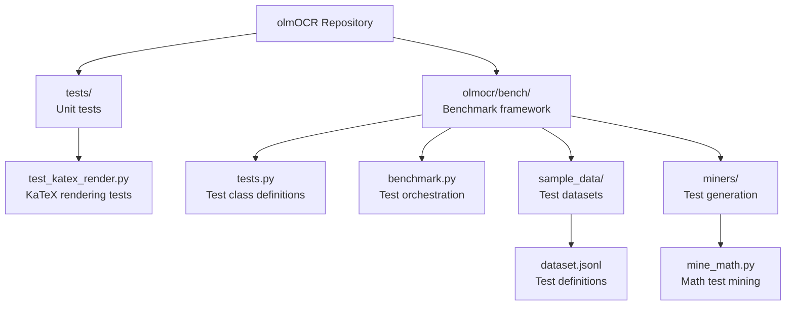

Sources: [tests/test_katex_render.py:1-6](), [olmocr/bench/tests.py:1-22](), [olmocr/bench/benchmark.py:1-31](), [olmocr/bench/sample_data/dataset.jsonl:1-10](), [olmocr/bench/miners/mine_math.py:1-40]()

## Benchmark Test Framework

### Test Class Hierarchy

The benchmark framework implements a polymorphic test system with `BasePDFTest` as the abstract base:

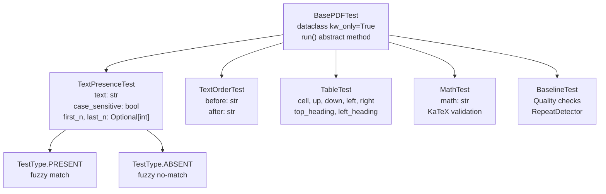

Sources: [olmocr/bench/tests.py:474-518](), [olmocr/bench/tests.py:519-574](), [olmocr/bench/tests.py:576-618](), [olmocr/bench/tests.py:620-855](), [olmocr/bench/tests.py:856-920]()

### BasePDFTest Common Interface

All test types inherit common attributes and validation:

| Field | Type | Validation | Description |
|-------|------|-----------|-------------|
| `pdf` | `str` | Cannot be empty | PDF filename relative to pdfs folder |
| `page` | `int` | - | 1-indexed page number |
| `id` | `str` | Cannot be empty | Unique test identifier |
| `type` | `str` | Must be in TestType enum | Test type identifier |
| `max_diffs` | `int` | Must be ≥ 0 | Edit distance threshold for fuzzy matching |
| `checked` | `Optional[TestChecked]` | - | Verification status (verified/rejected) |
| `url` | `Optional[str]` | - | Source URL for provenance |

The `__post_init__` method validates these constraints at instantiation.

Sources: [olmocr/bench/tests.py:474-504]()

### Text Validation: TextPresenceTest

`TextPresenceTest` validates text presence or absence using fuzzy matching:

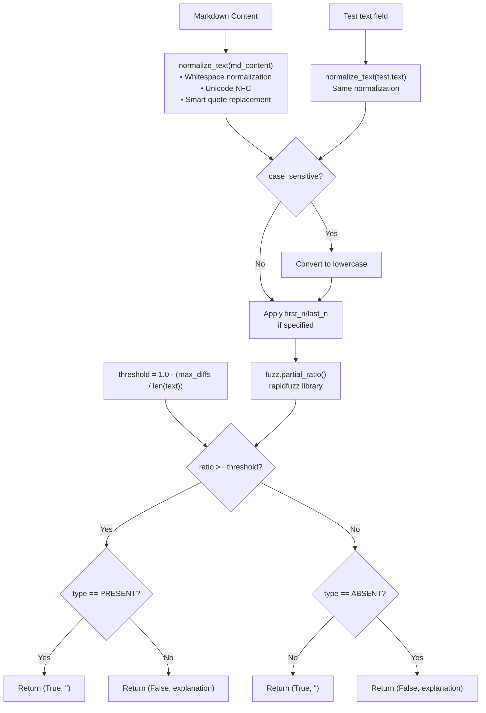

The `normalize_text()` function handles:
- `<br>` tag removal
- Whitespace normalization via `re.sub(r"\s+", " ", text)`
- Bold/italic markdown removal
- Unicode NFC normalization
- Smart quote and dash replacement

Sources: [olmocr/bench/tests.py:116-146](), [olmocr/bench/tests.py:519-574]()

### Ordering Validation: TextOrderTest

`TextOrderTest` validates relative text positioning using exact substring search with edit distance:

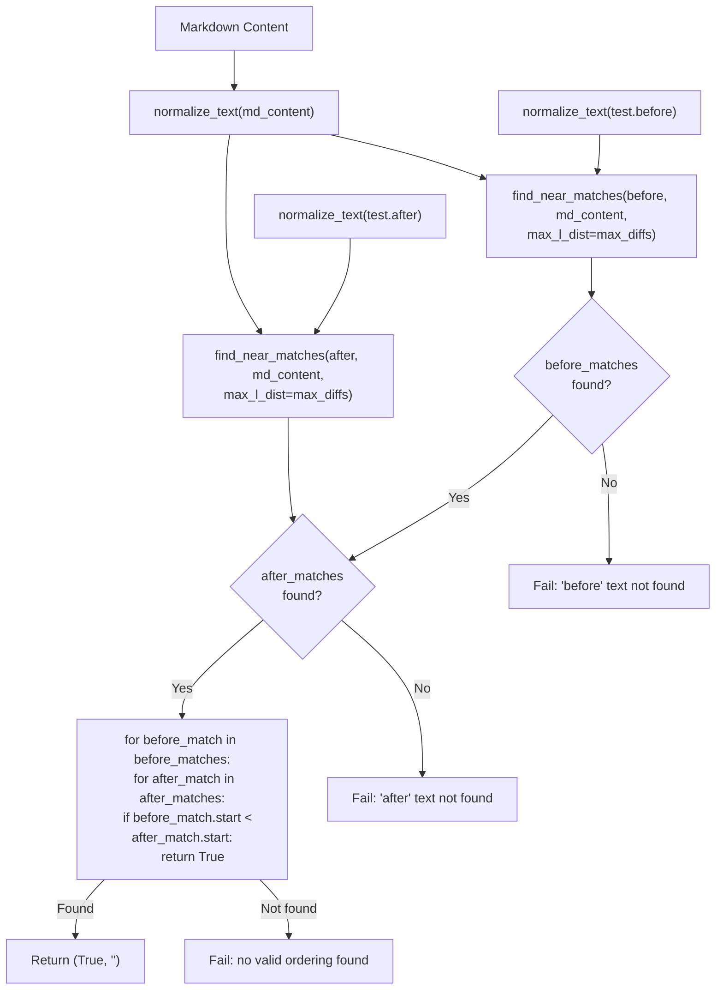

The validation ensures `max_diffs` is reasonable (< 50% of search string length) during `__post_init__`.

Sources: [olmocr/bench/tests.py:576-618]()

### Table Structure Validation: TableTest

`TableTest` validates table cell relationships and structure:

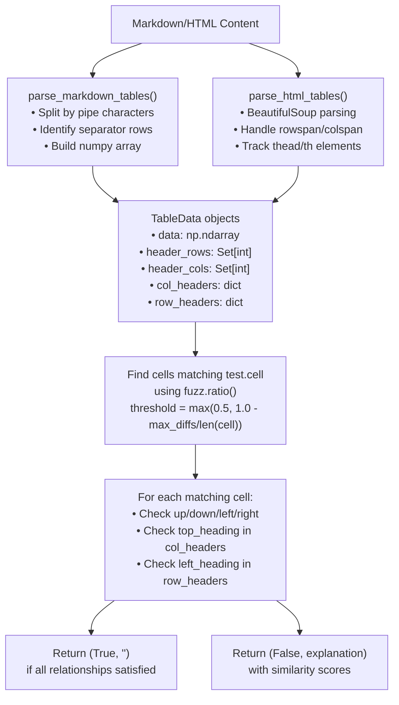

The `TableData` class provides a structured representation:
- `data`: numpy array of cell contents
- `header_rows`/`header_cols`: Sets of header indices
- `col_headers`: Maps column index to `[(row, text), ...]` for all headers above
- `row_headers`: Maps row index to `[(col, text), ...]` for all headers to the left

HTML table parsing handles complex structures:
- rowspan/colspan via cell_grid tracking
- thead detection for automatic header marking
- th elements mark header rows and columns
- Header propagation through spanned cells

Sources: [olmocr/bench/tests.py:24-94](), [olmocr/bench/tests.py:149-256](), [olmocr/bench/tests.py:304-472](), [olmocr/bench/tests.py:620-855]()

### Mathematical Equation Validation: MathTest

`MathTest` validates equations by rendering with KaTeX and comparing visual output:

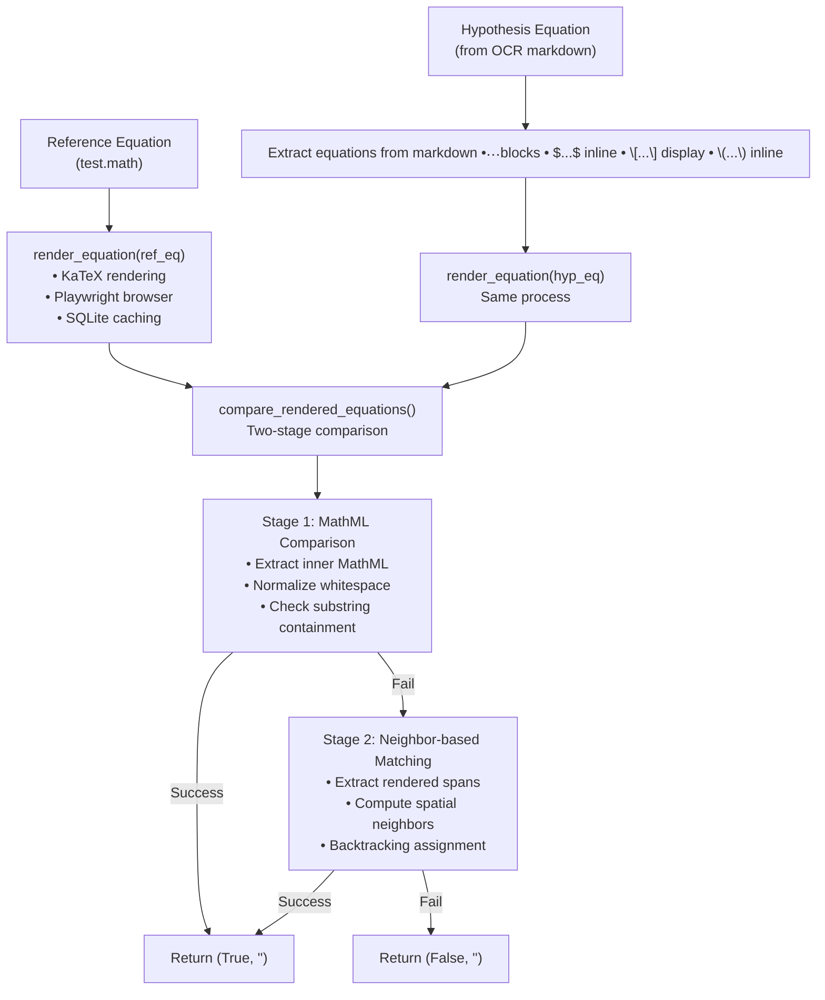

Sources: [olmocr/bench/tests.py:856-920](), [olmocr/bench/katex/render.py:387-421](), [olmocr/bench/katex/render.py:424-557]()

## KaTeX Rendering Infrastructure

### Caching and Parallelization

The KaTeX rendering system uses thread-safe caching and parallel execution:

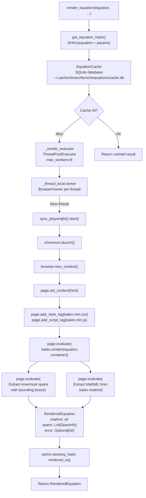

Key implementation details:

**Thread-Local Browser Management** [olmocr/bench/katex/render.py:160-211]():
- Each thread maintains its own `BrowserOwner` instance
- `weakref.finalize` ensures cleanup even on abrupt termination
- Avoids resource leaks from unbounded thread creation

**SQLite Caching** [olmocr/bench/katex/render.py:34-127]():
- Thread-safe with threading.Lock
- Schema: `(eq_hash TEXT PRIMARY KEY, mathml TEXT, spans TEXT, error TEXT)`
- Stores both successful renders and error states

**Parallel Execution** [olmocr/bench/katex/render.py:165-175]():
- Fixed ThreadPoolExecutor with 8 workers
- Submit tasks via `executor.submit()`
- Wait for results with `future.result()`

Sources: [olmocr/bench/katex/render.py:34-127](), [olmocr/bench/katex/render.py:160-228](), [olmocr/bench/katex/render.py:387-421]()

### Equation Comparison Algorithm

The `compare_rendered_equations()` function implements a two-stage comparison:

**Stage 1: MathML Comparison** [olmocr/bench/katex/render.py:432-453]():
```python
def extract_inner(mathml: str) -> str:
    # Remove <annotation> tags, keep semantic content
    soup = BeautifulSoup(mathml, "xml")
    semantics = soup.find("semantics")
    inner_parts = [child for child in semantics.contents 
                   if getattr(child, "name", None) != "annotation"]
    return "".join(inner_parts)

# Normalize and check containment
ref_inner = normalize(extract_inner(reference.mathml))
hyp_inner = normalize(extract_inner(hypothesis.mathml))
if ref_inner in hyp_inner:
    return True  # Match found
```

**Stage 2: Neighbor-based Span Matching** [olmocr/bench/katex/render.py:454-557]():
1. Expand multi-character spans to individual characters with interpolated bounding boxes
2. Build candidate maps: which reference spans could match each hypothesis span (by text)
3. Compute spatial neighbors (up/down/left/right) using bounding box centers with tolerance
4. Backtrack to find consistent character-to-character mapping that preserves spatial relationships

This approach handles:
- Extra wrapper elements or formatting differences (MathML stage)
- Whitespace variations in rendering
- Different but visually equivalent LaTeX commands
- Spatial layout validation without requiring identical DOM structure

Sources: [olmocr/bench/katex/render.py:424-557]()

### Unit Test Coverage

The KaTeX rendering has comprehensive unit tests:

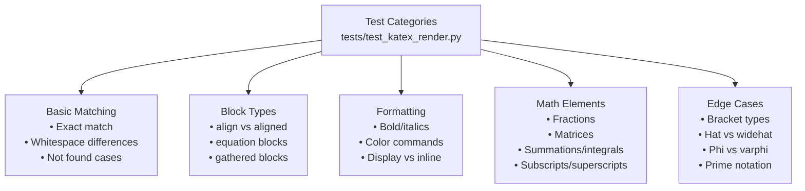

Notable test cases:
- `test_x_vs_textx`: Distinguishes between variable x and text "x"
- `test_assert_subtle_square_root`: Detects `sqrt{3}a` vs `sqrt{3a}` difference
- `test_parens`: Validates `\left\{...\right\}` vs `\{...\}` equivalence
- `test_newcommand_expansion`: Handles LaTeX macro expansion

Sources: [tests/test_katex_render.py:6-210]()

## Test Execution and Orchestration

### Benchmark Execution Flow

The `benchmark.py` script orchestrates complete test execution:

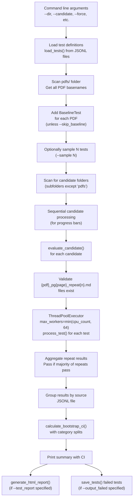

Sources: [olmocr/bench/benchmark.py:162-457]()

### Candidate Evaluation Logic

The `evaluate_candidate()` function processes a single candidate's outputs:

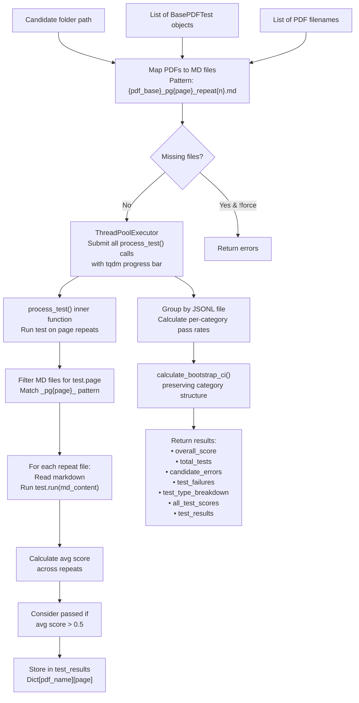

Sources: [olmocr/bench/benchmark.py:33-160]()

### Test Result Data Structure

```python
# Test results are nested dictionaries
test_results: Dict[str, Dict[int, List[Tuple[BasePDFTest, bool, str]]]]
# Structure: pdf_name -> page_number -> [(test, passed, explanation), ...]

# Example:
{
    "example.pdf": {
        1: [
            (TextPresenceTest(...), True, ""),
            (TextOrderTest(...), False, "Could not find ordering"),
            (TableTest(...), True, "")
        ],
        2: [...]
    }
}
```

This structure enables:
- Per-page result retrieval
- Test type filtering
- Failure explanation tracking
- HTML report generation with page context

Sources: [olmocr/bench/benchmark.py:35-36](), [olmocr/bench/benchmark.py:86-89]()

## Statistical Validation Methods

### Bootstrap Confidence Intervals

The `calculate_bootstrap_ci()` function computes confidence intervals while respecting test category structure:

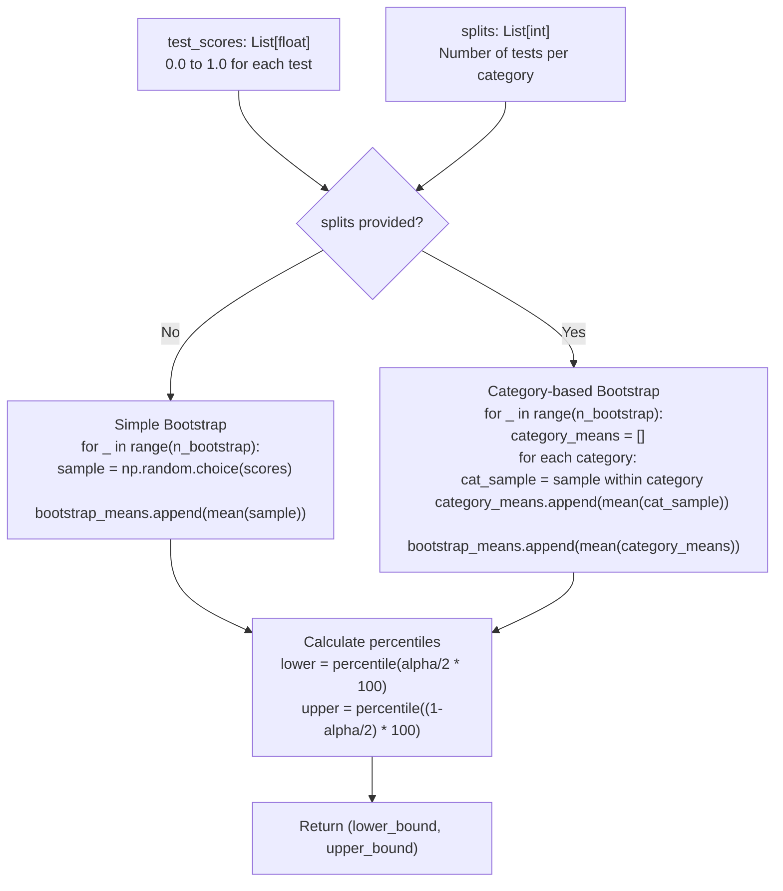

**Why Category-based Bootstrap?**

The category-based approach ensures equal weighting across test categories (JSONL files). Without this, categories with more tests would dominate the overall score. Example:

```python
# Without splits (biased):
# Category A: 100 tests, 90% pass
# Category B: 10 tests, 50% pass
# Overall: (90 + 5) / 110 = 86.4%

# With splits (fair):
# Overall: (90% + 50%) / 2 = 70%
```

Sources: [olmocr/bench/utils.py:6-68]()

### Permutation Testing

The `perform_permutation_test()` function tests for significant differences between candidates:

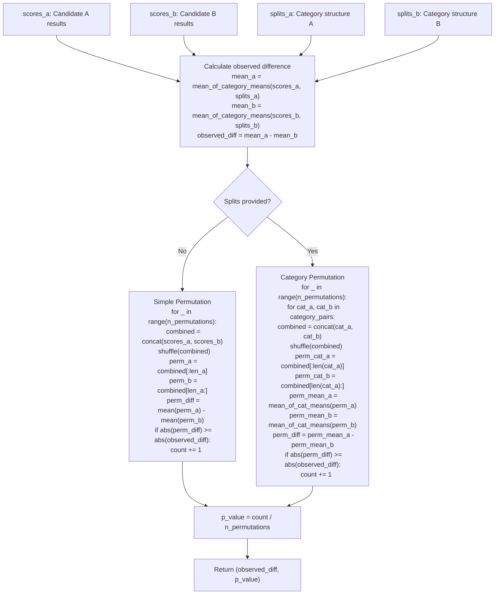

The category-based permutation maintains category structure during shuffling:
1. For each category pair (A_cat_i, B_cat_i), combine and shuffle
2. Redistribute maintaining original category sizes
3. Calculate mean-of-category-means for both permuted groups
4. Count how many permuted differences are as extreme as observed

This approach preserves category balance while testing for statistical significance.

Sources: [olmocr/bench/utils.py:70-194]()

## Test Data Management

### JSONL Test Definition Format

Tests are defined in JSONL files with one JSON object per line:

```json
{"pdf": "example.pdf", "page": 1, "id": "test_001", "type": "present", "text": "Hello World", "max_diffs": 2}
{"pdf": "example.pdf", "page": 1, "id": "test_002", "type": "absent", "text": "Watermark Text", "last_n": 50}
{"pdf": "example.pdf", "page": 1, "id": "test_003", "type": "order", "before": "Introduction", "after": "Methods", "max_diffs": 1}
{"pdf": "example.pdf", "page": 1, "id": "test_004", "type": "table", "cell": "42", "top_heading": "Results", "left_heading": "Metric A"}
{"pdf": "example.pdf", "page": 1, "id": "test_005", "type": "math", "math": "\\int_a^b f(x) dx"}
```

The `load_tests()` function [olmocr/bench/tests.py:858-920]():
1. Reads JSONL file line by line
2. Parses JSON and extracts `type` field
3. Instantiates appropriate test class (`TextPresenceTest`, `TextOrderTest`, etc.)
4. Validates via `__post_init__` methods
5. Returns list of validated test objects

Sources: [olmocr/bench/sample_data/dataset.jsonl:1-117](), [olmocr/bench/tests.py:858-920]()

### Automated Test Mining

The `mine_math.py` script generates math tests from arXiv papers:

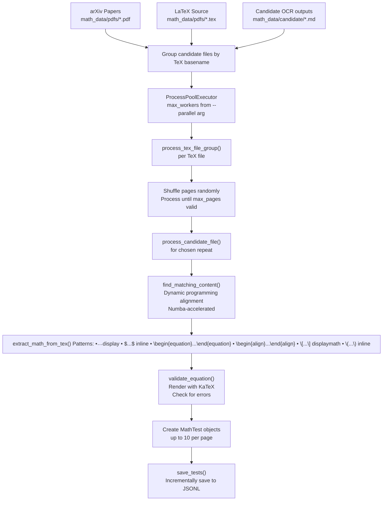

**Matching Algorithm** [olmocr/bench/miners/mine_math.py:162-194]():

The `find_matching_content()` function uses Numba-accelerated dynamic programming:

```python
@numba.njit
def compute_dp(candidate_arr, text_arr):
    # Compute edit distance allowing free text prefix
    # dp[i][j] = min edits to match candidate[:i] in text[:j]
    ...

@numba.njit  
def find_best_end(dp, m, n):
    # Find text position with minimum edit distance
    ...

@numba.njit
def backtrack(dp, candidate_arr, text_arr, m, best_end):
    # Recover the matched substring
    ...
```

This enables fast fuzzy matching of candidate OCR output to TeX source, even for long documents.

Sources: [olmocr/bench/miners/mine_math.py:1-374](), [olmocr/bench/miners/mine_math.py:114-194]()

### Test Data Downloading

The `download_math.py` script fetches arXiv papers:

```bash
python olmocr/bench/miners/download_math.py \
    --url "https://arxiv.org/list/math/recent?skip=0&show=2000" \
    --data_dir math_data/pdfs
```

The script:
1. Scrapes paper IDs from arXiv list page
2. Downloads LaTeX source from `export.arxiv.org/src/{paper_id}`
3. Extracts single `.tex` file from source tarball
4. Downloads PDF from `export.arxiv.org/pdf/{paper_id}.pdf`
5. Only keeps files when both TeX and PDF succeed (unless `--pdf_only`)

Sources: [olmocr/bench/miners/download_math.py:1-121]()

## HTML Report Generation

The `generate_html_report()` function creates interactive visual reports:

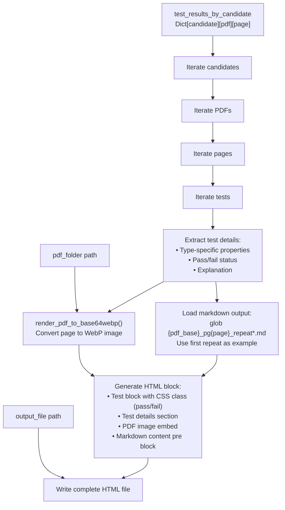

**Report Features**:
- Color-coded test blocks (green border for pass, red for fail)
- Rendered PDF page images (WebP format for size efficiency)
- OCR markdown output in monospace pre blocks
- Failure explanations highlighted in yellow
- Type-specific test detail display

Sources: [olmocr/bench/report.py:12-228]()

## CI/CD Integration

### Docker Test Environment

The base Dockerfile sets up the complete test environment:

```dockerfile
# Install benchmark dependencies
RUN uv pip install --system --no-cache ".[bench]"

# Install Playwright browser automation
RUN playwright install-deps
RUN playwright install chromium

# Verify installation
RUN python3 -m olmocr.pipeline --help
```

This ensures:
- All benchmark dependencies (playwright, fuzzysearch, rapidfuzz, etc.) are installed
- Chromium browser is available for KaTeX rendering
- The olmocr package is importable and functional

Sources: [Dockerfile:51-56]()

### Test Markers and Filtering

Tests can be excluded from CI using the `nonci` marker:

```python
import pytest

@pytest.mark.nonci
def test_expensive_ocr_comparison():
    # This test is skipped by default in CI
    # Can be run explicitly with: pytest -m nonci
    ...
```

The `addopts = "-m 'not nonci'"` configuration automatically filters these tests unless explicitly requested.

Sources: [pyproject.toml:196-199]()

## Command Reference

### Running Benchmarks

```bash
# Basic benchmark run
python -m olmocr.bench.benchmark --dir /path/to/benchmark_data

# Run specific candidate only
python -m olmocr.bench.benchmark --dir /path/to/data --candidate olmocr

# Sample 100 random tests
python -m olmocr.bench.benchmark --dir /path/to/data --sample 100

# Generate HTML report
python -m olmocr.bench.benchmark --dir /path/to/data --test_report results.html

# Output failed tests to JSONL
python -m olmocr.bench.benchmark --dir /path/to/data --output_failed failed_tests.jsonl

# Skip baseline tests
python -m olmocr.bench.benchmark --dir /path/to/data --skip_baseline

# Force run even with missing files
python -m olmocr.bench.benchmark --dir /path/to/data --force

# Custom bootstrap parameters
python -m olmocr.bench.benchmark --dir /path/to/data \
    --bootstrap_samples 5000 --confidence_level 0.99
```

Sources: [olmocr/bench/benchmark.py:162-194]()

### Running Unit Tests

```bash
# Run all tests
pytest tests/

# Run specific test file with verbose output
pytest tests/test_katex_render.py -v

# Run with coverage report
pytest --cov=olmocr --cov-report=html tests/

# Run only non-CI tests
pytest -m nonci

# Run with asyncio support
pytest --asyncio-mode=auto tests/
```

Sources: [pyproject.toml:188-199]()

### Mining Math Tests

```bash
# Mine math tests from arXiv papers
python -m olmocr.bench.miners.mine_math \
    --math_data /path/to/math_data \
    --candidate olmocr \
    --max_pages 3 \
    --parallel 8 \
    --sim_threshold 0.7
```

Sources: [olmocr/bench/miners/mine_math.py:319-370]()

### Downloading Test Data

```bash
# Download arXiv papers with LaTeX source
python -m olmocr.bench.miners.download_math \
    --url "https://arxiv.org/list/math/recent?skip=0&show=2000" \
    --data_dir math_data/pdfs

# Download PDFs only (skip LaTeX verification)
python -m olmocr.bench.miners.download_math \
    --url "https://arxiv.org/list/math/recent?skip=0&show=2000" \
    --data_dir math_data/pdfs \
    --pdf_only
```

Sources: [olmocr/bench/miners/download_math.py:72-120]()

## Key Testing Components Reference

| Component | Location | Purpose |
|-----------|----------|---------|
| `BasePDFTest` | [olmocr/bench/tests.py:474-518]() | Abstract base class for all test types |
| `TextPresenceTest` | [olmocr/bench/tests.py:519-574]() | Text presence/absence validation with fuzzy matching |
| `TextOrderTest` | [olmocr/bench/tests.py:576-618]() | Relative text positioning validation |
| `TableTest` | [olmocr/bench/tests.py:620-855]() | Table structure and cell relationship validation |
| `MathTest` | [olmocr/bench/tests.py:856-920]() | Mathematical equation validation via KaTeX |
| `normalize_text` | [olmocr/bench/tests.py:116-146]() | Text normalization for matching |
| `parse_markdown_tables` | [olmocr/bench/tests.py:149-256]() | Markdown table parsing to TableData |
| `parse_html_tables` | [olmocr/bench/tests.py:304-472]() | HTML table parsing with rowspan/colspan |
| `render_equation` | [olmocr/bench/katex/render.py:387-421]() | KaTeX equation rendering with caching |
| `compare_rendered_equations` | [olmocr/bench/katex/render.py:424-557]() | Visual equation comparison algorithm |
| `EquationCache` | [olmocr/bench/katex/render.py:34-127]() | SQLite-based rendering cache |
| `evaluate_candidate` | [olmocr/bench/benchmark.py:33-160]() | Candidate evaluation orchestrator |
| `calculate_bootstrap_ci` | [olmocr/bench/utils.py:6-68]() | Bootstrap confidence interval calculation |
| `perform_permutation_test` | [olmocr/bench/utils.py:70-194]() | Statistical significance testing |
| `generate_html_report` | [olmocr/bench/report.py:12-228]() | Interactive HTML report generation |
| `find_matching_content` | [olmocr/bench/miners/mine_math.py:162-194]() | Numba-accelerated fuzzy text matching |
| `load_tests` | [olmocr/bench/tests.py:858-920]() | JSONL test definition loader |
| `save_tests` | [olmocr/bench/tests.py:922-941]() | JSONL test definition writer |

Sources: All files cited in the table