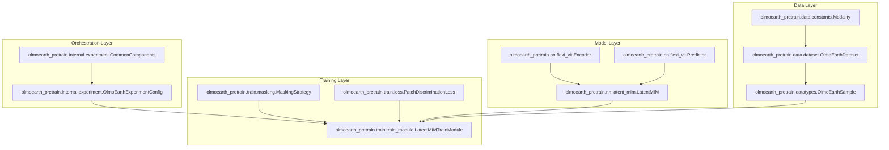
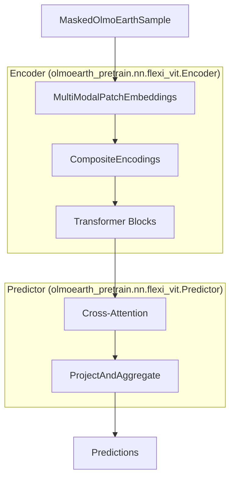

<!-- source: DeepWiki mcp.deepwiki.com · repo allenai/olmoearth_pretrain · page 1 Overview · fetched 2026-10-26 -->

# Overview

Relevant source files

The following files were used as context for generating this wiki page:

- [.github/workflows/lint.yaml](.github/workflows/lint.yaml)
- [.github/workflows/tests.yaml](.github/workflows/tests.yaml)
- [README.md](README.md)
- [olmoearth_pretrain/data/transform.py](olmoearth_pretrain/data/transform.py)
- [olmoearth_pretrain/internal/common.py](olmoearth_pretrain/internal/common.py)
- [olmoearth_pretrain/nn/flexi_vit.py](olmoearth_pretrain/nn/flexi_vit.py)
- [olmoearth_pretrain/nn/galileo.py](olmoearth_pretrain/nn/galileo.py)
- [olmoearth_pretrain/nn/latent_mim.py](olmoearth_pretrain/nn/latent_mim.py)
- [olmoearth_pretrain/nn/mae.py](olmoearth_pretrain/nn/mae.py)
- [olmoearth_pretrain/py.typed](olmoearth_pretrain/py.typed)
- [olmoearth_pretrain/train/masking.py](olmoearth_pretrain/train/masking.py)
- [pyproject.toml](pyproject.toml)
- [tests/integration/eval/test_geobench_dataset_with_model.py](tests/integration/eval/test_geobench_dataset_with_model.py)
- [tests/integration/nn/test_flexi_vit.py](tests/integration/nn/test_flexi_vit.py)
- [tests/integration/nn/test_latent_mim.py](tests/integration/nn/test_latent_mim.py)
- [tests/unit/internal/test_experiment.py](tests/unit/internal/test_experiment.py)
- [tests/unit/train/test_masking.py](tests/unit/train/test_masking.py)
- [uv.lock](uv.lock)

This document provides a high-level introduction to the OlmoEarth pretraining repository, its architecture, and how the major system components interact. OlmoEarth is a flexible, multi-modal, spatio-temporal family of foundation models for Earth observations that processes satellite imagery and derived geospatial data products through self-supervised pretraining.

**Scope**: This page covers the overall system architecture, key abstractions, and how data flows from raw satellite imagery through model training to downstream evaluation. For detailed information about specific subsystems, see:
- Key concepts and terminology: [Key Concepts and Terminology](#1.1)
- Repository organization: [Repository Structure](#1.2)

## Purpose and Key Features

The OlmoEarth pretraining system enables researchers to train foundation models on multi-modal Earth observation data. The system is designed for:

1.  **Multi-modal input processing**: Handles Sentinel-2, Sentinel-1, and Landsat satellite imagery plus derived map products like WorldCover, OpenStreetMap, SRTM DEM, and more [README.md:51-51]().
2.  **Self-supervised learning**: Implements masked autoencoding (MAE) and contrastive learning objectives [olmoearth_pretrain/nn/latent_mim.py:1-20]().
3.  **Flexible architecture**: Supports multiple model sizes (Nano, Tiny, Base, Large) with configurable depth and embedding dimensions [README.md:52-57]().
4.  **Scalable training**: Built on `olmo-core` with FSDP support for distributed training across multiple GPUs [pyproject.toml:71-71]().
5.  **Downstream evaluation**: Includes integrated evaluation on classification and segmentation benchmarks [README.md:88-93]().

**Sources**: [README.md:18-93](), [pyproject.toml:1-112]()

## Repository Structure

The codebase is organized into several key packages:

*   `olmoearth_pretrain/data/`: Dataset loading, normalization, and augmentation [olmoearth_pretrain/data/dataset.py:1-50]().
*   `olmoearth_pretrain/nn/`: Model architecture, including the FlexiVit encoder and predictor [olmoearth_pretrain/nn/flexi_vit.py:1-100]().
*   `olmoearth_pretrain/train/`: Training modules, masking strategies, and loss functions [olmoearth_pretrain/train/masking.py:1-50]().
*   `olmoearth_pretrain/evals/`: Evaluation datasets and task-specific logic [tests/integration/eval/test_geobench_dataset_with_model.py:1-15]().
*   `olmoearth_pretrain/internal/`: Experiment orchestration, configuration builders, and Beaker integration [olmoearth_pretrain/internal/common.py:1-50]().

**Sources**: [pyproject.toml:25-33](), [README.md:61-95]()

## System Architecture Overview

The following diagram shows the primary layers of the OlmoEarth system and their relationships:

### System Layer Architecture

**Sources**: [olmoearth_pretrain/nn/flexi_vit.py:1-65](), [olmoearth_pretrain/train/masking.py:33-82](), [olmoearth_pretrain/internal/experiment.py:11-23]()

## Data Flow: From Raw Images to Masked Tokens

The data pipeline transforms raw satellite imagery stored in H5PY files into model-ready tensors with appropriate masking for self-supervised pretraining.

### Data Processing Pipeline

**Key classes and methods**:
*   `OlmoEarthDataset` loads samples from H5PY files [olmoearth_pretrain/data/dataset.py:9-10]().
*   `OlmoEarthSample` is the primary container for multi-modal tensors [olmoearth_pretrain/datatypes.py:18-18]().
*   `MaskingStrategy.apply_mask()` determines which tokens are assigned to the encoder, decoder, or ignored [olmoearth_pretrain/train/masking.py:72-82]().
*   `MaskedOlmoEarthSample` contains the data and the generated masks [olmoearth_pretrain/train/masking.py:10-11]().
*   `TokensAndMasks` represents the flattened tokenized representation used inside the transformer [olmoearth_pretrain/nn/flexi_vit.py:23-23]().

**Sources**: [olmoearth_pretrain/train/masking.py:1-110](), [olmoearth_pretrain/nn/flexi_vit.py:167-181]()

## Model Architecture: FlexiVit Encoder-Decoder

The OlmoEarth model uses a FlexiVit architecture. The `Encoder` processes visible tokens, while the `Predictor` (decoder) attempts to reconstruct masked tokens using cross-attention.

### FlexiVit Components

**Key configuration components**:
*   `Encoder` uses `MultiModalPatchEmbeddings` to handle different resolutions and modalities [olmoearth_pretrain/nn/flexi_vit.py:183-183]().
*   `CompositeEncodings` injects spatial, temporal (month), and channel-specific information [olmoearth_pretrain/nn/flexi_vit.py:26-30]().
*   `ProjectAndAggregate` handles the final projection or pooling of tokens [olmoearth_pretrain/nn/flexi_vit.py:65-65]().
*   `LatentMIM` wraps the encoder and predictor, often maintaining a `target_encoder` updated via EMA for stable training [tests/integration/nn/test_latent_mim.py:87-149]().

**Sources**: [olmoearth_pretrain/nn/flexi_vit.py:1-183](), [tests/integration/nn/test_latent_mim.py:66-87]()

## Training and Optimization

Training is orchestrated by the `LatentMIMTrainModule`, which manages the optimization loop, loss calculation, and distributed training setup.

*   **Masking**: Strategies like `RandomMaskingStrategy` or `SpaceMaskingStrategy` define how data is hidden from the model [olmoearth_pretrain/train/masking.py:15-18]().
*   **Loss Functions**: The primary objective is often `PatchDiscriminationLoss`, which compares predicted latent tokens against targets from a teacher/target encoder [olmoearth_pretrain/train/loss.py:12-12]().
*   **Optimization**: Uses `AdamWConfig` for weight decay and learning rate management [tests/unit/internal/test_experiment.py:130-130]().
*   **Infrastructure**: Integration with Beaker allows for scalable cluster execution [olmoearth_pretrain/internal/common.py:1-30]().

**Sources**: [olmoearth_pretrain/train/masking.py:10-20](), [tests/unit/internal/test_experiment.py:120-154](), [olmoearth_pretrain/internal/common.py:110-124]()

## Development and Testing

The repository maintains high code quality through rigorous testing and linting:
*   **Unit Tests**: Located in `tests/unit/`, covering masking, model components, and data loading [tests/unit/train/test_masking.py:1-10]().
*   **Integration Tests**: Located in `tests/integration/`, verifying end-to-end forward passes and evaluation datasets [tests/integration/nn/test_latent_mim.py:1-15]().
*   **CI/CD**: GitHub Actions run linting (Ruff) and tests on every pull request [ .github/workflows/lint.yaml:1-10](), [.github/workflows/tests.yaml:1-10]().
*   **Environment**: Managed via `uv` for reproducible dependency resolution [README.md:24-35]().

**Sources**: [README.md:95-111](), [pyproject.toml:113-121](), [.github/workflows/lint.yaml:1-40]()

---

