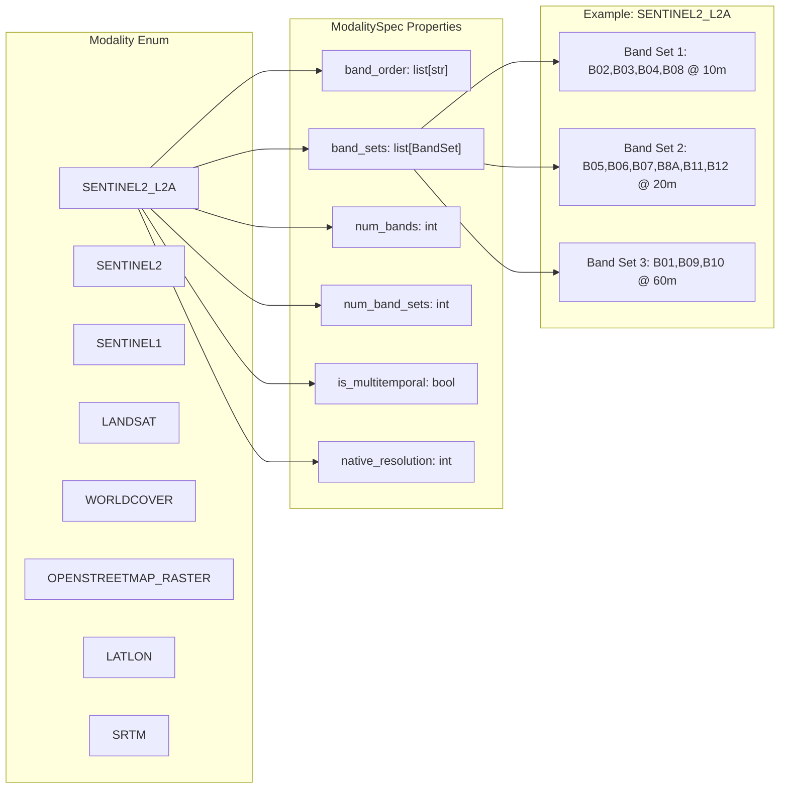
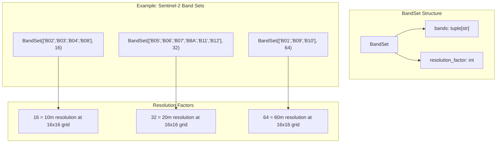
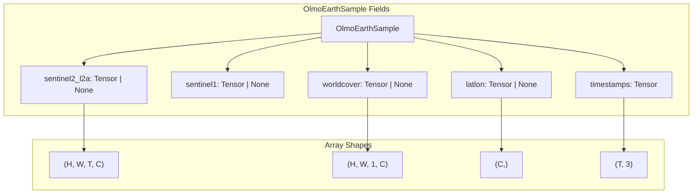
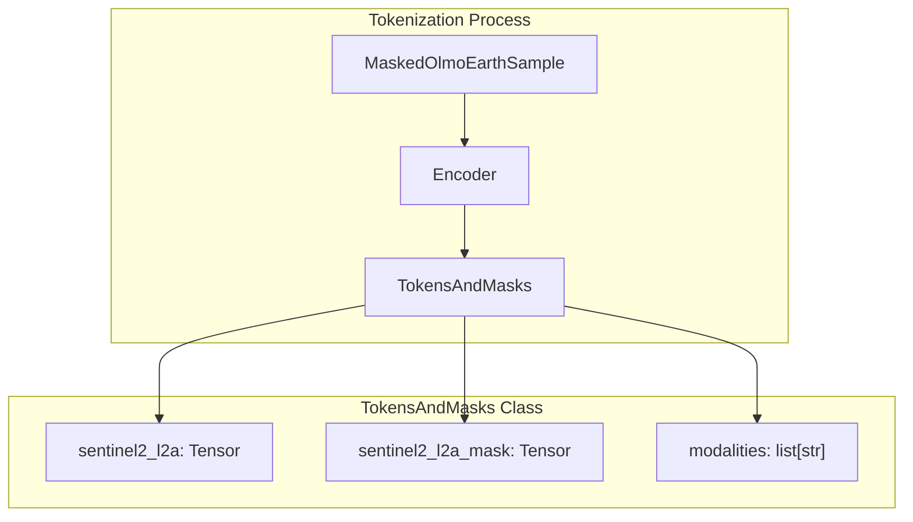
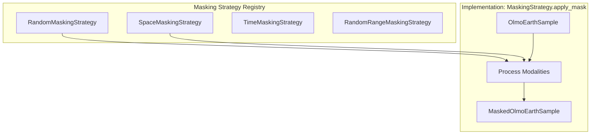
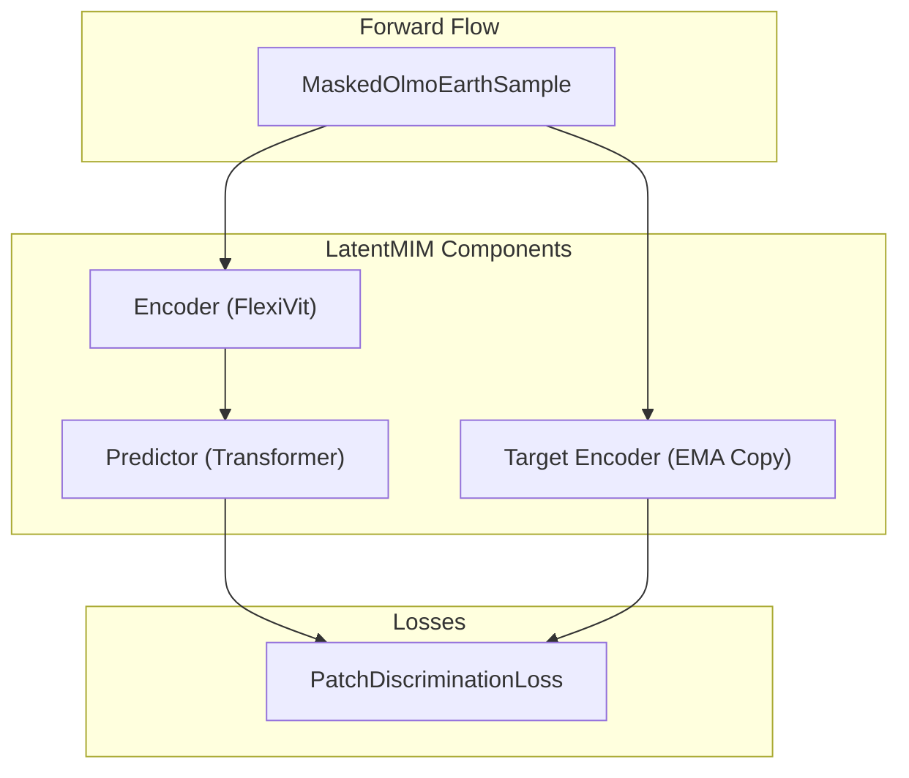

<!-- source: DeepWiki mcp.deepwiki.com · repo allenai/olmoearth_pretrain · page 1.1 Key Concepts and Terminology · fetched 2026-10-26 -->

# Key Concepts and Terminology

Relevant source files

The following files were used as context for generating this wiki page:

- [olmoearth_pretrain/data/transform.py](olmoearth_pretrain/data/transform.py)
- [olmoearth_pretrain/nn/flexi_vit.py](olmoearth_pretrain/nn/flexi_vit.py)
- [olmoearth_pretrain/nn/galileo.py](olmoearth_pretrain/nn/galileo.py)
- [olmoearth_pretrain/nn/latent_mim.py](olmoearth_pretrain/nn/latent_mim.py)
- [olmoearth_pretrain/nn/mae.py](olmoearth_pretrain/nn/mae.py)
- [olmoearth_pretrain/train/masking.py](olmoearth_pretrain/train/masking.py)
- [tests/integration/eval/test_geobench_dataset_with_model.py](tests/integration/eval/test_geobench_dataset_with_model.py)
- [tests/integration/nn/test_flexi_vit.py](tests/integration/nn/test_flexi_vit.py)
- [tests/integration/nn/test_latent_mim.py](tests/integration/nn/test_latent_mim.py)
- [tests/unit/data/test_constants.py](tests/unit/data/test_constants.py)
- [tests/unit/internal/test_experiment.py](tests/unit/internal/test_experiment.py)
- [tests/unit/train/test_masking.py](tests/unit/train/test_masking.py)

This page defines the core concepts and terminology used throughout the OlmoEarth pretraining system. Understanding these concepts is essential for working with the codebase, whether you're training models, performing inference, or extending functionality.

---

## Core Data Concepts

### Modalities

**Modalities** are distinct types of Earth observation data sources processed by OlmoEarth. Each modality represents a different sensor or derived data product with unique spectral, spatial, and temporal characteristics.

#### Modality Specification Diagram

The `Modality` enum ([olmoearth_pretrain/data/constants.py:130-250]()) defines all supported data sources. Key modalities include:

| Modality | Description | Bands | Resolution | Temporal |
|----------|-------------|-------|------------|----------|
| `SENTINEL2_L2A` | Optical imagery from Sentinel-2 | 13 bands in 3 sets | 10m, 20m, 60m | Yes |
| `SENTINEL1` | SAR imagery from Sentinel-1 | 2 bands (VV, VH) | 10m | Yes |
| `LANDSAT` | Optical imagery from Landsat 8/9 | 11 bands in 3 sets | 30m, 15m, 100m | Yes |
| `WORLDCOVER` | ESA land cover classification | 1 band (10 classes) | 10m | No |
| `LATLON` | Geolocation information | 2 values (lat, lon) | N/A | No |

**Sources:** [olmoearth_pretrain/data/constants.py:130-250](), [tests/unit/data/test_constants.py:6-57]()

### Band Sets

A **Band Set** groups spectral bands that share the same native spatial resolution. This concept is critical because different bands of the same modality may be captured at different resolutions.

The `resolution_factor` indicates how many pixels at that resolution fit into the standard tile. For example, at 10m resolution, you have 256 pixels (16 × 16 = 256), so the factor is 16.

**Sources:** [olmoearth_pretrain/data/constants.py:30-60](), [tests/unit/data/test_constants.py:50-56]()

### Samples

An **OlmoEarthSample** is the fundamental data container that holds multi-modal, spatio-temporal Earth observation data for a single location.

`OlmoEarthSample` is a `NamedTuple` ([olmoearth_pretrain/datatypes.py:112-185]()) where:
- Spatial modalities have shape `(H, W, T, C)` for multi-temporal or `(H, W, C)` for static.
- `timestamps` contains `[day, month, year]` for each timestep.

**Sources:** [olmoearth_pretrain/datatypes.py:112-185](), [olmoearth_pretrain/data/transform.py:16-113]()

---

## Spatial and Temporal Concepts

### Patches

**Patches** are square spatial subdivisions of the input data. The **patch size** determines how many pixels are grouped together before being embedded into a single token. In `FlexiVit`, this is dynamic, but restricted by `max_patch_size`.

**Sources:** [olmoearth_pretrain/nn/flexi_vit.py:557-600](), [tests/unit/train/test_masking.py:46-68]()

### Tokens

**Tokens** are the atomic units of information processed by the transformer model. The `TokensAndMasks` class stores these embeddings along with their associated masks.

The `TokensAndMasks` representation ([olmoearth_pretrain/datatypes.py:20-110]()) is used to pass data between the `Encoder` and `Predictor`.

**Sources:** [olmoearth_pretrain/datatypes.py:20-110](), [olmoearth_pretrain/nn/flexi_vit.py:19-24]()

---

## Masking and Training Concepts

### Mask Values

**Mask Values** define the role of each token during training. The `MaskValue` enum ([olmoearth_pretrain/datatypes.py:13-17]()) has four states:

| Value | Name | Purpose |
|-------|------|---------|
| `0` | `ONLINE_ENCODER` | Token is visible and processed by online encoder |
| `1` | `DECODER` | Token is masked and reconstructed by decoder |
| `2` | `TARGET_ENCODER_ONLY` | Token visible only to target encoder (not online) |
| `99` | `MISSING` | Data unavailable due to clouds/gaps |

**Sources:** [olmoearth_pretrain/datatypes.py:13-17](), [olmoearth_pretrain/train/masking.py:15-19]()

### Masking Strategies

**Masking Strategies** determine which tokens receive which mask values. 

- **RandomMaskingStrategy**: Masks tokens independently ([olmoearth_pretrain/train/masking.py:318-350]()).
- **SpaceMaskingStrategy**: Masks entire spatial patches across all timesteps ([olmoearth_pretrain/train/masking.py:353-380]()).
- **TimeMaskingStrategy**: Masks entire timesteps across all spatial locations ([olmoearth_pretrain/train/masking.py:383-410]()).

**Sources:** [olmoearth_pretrain/train/masking.py:33-82](), [tests/unit/train/test_masking.py:10-20]()

---

## Model Architecture Concepts

### Latent MIM (Masked Image Modeling)

OlmoEarth uses a `LatentMIM` approach where the model predicts the latent representations of masked patches rather than raw pixels.

The `LatentMIM` class ([olmoearth_pretrain/nn/latent_mim.py:25-92]()) orchestrates the forward pass through the `Encoder` and `Predictor`, while the `target_encoder` (a `deepcopy` of the encoder) provides the targets for the `PatchDiscriminationLoss`.

**Sources:** [olmoearth_pretrain/nn/latent_mim.py:25-92](), [tests/integration/nn/test_latent_mim.py:66-87]()

### Embeddings and Encodings

**Embeddings** convert raw data and metadata into the transformer's latent space:

- **FlexiPatchEmbed**: Projects variable-sized patches into embeddings ([olmoearth_pretrain/nn/flexi_patch_embed.py:16-120]()).
- **CompositeEncodings**: Combines patch embeddings with positional, temporal (month), and channel (band set) encodings ([olmoearth_pretrain/nn/encodings.py:150-250]()).

**Sources:** [olmoearth_pretrain/nn/flexi_vit.py:25-37](), [olmoearth_pretrain/nn/encodings.py:10-30]()

---

## Data Handling Concepts

### Missing Values

The **MISSING_VALUE** constant (`-32768`) marks unavailable data. The masking system automatically identifies these and assigns `MaskValue.MISSING`.

**Sources:** [olmoearth_pretrain/data/constants.py:14-14](), [olmoearth_pretrain/train/masking.py:84-96]()

### Transforms and Augmentations

The `Transform` registry ([olmoearth_pretrain/data/transform.py:20-29]()) provides common augmentations:
- **FlipAndRotateSpace**: Randomly applies one of 8 orthogonal transformations ([olmoearth_pretrain/data/transform.py:42-113]()).
- **Mixup**: Blends two samples and their timestamps ([olmoearth_pretrain/data/transform.py:116-146]()).

**Sources:** [olmoearth_pretrain/data/transform.py:20-166]()

---

## Code Entity Reference

| Concept | Primary Class/Enum | File Path |
|---------|-------------------|-----------|
| Modality | `Modality` | [olmoearth_pretrain/data/constants.py:130-250]() |
| Sample | `OlmoEarthSample` | [olmoearth_pretrain/datatypes.py:112-185]() |
| Masked Sample | `MaskedOlmoEarthSample` | [olmoearth_pretrain/datatypes.py:188-250]() |
| Tokens | `TokensAndMasks` | [olmoearth_pretrain/datatypes.py:20-110]() |
| Latent MIM | `LatentMIM` | [olmoearth_pretrain/nn/latent_mim.py:25-92]() |
| Encoder | `Encoder` | [olmoearth_pretrain/nn/flexi_vit.py:557-600]() |
| Predictor | `Predictor` | [olmoearth_pretrain/nn/flexi_vit.py:850-900]() |
| Masking Strategy | `MaskingStrategy` | [olmoearth_pretrain/train/masking.py:33-82]() |

**Sources:** [olmoearth_pretrain/datatypes.py:1-250](), [olmoearth_pretrain/nn/flexi_vit.py:1-1000]()

---

