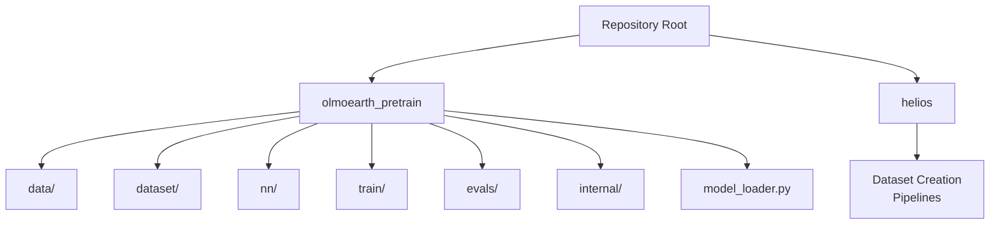
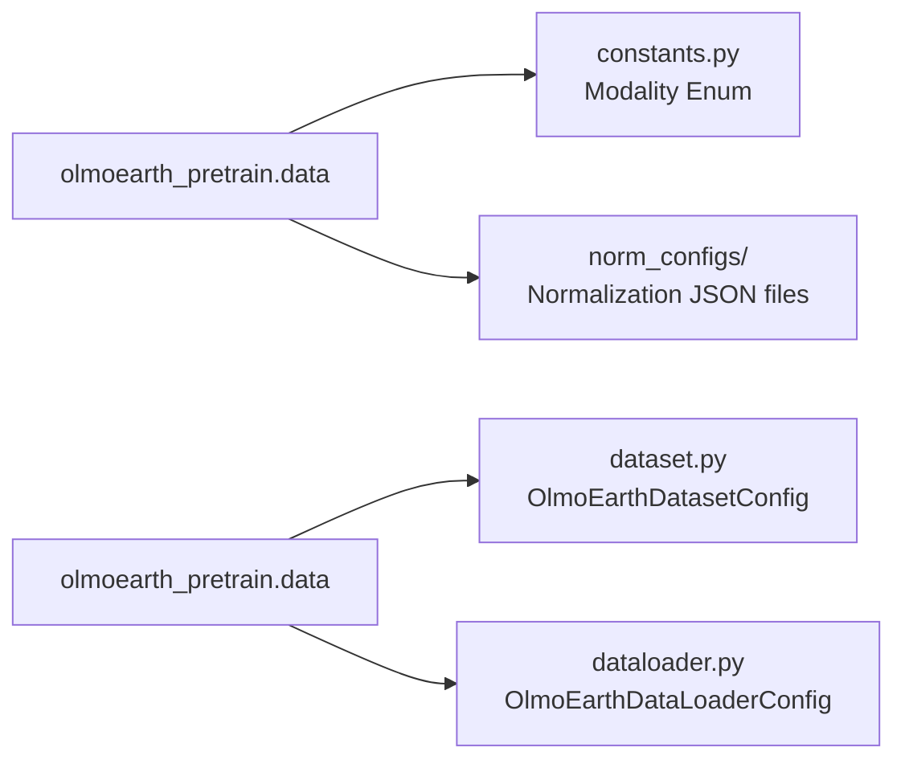
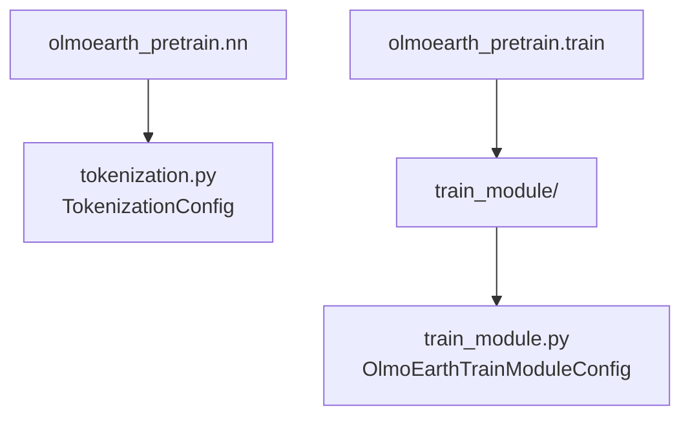
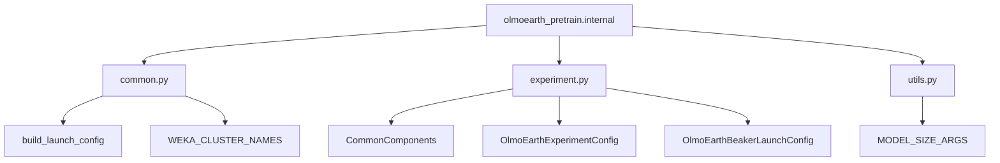
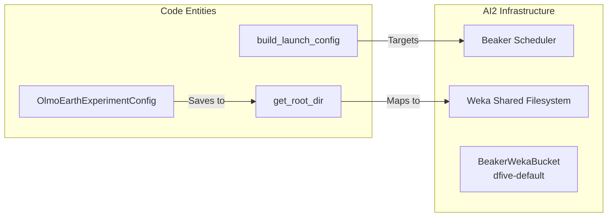

<!-- source: DeepWiki mcp.deepwiki.com · repo allenai/olmoearth_pretrain · page 1.2 Repository Structure · fetched 2026-10-26 -->

# Repository Structure

<details>
<summary>Relevant source files</summary>

The following files were used as context for generating this wiki page:

- [.github/workflows/lint.yaml](.github/workflows/lint.yaml)
- [.github/workflows/tests.yaml](.github/workflows/tests.yaml)
- [README.md](README.md)
- [docs/Evaluation.md](docs/Evaluation.md)
- [docs/Pretraining.md](docs/Pretraining.md)
- [olmoearth_pretrain/internal/common.py](olmoearth_pretrain/internal/common.py)
- [olmoearth_pretrain/internal/experiment.py](olmoearth_pretrain/internal/experiment.py)
- [olmoearth_pretrain/internal/utils.py](olmoearth_pretrain/internal/utils.py)
- [olmoearth_pretrain/py.typed](olmoearth_pretrain/py.typed)
- [pyproject.toml](pyproject.toml)
- [scripts/archived/20251027_finetune.sh](scripts/archived/20251027_finetune.sh)
- [uv.lock](uv.lock)

</details>


This document provides a comprehensive overview of how the OlmoEarth pretraining codebase is organized, including the main packages, module hierarchy, directory structure, and how different components are arranged within the repository.

---

## Repository Overview

The OlmoEarth pretraining repository is structured around two main Python packages: `olmoearth_pretrain` (the primary package containing all model, training, and evaluation code) and `helios` (a supporting package for dataset creation and processing). The codebase follows a modular architecture where functionality is organized into distinct layers: data pipeline, model architecture, training system, evaluation, and experiment orchestration.

**Sources:** [pyproject.toml:25-27]()

---

## Top-Level Directory Structure

```
olmoearth_pretrain/              # Main package directory
├── data/                        # Data specifications and constants
├── dataset/                     # Dataset loading and preprocessing
├── evals/                       # Evaluation systems and tasks
├── inference_benchmarking/      # Throughput and performance scripts
├── internal/                    # Internal utilities for experiment launching
├── nn/                          # Neural network models and components
├── train/                       # Training utilities and modules
└── model_loader.py              # Model loading from Hugging Face

helios/                          # Supporting package for dataset creation
├── ...                          # Dataset processing pipelines

scripts/                         # Training and evaluation scripts
├── official/                    # Official model configuration scripts (Base, Large, etc.)
├── archived/                    # Legacy or one-off experiment scripts
└── ...                          # Additional utility scripts

tests/                           # Test suite
├── unit/                        # Unit tests for core logic
└── tests_minimal_deps/          # Tests for inference with minimal dependencies

.github/                         # CI/CD workflows
└── workflows/
    ├── lint.yaml                # Linting pipeline (Ruff, MyPy)
    └── tests.yaml               # Test pipeline (Pytest)

pyproject.toml                   # Project configuration and dependencies
uv.lock                          # Dependency lock file
```

**Sources:** [pyproject.toml:25-27](), [README.md:95-111](), [.github/workflows/lint.yaml:1-40](), [.github/workflows/tests.yaml:1-63]()

---

## Package Structure Overview

### Package Declaration

The repository contains two main packages declared in the project configuration:



**Sources:** [pyproject.toml:25-27]()

---

## Core Module Organization

### Data and Dataset Modules

The data pipeline modules handle all aspects of loading, preprocessing, and managing satellite imagery data. The system distinguishes between core constants (modalities) and the actual loading logic.



Key data components:
- **`Modality`** ([olmoearth_pretrain/data/constants.py](), referenced in [olmoearth_pretrain/internal/experiment.py:23]()): Enum defining supported satellite modalities like Sentinel-2, Sentinel-1, and Landsat.
- **`OlmoEarthDatasetConfig`** ([olmoearth_pretrain/data/dataset.py](), referenced in [olmoearth_pretrain/internal/experiment.py:25-27]()): Configuration for the H5PY-based dataset.
- **`OlmoEarthDataLoaderConfig`** ([olmoearth_pretrain/data/dataloader.py](), referenced in [olmoearth_pretrain/internal/experiment.py:24]()): Configuration for distributed data loading.

**Sources:** [olmoearth_pretrain/internal/experiment.py:23-27](), [olmoearth_pretrain/internal/common.py:18]()

---

### Model Architecture and Training Modules

The model architecture is primarily located in `nn/`, while training logic resides in `train/`.



Key components:
- **`TokenizationConfig`** ([olmoearth_pretrain/nn/tokenization.py:36]()): Manages band groupings and tokenization strategies across different modalities.
- **`OlmoEarthTrainModuleConfig`** ([olmoearth_pretrain/train/train_module/train_module.py:37-39]()): Configures the training loop, loss functions, and model optimization steps.

**Sources:** [olmoearth_pretrain/internal/experiment.py:36-39]()

---

### Experiment Orchestration Modules

The `internal/` module provides the core infrastructure for configuring and launching experiments, particularly on Beaker clusters.



Key orchestration components:
- **`OlmoEarthBeakerLaunchConfig`** ([olmoearth_pretrain/internal/experiment.py:45-65]()): Extends standard Beaker configs to support specific hostnames and AI2 cluster constraints.
- **`CommonComponents`** ([olmoearth_pretrain/internal/experiment.py:75-109]()): A shared configuration class containing run names, save folders, and training modalities used across all experiment types.
- **`OlmoEarthExperimentConfig`** ([olmoearth_pretrain/internal/experiment.py:127-140]()): The top-level configuration object for a pretraining run, aggregating model, dataset, loader, and trainer configs.
- **`MODEL_SIZE_ARGS`** ([olmoearth_pretrain/internal/utils.py:48-193]()): A registry of architectural hyperparameters for standard model sizes (Nano, Tiny, Base, Large, Giga).
- **`build_launch_config`** ([olmoearth_pretrain/internal/common.py:110-209]()): Orchestrates the creation of Beaker jobs, including mounting Weka buckets and setting NCCL environment variables.

**Sources:** [olmoearth_pretrain/internal/experiment.py:44-140](), [olmoearth_pretrain/internal/common.py:110-209](), [olmoearth_pretrain/internal/utils.py:48-193]()

---

## Dependency and Environment Management

The repository uses `uv` for dependency management, categorized into several extras to allow for minimal inference-only installations.

| Extra | Purpose | Key Dependencies |
|-------|---------|------------------|
| Core (None) | Minimal Inference | `torch`, `numpy`, `huggingface_hub`, `einops` |
| `training` | Pretraining | `ai2-olmo-core`, `albumentations`, `wandb` |
| `beaker` | Cluster Launching | `beaker-py`, `docker`, `google-cloud-compute` |
| `eval` | Downstream Eval | `rslearn`, `scikit-learn`, `pytorch-lightning` |
| `dataset-creation` | Data Processing | `rslearn`, `rioxarray`, `rasterio` |

**Sources:** [pyproject.toml:11-145](), [README.md:22-44]()

---

## Infrastructure and Cluster Configuration

The system is designed to run seamlessly on AI2's Beaker infrastructure using Weka for high-performance storage.



- **Weka Integration**: Clusters like `jupiter`, `saturn`, and `neptune` are recognized as Weka-enabled [olmoearth_pretrain/internal/common.py:35-43]().
- **Root Directories**: The `get_root_dir` function automatically routes experiment outputs to `/weka/dfive-default/olmoearth_pretrain` when running on supported clusters [olmoearth_pretrain/internal/common.py:58-77]().
- **NCCL Debugging**: Environment variables for NCCL tracing are managed via `set_nccl_debug_env_vars` to aid in troubleshooting distributed training [olmoearth_pretrain/internal/common.py:88-107]().

**Sources:** [olmoearth_pretrain/internal/common.py:30-107]()

---

## Development and CI/CD

The repository maintains high code quality through automated linting and testing.

- **Linting**: The `lint.yaml` workflow uses `uv` to run `pre-commit` hooks, which include Ruff for formatting and linting [ .github/workflows/lint.yaml:1-40]().
- **Testing**:
    - **Full Suite**: Runs all unit and integration tests with all extras [ .github/workflows/tests.yaml:12-41]().
    - **Minimal Deps**: Specifically verifies that model loading works with only base dependencies (no `olmo-core`) to ensure inference compatibility [ .github/workflows/tests.yaml:42-63]().

**Sources:** [.github/workflows/lint.yaml:1-40](), [.github/workflows/tests.yaml:1-63](), [README.md:95-111]()

---

