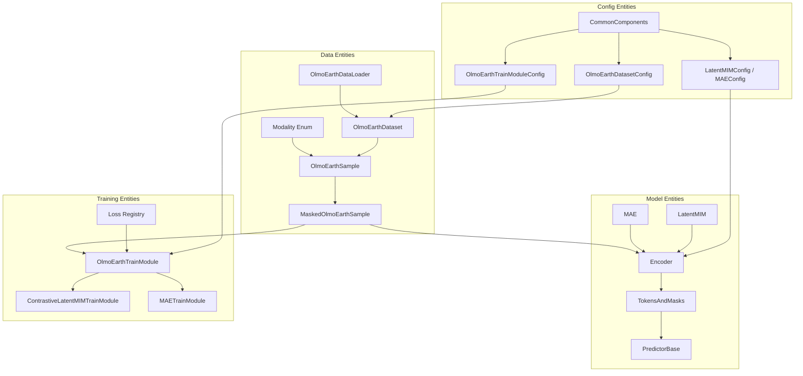
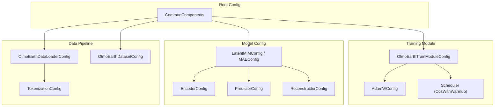
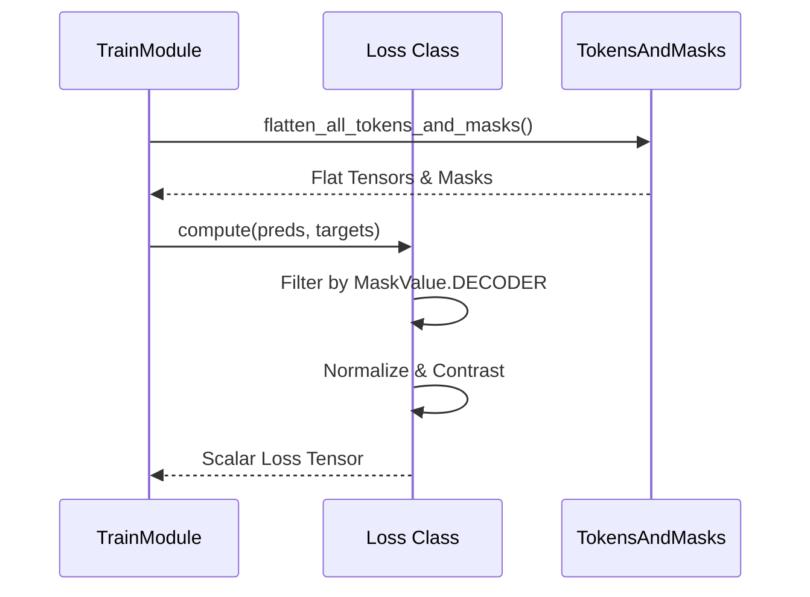

<!-- source: DeepWiki mcp.deepwiki.com · repo allenai/olmoearth_pretrain · page 10 Reference · fetched 2026-10-26 -->

# Reference

Relevant source files

The following files were used as context for generating this wiki page:

- [docs/Adding-Eval-Datasets.md](docs/Adding-Eval-Datasets.md)
- [olmoearth_pretrain/config.py](olmoearth_pretrain/config.py)
- [olmoearth_pretrain/evals/constants.py](olmoearth_pretrain/evals/constants.py)
- [olmoearth_pretrain/evals/datasets/configs.py](olmoearth_pretrain/evals/datasets/configs.py)
- [olmoearth_pretrain/evals/datasets/pastis_processor.py](olmoearth_pretrain/evals/datasets/pastis_processor.py)
- [olmoearth_pretrain/evals/datasets/paths.py](olmoearth_pretrain/evals/datasets/paths.py)
- [olmoearth_pretrain/nn/pooled_modality_predictor.py](olmoearth_pretrain/nn/pooled_modality_predictor.py)
- [olmoearth_pretrain/nn/st_model.py](olmoearth_pretrain/nn/st_model.py)
- [olmoearth_pretrain/nn/tokenization.py](olmoearth_pretrain/nn/tokenization.py)
- [olmoearth_pretrain/train/loss.py](olmoearth_pretrain/train/loss.py)
- [olmoearth_pretrain/train/train_module/train_module.py](olmoearth_pretrain/train/train_module/train_module.py)
- [scripts/official/ablations/base_high_entropy_dataset.py](scripts/official/ablations/base_high_entropy_dataset.py)
- [scripts/official/ablations/base_mae.py](scripts/official/ablations/base_mae.py)
- [scripts/official/ablations/base_random_masking.py](scripts/official/ablations/base_random_masking.py)
- [tests/unit/data/test_constants.py](tests/unit/data/test_constants.py)
- [tests/unit/test_config.py](tests/unit/test_config.py)
- [tests/unit/train/test_loss.py](tests/unit/train/test_loss.py)

This page provides quick-reference material for developers working with the OlmoEarth pretraining codebase. It includes lookup tables, constant values, code entity mappings, and cross-references to detailed documentation.

**Scope**: This page covers core constants, enumerations, model configurations, and code entity hierarchies. For complete configuration schemas, see [Configuration Schema Reference](#10.1). For detailed modality specifications with band orders and resolutions, see [Modality Specifications](#10.2). For mathematical formulations of loss functions, see [Loss Function Reference](#10.3). For evaluation dataset details, see [Evaluation Datasets](#10.4).

## System Entity to Code Mapping

The following diagram maps high-level system concepts to their concrete implementations in the codebase:

**Sources**: [olmoearth_pretrain/nn/flexi_vit.py:1-100](), [olmoearth_pretrain/train/train_module/train_module.py:79-162](), [olmoearth_pretrain/internal/experiment.py:29-34]()

## Model Size Configurations

OlmoEarth configurations use standardized model sizes defined in `MODEL_SIZE_ARGS`. These arguments specify embedding sizes, depths, and head counts for both encoders and decoders.

| Model Size Key | Encoder Embedding | Encoder Depth | Encoder Heads | Decoder Embedding | Decoder Depth |
|----------------|-------------------|---------------|---------------|-------------------|---------------|
| `nano` | 192 | 6 | 3 | 192 | 4 |
| `tiny` | 384 | 12 | 6 | 192 | 4 |
| `base_shallow_decoder` | 768 | 12 | 12 | 512 | 4 |
| `large` | 1024 | 24 | 16 | 512 | 8 |

**Configuration Location**: `olmoearth_pretrain.internal.utils.MODEL_SIZE_ARGS`

**Sources**: [scripts/official/ablations/base_high_entropy_dataset.py:35-35](), [scripts/official/ablations/base_mae.py:107-107]()

## Core Modalities

The system supports a wide array of Earth Observation modalities. These are defined in the `Modality` registry.

| Modality Name | Typical Usage | Sources |
|---------------|---------------|---------|
| `SENTINEL2_L2A` | Multispectral Optical | [scripts/official/ablations/base_high_entropy_dataset.py:66-66]() |
| `SENTINEL1` | SAR (Radar) | [scripts/official/ablations/base_high_entropy_dataset.py:67-67]() |
| `LANDSAT` | Multispectral Optical | [scripts/official/ablations/base_high_entropy_dataset.py:68-68]() |
| `WORLDCOVER` | Land Cover Mask | [scripts/official/ablations/base_high_entropy_dataset.py:69-69]() |
| `SRTM` | Elevation (DEM) | [scripts/official/ablations/base_high_entropy_dataset.py:70-70]() |
| `OPENSTREETMAP_RASTER` | Infrastructure/Roads | [scripts/official/ablations/base_high_entropy_dataset.py:71-71]() |
| `WRI_CANOPY_HEIGHT_MAP` | Vegetation Height | [scripts/official/ablations/base_high_entropy_dataset.py:72-72]() |
| `CDL` | Cropland Data Layer | [scripts/official/ablations/base_high_entropy_dataset.py:73-73]() |

**Sources**: [olmoearth_pretrain/data/constants.py:15-23](), [olmoearth_pretrain/nn/tokenization.py:28-28]()

## Key Enumerations

### MaskValue

The `MaskValue` enum defines the semantics of mask tensors. These values guide the model on which tokens to process in the encoder versus the decoder.

| Name | Value | Purpose |
|------|-------|---------|
| `ENCODER` | `1.0` | Token processed by the online encoder |
| `DECODER` | `2.0` | Token masked from encoder, to be predicted by decoder |
| `MISSING` | `3.0` | Data not available for this timestep/modality |

**Code Location**: [olmoearth_pretrain/datatypes.py:20-20](), [olmoearth_pretrain/train/masking.py:21-21]()

### AttentionMode

For spatial-temporal models (`STBase`), different attention mechanisms can be applied:

| Mode | Value | Description |
|------|-------|-------------|
| `FULL` | `0` | Global attention across all tokens |
| `SPATIAL` | `1` | Attention within spatial patches only |
| `TEMPORAL` | `2` | Attention across timesteps for the same spatial location |
| `WINDOWED` | `3` | Localized spatial-temporal window attention |

**Code Location**: [olmoearth_pretrain/nn/st_model.py:37-43]()

## Configuration Class Hierarchy

The configuration system is built on `olmo_core.config.Config`. It supports a "standalone" mode for inference without heavy dependencies.

**Sources**: [olmoearth_pretrain/config.py:64-121](), [olmoearth_pretrain/train/train_module/train_module.py:79-141]()

## Loss Function Reference

Losses are managed via a `ClassRegistry` and can be combined in the training modules.

| Registry Key | Class | Description |
|--------------|-------|-------------|
| `patch_discrimination` | `PatchDiscriminationLoss` | Contrastive loss for patch-level representations |
| `modality_patch_discrimination_new` | `ModalityPatchDiscriminationLossNew` | Modality-aware patch contrastive loss |
| `InfoNCE` | `InfoNCELoss` | Standard noise-contrastive estimation |
| `mae` | `L1Loss / L2Loss` | Pixel-level reconstruction error |
| `koleo` | `KoLeoLoss` | Regularization to prevent representation collapse |

**Sources**: [olmoearth_pretrain/train/loss.py:46-49](), [olmoearth_pretrain/train/loss.py:187-193](), [tests/unit/train/test_loss.py:8-20]()

## Evaluation Dataset Catalog

The `DATASET_TO_CONFIG` lookup table provides metadata for supported downstream evaluation tasks.

| Dataset Name | Task Type | Modalities | Classes |
|--------------|-----------|------------|---------|
| `m-eurosat` | Classification | Sentinel-2 | 10 |
| `m-bigearthnet` | Classification | Sentinel-2 | 43 |
| `m-so2sat` | Classification | Sentinel-2 | 17 |
| `mados` | Segmentation | Sentinel-2 | 15 |
| `sen1floods11` | Segmentation | Sentinel-1 | 2 |
| `pastis` | Segmentation | S2, S1 | 19 |
| `nandi` | Classification | S2, S1, Landsat | 6 |

**Sources**: [olmoearth_pretrain/evals/datasets/configs.py:51-184]()

## Common Code Paths

### Loss Computation Flow
The `compute` method is the primary entry point for all loss functions, taking `Predictions` and `Targets` as `TokensAndMasks` objects.

**Sources**: [olmoearth_pretrain/train/loss.py:25-33](), [olmoearth_pretrain/train/loss.py:81-109]()

---

For detailed configuration schemas with all available fields and their types, see [Configuration Schema Reference](#10.1).

For complete band orders and resolution specifications for all modalities, see [Modality Specifications](#10.2).

For mathematical formulations and usage examples of loss functions, see [Loss Function Reference](#10.3).

For descriptions of evaluation datasets including metrics and access information, see [Evaluation Datasets](#10.4).

---

