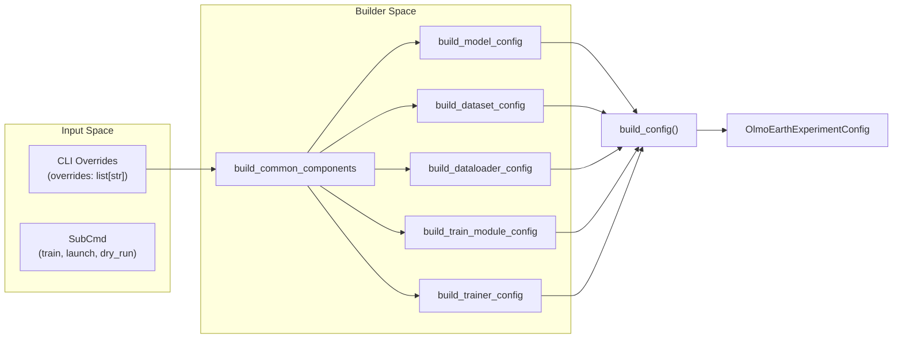

<!-- source: DeepWiki mcp.deepwiki.com · repo allenai/olmoearth_pretrain · page 10.1 Configuration Schema Reference · fetched 2026-10-26 -->

# Configuration Schema Reference

Relevant source files

The following files were used as context for generating this wiki page:

- [docs/Adding-Eval-Datasets.md](docs/Adding-Eval-Datasets.md)
- [docs/Evaluation.md](docs/Evaluation.md)
- [docs/Pretraining.md](docs/Pretraining.md)
- [olmoearth_pretrain/config.py](olmoearth_pretrain/config.py)
- [olmoearth_pretrain/evals/constants.py](olmoearth_pretrain/evals/constants.py)
- [olmoearth_pretrain/evals/datasets/configs.py](olmoearth_pretrain/evals/datasets/configs.py)
- [olmoearth_pretrain/evals/datasets/pastis_processor.py](olmoearth_pretrain/evals/datasets/pastis_processor.py)
- [olmoearth_pretrain/evals/datasets/paths.py](olmoearth_pretrain/evals/datasets/paths.py)
- [olmoearth_pretrain/internal/experiment.py](olmoearth_pretrain/internal/experiment.py)
- [olmoearth_pretrain/internal/utils.py](olmoearth_pretrain/internal/utils.py)
- [olmoearth_pretrain/train/train_module/contrastive_latentmim.py](olmoearth_pretrain/train/train_module/contrastive_latentmim.py)
- [olmoearth_pretrain/train/train_module/galileo.py](olmoearth_pretrain/train/train_module/galileo.py)
- [olmoearth_pretrain/train/train_module/latent_mim.py](olmoearth_pretrain/train/train_module/latent_mim.py)
- [olmoearth_pretrain/train/train_module/mae.py](olmoearth_pretrain/train/train_module/mae.py)
- [olmoearth_pretrain/train/utils.py](olmoearth_pretrain/train/utils.py)
- [scripts/archived/20251027_finetune.sh](scripts/archived/20251027_finetune.sh)
- [scripts/official/script.py](scripts/official/script.py)
- [tests/unit/test_config.py](tests/unit/test_config.py)
- [tests/unit/train/test_utils.py](tests/unit/train/test_utils.py)

This page provides a complete reference of all configuration classes, their fields, types, and default values used in the OlmoEarth pretraining system. These configurations control every aspect of model architecture, data loading, training, and evaluation.

The system is built to be flexible: it uses `olmo-core` for full training features (validation, CLI overrides, merging) but includes a fallback `_StandaloneConfig` to allow model loading and inference in environments where `olmo-core` is not installed. [olmoearth_pretrain/config.py:30-76]()

## Configuration System Overview

The OlmoEarth configuration system uses a builder pattern with dataclass-based configurations. When `olmo-core` is available, these inherit from `olmo_core.config.Config`. All configurations support:

- **Type validation** at construction time.
- **Serialization** to/from JSON via `as_dict()` and `from_dict()`. [olmoearth_pretrain/config.py:124-180]()
- **CLI overrides** using dotted notation (e.g., `--model.depth=12`). [olmoearth_pretrain/internal/experiment.py:168-206]()
- **Merging** of multiple configuration sources via `.merge()`. [olmoearth_pretrain/internal/experiment.py:200-200]()

Sources: [olmoearth_pretrain/config.py:1-180](), [olmoearth_pretrain/internal/experiment.py:1-210]()

## Configuration Hierarchy

The following diagram shows how configuration classes are organized and their relationships:

Title: Configuration Class Relationships

```mermaid
graph TB
    subgraph "Top-Level Configs"
        ExpCfg["OlmoEarthExperimentConfig"]
        EvalCfg["OlmoEarthEvaluateConfig"]
        BenchCfg["BenchmarkExperimentConfig"]
    end
    
    subgraph "Shared Components"
        Common["CommonComponents"]
        Launch["OlmoEarthBeakerLaunchConfig"]
        Viz["OlmoEarthVisualizeConfig"]
    end
    
    subgraph "Model Configs"
        ModelCfg["LatentMIMConfig"]
        EncCfg["FlexiVit / EncoderConfig"]
        DecCfg["PredictorConfig"]
    end
    
    subgraph "Data Configs"
        DatasetCfg["OlmoEarthDatasetConfig"]
        LoaderCfg["OlmoEarthDataLoaderConfig"]
    end
    
    subgraph "Training Configs"
        TrainModCfg["ContrastiveLatentMIMTrainModuleConfig"]
        TrainerCfg["TrainerConfig"]
        MaskCfg["MaskingConfig"]
        LossCfg["LossConfig"]
        OptimCfg["AdamWConfig"]
        SchedCfg["CosWithWarmup"]
        DPCfg["DataParallelConfig"]
    end
    
    subgraph "Callback Configs"
        WandbCb["OlmoEarthWandBCallback"]
        EvalCb["DownstreamEvaluatorCallbackConfig"]
        TaskCfg["DownstreamTaskConfig"]
        CkptCb["CheckpointerConfig"]
    end
    
    ExpCfg --> ModelCfg
    ExpCfg --> DatasetCfg
    ExpCfg --> LoaderCfg
    ExpCfg --> TrainModCfg
    ExpCfg --> TrainerCfg
    ExpCfg --> Launch
    ExpCfg --> Viz
    
    EvalCfg --> ModelCfg
    EvalCfg --> TrainerCfg
    EvalCfg --> Launch
    
    BenchCfg --> Launch
    
    Common --> Launch
    
    ModelCfg --> EncCfg
    ModelCfg --> DecCfg
    
    TrainModCfg --> OptimCfg
    TrainModCfg --> SchedCfg
    TrainModCfg --> MaskCfg
    TrainModCfg --> LossCfg
    TrainModCfg --> DPCfg
    
    TrainerCfg --> WandbCb
    TrainerCfg --> EvalCb
    TrainerCfg --> CkptCb
    
    EvalCb --> TaskCfg
```

Sources: [olmoearth_pretrain/internal/experiment.py:43-167](), [scripts/official/script.py:72-248]()

## Top-Level Experiment Configurations

### OlmoEarthExperimentConfig

Primary configuration for pretraining experiments. This is the root configuration object passed to the training system. [olmoearth_pretrain/internal/experiment.py:127-140]()

| Field | Type | Default | Description |
|-------|------|---------|-------------|
| `run_name` | `str` | **required** | Unique identifier for the experiment run |
| `model` | `Config` | **required** | Model architecture configuration |
| `dataset` | `Config` | **required** | Dataset configuration (typically `OlmoEarthDatasetConfig`) |
| `data_loader` | `OlmoEarthDataLoaderConfig` | **required** | DataLoader configuration for batching and workers |
| `train_module` | `OlmoEarthTrainModuleConfig` | **required** | Training module with optimizer, loss, and masking |
| `trainer` | `TrainerConfig` | **required** | Trainer configuration with callbacks and duration |
| `launch` | `OlmoEarthBeakerLaunchConfig \| None` | `None` | Beaker cluster launch configuration |
| `visualize` | `OlmoEarthVisualizeConfig \| None` | `None` | Dataset visualization configuration |
| `init_seed` | `int` | `12536` | Random seed for initialization |

Sources: [olmoearth_pretrain/internal/experiment.py:127-140]()

### OlmoEarthEvaluateConfig

Configuration for evaluation-only runs (no training). [olmoearth_pretrain/internal/experiment.py:148-157]()

| Field | Type | Default | Description |
|-------|------|---------|-------------|
| `run_name` | `str` | **required** | Unique identifier for the evaluation run |
| `model` | `Config` | **required** | Model architecture configuration |
| `trainer` | `TrainerConfig` | **required** | Trainer configuration (evaluation callbacks only) |
| `launch` | `OlmoEarthBeakerLaunchConfig \| None` | `None` | Beaker cluster launch configuration |
| `train_module` | `OlmoEarthTrainModuleConfig \| None` | `None` | Optional training module for specific eval logic |
| `init_seed` | `int` | `12536` | Random seed for initialization |

Sources: [olmoearth_pretrain/internal/experiment.py:148-157]()

### CommonComponents

Shared configuration components used by builder functions to maintain consistency across training, dataloading, and masking. [olmoearth_pretrain/internal/experiment.py:75-95]()

| Field | Type | Default | Description |
|-------|------|---------|-------------|
| `run_name` | `str` | **required** | Experiment run name |
| `save_folder` | `str` | **required** | Path where checkpoints and outputs are saved |
| `training_modalities` | `list[str]` | **required** | List of modality names to train on |
| `launch` | `OlmoEarthBeakerLaunchConfig \| None` | `None` | Beaker launch configuration |
| `nccl_debug` | `bool` | `False` | Enable NCCL debugging for distributed training |
| `tokenization_config` | `TokenizationConfig \| None` | `None` | Custom tokenization for band groupings |

**Validation Rules:**
- `training_modalities` must be a list of valid names from `Modality.names()`. [olmoearth_pretrain/internal/experiment.py:98-105]()

Sources: [olmoearth_pretrain/internal/experiment.py:75-109]()

### OlmoEarthBeakerLaunchConfig

Extended `BeakerLaunchConfig` with additional hostname targeting support for AI2 researchers. [olmoearth_pretrain/internal/experiment.py:45-66]()

| Field | Type | Default | Description |
|-------|------|---------|-------------|
| `hostnames` | `list[str] \| None` | `None` | Specific Beaker hosts to target for job execution |
| *(inherits fields)* | | | `name`, `budget`, `workspace`, `clusters`, `num_gpus`, etc. |

Sources: [olmoearth_pretrain/internal/experiment.py:45-66]()

## Model Configuration Classes

### Model Size Presets

The codebase provides standard architectural configurations via `MODEL_SIZE_ARGS` in `olmoearth_pretrain/internal/utils.py`. [olmoearth_pretrain/internal/utils.py:48-193]()

| Size | `encoder_depth` | `encoder_embedding_size` | `num_heads` | `decoder_depth` |
|------|-----------------|--------------------------|-------------|-----------------|
| **Nano** | 4 | 128 | 8 | 4 |
| **Tiny** | 12 | 192 | 3 | 12 |
| **Base** | 12 | 768 | 12 | 12 |
| **Large** | 24 | 1024 | 16 | 24 |
| **Giga** | 40 | 1536 | 24 | 40 |

Sources: [olmoearth_pretrain/internal/utils.py:48-102]()

## Data Configuration Classes

### OlmoEarthDatasetConfig

Configuration for the H5PY-based dataset loading. [olmoearth_pretrain/data/dataset.py]()

| Field | Type | Default | Description |
|-------|------|---------|-------------|
| `h5py_dir` | `str` | **required** | Path to H5PY dataset directory |
| `training_modalities` | `list[str]` | **required** | List of modalities to load |

Sources: [scripts/official/script.py:164-170]()

### OlmoEarthDataLoaderConfig

Controls batching, worker distribution, and patch sampling. [olmoearth_pretrain/data/dataloader.py]()

| Field | Type | Default | Description |
|-------|------|---------|-------------|
| `num_workers` | `int` | **required** | Number of dataloader worker processes |
| `global_batch_size` | `int` | **required** | Total batch size across all GPUs |
| `token_budget` | `int` | **required** | Max tokens per batch (FlexiVit feature) |
| `sampled_hw_p_list` | `list[int]` | **required** | List of spatial patch counts to sample from |
| `min_patch_size` | `int` | **required** | Minimum patch size (e.g., 1) |
| `max_patch_size` | `int` | **required** | Maximum patch size (e.g., 8) |
| `num_masked_views` | `int` | `1` | Number of masked views (2 for contrastive training) |
| `masking_config` | `MaskingConfig` | **required** | Masking strategy applied in workers |

Sources: [scripts/official/script.py:135-162]()

## Training Configuration Classes

### ContrastiveLatentMIMTrainModuleConfig

Configuration for the `ContrastiveLatentMIMTrainModule`, which manages the reconstruction and contrastive objectives. [olmoearth_pretrain/train/train_module/contrastive_latentmim.py:36-59]()

| Field | Type | Default | Description |
|-------|------|---------|-------------|
| `optim_config` | `OptimConfig` | `AdamWConfig` | Optimizer configuration (AdamW) |
| `rank_microbatch_size` | `int` | **required** | Batch size per GPU rank |
| `loss_config` | `LossConfig` | `patch_discrimination` | Primary reconstruction loss configuration |
| `contrastive_config` | `LossConfig \| None` | `None` | Contrastive loss configuration (e.g., InfoNCE) |
| `masking_config` | `MaskingConfig` | `random` | Masking strategy for metrics/reference |
| `token_exit_cfg` | `dict[str, int]` | `all: 0` | Early exit layer index per modality |
| `ema_decay` | `tuple[float, float]` | `(0.996, 1.0)` | Target encoder EMA decay (start, end) |
| `max_grad_norm` | `float` | `1.0` | Gradient clipping threshold |
| `dp_config` | `DataParallelConfig` | **required** | FSDP/DDP configuration |

Sources: [olmoearth_pretrain/train/train_module/contrastive_latentmim.py:36-59](), [scripts/official/script.py:97-133]()

### MaskingConfig

Configuration for token masking strategies. [olmoearth_pretrain/train/masking.py]()

| Field | Type | Default | Description |
|-------|------|---------|-------------|
| `strategy_config` | `dict` | **required** | Parameters for the masking strategy |
| `tokenization_config` | `TokenizationConfig \| None` | `None` | Consistent band groupings |

**Modality Cross Random Strategy Fields:** [scripts/official/script.py:78-92]()
- `type`: `"modality_cross_random"`
- `encode_ratio`: Ratio of tokens visible to encoder (e.g., 0.5)
- `decode_ratio`: Ratio of tokens to be reconstructed (e.g., 0.5)
- `only_decode_modalities`: List of modalities that are targets only (e.g., `WorldCover`, `SRTM`).

Sources: [scripts/official/script.py:72-94]()

## Configuration Builder Pattern

The system uses a set of builder functions to assemble the final `OlmoEarthExperimentConfig`. This allows for programmatic defaults and cluster-specific logic.

Title: Config Builder Data Flow

Sources: [olmoearth_pretrain/internal/experiment.py:181-224](), [scripts/official/script.py:53-248]()

## Evaluation Task Configurations

Downstream evaluations are configured via `DownstreamTaskConfig`, typically registered in a trainer's callbacks. [olmoearth_pretrain/train/callbacks/evaluator_callback.py]()

| Field | Type | Default | Description |
|-------|------|---------|-------------|
| `dataset` | `str` | **required** | Dataset identifier (e.g., `"m-eurosat"`) |
| `embedding_batch_size` | `int` | **required** | Batch size for feature extraction |
| `pooling_type` | `PoolingType` | `MEAN` | How to pool tokens (`MEAN`, `MAX`, `CLS`) |
| `norm_stats_from_pretrained`| `bool` | `True` | Use pretraining stats for normalization |
| `eval_interval` | `Duration` | **required** | How often to run evaluation |

Sources: [scripts/official/script.py:190-218]()

## Modality Reference for Configs

When configuring `training_modalities` or `token_exit_cfg`, the following names are used as keys.

| Modality Name | Source Code Symbol |
|---------------|-------------------|
| `sentinel2_l2a` | `Modality.SENTINEL2_L2A` |
| `sentinel1` | `Modality.SENTINEL1` |
| `landsat` | `Modality.LANDSAT` |
| `worldcover` | `Modality.WORLDCOVER` |
| `srtm` | `Modality.SRTM` |
| `openstreetmap_raster` | `Modality.OPENSTREETMAP_RASTER` |
| `wri_canopy_height_map` | `Modality.WRI_CANOPY_HEIGHT_MAP` |
| `cdl` | `Modality.CDL` |
| `worldcereal` | `Modality.WORLDCEREAL` |

Sources: [olmoearth_pretrain/data/constants.py:23-23](), [scripts/official/script.py:58-68]()

---

