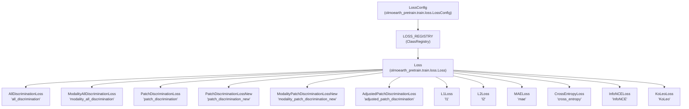
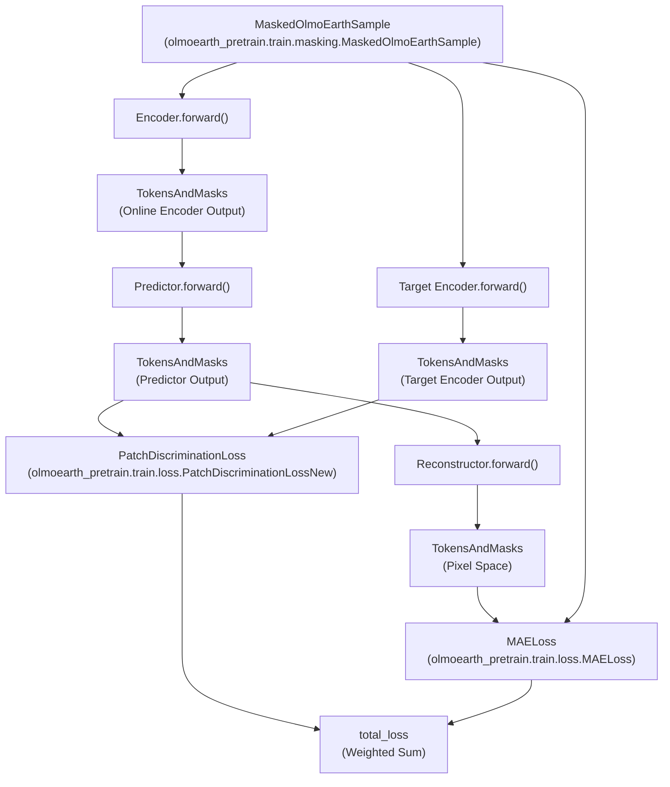

<!-- source: DeepWiki mcp.deepwiki.com · repo allenai/olmoearth_pretrain · page 10.3 Loss Function Reference · fetched 2026-10-26 -->

# Loss Function Reference

<details>
<summary>Relevant source files</summary>

The following files were used as context for generating this wiki page:

- [olmoearth_pretrain/nn/pooled_modality_predictor.py](olmoearth_pretrain/nn/pooled_modality_predictor.py)
- [olmoearth_pretrain/nn/st_model.py](olmoearth_pretrain/nn/st_model.py)
- [olmoearth_pretrain/nn/tokenization.py](olmoearth_pretrain/nn/tokenization.py)
- [olmoearth_pretrain/train/loss.py](olmoearth_pretrain/train/loss.py)
- [olmoearth_pretrain/train/train_module/train_module.py](olmoearth_pretrain/train/train_module/train_module.py)
- [scripts/official/ablations/base_high_entropy_dataset.py](scripts/official/ablations/base_high_entropy_dataset.py)
- [scripts/official/ablations/base_mae.py](scripts/official/ablations/base_mae.py)
- [scripts/official/ablations/base_random_masking.py](scripts/official/ablations/base_random_masking.py)
- [tests/integration/eval/test_geobench_dataset_with_model.py](tests/integration/eval/test_geobench_dataset_with_model.py)
- [tests/integration/nn/test_latent_mim.py](tests/integration/nn/test_latent_mim.py)
- [tests/integration/nn/test_mae.py](tests/integration/nn/test_mae.py)
- [tests/unit/internal/test_experiment.py](tests/unit/internal/test_experiment.py)
- [tests/unit/train/test_loss.py](tests/unit/train/test_loss.py)
- [tests/unit/train/test_masking.py](tests/unit/train/test_masking.py)

</details>


This page provides a comprehensive catalog of all loss functions available in the OlmoEarth pretraining system, including their mathematical formulations, configuration parameters, and usage patterns.

For information about how losses are integrated into the training loop, see [Training System](). For details on how to configure training runs that use these losses, see [Training Modules]().

## Overview

The OlmoEarth codebase implements multiple loss functions for self-supervised learning on multi-modal satellite imagery. All loss functions inherit from the `Loss` abstract base class and are registered in `LOSS_REGISTRY` for configuration-based instantiation. Loss functions operate on `TokensAndMasks` representations produced by the model's encoder and decoder [olmoearth_pretrain/train/loss.py:25-46]().

The primary losses fall into four categories:
- **Patch Discrimination Losses**: Contrastive losses for self-supervised learning.
- **Reconstruction Losses**: Pixel-space reconstruction objectives (MAE, L1, L2).
- **Contrastive Losses**: Instance-level contrastive learning (InfoNCE).
- **Regularization Losses**: Feature distribution regularizers (KoLeo).

Sources: [olmoearth_pretrain/train/loss.py:1-873]()

## Loss Function Architecture

### Class Hierarchy



**Diagram: Loss Function Class Hierarchy**

All loss functions implement the `compute` method which takes predictions and targets as arguments [olmoearth_pretrain/train/loss.py:30-33](). Each loss is registered with a string identifier used in configuration files.

Sources: [olmoearth_pretrain/train/loss.py:25-46](), [olmoearth_pretrain/train/loss.py:855-873]()

### Base Loss Class

The abstract `Loss` class defines the interface for all loss functions:

| Method | Description |
|--------|-------------|
| `compute(predictions, targets, **kwargs)` | Abstract method that computes the loss value [olmoearth_pretrain/train/loss.py:30-33]() |
| `_expand_and_reciprocate(t)` | Utility for batch averaging with variable token counts [olmoearth_pretrain/train/loss.py:36-43]() |

The `compute` method signature varies by loss type:
- **Token-level losses** (patch discrimination, MAE): Accept `TokensAndMasks` for both predictions and targets [olmoearth_pretrain/train/loss.py:188-193]().
- **Instance-level losses** (InfoNCE): Accept `torch.Tensor` embeddings [olmoearth_pretrain/train/loss.py:724-730]().
- **Regularization losses** (KoLeo): May accept only predictions [olmoearth_pretrain/train/loss.py:762-770]().

Sources: [olmoearth_pretrain/train/loss.py:25-43]()

### Loss Registry and Configuration

The `LOSS_REGISTRY` is a `ClassRegistry` that maps string identifiers to loss classes [olmoearth_pretrain/train/loss.py:46](). This enables configuration-based loss instantiation:

```python
# Example configuration from script
loss_config = LossConfig(
    loss_config={
        "type": "modality_patch_discrimination_new",
        "tau": 0.1,
    }
)
```

The `LossConfig` dataclass handles building loss instances from configuration dictionaries [olmoearth_pretrain/train/loss.py:855-873]().

Sources: [olmoearth_pretrain/train/loss.py:46](), [olmoearth_pretrain/train/loss.py:855-873](), [scripts/official/ablations/base_high_entropy_dataset.py:102-107]()

## Patch Discrimination Losses

Patch discrimination losses are the primary self-supervised learning objectives in OlmoEarth. They learn representations by contrasting masked patch predictions against target encoder outputs.

### PatchDiscriminationLossNew

**Registry key**: `patch_discrimination_new`

Lower-memory implementation of patch discrimination that processes each sample in the batch sequentially to avoid large similarity matrices [olmoearth_pretrain/train/loss.py:188-265]().

| Parameter | Type | Default | Description |
|-----------|------|---------|-------------|
| `tau` | float | 0.1 | Softmax temperature for contrastive learning |
| `pred2unit` | bool | False | Whether to standardize predictions using batch statistics |
| `weight` | float | 1.0 | Weight to apply to this loss |

**Implementation details**:
- Extracts only tokens marked as `MaskValue.DECODER` from predictions and targets [olmoearth_pretrain/train/loss.py:214-215]().
- Processes each sample independently to avoid OOM with large batches [olmoearth_pretrain/train/loss.py:212]().
- Handles samples with variable numbers of masked tokens via `_expand_and_reciprocate` [olmoearth_pretrain/train/loss.py:261]().

Sources: [olmoearth_pretrain/train/loss.py:188-265]()

### ModalityPatchDiscriminationLossNew

**Registry key**: `modality_patch_discrimination_new`

Per-modality variant that computes patch discrimination loss separately for each modality and sums them [olmoearth_pretrain/train/loss.py:267-370]().

| Parameter | Type | Default | Description |
|-----------|------|---------|-------------|
| `tau` | float | 0.1 | Softmax temperature |
| `pred2unit` | bool | False | Standardize predictions |
| `weight` | float | 1.0 | Global loss weight |
| `modality_weights` | dict\[str, float\] \| None | None | Per-modality weights |

**Use case**: When training on multiple modalities with different characteristics, this allows separate loss computation per modality with optional per-modality weighting [olmoearth_pretrain/train/loss.py:270-281]().

Sources: [olmoearth_pretrain/train/loss.py:267-370]()

### AdjustedPatchDiscriminationLoss

**Registry key**: `adjusted_patch_discrimination`

Applies Gaussian-based weighting to hard negative samples [olmoearth_pretrain/train/loss.py:450-561]().

| Parameter | Type | Default | Description |
|-----------|------|---------|-------------|
| `tau` | float | 0.1 | Softmax temperature |
| `mu` | float | 0.7 | Mean of Gaussian distribution for weighting |
| `sigma` | float | 1.0 | Standard deviation of Gaussian distribution |

Higher `mu` and lower `sigma` focus more on hard negatives (similar non-matching patches) [tests/unit/train/test_loss.py:66-74]().

Sources: [olmoearth_pretrain/train/loss.py:450-561](), [tests/unit/train/test_loss.py:49-74]()

## Reconstruction Losses

Reconstruction losses operate on pixel-space predictions, typically from a `Reconstructor` module [olmoearth_pretrain/nn/mae.py:126-131]().

### MAELoss

**Registry key**: `mae`

Masked Auto-Encoder loss for pixel-space reconstruction [olmoearth_pretrain/train/loss.py:616-695]().

| Parameter | Type | Default | Description |
|-----------|------|---------|-------------|
| `loss_function` | str | "MSELoss" | PyTorch loss class name |
| `only_decode` | bool | True | Only compute loss on DECODER masked tokens |
| `weight` | float | 1.0 | Weight to apply to this loss |

**Processing pipeline**:
1. Flatten spatiotemporal data: `[B, H, W, T, C]` → `[B, H×W×T×C]` [olmoearth_pretrain/train/loss.py:668-669]().
2. Apply mask to only compute loss on relevant tokens (usually `MaskValue.DECODER`) [olmoearth_pretrain/train/loss.py:672-675]().
3. Normalize by number of non-zero elements in the mask [olmoearth_pretrain/train/loss.py:688]().

Sources: [olmoearth_pretrain/train/loss.py:616-695](), [tests/integration/nn/test_mae.py:159-160]()

### L1Loss / L2Loss

**Registry keys**: `l1`, `l2`

Mean Absolute Error (L1) or Mean Squared Error (L2) on latent representations [olmoearth_pretrain/train/loss.py:563-614]().

**Use case**: Used when training directly on latent representations without a reconstructor. Typically used with token-level predictions from a decoder [tests/unit/train/test_loss.py:166-211]().

Sources: [olmoearth_pretrain/train/loss.py:563-614](), [tests/unit/train/test_loss.py:166-211]()

## Contrastive and Regularization Losses

### InfoNCELoss

**Registry key**: `InfoNCE`

Instance-level contrastive loss that operates on pooled embeddings rather than token-level representations [olmoearth_pretrain/train/loss.py:724-760]().

| Parameter | Type | Default | Description |
|-----------|------|---------|-------------|
| `tau` | float | 0.1 | Temperature for softmax |
| `weight` | float | 1.0 | Weight to apply to this loss |

**Usage pattern**: Applied to pooled encoder outputs to enforce instance-level consistency across augmentations [olmoearth_pretrain/train/train_module/contrastive_latentmim.py:108-113]().

Sources: [olmoearth_pretrain/train/loss.py:724-760](), [scripts/official/ablations/base_high_entropy_dataset.py:108-113]()

### KoLeoLoss

**Registry key**: `KoLeo`

Kozachenko-Leonenko differential entropy regularizer that encourages uniform distribution of features within a batch [olmoearth_pretrain/train/loss.py:762-853]().

| Parameter | Type | Default | Description |
|-----------|------|---------|-------------|
| `weight` | float | 0.1 | Weight to apply to regularization |
| `mode` | str | "instance" | "instance" or "patch" - level at which to compute neighbors |

**Mode differences**:
- `instance`: Computes nearest neighbors among pooled instance-level embeddings [olmoearth_pretrain/train/loss.py:816-820]().
- `patch`: Computes nearest neighbors among all patch-level tokens marked as `ONLINE_ENCODER` [olmoearth_pretrain/train/loss.py:797-814]().

Sources: [olmoearth_pretrain/train/loss.py:762-853]()

## Loss Computation Flow



**Diagram: Loss Computation Flow in Training**

This diagram shows how different loss functions operate on different outputs of the model:
- **Patch discrimination**: Latent tokens from predictor vs. target encoder [tests/integration/nn/test_latent_mim.py:138-149]().
- **MAE**: Reconstructed pixels vs. original masked data [tests/integration/nn/test_mae.py:159-160]().

Sources: [tests/integration/nn/test_latent_mim.py:138-149](), [tests/integration/nn/test_mae.py:159-160](), [olmoearth_pretrain/train/train_module/contrastive_latentmim.py:280-310]()

## Token Masking and Loss Computation

Loss functions use the `MaskValue` enum to determine which tokens to include in computation [olmoearth_pretrain/train/masking.py:13-30]():

| MaskValue | Value | Purpose |
|-----------|-------|---------|
| `ONLINE_ENCODER` | 0 | Unmasked tokens processed by online encoder. |
| `TARGET_ENCODER` | 1 | Tokens processed by target encoder (usually unmasked view). |
| `DECODER` | 2 | Masked tokens to be predicted by the decoder/predictor. |
| `MISSING` | -1 | Missing data that should be ignored by all losses. |

**Example filtering**:
```python
# Extract only decoder tokens for patch discrimination in loss.py
pred = all_preds[all_masks == MaskValue.DECODER.value]
target = all_targets[all_masks == MaskValue.DECODER.value]
```

Sources: [olmoearth_pretrain/train/masking.py:13-30](), [olmoearth_pretrain/train/loss.py:214-215]()

## Testing and Validation

Unit tests for loss functions verify numerical correctness and implementation equivalence:

| Test | File Location | Purpose |
|------|--------------|---------|
| `test_patch_disc_loss` | [tests/unit/train/test_loss.py:26-46]() | Basic patch discrimination sanity check. |
| `test_if_old_and_new_loss_are_the_same` | [tests/unit/train/test_loss.py:77-97]() | Verifies memory-efficient implementation matches original. |
| `test_patch_disc_loss_averaged_over_batch_size` | [tests/unit/train/test_loss.py:126-163]() | Ensures loss is properly normalized by batch size. |
| `test_l1_loss` | [tests/unit/train/test_loss.py:166-186]() | Verifies L1 reconstruction on latent tokens. |

Sources: [tests/unit/train/test_loss.py:1-241]()

---

