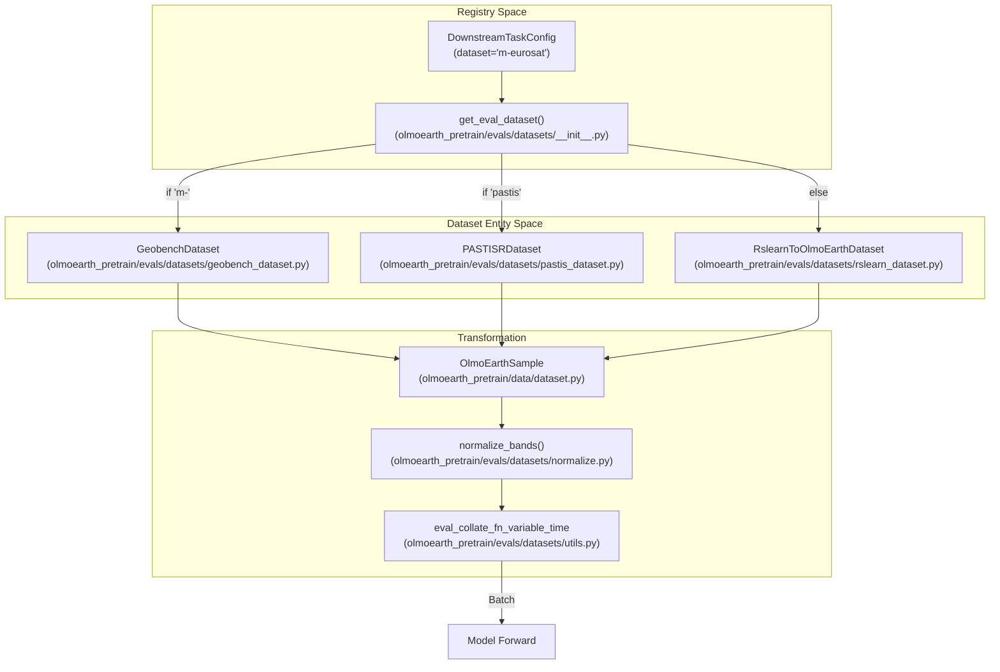
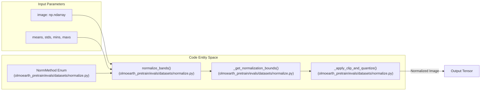

<!-- source: DeepWiki mcp.deepwiki.com · repo allenai/olmoearth_pretrain · page 10.4 Evaluation Datasets · fetched 2026-10-26 -->

# Evaluation Datasets

<details>
<summary>Relevant source files</summary>

The following files were used as context for generating this wiki page:

- [olmoearth_pretrain/evals/datasets/__init__.py](olmoearth_pretrain/evals/datasets/__init__.py)
- [olmoearth_pretrain/evals/datasets/breizhcrops.py](olmoearth_pretrain/evals/datasets/breizhcrops.py)
- [olmoearth_pretrain/evals/datasets/floods_dataset.py](olmoearth_pretrain/evals/datasets/floods_dataset.py)
- [olmoearth_pretrain/evals/datasets/geobench_dataset.py](olmoearth_pretrain/evals/datasets/geobench_dataset.py)
- [olmoearth_pretrain/evals/datasets/mados_dataset.py](olmoearth_pretrain/evals/datasets/mados_dataset.py)
- [olmoearth_pretrain/evals/datasets/normalize.py](olmoearth_pretrain/evals/datasets/normalize.py)
- [olmoearth_pretrain/evals/datasets/pastis_dataset.py](olmoearth_pretrain/evals/datasets/pastis_dataset.py)
- [olmoearth_pretrain/evals/datasets/rslearn_dataset.py](olmoearth_pretrain/evals/datasets/rslearn_dataset.py)
- [olmoearth_pretrain/internal/all_evals.py](olmoearth_pretrain/internal/all_evals.py)
- [olmoearth_pretrain/internal/full_eval_sweep_finetune.py](olmoearth_pretrain/internal/full_eval_sweep_finetune.py)
- [olmoearth_pretrain/train/callbacks/evaluator_callback.py](olmoearth_pretrain/train/callbacks/evaluator_callback.py)
- [scripts/tools/validate_segmentation_metrics.py](scripts/tools/validate_segmentation_metrics.py)
- [tests/unit/eval/__init__.py](tests/unit/eval/__init__.py)
- [tests/unit/eval/datasets/test_normalize.py](tests/unit/eval/datasets/test_normalize.py)

</details>


This page catalogs the evaluation datasets supported by the OlmoEarth pretraining system. It documents dataset properties, implementation details, normalization requirements, and how datasets are registered for evaluation tasks.

---

## Overview

Evaluation datasets in OlmoEarth serve as downstream tasks for assessing the quality of learned representations. These datasets span various Earth observation applications including land cover classification, crop type mapping, and environmental monitoring. The system supports a wide range of datasets through a unified interface, including GeoBench, PASTIS, and custom `rslearn` datasets.

The evaluation system supports three primary modes:
1.  **KNN**: Embedding-based classification using nearest neighbors [olmoearth_pretrain/train/callbacks/evaluator_callback.py:60]().
2.  **Linear Probe**: Training a linear head on frozen backbone features [olmoearth_pretrain/train/callbacks/evaluator_callback.py:61]().
3.  **Finetune**: End-to-end training with a trainable backbone [olmoearth_pretrain/train/callbacks/evaluator_callback.py:62]().

Sources: [olmoearth_pretrain/train/callbacks/evaluator_callback.py:57-63]()

---

## Dataset Registry and Task Configuration

The evaluation system uses a centralized registry to define task parameters. This is managed via `DownstreamTaskConfig` which encapsulates dataset identity, normalization strategy, and training hyperparameters.

### Task Configuration Schema

The `DownstreamTaskConfig` class defines how a task should be executed:

| Field | Type | Description |
| :--- | :--- | :--- |
| `dataset` | `str` | Key used to look up the dataset implementation. |
| `input_modalities` | `list[str]` | List of satellite modalities (e.g., `["sentinel2_l2a"]`). |
| `norm_method` | `NormMethod` | Strategy for pixel normalization. |
| `norm_stats_from_pretrained` | `bool` | If True, uses statistics from the pretraining phase. |
| `eval_mode` | `EvalMode` | `knn`, `linear_probe`, or `finetune`. |
| `pooling_type` | `PoolingType` | How to aggregate patch tokens (e.g., `MEAN`, `MAX`). |

Sources: [olmoearth_pretrain/train/callbacks/evaluator_callback.py:66-115](), [olmoearth_pretrain/internal/all_evals.py:66-203]()

### Registry Implementation

Tasks are registered in `olmoearth_pretrain/internal/all_evals.py`. For example, EuroSAT is configured for KNN evaluation using Sentinel-2 data:

```python
"m_eurosat": DownstreamTaskConfig(
    dataset="m-eurosat",
    embedding_batch_size=128,
    pooling_type=PoolingType.MEAN,
    norm_stats_from_pretrained=True,
    norm_method=NormMethod.NORM_NO_CLIP_2_STD,
    input_modalities=[Modality.SENTINEL2_L2A.name],
    eval_mode=EvalMode.KNN,
    primary_metric=EvalMetric.ACCURACY,
)
```

Sources: [olmoearth_pretrain/internal/all_evals.py:67-78]()

---

## Supported Datasets

The system provides specialized `Dataset` classes for different data sources, all yielding `MaskedOlmoEarthSample` objects to maintain compatibility with the model's `forward` pass.

### GeoBench (m-*)
Datasets prefixed with `m-` (e.g., `m-eurosat`, `m-so2sat`) are sourced from the GeoBench benchmark. The `GeobenchDataset` class handles the conversion from GeoBench's internal format to the `OlmoEarthSample` structure.
*   **Implementation**: `GeobenchDataset` [olmoearth_pretrain/evals/datasets/geobench_dataset.py:62]()
*   **Bands**: Maps GeoBench band names to OlmoEarth standard names (e.g., mapping Landsat B1 to "01 - Coastal aerosol") [olmoearth_pretrain/evals/datasets/geobench_dataset.py:34-59]().

### PASTIS-R
A multi-modal, multi-temporal dataset for panoptic segmentation, providing synchronized Sentinel-1 and Sentinel-2 data.
*   **Implementation**: `PASTISRDataset` [olmoearth_pretrain/evals/datasets/pastis_dataset.py:53]()
*   **Modalities**: Supports `SENTINEL1` and `SENTINEL2_L2A` [olmoearth_pretrain/evals/datasets/pastis_dataset.py:56]().
*   **Normalization**: Uses pre-calculated statistics for S1 (dB scale) and S2 [olmoearth_pretrain/evals/datasets/pastis_dataset.py:31-50]().

### MADOS
A dataset for marine debris and ocean surface object detection/segmentation.
*   **Implementation**: `MADOSDataset` [olmoearth_pretrain/evals/datasets/mados_dataset.py:103]()
*   **Processing**: Interpolates missing Sentinel-2 bands (B6, B9, B10) to match the standard 13-band stack [olmoearth_pretrain/evals/datasets/mados_dataset.py:142-145]().

### BreizhCrops
A time-series dataset for crop type mapping in Brittany, France.
*   **Implementation**: `BreizhCropsDataset` [olmoearth_pretrain/evals/datasets/breizhcrops.py:52]()
*   **Temporal**: Supports monthly averaging of the time series [olmoearth_pretrain/evals/datasets/breizhcrops.py:177-178]().

### rslearn Datasets
The `RslearnToOlmoEarthDataset` class acts as a bridge for any dataset ingested via the `rslearn` library. It converts `rslearn` model datasets into the temporal format required by OlmoEarth.
*   **Implementation**: `RslearnToOlmoEarthDataset` [olmoearth_pretrain/evals/datasets/rslearn_dataset.py:80]()
*   **Temporal Logic**: Generates monthly timestamps (day, month, year) for the input sequence [olmoearth_pretrain/evals/datasets/rslearn_dataset.py:40-77]().

Sources: [olmoearth_pretrain/evals/datasets/__init__.py:34-106](), [olmoearth_pretrain/evals/datasets/rslearn_dataset.py:80-173]()

---

## Data Flow: From Registry to Model

The following diagram illustrates how a dataset name in a config file is resolved to a concrete Python class and eventually transformed into a model-ready batch.



**Diagram: Dataset Resolution and Transformation Flow**

Sources: [olmoearth_pretrain/evals/datasets/__init__.py:34-106](), [olmoearth_pretrain/train/callbacks/evaluator_callback.py:231-250]()

---

## Normalization Strategies

Evaluation datasets use the `normalize_bands` function to transform raw reflectance or backscatter values into a standardized range.

### Normalization Methods (`NormMethod`)

| Method | Implementation Detail |
| :--- | :--- |
| `STANDARDIZE` | `(image - means) / stds` [olmoearth_pretrain/evals/datasets/normalize.py:143]() |
| `NORM_NO_CLIP_2_STD` | Rescales based on `[mean - 2*std, mean + 2*std]` without clipping [olmoearth_pretrain/evals/datasets/normalize.py:80]() |
| `NORM_YES_CLIP_MIN_MAX_INT` | Rescales based on `[min, max]` and quantizes to 8-bit [olmoearth_pretrain/evals/datasets/normalize.py:107-118]() |

### Normalization Logic Flow

The system bridges "Natural Language Space" (e.g., "Standardize this image") to "Code Entity Space" through the `NormMethod` enum and `normalize_bands` logic.



**Diagram: Normalization Execution Logic**

Sources: [olmoearth_pretrain/evals/datasets/normalize.py:48-150]()

---

## Evaluation Sweeps

To find optimal hyperparameters for downstream tasks, the repository includes scripts for launching exhaustive sweeps.

### Finetune Sweeps
The `full_eval_sweep_finetune.py` script automates launching jobs across multiple tasks with varying learning rates (e.g., `[1e-4, 5e-4, 1e-3]`). It uses `ModelPreset` objects to ensure the correct normalization method is applied for different model architectures (e.g., `dino_v3` vs `croma`).

*   **Presets**: Defines specific `NormMethod` and batch sizes per model [olmoearth_pretrain/internal/full_eval_sweep_finetune.py:103-200]().
*   **Task Filtering**: Allows running a subset of tasks using the `--trainer.callbacks.downstream_evaluator.tasks_to_run` flag [olmoearth_pretrain/internal/full_eval_sweep_finetune.py:21-23]().

Sources: [olmoearth_pretrain/internal/full_eval_sweep_finetune.py:1-53](), [olmoearth_pretrain/internal/full_eval_sweep_finetune.py:103-200]()

---

