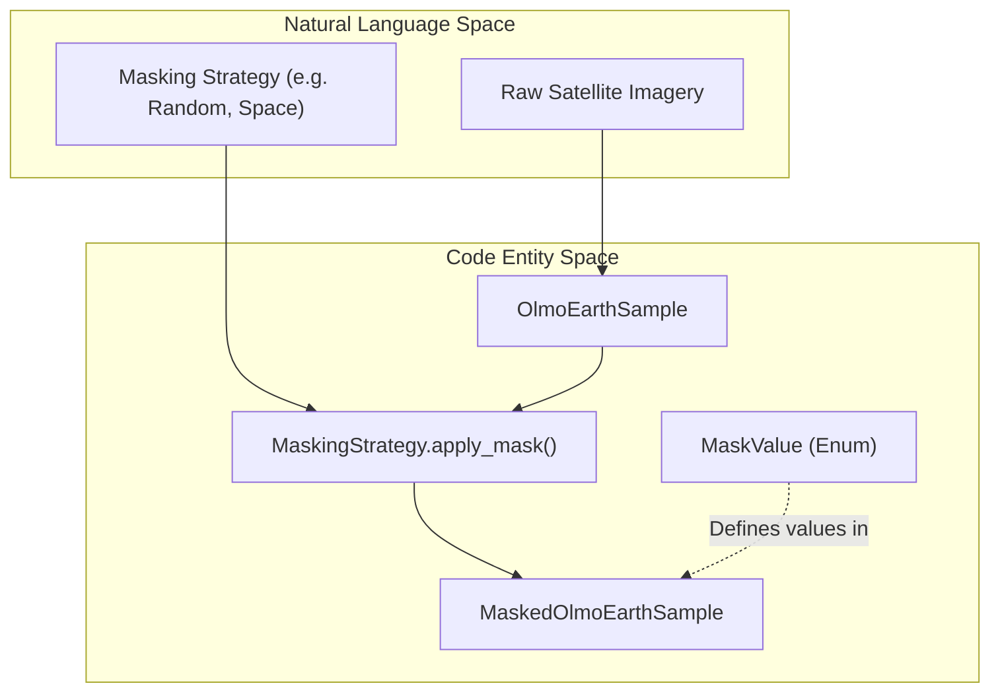
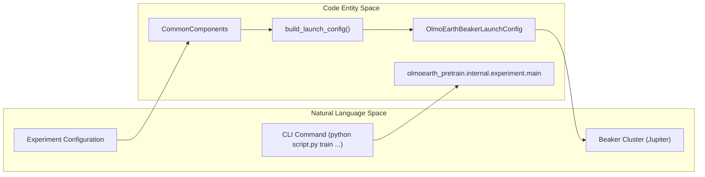

<!-- source: DeepWiki mcp.deepwiki.com · repo allenai/olmoearth_pretrain · page 11 Glossary · fetched 2026-10-26 -->

# Glossary

Relevant source files

The following files were used as context for generating this wiki page:

- [.github/workflows/lint.yaml](.github/workflows/lint.yaml)
- [.github/workflows/tests.yaml](.github/workflows/tests.yaml)
- [README.md](README.md)
- [olmoearth_pretrain/data/transform.py](olmoearth_pretrain/data/transform.py)
- [olmoearth_pretrain/internal/all_evals.py](olmoearth_pretrain/internal/all_evals.py)
- [olmoearth_pretrain/internal/common.py](olmoearth_pretrain/internal/common.py)
- [olmoearth_pretrain/internal/full_eval_sweep_finetune.py](olmoearth_pretrain/internal/full_eval_sweep_finetune.py)
- [olmoearth_pretrain/nn/flexi_vit.py](olmoearth_pretrain/nn/flexi_vit.py)
- [olmoearth_pretrain/nn/galileo.py](olmoearth_pretrain/nn/galileo.py)
- [olmoearth_pretrain/nn/latent_mim.py](olmoearth_pretrain/nn/latent_mim.py)
- [olmoearth_pretrain/nn/mae.py](olmoearth_pretrain/nn/mae.py)
- [olmoearth_pretrain/py.typed](olmoearth_pretrain/py.typed)
- [olmoearth_pretrain/train/callbacks/evaluator_callback.py](olmoearth_pretrain/train/callbacks/evaluator_callback.py)
- [olmoearth_pretrain/train/masking.py](olmoearth_pretrain/train/masking.py)
- [pyproject.toml](pyproject.toml)
- [scripts/tools/validate_segmentation_metrics.py](scripts/tools/validate_segmentation_metrics.py)
- [tests/integration/eval/test_geobench_dataset_with_model.py](tests/integration/eval/test_geobench_dataset_with_model.py)
- [tests/integration/nn/test_flexi_vit.py](tests/integration/nn/test_flexi_vit.py)
- [tests/integration/nn/test_latent_mim.py](tests/integration/nn/test_latent_mim.py)
- [tests/unit/data/test_constants.py](tests/unit/data/test_constants.py)
- [tests/unit/eval/__init__.py](tests/unit/eval/__init__.py)
- [tests/unit/internal/test_experiment.py](tests/unit/internal/test_experiment.py)
- [tests/unit/train/test_masking.py](tests/unit/train/test_masking.py)
- [uv.lock](uv.lock)

This page provides definitions and technical details for codebase-specific terms, jargon, and abbreviations used in the OlmoEarth pretraining framework.

## Core Concepts & Data Structures

### OlmoEarthSample
The primary data container used to pass multi-modal satellite data through the pipeline. It is a named tuple (or dataclass-like structure) that holds tensors for different modalities (Sentinel-2, Sentinel-1, Landsat, etc.) along with metadata like timestamps and geolocation.
*   **Implementation**: Defined in `olmoearth_pretrain.datatypes.OlmoEarthSample` [olmoearth_pretrain/train/masking.py:18-19]().
*   **Data Flow**: Loaded by the `OlmoEarthDataset`, augmented by transforms, and then passed to a `MaskingStrategy`.

### MaskedOlmoEarthSample
An extension of `OlmoEarthSample` that includes mask tensors for each modality. These masks indicate which patches are visible to the encoder, which are targets for reconstruction, and which are missing from the source data.
*   **Implementation**: Defined in `olmoearth_pretrain.datatypes.MaskedOlmoEarthSample` [olmoearth_pretrain/train/masking.py:16-17]().
*   **Key Method**: `unmask()` reverts all mask values to a default state (typically 0 or `ONLINE_ENCODER`) [tests/unit/train/test_masking.py:25-40]().

### TokensAndMasks
The internal representation of data after it has been processed by the `MultiModalPatchEmbed` layer but before/during transformer blocks. It maintains the association between latent tokens and their corresponding mask values.
*   **Implementation**: Defined in `olmoearth_pretrain.datatypes.TokensAndMasks` [olmoearth_pretrain/nn/flexi_vit.py:23-24]().
*   **Role**: Used by the `FlexiVitEncoder` to ensure that only unmasked tokens are processed in specific attention blocks or pooling operations [olmoearth_pretrain/nn/flexi_vit.py:112-114]().

### Modality & BandSet
*   **Modality**: A specific source of Earth observation data (e.g., `SENTINEL2_L2A`, `LANDSAT`). Each modality has a fixed number of bands and a `tile_size_factor` relative to a base resolution [olmoearth_pretrain/data/constants.py:8-19]().
*   **BandSet**: A logical grouping of bands within a modality that are processed together (e.g., RGB bands). Masking is often performed at the BandSet level rather than the individual band level [olmoearth_pretrain/train/masking.py:27-30]().

---

## Masking Terminology

The system uses specific float/integer values within mask tensors to control the flow of data through the `FlexiVit` architecture.

| Term | `MaskValue` Enum | Description |
| :--- | :--- | :--- |
| **Online Encoder** | `ONLINE_ENCODER` | Tokens that are visible to the "student" model and receive gradients [olmoearth_pretrain/train/masking.py:144-145](). |
| **Target Encoder** | `TARGET_ENCODER_ONLY` | Tokens processed only by the EMA "teacher" model to generate targets [olmoearth_pretrain/train/masking.py:148-150](). |
| **Decoder** | `DECODER` | Tokens that are masked out in the encoder but must be reconstructed by the decoder [olmoearth_pretrain/train/masking.py:146-147](). |
| **Missing** | `MISSING` | Indicates data was unavailable in the original H5PY source (e.g., a cloudy timestep or missing modality) [olmoearth_pretrain/train/masking.py:106-106](). |

### Natural Language to Code Entity Space: Masking Flow
The diagram below shows how a `MaskingStrategy` transforms raw data into the masked format required by the `TrainModule`.

**Sources**: [olmoearth_pretrain/train/masking.py:10-22](), [tests/unit/train/test_masking.py:62-68]()

---

## Evaluation Concepts

### KNN Evaluation
A non-parametric evaluation method where embeddings are extracted from a frozen backbone and a K-Nearest Neighbors classifier is used to predict labels.
*   **Implementation**: `run_knn` [olmoearth_pretrain/train/callbacks/evaluator_callback.py:40-40]().
*   **Use Case**: Common for classification tasks like EuroSAT (`m_eurosat`) [olmoearth_pretrain/internal/all_evals.py:67-78]().

### Linear Probe (LP)
Training a single linear layer on top of frozen backbone embeddings.
*   **Implementation**: `train_and_eval_probe` using `ProbeType.LINEAR` [olmoearth_pretrain/train/callbacks/evaluator_callback.py:41-41]().
*   **Tasks**: Used for segmentation tasks like South Africa Crop Type (`m_sa_crop_type`) [olmoearth_pretrain/internal/all_evals.py:124-137]().

### Fine-tuning (FT)
End-to-end training where the backbone weights are updated alongside the task-specific head.
*   **Implementation**: `run_finetune_eval` [olmoearth_pretrain/train/callbacks/evaluator_callback.py:39-39]().
*   **Sweep Utility**: `full_eval_sweep_finetune.py` automates hyperparameter sweeps (e.g., learning rates) for fine-tuning [olmoearth_pretrain/internal/full_eval_sweep_finetune.py:1-31]().

---

## Infrastructure & Orchestration

### Beaker
The AI2 cluster infrastructure used for running large-scale experiments.
*   **Weka**: The distributed file system used for storing datasets and checkpoints (e.g., `/weka/dfive-default`) [olmoearth_pretrain/internal/common.py:30-32]().
*   **Jupiter/Saturn**: Specific cluster names within the Beaker environment [olmoearth_pretrain/internal/common.py:35-43]().

### SubCommands
The CLI interface for interacting with the repository.
*   **`train`**: Launches a pretraining run.
*   **`evaluate`**: Runs the evaluation suite on a checkpoint.
*   **`launch`**: Submits a job to Beaker [olmoearth_pretrain/internal/experiment.py:45-45]().

### Natural Language to Code Entity Space: Experiment Execution
This diagram maps the process of launching a training job from a local command to a Beaker cluster.

**Sources**: [olmoearth_pretrain/internal/experiment.py:19-25](), [olmoearth_pretrain/internal/common.py:110-124]()

---

## Technical Abbreviations

*   **EMA**: Exponential Moving Average. Refers to the `TargetEncoder` weights which are a slowly moving average of the `OnlineEncoder` weights [olmoearth_pretrain/nn/flexi_vit.py:20-24]().
*   **GSD**: Ground Sample Distance. The physical distance on the ground represented by one pixel (e.g., 10m for Sentinel-2) [olmoearth_pretrain/nn/flexi_vit.py:15-16]().
*   **MIM**: Masked Image Modeling. The core self-supervised objective used for pretraining [olmoearth_pretrain/nn/latent_mim.py]().
*   **FSDP**: Fully Sharded Data Parallel. The PyTorch distributed training strategy used to scale large models across multiple GPUs [olmoearth_pretrain/nn/flexi_vit.py:11-11]().

**Sources**: [olmoearth_pretrain/nn/flexi_vit.py:1-40](), [olmoearth_pretrain/train/masking.py:1-30](), [olmoearth_pretrain/internal/all_evals.py:1-40](), [olmoearth_pretrain/internal/common.py:1-50]()