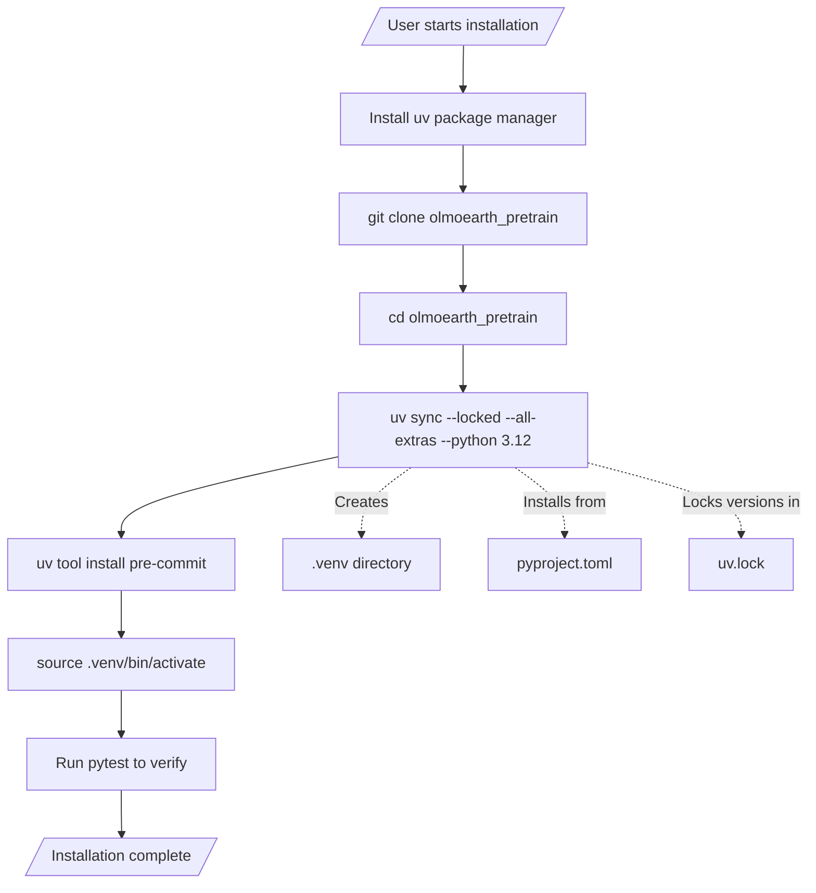
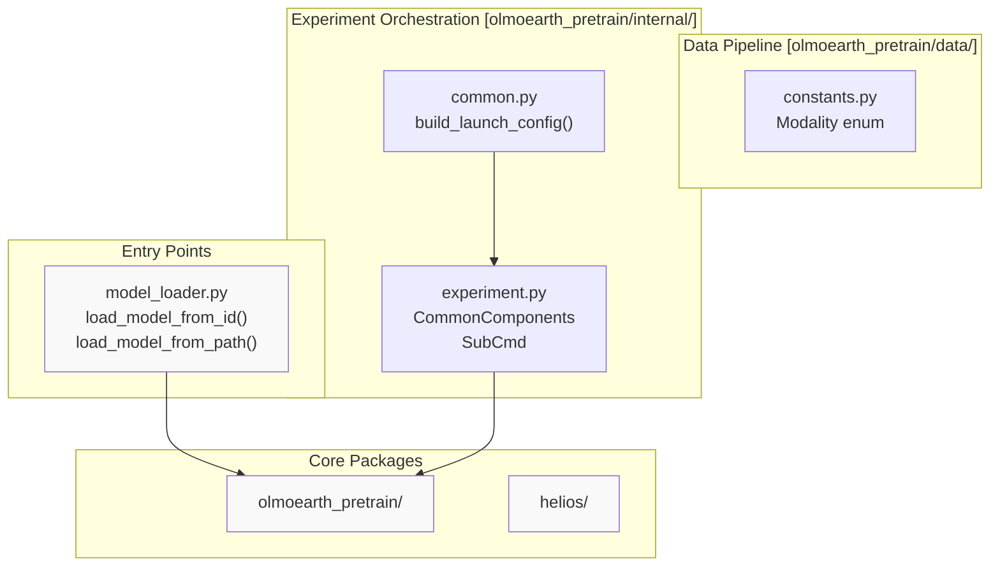

<!-- source: DeepWiki mcp.deepwiki.com · repo allenai/olmoearth_pretrain · page 2 Getting Started · fetched 2026-10-26 -->

# Getting Started

<details>
<summary>Relevant source files</summary>

The following files were used as context for generating this wiki page:

- [.github/workflows/lint.yaml](.github/workflows/lint.yaml)
- [.github/workflows/tests.yaml](.github/workflows/tests.yaml)
- [README.md](README.md)
- [olmoearth_pretrain/internal/common.py](olmoearth_pretrain/internal/common.py)
- [olmoearth_pretrain/model_loader.py](olmoearth_pretrain/model_loader.py)
- [olmoearth_pretrain/py.typed](olmoearth_pretrain/py.typed)
- [pyproject.toml](pyproject.toml)
- [uv.lock](uv.lock)

</details>


This page provides instructions for installing the OlmoEarth pretraining codebase, setting up the development environment, and running basic operations. For detailed guides on specific workflows, see [Inference Quickstart](#2.2) for loading pretrained models and computing embeddings, and [Training Quickstart](#2.3) for launching training runs.

## Purpose and Scope

This page covers:
- Installing Python dependencies using `uv` [README.md:24-35]()
- Configuring the development environment [README.md:31-33]()
- Verifying the installation with `pytest` [README.md:95-111]()
- Understanding the repository structure and key code entities [pyproject.toml:25-33]()
- Basic examples of model loading and training [olmoearth_pretrain/model_loader.py:57-75]()

For dataset creation and preprocessing, see the [Dataset Creation documentation](). For detailed model architecture information, see [Model Architecture](#4).

## Prerequisites

**Python Version**: The codebase requires Python 3.11, 3.12, or 3.13 [pyproject.toml:10](). Python 3.12 is recommended for best compatibility [README.md:24]().

**System Requirements**:
- **Linux**: Required for GPU training with CUDA 12.8 [pyproject.toml:56,66]().
- **macOS / Windows**: Supported for CPU-only inference and development [pyproject.toml:55,61]().
- **Git and Git LFS**: For cloning the repository and managing large model artifacts.
- **CUDA 12.8 compatible GPU**: Recommended for training performance.

**Sources**: [pyproject.toml:10,54-68](), [README.md:24]()

## Installation Flow

The following diagram shows the complete installation process:



**Sources**: [README.md:22-36](), [pyproject.toml:1-152]()

## Step-by-Step Installation

### 1. Install uv Package Manager

Install the `uv` package manager, which provides fast Python package installation and management:

```bash
curl -LsSf https://astral.sh/uv/install.sh | sh
```

The `uv` tool is used throughout the codebase for dependency management and is required by the CI/CD pipeline [README.md:24](), [.github/workflows/lint.yaml:27-30]().

### 2. Clone the Repository

```bash
git clone git@github.com:allenai/olmoearth_pretrain.git
cd olmoearth_pretrain
```

**Sources**: [README.md:28-29]()

### 3. Install Dependencies

Install all dependencies including development, evaluation, and Beaker launch tools:

```bash
uv sync --locked --all-extras --python 3.12
```

For **inference-only** installations without training dependencies:
```bash
uv sync --locked
```

This command:
- Creates a virtual environment at `.venv/` [README.md:35]().
- Installs all dependency groups from `pyproject.toml` [pyproject.toml:69-145]().
- Uses the locked versions from `uv.lock` [uv.lock:1-20]().
- Installs PyTorch with CUDA 12.8 on Linux, CPU-only on other platforms [pyproject.toml:54-68]().

**Dependency Groups**:

| Group | Purpose | Key Packages |
|-------|---------|--------------|
| `main` | Core inference | `torch`, `numpy`, `huggingface_hub`, `einops` [pyproject.toml:11-18]() |
| `training` | Training logic | `ai2-olmo-core`, `albumentations`, `wandb` [pyproject.toml:70-85]() |
| `eval` | Evaluation tasks | `geobench`, `terratorch`, `pytorch-lightning`, `rslearn` [pyproject.toml:122-139]() |
| `beaker` | Cluster deployment | `beaker-py`, `docker` [pyproject.toml:86-95]() |
| `dataset-creation` | Data processing | `rslearn`, `rasterio`, `gcsfs`, `rioxarray` [pyproject.toml:96-112]() |

**Sources**: [README.md:24-42](), [pyproject.toml:11-145]()

### 4. Install Pre-commit Hooks (Development Only)

For contributors, install pre-commit hooks for code quality checks:

```bash
uv tool install pre-commit --with pre-commit-uv --force-reinstall
```

This enables automatic linting with `ruff` and other quality checks [README.md:32](), [.github/workflows/lint.yaml:35]().

### 5. Activate Virtual Environment

Activate the `uv`-managed virtual environment:

```bash
source .venv/bin/activate
```

Alternatively, prefix commands with `uv run`:

```bash
uv run python script.py
```

**Sources**: [README.md:35]()

## Verifying Installation

### Run Unit Tests

Verify the installation by running the test suite. You can choose different dependency configurations:

```bash
# Full test suite (requires all-no-flash extra)
uv run --extra all-no-flash pytest tests/

# Model loading tests with minimal deps (verifies inference-only path)
uv run --extra dev pytest tests_minimal_deps/
```

**Sources**: [README.md:95-111](), [.github/workflows/tests.yaml:34-63]()

### Load a Pretrained Model

Verify model loading functionality using `model_loader.py`:

```python
from olmoearth_pretrain.model_loader import ModelID, load_model_from_id

# Load OlmoEarth-v1-Nano model (smallest, fastest to download)
model = load_model_from_id(ModelID.OLMOEARTH_V1_NANO)
print(f"Model loaded successfully: {type(model)}")
```

This downloads the model configuration and weights from Hugging Face and initializes the model [olmoearth_pretrain/model_loader.py:57-75]().

**Available Model IDs**:
- `ModelID.OLMOEARTH_V1_NANO` - 1.4M encoder params
- `ModelID.OLMOEARTH_V1_TINY` - 6.2M encoder params
- `ModelID.OLMOEARTH_V1_BASE` - 89M encoder params
- `ModelID.OLMOEARTH_V1_LARGE` - 308M encoder params

**Sources**: [olmoearth_pretrain/model_loader.py:44-50](), [README.md:52-57]()

## Code Structure Overview

The following diagram maps high-level components to their implementation in the codebase:



**Key Code Entities**:

| Component | Primary Classes/Functions | Purpose |
|-----------|---------------------------|---------|
| Model Loading | `load_model_from_id()`, `ModelID` | Initialize pretrained models from Hugging Face [olmoearth_pretrain/model_loader.py:57]() |
| Modalities | `Modality` enum | Definitions for Sentinel-2, Sentinel-1, etc. [olmoearth_pretrain/internal/common.py:18]() |
| Beaker Integration | `build_launch_config()` | Configures jobs for the Beaker cluster [olmoearth_pretrain/internal/common.py:110]() |
| Experiment Config | `CommonComponents`, `SubCmd` | Base structures for experiment orchestration [olmoearth_pretrain/internal/common.py:19-24]() |

**Sources**: [olmoearth_pretrain/model_loader.py:44-75](), [olmoearth_pretrain/internal/common.py:1-124](), [pyproject.toml:25-27]()

## Package Structure

The repository is organized into the following main packages:

```
olmoearth_pretrain/
├── data/              # Data loading and modality constants
├── dataset/           # Dataset creation utilities
├── evals/             # Evaluation tasks and metrics
├── internal/          # Experiment orchestration and Beaker integration
├── nn/                # Neural network modules (FlexiVit)
├── train/             # Training modules and losses
└── model_loader.py    # Pretrained model loading utilities

helios/                # Shared utilities

tests/                 # Unit and integration tests
tests_minimal_deps/    # Tests for inference-only compatibility
```

**Sources**: [pyproject.toml:25-33](), [README.md:104-111]()

## Quick Examples

### Example 1: Load a Pretrained Model

```python
import torch
from olmoearth_pretrain.model_loader import ModelID, load_model_from_id

# Load model weights from Hugging Face
model = load_model_from_id(ModelID.OLMOEARTH_V1_BASE)
model.eval()

# Verify architecture
print(model)
```

**Sources**: [olmoearth_pretrain/model_loader.py:57-75]()

### Example 2: List Supported Model Sizes

```python
from olmoearth_pretrain.model_loader import ModelID

for model_id in ModelID:
    print(f"Model: {model_id.value} -> HF Repo: {model_id.repo_id()}")
```

**Sources**: [olmoearth_pretrain/model_loader.py:44-54]()

## Next Steps

1. **For Inference**: See [Inference Quickstart](#2.2) for detailed instructions on computing embeddings for satellite imagery.
2. **For Training**: See [Training Quickstart](#2.3) for launching training runs and monitoring progress.
3. **For Cluster Use**: See [Experiment Orchestration](#7) for details on launching jobs on Beaker using `build_launch_config` [olmoearth_pretrain/internal/common.py:110]().

---

**Sources**: [README.md:1-115](), [pyproject.toml:1-152](), [olmoearth_pretrain/model_loader.py:1-140](), [olmoearth_pretrain/internal/common.py:1-174](), [.github/workflows/tests.yaml:1-63]()

---

