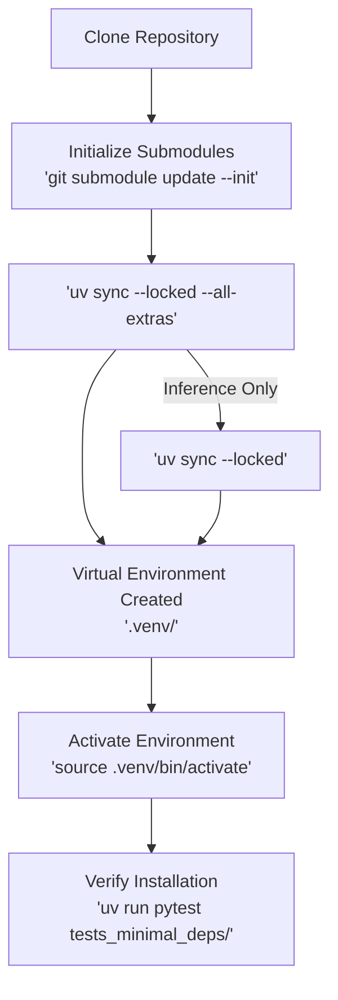
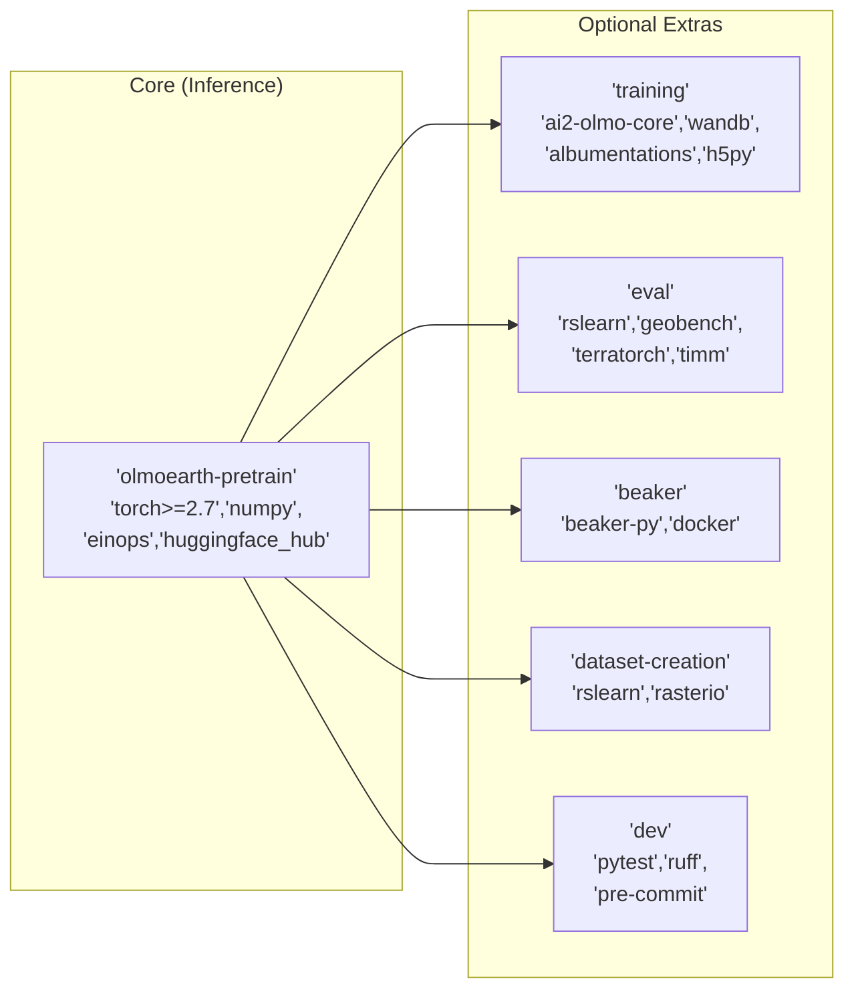
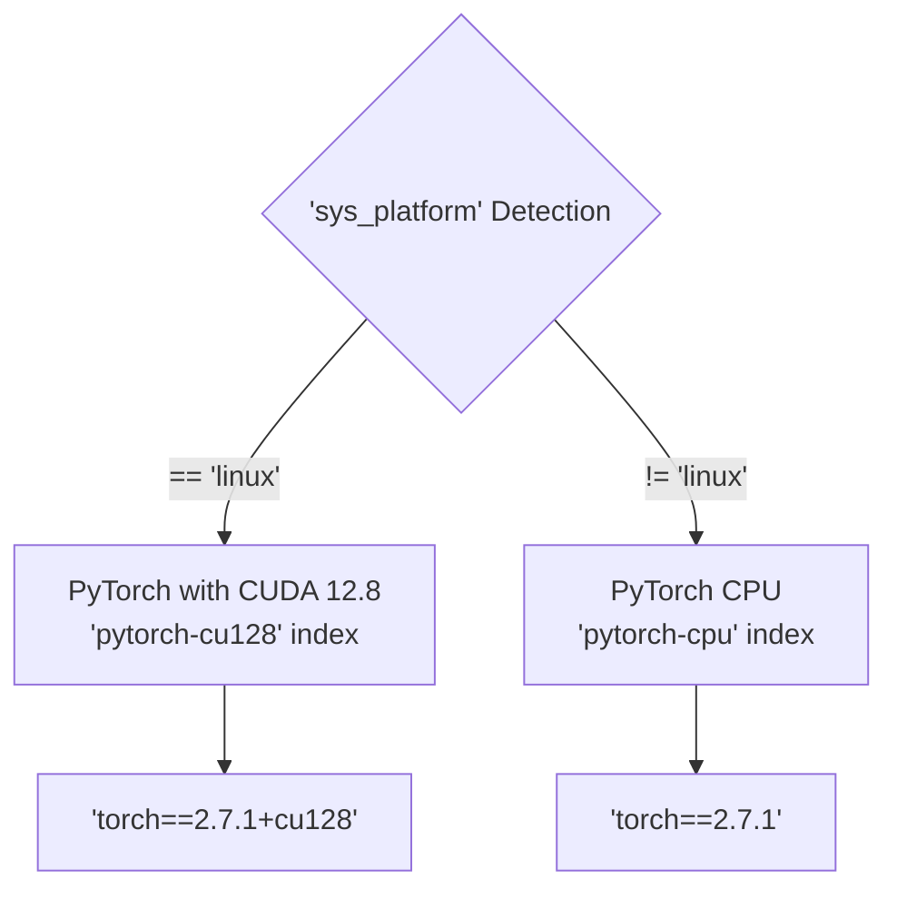
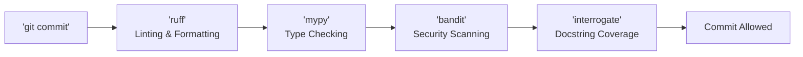
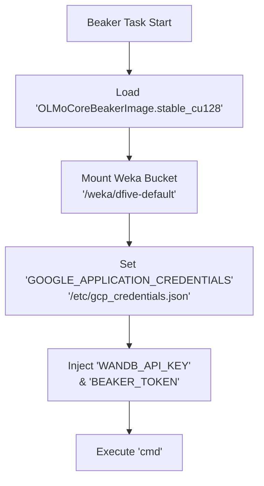

<!-- source: DeepWiki mcp.deepwiki.com · repo allenai/olmoearth_pretrain · page 2.1 Installation and Environment Setup · fetched 2026-10-26 -->

# Installation and Environment Setup

<details>
<summary>Relevant source files</summary>

The following files were used as context for generating this wiki page:

- [.github/workflows/lint.yaml](.github/workflows/lint.yaml)
- [.github/workflows/tests.yaml](.github/workflows/tests.yaml)
- [.pre-commit-config.yaml](.pre-commit-config.yaml)
- [README.md](README.md)
- [olmoearth_pretrain/internal/common.py](olmoearth_pretrain/internal/common.py)
- [olmoearth_pretrain/nn/encodings.py](olmoearth_pretrain/nn/encodings.py)
- [olmoearth_pretrain/py.typed](olmoearth_pretrain/py.typed)
- [pyproject.toml](pyproject.toml)
- [tests/unit/nn/test_flexi_vit.py](tests/unit/nn/test_flexi_vit.py)
- [uv.lock](uv.lock)

</details>


This page covers the installation of the OlmoEarth pretraining codebase, dependency management with `uv`, and environment configuration for both local development and cluster-based training.

## Prerequisites

The OlmoEarth pretraining repository requires:
- **Python 3.11 to 3.13** (Python 3.14+ is not supported due to PyTorch compatibility) [pyproject.toml:10-10]()
- **uv 0.9.5+** for dependency management [.github/workflows/lint.yaml:30-30]()
- **Git** with submodule support

**Python Version Specification**
The project enforces Python version constraints in `pyproject.toml` to ensure compatibility with PyTorch 2.7.1, which is the primary deep learning framework used throughout the codebase [pyproject.toml:10-10]().

Sources: [pyproject.toml:10-10](), [.github/workflows/lint.yaml:30-30]()

## Core Installation

### Installation Flow



**Step-by-Step Installation**

1.  **Clone the repository:**
    ```bash
    git clone git@github.com:allenai/olmoearth_pretrain.git
    cd olmoearth_pretrain
    ``` [README.md:28-29]()

2.  **Install dependencies with uv:**
    For full development and training support:
    ```bash
    uv sync --locked --all-extras --python 3.12
    ``` [README.md:30-30]()
    
    For inference-only usage (minimal dependencies):
    ```bash
    uv sync --locked
    ``` [README.md:41-41]()

3.  **Activate the virtual environment:**
    ```bash
    source .venv/bin/activate
    ``` [README.md:35-35]()

Sources: [README.md:22-42](), [.github/workflows/tests.yaml:32-32]()

## Dependency Groups

The project organizes dependencies into several optional extras defined in `pyproject.toml`. These allow for modular installations based on the target task (e.g., training vs. evaluation).

### Dependency Group Structure



**Key Dependency Groups:**

| Extra | Purpose | Key Packages |
|-------|---------|--------------|
| `training` | Model pretraining and optimization | `ai2-olmo-core`, `wandb`, `albumentations`, `hdf5plugin` [pyproject.toml:70-85]() |
| `eval` | Downstream task evaluation | `rslearn`, `geobench`, `terratorch`, `timm`, `scikit-learn` [pyproject.toml:122-139]() |
| `dataset-creation` | Preparing raw data for training | `rslearn`, `rasterio`, `rioxarray`, `geobench` [pyproject.toml:96-112]() |
| `dev` | Development and CI tools | `pytest`, `ruff`, `mypy`, `pre-commit` [pyproject.toml:113-121]() |
| `all-no-flash` | All extras except `flash-attn` | Combines `training`, `beaker`, `dataset-creation`, `dev`, `eval` [pyproject.toml:143-145]() |

Sources: [pyproject.toml:11-18](), [pyproject.toml:70-145]()

## Platform-Specific Considerations

### PyTorch Installation Strategy

The project uses platform-specific PyTorch indices in `uv` to ensure correct builds (CUDA vs. CPU) are installed automatically based on the operating system [pyproject.toml:54-67]().



Sources: [pyproject.toml:54-67](), [uv.lock:54-56]()

### Flash Attention (CUDA Only)

Flash attention provides significant speedups but requires a CUDA environment. It is isolated in its own extra to prevent installation failures on non-GPU machines [pyproject.toml:140-142]().

```bash
# Install flash attention separately if CUDA is available
uv sync --extra flash-attn
```

Sources: [pyproject.toml:140-142](), [pyproject.toml:147-152]()

## Development Environment Setup

### Pre-commit Hooks

The project uses `pre-commit` to enforce code quality standards including linting, formatting, and type checking.

**Installation:**
```bash
uv tool install pre-commit --with pre-commit-uv --force-reinstall
pre-commit install
``` [README.md:32-32]()

**Pre-commit Hook Pipeline:**



**Tool Configurations:**
- **Ruff**: Configured for Google-style docstrings and automatic fixes [pyproject.toml:34-41]().
- **Mypy**: Enforces type hints and ignores missing imports for specific external libraries [.pre-commit-config.yaml:34-49]().
- **Interrogate**: Enforces a minimum of 80% docstring coverage for the `olmoearth_pretrain` package [.pre-commit-config.yaml:60-75]().

Sources: [.pre-commit-config.yaml:1-92](), [pyproject.toml:34-41]()

### Running Tests

The repository includes both a full test suite and minimal dependency tests to verify inference compatibility.

**Run all tests:**
```bash
uv run --extra all-no-flash pytest tests/
``` [README.md:101-101]()

**Run model loading tests (Minimal dependencies):**
```bash
# Verify loading works without training dependencies (no olmo-core)
uv run --extra dev pytest tests_minimal_deps/
``` [README.md:107-107]()

Sources: [README.md:95-111](), [.github/workflows/tests.yaml:12-63]()

## Beaker Cluster Environment Setup

When running on AI2's Beaker clusters, the environment is configured via `OlmoEarthBeakerLaunchConfig` [olmoearth_pretrain/internal/common.py:175-190]().

### Beaker Setup Sequence



**Weka Mount Configuration:**
Beaker jobs automatically mount the Weka filesystem for shared access to datasets and checkpoints:
```python
DEFAULT_OLMOEARTH_PRETRAIN_WEKA_BUCKET = BeakerWekaBucket(
    "dfive-default", "/weka/dfive-default"
)
``` [olmoearth_pretrain/internal/common.py:30-32]()

**NCCL Debugging:**
For troubleshooting distributed training issues on clusters, the environment can be configured with detailed NCCL logging:
```python
nccl_settings = {
    "NCCL_DEBUG": "DETAIL",
    "TORCH_NCCL_TRACE_BUFFER_SIZE": "1000000000",
    "TORCH_NCCL_BLOCKING_WAIT": "1",
}
``` [olmoearth_pretrain/internal/common.py:96-100]()

Sources: [olmoearth_pretrain/internal/common.py:30-32](), [olmoearth_pretrain/internal/common.py:88-109](), [olmoearth_pretrain/internal/common.py:142-193]()

---

