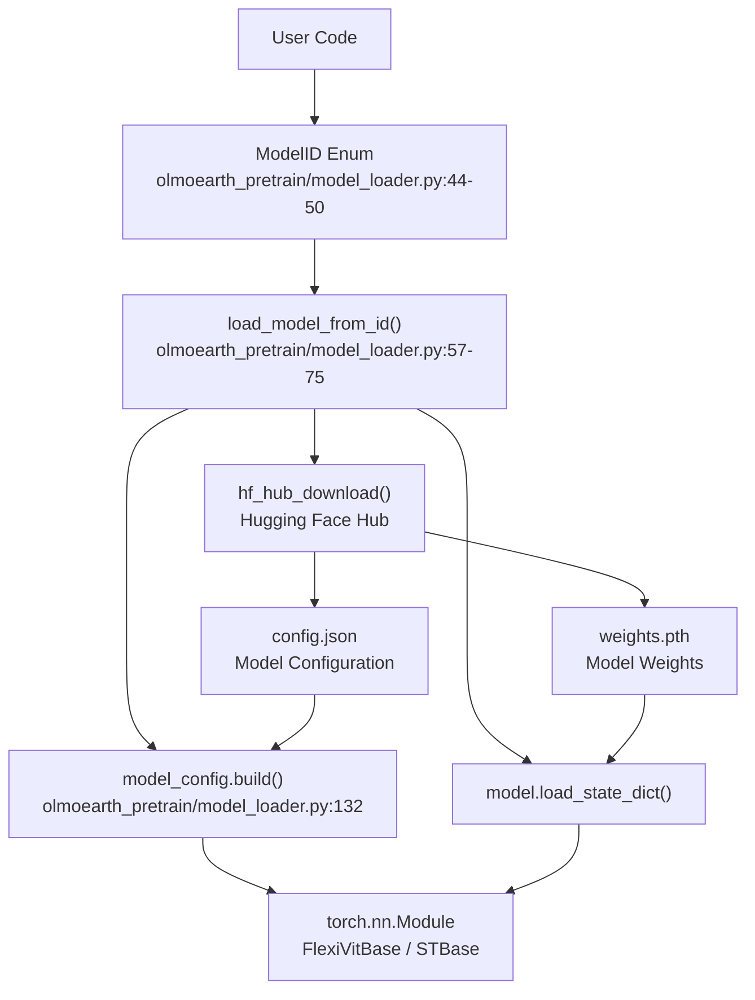
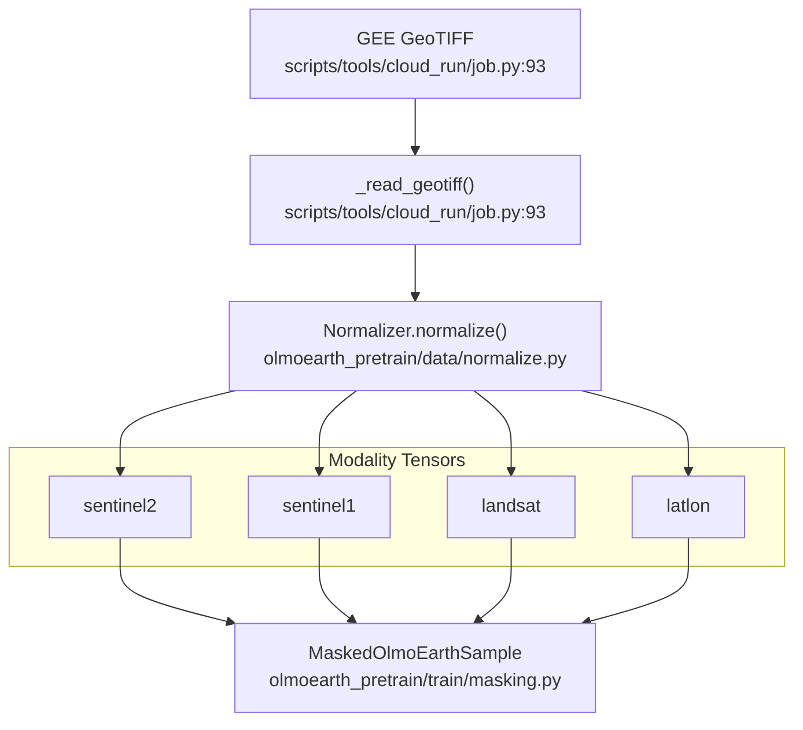
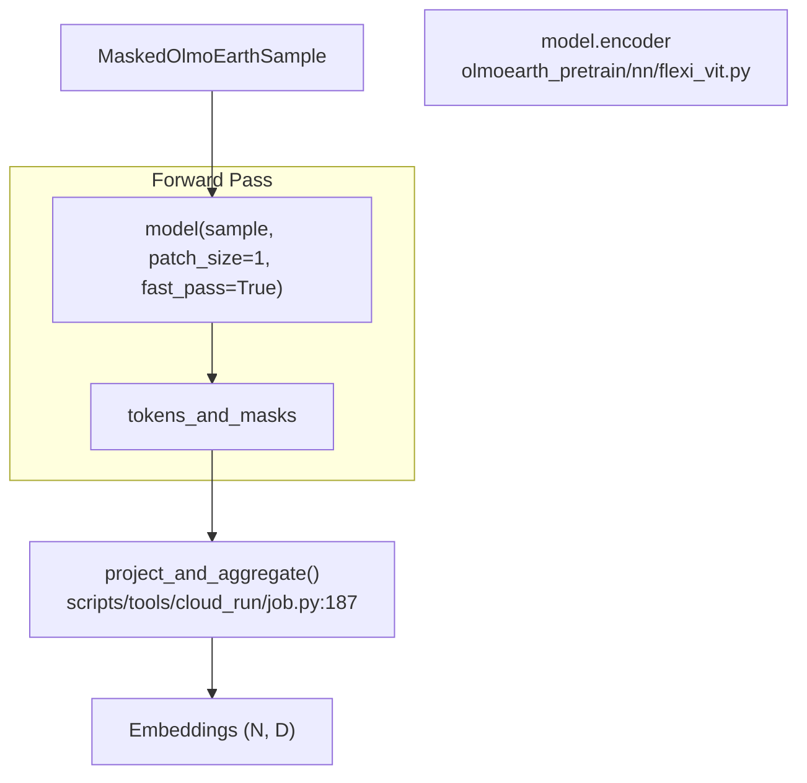

<!-- source: DeepWiki mcp.deepwiki.com · repo allenai/olmoearth_pretrain · page 2.2 Inference Quickstart · fetched 2026-10-26 -->

# Inference Quickstart

Relevant source files

The following files were used as context for generating this wiki page:

- [olmoearth_pretrain/evals/datasets/utils.py](olmoearth_pretrain/evals/datasets/utils.py)
- [olmoearth_pretrain/evals/embeddings.py](olmoearth_pretrain/evals/embeddings.py)
- [olmoearth_pretrain/evals/eval_wrapper.py](olmoearth_pretrain/evals/eval_wrapper.py)
- [olmoearth_pretrain/model_loader.py](olmoearth_pretrain/model_loader.py)
- [olmoearth_pretrain/nn/pooling.py](olmoearth_pretrain/nn/pooling.py)
- [scripts/tools/cloud_run/Dockerfile](scripts/tools/cloud_run/Dockerfile)
- [scripts/tools/cloud_run/README.md](scripts/tools/cloud_run/README.md)
- [scripts/tools/cloud_run/deploy.sh](scripts/tools/cloud_run/deploy.sh)
- [scripts/tools/cloud_run/job.py](scripts/tools/cloud_run/job.py)
- [scripts/tools/gee/README.md](scripts/tools/gee/README.md)
- [scripts/tools/gee/gee_OlmoEarth_cropland_eval.js](scripts/tools/gee/gee_OlmoEarth_cropland_eval.js)
- [scripts/tools/gee/gee_create_OlmoEarth_cropland.js](scripts/tools/gee/gee_create_OlmoEarth_cropland.js)
- [scripts/tools/generate_embeddings.ipynb](scripts/tools/generate_embeddings.ipynb)

This page provides a technical guide for loading pretrained OlmoEarth models and computing embeddings from satellite imagery. The guide covers model initialization, data preparation, and the inference pipeline using both local scripts and cloud-based workflows.

## Overview

The inference workflow consists of three main stages:

1.  **Model Loading**: Initialize a pretrained model from Hugging Face or local storage using `ModelID` [olmoearth_pretrain/model_loader.py:44-50]() and `load_model_from_id()` [olmoearth_pretrain/model_loader.py:57-75]().
2.  **Data Preparation**: Load and normalize satellite imagery into the expected tensor format. This involves mapping Google Earth Engine (GEE) or raw GeoTIFF bands to OlmoEarth modalities [scripts/tools/cloud_run/job.py:26-48]().
3.  **Inference Execution**: Pass prepared data through the encoder to obtain embeddings, often followed by projection and aggregation [scripts/tools/cloud_run/job.py:186-188]().

## Model Loading Architecture

**Model Loading Flow**: The system resolves artifacts (config and weights) via `_resolve_artifact_path` [olmoearth_pretrain/model_loader.py:100-109](), instantiates the model from the JSON config, and loads the state dict.

Sources: [olmoearth_pretrain/model_loader.py:1-139]()

### Available Model Sizes

Pretrained variants are accessible via the `ModelID` [olmoearth_pretrain/model_loader.py:44-50]() enum:

| Model ID | Repo ID |
| :--- | :--- |
| `OLMOEARTH_V1_NANO` | `allenai/OlmoEarth-v1-Nano` |
| `OLMOEARTH_V1_TINY` | `allenai/OlmoEarth-v1-Tiny` |
| `OLMOEARTH_V1_BASE` | `allenai/OlmoEarth-v1-Base` |
| `OLMOEARTH_V1_LARGE` | `allenai/OlmoEarth-v1-Large` |

Sources: [olmoearth_pretrain/model_loader.py:44-54]()

## Data Preparation Pipeline

For inference, data must be normalized and wrapped in a `MaskedOlmoEarthSample` [olmoearth_pretrain/train/masking.py:18]().

**Normalization Strategies**: The `Normalizer` [olmoearth_pretrain/data/normalize.py:16]() supports `COMPUTED` (per-sample) and `PREDEFINED` (fixed stats) strategies. For inference on GEE data, `COMPUTED` is typically used for imagery, while `PREDEFINED` is used for coordinate data like `latlon` [scripts/tools/cloud_run/job.py:63-87]().

Sources: [scripts/tools/cloud_run/job.py:67-127](), [olmoearth_pretrain/data/normalize.py:16]()

### Modality Band Mapping

The inference scripts define a mapping between GEE exported band names and OlmoEarth's internal `Modality` band orders [scripts/tools/cloud_run/job.py:26-48]():

*   **Sentinel-2**: Matches `Modality.SENTINEL2_L2A` (B2, B3, B4, B8, B5, B6, B7, B8A, B11, B12, B1, B9) [scripts/tools/cloud_run/job.py:31-44]().
*   **Sentinel-1**: Matches `Modality.SENTINEL1` (VV, VH) [scripts/tools/cloud_run/job.py:28]().
*   **Landsat**: Matches `Modality.LANDSAT` (B8, B1, B2, B3, B4, B5, B6, B7, B9, B10, B11) [scripts/tools/cloud_run/job.py:47]().

## Inference Execution

The standard inference loop processes pixels or patches and extracts projected embeddings.

### Core Inference Logic
In `job.py`, the model is restricted to the encoder for efficiency [scripts/tools/cloud_run/job.py:59](). The `fast_pass=True` argument ensures only encoder features are returned [scripts/tools/cloud_run/job.py:186]().

Key output dimensions:
*   **Embedding Size**: Determined by the `project_and_aggregate` layer's output features [scripts/tools/cloud_run/job.py:60]().
*   **Aggregation**: For evaluation tasks, `pool_unmasked_tokens` [olmoearth_pretrain/nn/pooling.py:135]() is used to collapse spatial/temporal dimensions into a fixed-size vector based on `PoolingType` (MEAN or MAX) [olmoearth_pretrain/nn/pooling.py:17-21]().

Sources: [scripts/tools/cloud_run/job.py:164-189](), [olmoearth_pretrain/evals/embeddings.py:15-69](), [olmoearth_pretrain/nn/pooling.py:135-163]()

## Deployment Options

### 1. Google Colab / Jupyter
The `generate_embeddings.ipynb` notebook provides a "one-stop shop" for:
*   Exporting data from GEE to Google Cloud Storage (GCS) [scripts/tools/generate_embeddings.ipynb:18]().
*   Running OlmoEarth inference on the exported tiles [scripts/tools/generate_embeddings.ipynb:21]().

### 2. Google Cloud Run
For scalable inference, the repository includes a `Dockerfile` [scripts/tools/cloud_run/Dockerfile:1-36]() and a `deploy.sh` script [scripts/tools/cloud_run/deploy.sh:1-40]().
*   **Containerization**: The Dockerfile preloads the model to reduce startup latency [scripts/tools/cloud_run/Dockerfile:33]().
*   **Execution**: The `job.py` script serves as the entrypoint, downloading tiles from an `IN_BUCKET` and uploading embeddings to an `OUT_BUCKET` [scripts/tools/cloud_run/job.py:139-211]().

## Post-Inference: Cropland Mapping
Once embeddings are generated, they can be ingested back into Google Earth Engine using provided JavaScript utilities:
*   `gee_create_OlmoEarth_cropland.js`: Generates a cropland map from embeddings [scripts/tools/gee/README.md:7-9]().
*   `gee_OlmoEarth_cropland_eval.js`: Evaluates the map against datasets like CropHarvest or WorldCover [scripts/tools/gee/gee_OlmoEarth_cropland_eval.js:1-52]().

Sources: [scripts/tools/gee/README.md:1-14](), [scripts/tools/cloud_run/README.md:1-47]()

---

