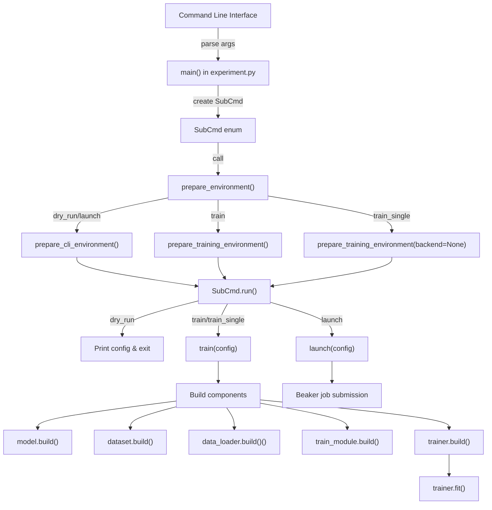
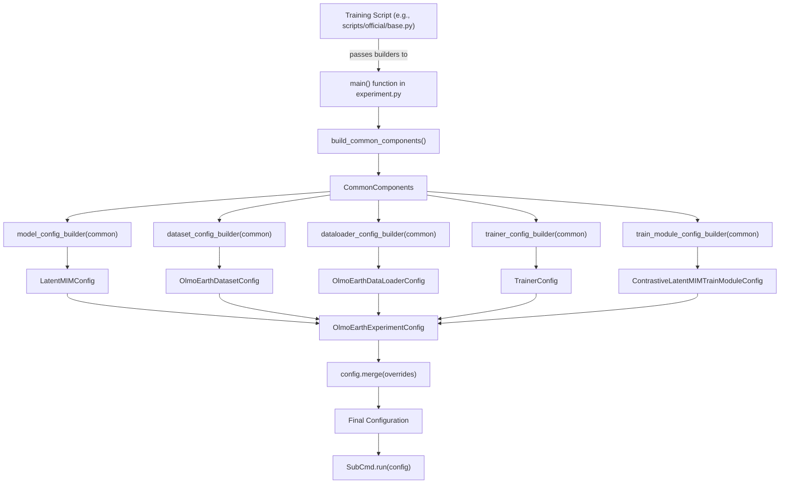

<!-- source: DeepWiki mcp.deepwiki.com · repo allenai/olmoearth_pretrain · page 2.3 Training Quickstart · fetched 2026-10-26 -->

# Training Quickstart

<details>
<summary>Relevant source files</summary>

The following files were used as context for generating this wiki page:

- [docs/Evaluation.md](docs/Evaluation.md)
- [docs/Pretraining.md](docs/Pretraining.md)
- [olmoearth_pretrain/internal/experiment.py](olmoearth_pretrain/internal/experiment.py)
- [olmoearth_pretrain/internal/utils.py](olmoearth_pretrain/internal/utils.py)
- [olmoearth_pretrain/train/train_module/contrastive_latentmim.py](olmoearth_pretrain/train/train_module/contrastive_latentmim.py)
- [olmoearth_pretrain/train/train_module/galileo.py](olmoearth_pretrain/train/train_module/galileo.py)
- [olmoearth_pretrain/train/train_module/latent_mim.py](olmoearth_pretrain/train/train_module/latent_mim.py)
- [olmoearth_pretrain/train/train_module/mae.py](olmoearth_pretrain/train/train_module/mae.py)
- [olmoearth_pretrain/train/utils.py](olmoearth_pretrain/train/utils.py)
- [scripts/archived/20251027_finetune.sh](scripts/archived/20251027_finetune.sh)
- [scripts/official/script.py](scripts/official/script.py)
- [tests/unit/train/test_utils.py](tests/unit/train/test_utils.py)

</details>


This page provides a practical guide to launching your first training run with OlmoEarth. It covers the basic command structure, essential subcommands, and a minimal example to get training started. For detailed environment setup, see [Installation and Environment Setup](#2.1). For comprehensive training configuration options, see [Experiment Orchestration](#7).

---

## Command Structure

All training runs use the main entrypoint defined in `olmoearth_pretrain/internal/experiment.py` via the `main()` function [olmoearth_pretrain/internal/experiment.py:460-557](). Training scripts act as builder modules that configure components and pass them to this entrypoint.

### Basic Syntax

```bash
python scripts/official/<SCRIPT>.py <SUBCOMMAND> <RUN_NAME> <CLUSTER> [OVERRIDES...]
```

**Parameters:**
- `<SCRIPT>`: One of `nano.py`, `tiny.py`, `base.py`, or `large.py` from `scripts/official/` [docs/Pretraining.md:62-63]().
- `<SUBCOMMAND>`: Execution mode (e.g., `train`, `dry_run`, `launch`).
- `<RUN_NAME>`: Unique identifier for your run (used in checkpoints and W&B) [olmoearth_pretrain/internal/experiment.py:89]().
- `<CLUSTER>`: Target cluster (use `local` for local execution, or AI2 cluster names like `ai2/saturn`) [docs/Pretraining.md:62-63]().
- `[OVERRIDES...]`: Optional configuration overrides in dotted notation (e.g., `--trainer.max_duration.value=100`) [docs/Pretraining.md:88-89]().

### Multi-GPU Training

For distributed training on multiple GPUs, use `torchrun` [docs/Pretraining.md:65-68]():

```bash
torchrun --nproc_per_node=<NUM_GPUS> scripts/official/<SCRIPT>.py train <RUN_NAME> local [OVERRIDES...]
```

**Sources:** [olmoearth_pretrain/internal/experiment.py:460-557](), [docs/Pretraining.md:56-110]()

---

## Core Training Subcommands

The training system supports multiple subcommands defined in the `SubCmd` enum [olmoearth_pretrain/internal/experiment.py:280-294](). The most important for getting started are:

| Subcommand | Purpose | Environment Setup | Use Case |
|------------|---------|-------------------|----------|
| `dry_run` | Print configuration and exit | CLI environment | Validate configuration without running [olmoearth_pretrain/internal/experiment.py:283]() |
| `train` | Run distributed training | Training environment (torchrun) | Multi-GPU training [olmoearth_pretrain/internal/experiment.py:280]() |
| `train_single` | Run on single device | Training environment (no backend) | Single GPU/CPU debugging [olmoearth_pretrain/internal/experiment.py:281]() |
| `launch` | Submit to Beaker cluster | CLI environment | AI2 cluster submission [olmoearth_pretrain/internal/experiment.py:282]() |

### Command Flow Diagram: CLI to Execution

This diagram bridges the Natural Language CLI commands to the `Code Entity Space` of `experiment.py`.



**Sources:** [olmoearth_pretrain/internal/experiment.py:366-457](), [olmoearth_pretrain/internal/experiment.py:280-294]()

---

## Configuration Builder Pattern

Training configurations are assembled from builder functions that each return a specific configuration component. The system uses a `CommonComponents` object shared across all builders [olmoearth_pretrain/internal/experiment.py:75-94]().

### Configuration Assembly Flow



**Key Components:**

- **CommonComponents**: Shared configuration container holding `run_name`, `save_folder`, `training_modalities`, and `launch` config [olmoearth_pretrain/internal/experiment.py:75-94]().
- **Builder Functions**: Functions like `build_train_module_config` [scripts/official/script.py:97-132]() that return typed configuration objects.
- **OlmoEarthExperimentConfig**: Top-level container assembling all component configs [olmoearth_pretrain/internal/experiment.py:127-138]().
- **Override Mechanism**: CLI overrides are merged into the final configuration using `config.merge(overrides)` [olmoearth_pretrain/internal/experiment.py:200]().

**Sources:** [olmoearth_pretrain/internal/experiment.py:75-138](), [olmoearth_pretrain/internal/experiment.py:181-206](), [scripts/official/script.py:53-69]()

---

## Minimal Training Example

### Step 1: Validate Configuration

Start with a dry run to verify your configuration [docs/Pretraining.md:99-102]():

```bash
python scripts/official/nano.py dry_run my_first_run local
```

This prints the assembled configuration without executing training. Review the output for:
- Dataset path (`dataset.h5py_dir`) [scripts/official/script.py:166-169]()
- Batch size (`data_loader.global_batch_size`) [scripts/official/script.py:149]()
- Maximum duration (`trainer.max_duration`) [scripts/official/script.py:174]()
- Training modalities (`common.training_modalities`) [scripts/official/script.py:58-68]()

### Step 2: Single-Device Test

Run a quick test on a single GPU or CPU [docs/Pretraining.md:85-89]():

```bash
python scripts/official/nano.py train_single my_test_run local \
  --trainer.max_duration.value=10
```

This trains for 10 steps without distributed backend initialization. Useful for debugging data loading and model forward pass.

### Step 3: Multi-GPU Training

Launch distributed training on 4 GPUs [docs/Pretraining.md:92-96]():

```bash
torchrun --nproc_per_node=4 scripts/official/nano.py train my_training_run local \
  --trainer.max_duration.epochs=100
```

**Important Notes:**
- Checkpoints are saved to the path specified in `common.save_folder` [olmoearth_pretrain/internal/experiment.py:90]().
- External users must specify dataset path: `--dataset.h5py_dir=/path/to/h5data` [docs/Pretraining.md:143]().

**Sources:** [docs/Pretraining.md:84-110](), [olmoearth_pretrain/internal/experiment.py:75-94]()

---

## Configuration Override Examples

The CLI supports dotted-path overrides for any configuration field. Overrides are applied after builder functions execute [olmoearth_pretrain/internal/experiment.py:200]().

### Common Override Patterns

```bash
# Adjust batch size and microbatch size
torchrun --nproc_per_node=4 scripts/official/base.py train my_run local \
  --data_loader.global_batch_size=256 \
  --train_module.rank_microbatch_size=8

# Change learning rate and warmup
torchrun --nproc_per_node=4 scripts/official/base.py train my_run local \
  --train_module.optim_config.lr=0.0002 \
  --train_module.scheduler.warmup_steps=5000

# Modify training duration
torchrun --nproc_per_node=4 scripts/official/base.py train my_run local \
  --trainer.max_duration.epochs=50

# Disable W&B logging
torchrun --nproc_per_node=4 scripts/official/base.py train my_run local \
  --trainer.callbacks.wandb.enabled=False

# External users: specify dataset path
torchrun --nproc_per_node=4 scripts/official/base.py train my_run local \
  --dataset.h5py_dir=/path/to/h5py_data/1138828
```

### Common Components Overrides

Overrides prefixed with `common.` modify the `CommonComponents` object before other builder functions execute [olmoearth_pretrain/internal/experiment.py:198-200]():

```bash
# Change training modalities
python scripts/official/base.py train my_run local \
  --common.training_modalities='[SENTINEL2_L2A,SENTINEL1]'

# Change save folder
python scripts/official/base.py train my_run local \
  --common.save_folder=/custom/checkpoint/path
```

**Sources:** [olmoearth_pretrain/internal/experiment.py:198-200](), [docs/Pretraining.md:143]()

---

## Monitoring Training Progress

### Weights & Biases Integration

Training runs automatically log to W&B if enabled in the config [scripts/official/script.py:183-188](). The `OlmoEarthWandBCallback` handles metrics like:
- Training loss (`base_loss`, `contrastive_loss`) [olmoearth_pretrain/train/train_module/contrastive_latentmim.py:155-165]().
- Learning rate schedules.
- GPU memory usage (via `GPUMemoryMonitorCallback`) [scripts/official/script.py:17]().
- Throughput (tokens/second via `OlmoEarthSpeedMonitorCallback`) [scripts/official/script.py:37]().

### Checkpoint Saving

Checkpoints are saved to `common.save_folder` using the `CheckpointerCallback` [scripts/official/script.py:14, 182](). Intervals are configured in the trainer:
- **Permanent checkpoints**: Saved every `PERMANENT_SAVE_INTERVAL` (default: 5000) [scripts/official/script.py:180]().
- **Ephemeral checkpoints**: Saved every `EPHERMERAL_SAVE_INTERVAL` (default: 250) [scripts/official/script.py:181]().

Checkpoint directories contain:
- `model.pt`: Model state dict.
- `train_module.pt`: Optimizer and training state.
- `dataloader.pt`: Data loader state for resumption.
- `config.yaml`: Full experiment configuration (via `ConfigSaverCallback`) [scripts/official/script.py:15]().

**Sources:** [scripts/official/script.py:14-40, 172-188](), [olmoearth_pretrain/train/train_module/contrastive_latentmim.py:153-165]()

---

## Model Size Scripts

The repository provides pre-configured scripts for different model sizes in `scripts/official/`. These scripts use the `MODEL_SIZE_ARGS` dictionary to set architectural parameters [olmoearth_pretrain/internal/utils.py:48-193]().

| Script | Model Size | Embedding Size | Depth | Heads |
|--------|-----------|----------------|-------|-------|
| `nano.py` | Nano | 128 | 4 | 8 |
| `tiny.py` | Tiny | 192 | 12 | 3 |
| `base.py` | Base | 768 | 12 | 12 |
| `large.py` | Large | 1024 | 24 | 16 |

**Sources:** [olmoearth_pretrain/internal/utils.py:48-193](), [scripts/official/script.py:49-50]()

---

## Next Steps

1. **Monitor Progress**: Check W&B dashboard for loss curves and evaluation metrics [docs/Pretraining.md:189-201]().
2. **Adjust Hyperparameters**: Use overrides to tune learning rate, batch size, or masking strategy [docs/Pretraining.md:320-338]().
3. **Evaluate Checkpoints**: Use the evaluation suite to check downstream performance [docs/Evaluation.md:30-47]().
4. **Scale Up**: Move from Nano to larger models as you validate your setup [olmoearth_pretrain/internal/utils.py:48-193]().

**Sources:** [docs/Pretraining.md:1-26](), [docs/Evaluation.md:1-47]()

---

