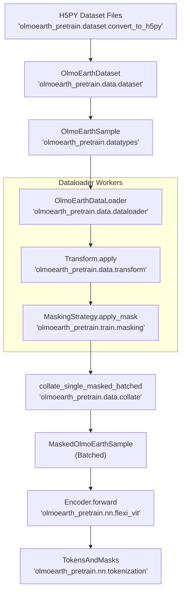
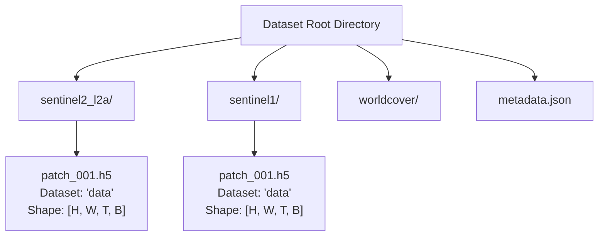

<!-- source: DeepWiki mcp.deepwiki.com · repo allenai/olmoearth_pretrain · page 3 Data Pipeline · fetched 2026-10-26 -->

# Data Pipeline

Relevant source files

The following files were used as context for generating this wiki page:

- [olmoearth_pretrain/data/collate.py](olmoearth_pretrain/data/collate.py)
- [olmoearth_pretrain/data/dataloader.py](olmoearth_pretrain/data/dataloader.py)
- [olmoearth_pretrain/data/dataset.py](olmoearth_pretrain/data/dataset.py)
- [olmoearth_pretrain/data/visualize.py](olmoearth_pretrain/data/visualize.py)
- [olmoearth_pretrain/datatypes.py](olmoearth_pretrain/datatypes.py)
- [tests/integration/eval/test_geobench_dataset_with_model.py](tests/integration/eval/test_geobench_dataset_with_model.py)
- [tests/integration/nn/test_latent_mim.py](tests/integration/nn/test_latent_mim.py)
- [tests/unit/data/test_constants.py](tests/unit/data/test_constants.py)
- [tests/unit/internal/test_experiment.py](tests/unit/internal/test_experiment.py)
- [tests/unit/train/test_masking.py](tests/unit/train/test_masking.py)

## Purpose and Scope

This document provides a comprehensive guide to the data pipeline in the OlmoEarth pretraining system. The pipeline transforms raw satellite imagery from multiple sources (Sentinel-2, Sentinel-1, Landsat, WorldCover, etc.) into model-ready tensors suitable for self-supervised learning. The pipeline handles multi-modal data loading, normalization, augmentation, and masking to produce `OlmoEarthSample` and `MaskedOlmoEarthSample` objects consumed by the FlexiVit encoder.

This page focuses on the end-to-end data flow and the key components involved. For detailed information on specific aspects:
- Dataset storage format and H5PY structure: see [Dataset Format and H5PY Structure](#3.1)
- Detailed modality specifications and band orders: see [Modalities and Band Specifications](#3.2)
- Sample data structures and manipulation: see [OlmoEarthSample Data Structure](#3.3)
- Dataset loading implementation: see [Data Loading and Preprocessing](#3.4)
- Normalization methods: see [Normalization Strategies](#3.5)
- Augmentation techniques: see [Data Augmentation and Transforms](#3.6)

---

## End-to-End Data Flow

The following diagram illustrates the complete data pipeline from raw satellite imagery to model-ready token representations:

**Sources:** [olmoearth_pretrain/data/dataloader.py:48-83](), [olmoearth_pretrain/data/collate.py:40-69](), [olmoearth_pretrain/datatypes.py:76-106]()

---

## Data Storage Architecture

The pipeline stores preprocessed satellite imagery in H5PY format. This allows for efficient compressed storage and random access to spatial patches.

### H5PY Directory Structure

The `OlmoEarthDataset` class reads these files using `h5py` and `hdf5plugin` for decompression [olmoearth_pretrain/data/dataset.py:12-15]().

**Sources:** [olmoearth_pretrain/data/dataset.py:12-33]()

---

## Modality System

The pipeline supports multiple satellite data modalities, defined in the `Modality` class. Each modality specifies its band order, resolution, and whether it varies over space or time.

### Modality Definitions

| Modality | Bands | Resolution Factor | Temporal |
|----------|-------|-------------------|----------|
| `SENTINEL2_L2A` | 13 | 1 | Yes |
| `SENTINEL1` | 2 | 1 | Yes |
| `WORLDCOVER` | 1 | 1 | No |
| `LATLON` | 2 | N/A | No |
| `ERA5_10` | Variable | N/A | Yes |

The `Modality` enum provides helper methods like `bandsets_as_indices()` to group bands for tokenization [tests/unit/data/test_constants.py:50-57]().

**Sources:** [olmoearth_pretrain/data/constants.py:3-57](), [olmoearth_pretrain/datatypes.py:84-106]()

---

## Sample Data Structures

The system uses two primary `NamedTuple` structures for data handling:

### OlmoEarthSample
This is the base container for multi-modal data. It holds tensors for imagery (e.g., `sentinel2_l2a`), metadata (`latlon`), and capturing times (`timestamps`) [olmoearth_pretrain/datatypes.py:76-106]().

### MaskedOlmoEarthSample
An extension of the base sample that includes mask tensors for each modality. These masks use the `MaskValue` enum to define the role of each spatial/temporal patch:
- `ONLINE_ENCODER (0)`: Visible to the online model.
- `TARGET_ENCODER_ONLY (1)`: Visible only to the EMA target model.
- `DECODER (2)`: Masked out; must be predicted.
- `MISSING (3)`: Data was missing in the source [olmoearth_pretrain/datatypes.py:23-35]().

**Sources:** [olmoearth_pretrain/datatypes.py:23-106](), [tests/unit/train/test_masking.py:8-20]()

---

## Data Loading and Collation

The `OlmoEarthDataLoader` manages the complexity of loading multi-modal data across distributed ranks.

### Loading Logic
1. **Subsetting**: The `subset_sample_default` function handles spatial cropping and ensures the number of timesteps fits within a `token_budget` [olmoearth_pretrain/data/dataset.py:123-155]().
2. **Missing Timesteps**: The loader identifies valid starting points in time sequences to avoid samples that are entirely missing data [olmoearth_pretrain/data/dataset.py:95-120]().
3. **Collation**: The `collate_single_masked_batched` or `collate_double_masked_batched` functions are used to apply transforms and masking to the entire batch simultaneously for efficiency [olmoearth_pretrain/data/collate.py:40-107]().

**Sources:** [olmoearth_pretrain/data/dataloader.py:48-83](), [olmoearth_pretrain/data/dataset.py:48-155](), [olmoearth_pretrain/data/collate.py:40-107]()

---

## Normalization and Augmentation

### Normalization
The `Normalizer` class supports standardizing data using `PREDEFINED` ranges or `COMPUTED` statistics [olmoearth_pretrain/data/dataset.py:32](). This ensures that different modalities (e.g., radar vs. optical) are on a similar scale before being processed by the transformer.

### Augmentation
Augmentations are applied in the dataloader via the `Transform` class [olmoearth_pretrain/data/dataloader.py:78](). Common operations include `flip_and_rotate` and spatial scaling, which are applied consistently across all modalities in a sample to maintain geographic alignment [tests/unit/internal/test_experiment.py:144]().

**Sources:** [olmoearth_pretrain/data/dataset.py:32](), [olmoearth_pretrain/data/dataloader.py:78-141](), [tests/unit/internal/test_experiment.py:144-154]()

---

## Masking Strategies

Masking is the core of the self-supervised objective. The `MaskingStrategy` determines which parts of the `OlmoEarthSample` are hidden.

| Strategy | Description |
|----------|-------------|
| `RandomMaskingStrategy` | Standard random patch masking across all modalities [tests/unit/train/test_masking.py:62](). |
| `SpaceMaskingStrategy` | Masks consistent spatial regions across all timesteps [tests/unit/train/test_masking.py:134](). |
| `TimeMaskingStrategy` | Masks entire timesteps [tests/unit/train/test_masking.py:19](). |
| `ModalityCrossRandomMaskingStrategy` | Independent masking patterns for different modalities [tests/unit/train/test_masking.py:13](). |

**Sources:** [tests/unit/train/test_masking.py:10-20](), [olmoearth_pretrain/data/dataloader.py:140-152]()

---

