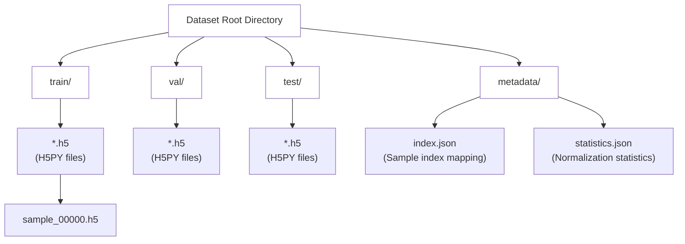
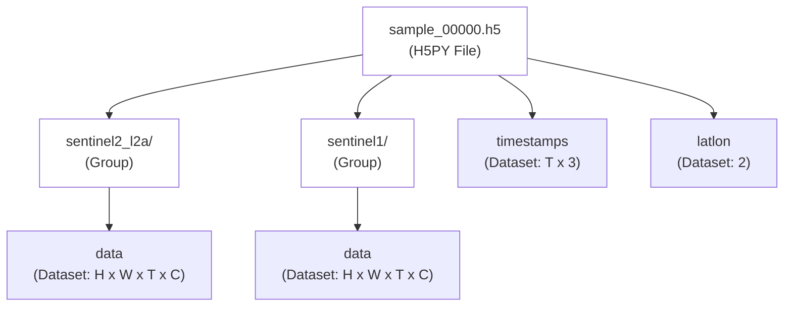
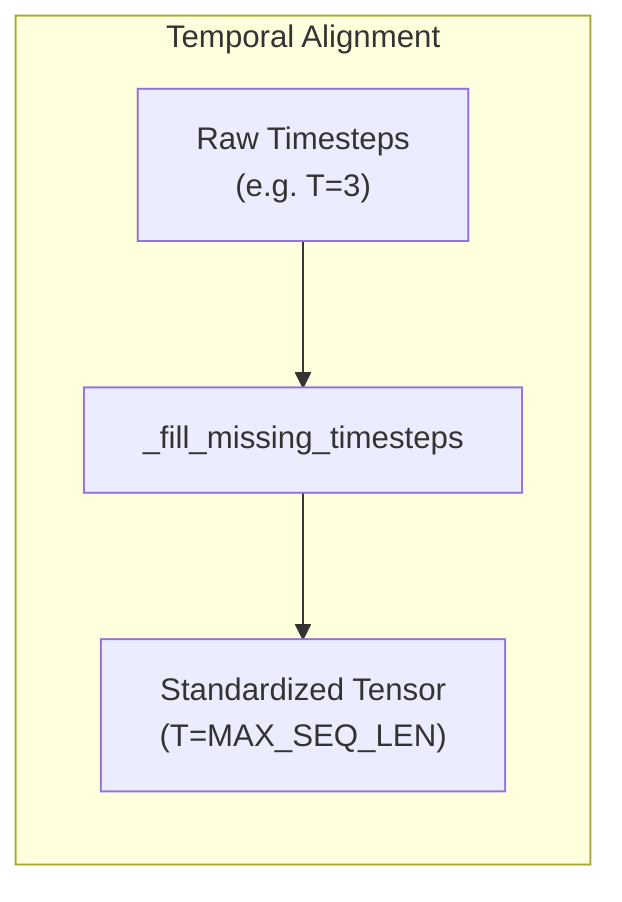
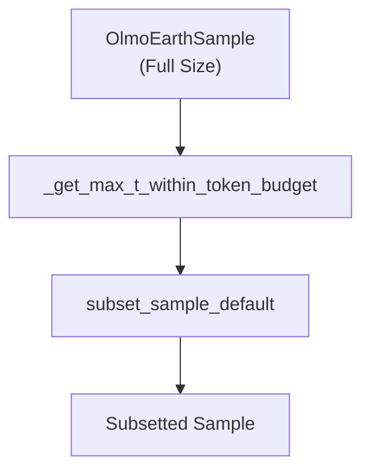

<!-- source: DeepWiki mcp.deepwiki.com · repo allenai/olmoearth_pretrain · page 3.1 Dataset Format and H5PY Structure · fetched 2026-10-26 -->

# Dataset Format and H5PY Structure

Relevant source files

The following files were used as context for generating this wiki page:

- [olmoearth_pretrain/data/collate.py](olmoearth_pretrain/data/collate.py)
- [olmoearth_pretrain/data/constants.py](olmoearth_pretrain/data/constants.py)
- [olmoearth_pretrain/data/dataloader.py](olmoearth_pretrain/data/dataloader.py)
- [olmoearth_pretrain/data/dataset.py](olmoearth_pretrain/data/dataset.py)
- [olmoearth_pretrain/data/visualize.py](olmoearth_pretrain/data/visualize.py)
- [olmoearth_pretrain/datatypes.py](olmoearth_pretrain/datatypes.py)
- [scripts/vnext/new_masking/base_collapsed_bandsets_ndvi.py](scripts/vnext/new_masking/base_collapsed_bandsets_ndvi.py)
- [tests/conftest.py](tests/conftest.py)
- [tests/integration/data/test_dataloader.py](tests/integration/data/test_dataloader.py)
- [tests/integration/data/test_dataset.py](tests/integration/data/test_dataset.py)
- [tests/unit/data/test_constants.py](tests/unit/data/test_constants.py)
- [tests/unit/data/test_dataset.py](tests/unit/data/test_dataset.py)
- [tests/unit/data/test_visualize.py](tests/unit/data/test_visualize.py)
- [tests/unit/dataset/test_sample.py](tests/unit/dataset/test_sample.py)

## Purpose and Scope

This page documents the H5PY file format used to store preprocessed satellite imagery in the OlmoEarth pretraining pipeline. It covers the on-disk directory structure, internal H5PY file organization, metadata storage, and how raw satellite data is organized for efficient training. 

The system relies on `h5py` for data storage and `hdf5plugin` for decompression of specialized compression types [olmoearth_pretrain/data/dataset.py:12-15](). The core data container for this format is the `OlmoEarthSample` [olmoearth_pretrain/datatypes.py:76-106]().

---

## H5PY Format Overview

The OlmoEarth dataset uses H5PY (Hierarchical Data Format version 5) as its primary storage format for preprocessed satellite imagery. H5PY provides several advantages for large-scale geospatial data:

- **Compression**: Efficient storage of multi-temporal, multi-modal satellite data.
- **Random Access**: Fast retrieval of individual samples without loading entire datasets.
- **Hierarchical Organization**: Natural grouping of modalities, timesteps, and metadata.
- **Memory Mapping**: Ability to work with datasets larger than available RAM.
- **Self-Describing**: Metadata stored alongside data for reproducibility.

The conversion from raw GeoTIFF files to H5PY format is handled by the `ConvertToH5py` utility [olmoearth_pretrain/dataset/convert_to_h5py.py:1-50]().

Sources: [olmoearth_pretrain/data/dataset.py:12-15](), [olmoearth_pretrain/dataset/convert_to_h5py.py:1-50]()

---

## Dataset Directory Structure

**Dataset Directory Organization**

The `OlmoEarthDataset` class initializes by pointing to a directory containing these H5PY files [olmoearth_pretrain/data/dataset.py:265-275]().

| Directory | Purpose | Contents |
|-----------|---------|----------|
| `train/` | Training samples | H5PY files containing multi-modal satellite imagery |
| `val/` | Validation samples | H5PY files for validation |
| `metadata/` | Dataset metadata | Normalization statistics used by `Normalizer` [olmoearth_pretrain/data/normalize.py:14-25]() |

Sources: [olmoearth_pretrain/data/dataset.py:265-275](), [olmoearth_pretrain/data/normalize.py:14-25]()

---

## H5PY File Internal Structure

**H5PY File Structure Components**

The `OlmoEarthDataset` loads data from these H5 groups and maps them to `OlmoEarthSample` fields [olmoearth_pretrain/data/dataset.py:465-510]().

| Component | Type | Shape | Description |
|-----------|------|-------|-------------|
| `modality/data` | Dataset | `(H, W, T, C)` | Image data with spatial H×W, temporal T, and spectral C [olmoearth_pretrain/data/dataset.py:470-480]() |
| `timestamps` | Dataset | `(T, 3)` | Day, Month, Year for each timestep [olmoearth_pretrain/datatypes.py:106-106]() |
| `latlon` | Dataset | `(2,)` | Latitude and Longitude of the sample center [olmoearth_pretrain/datatypes.py:105-105]() |

**Dimension Notation:**
- `H`, `W`: Height and Width. Note that different modalities have different base resolutions [olmoearth_pretrain/data/constants.py:108-126]().
- `T`: Number of timesteps.
- `C`: Number of channels/bands.

Sources: [olmoearth_pretrain/data/dataset.py:465-510](), [olmoearth_pretrain/datatypes.py:105-106](), [olmoearth_pretrain/data/constants.py:108-126]()

---

## Band Organization and Data Types

### Band Stacking Order

Bands within each modality are stacked in a specific order defined by `ModalitySpec` [olmoearth_pretrain/data/constants.py:108-126](). 

**Sentinel-2 L2A Band Order** (12 bands by default):
Defined via `BandSet` groupings [olmoearth_pretrain/data/constants.py:215-226]():
1. 10m: `B02, B03, B04, B08`
2. 20m: `B05, B06, B07, B8A, B11, B12`
3. 60m: `B01, B09`

The `band_order` property concatenates these into a single list [olmoearth_pretrain/data/constants.py:147-149]().

### Data Type Specifications

| Modality | Default Data Type | Resolution Factor |
|----------|-----------|-------------|
| Sentinel-2 L2A | `uint16` / `float32` | 16 (10m) [olmoearth_pretrain/data/constants.py:213-227]() |
| Sentinel-1 | `float32` | 16 (10m) [olmoearth_pretrain/data/constants.py:236-242]() |
| WorldCover | `uint8` | 16 (10m) [olmoearth_pretrain/data/constants.py:244-250]() |

Sources: [olmoearth_pretrain/data/constants.py:147-250]()

---

## Temporal Organization

### Multi-Timestep Structure

The dataset handles varying numbers of timesteps per modality. If a modality has fewer timesteps than the `max_sequence_length`, the `OlmoEarthDataset` fills the gaps with `MISSING_VALUE` (-99999) [olmoearth_pretrain/data/dataset.py:430-460]().

**Missing Value Handling:**
- `MISSING_VALUE` is defined as `-99999` [olmoearth_pretrain/data/constants.py:21-21]().
- During loading, `_fill_missing_timesteps` uses a boolean mask to place valid data at correct indices and fill the rest with the missing constant [olmoearth_pretrain/data/dataset.py:430-455]().

Sources: [olmoearth_pretrain/data/dataset.py:430-460](), [olmoearth_pretrain/data/constants.py:21-21]()

---

## Subsetting and Token Budgeting

During training, the `OlmoEarthDataLoader` samples a `patch_size` and a `sampled_hw_p` (height/width in patches) [olmoearth_pretrain/data/dataloader.py:55-83]().

The function `_get_max_t_within_token_budget` calculates how many timesteps can be included for a sample without exceeding the `max_tokens_per_instance` limit [olmoearth_pretrain/data/dataset.py:48-93]().

**Subsetting logic:**
1. Determine `max_t` based on token budget and spatial dimensions [olmoearth_pretrain/data/dataset.py:153-155]().
2. Find valid start timesteps that aren't all missing [olmoearth_pretrain/data/dataset.py:156-156]().
3. Perform a random spatial crop and temporal slice [olmoearth_pretrain/data/dataset.py:160-180]().

Sources: [olmoearth_pretrain/data/dataset.py:48-180](), [olmoearth_pretrain/data/dataloader.py:55-83]()

---

## Normalization and Statistics

The dataset uses a `Normalizer` which can operate in two modes: `PREDEFINED` or `COMPUTED` [olmoearth_pretrain/data/normalize.py:32-32]().

- **PREDEFINED**: Uses hardcoded constants (e.g., dividing by 10000 for Sentinel-2).
- **COMPUTED**: Loads `mean` and `std` from the `statistics.json` file in the `h5py_dir` [olmoearth_pretrain/data/dataset.py:325-335]().

Normalization is applied per-modality during the `__getitem__` call [olmoearth_pretrain/data/dataset.py:512-515]().

Sources: [olmoearth_pretrain/data/normalize.py:32-32](), [olmoearth_pretrain/data/dataset.py:325-335]()

---

