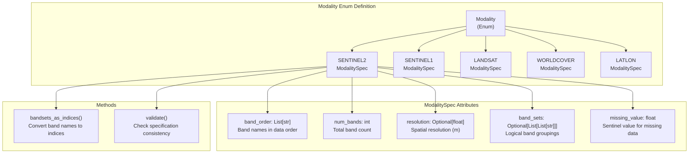
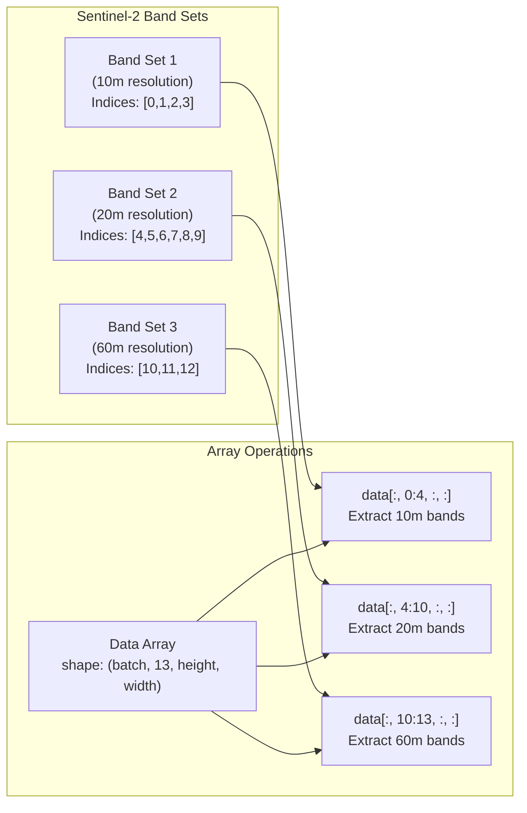
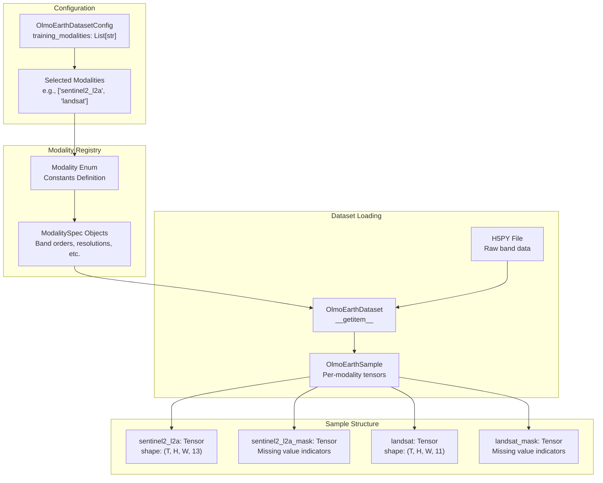
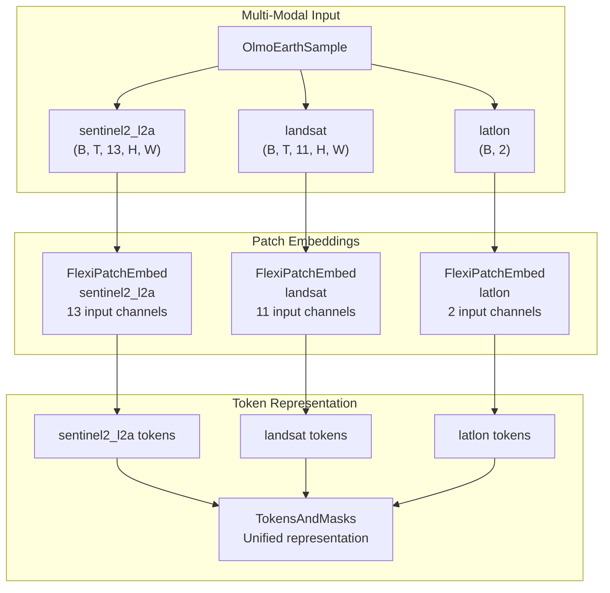

<!-- source: DeepWiki mcp.deepwiki.com · repo allenai/olmoearth_pretrain · page 3.2 Modalities and Band Specifications · fetched 2026-10-26 -->

# Modalities and Band Specifications

Relevant source files

The following files were used as context for generating this wiki page:

- [data/rslearn_dataset_configs/config_landsat.json](data/rslearn_dataset_configs/config_landsat.json)
- [data/rslearn_dataset_configs/config_naip.json](data/rslearn_dataset_configs/config_naip.json)
- [data/rslearn_dataset_configs/config_openstreetmap.json](data/rslearn_dataset_configs/config_openstreetmap.json)
- [data/rslearn_dataset_configs/config_sentinel1.json](data/rslearn_dataset_configs/config_sentinel1.json)
- [data/rslearn_dataset_configs/config_sentinel2.json](data/rslearn_dataset_configs/config_sentinel2.json)
- [data/rslearn_dataset_configs/config_worldcover.json](data/rslearn_dataset_configs/config_worldcover.json)
- [data/rslearn_dataset_configs/config_worldpop.json](data/rslearn_dataset_configs/config_worldpop.json)
- [tests/unit/data/test_constants.py](tests/unit/data/test_constants.py)

This page documents the satellite data modalities supported by OlmoEarth, their band specifications, and how they are defined in the codebase. Modalities represent different types of satellite sensors and derived data products, each with specific band configurations, spatial resolutions, and data characteristics.

For information about how modalities are loaded from H5PY files, see [3.1 Dataset Format and H5PY Structure](). For details on how modality data is normalized, see [3.5 Normalization Strategies]().

## Overview of Modalities

A **modality** in OlmoEarth represents a distinct type of satellite observation or derived data product. Each modality has:
- A unique identifier (e.g., `SENTINEL2`, `LANDSAT`, `WORLDCOVER`)
- A defined set of spectral bands or data channels
- Specific band ordering conventions
- Spatial resolution characteristics
- Missing value conventions

Modalities are defined in the `Modality` enum located in `olmoearth_pretrain/data/constants.py`, which serves as the central registry for all supported data types [olmoearth_pretrain/data/constants.py:3-4]().

**Sources:** [olmoearth_pretrain/data/constants.py](), [tests/unit/data/test_constants.py]()

## Modality Class Structure

The following diagram illustrates how modalities are organized in code and their key attributes:

**Modality Specification Architecture**

**Sources:** [olmoearth_pretrain/data/constants.py](), [tests/unit/data/test_constants.py:1-57]()

## Supported Modalities

### Sentinel-2 (SENTINEL2)

Sentinel-2 provides high-resolution optical imagery. The data includes 13 spectral bands covering visible, near-infrared, and shortwave infrared wavelengths. The implementation typically uses Level-1C or Level-2A data [data/rslearn_dataset_configs/config_sentinel2.json:42]().

**Band Order:**
The bands are ordered as follows in the data arrays [tests/unit/data/test_constants.py:11-25]():

| Index | Band Name | Description | Resolution |
|-------|-----------|-------------|------------|
| 0 | B02 | Blue | 10m |
| 1 | B03 | Green | 10m |
| 2 | B04 | Red | 10m |
| 3 | B08 | NIR | 10m |
| 4 | B05 | Red Edge 1 | 20m |
| 5 | B06 | Red Edge 2 | 20m |
| 6 | B07 | Red Edge 3 | 20m |
| 7 | B8A | NIR Narrow | 20m |
| 8 | B11 | SWIR 1 | 20m |
| 9 | B12 | SWIR 2 | 20m |
| 10 | B01 | Coastal Aerosol | 60m |
| 11 | B09 | Water Vapor | 60m |
| 12 | B10 | SWIR Cirrus | 60m |

**Band Sets:**
Sentinel-2 bands are logically grouped by resolution [tests/unit/data/test_constants.py:52-56]():
- **10m bands** (indices 0-3): High-resolution visible and NIR [data/rslearn_dataset_configs/config_sentinel2.json:7-12]()
- **20m bands** (indices 4-9): Red edge and SWIR bands [data/rslearn_dataset_configs/config_sentinel2.json:16-22]()
- **60m bands** (indices 10-12): Atmospheric correction bands [data/rslearn_dataset_configs/config_sentinel2.json:28-32]()

**Total Bands:** 13 [tests/unit/data/test_constants.py:46]()

**Sources:** [tests/unit/data/test_constants.py:11-56](), [data/rslearn_dataset_configs/config_sentinel2.json:3-36]()

### Landsat (LANDSAT)

Landsat provides multispectral imagery from the Landsat 8/9 missions. The data includes 11 spectral bands [tests/unit/data/test_constants.py:47]().

**Band Order:**
The bands are ordered as follows in the data arrays [tests/unit/data/test_constants.py:27-39]():

| Index | Band Name | Description | Resolution |
|-------|-----------|-------------|------------|
| 0 | B8 | Panchromatic | 15m |
| 1 | B1 | Coastal Aerosol | 30m |
| 2 | B2 | Blue | 30m |
| 3 | B3 | Green | 30m |
| 4 | B4 | Red | 30m |
| 5 | B5 | NIR | 30m |
| 6 | B6 | SWIR 1 | 30m |
| 7 | B7 | SWIR 2 | 30m |
| 8 | B9 | Cirrus | 30m |
| 9 | B10 | TIRS 1 | 100m |
| 10 | B11 | TIRS 2 | 100m |

**Total Bands:** 11 [tests/unit/data/test_constants.py:47]()

**Sources:** [tests/unit/data/test_constants.py:27-47](), [data/rslearn_dataset_configs/config_landsat.json:5-28]()

### Sentinel-1 (SENTINEL1)

Sentinel-1 provides Synthetic Aperture Radar (SAR) imagery. The data typically includes VV and VH polarization bands [data/rslearn_dataset_configs/config_sentinel1.json:7-10]().

**Key Characteristics:**
- **Polarizations**: VV and VH [data/rslearn_dataset_configs/config_sentinel1.json:27-32]()
- **Data Type**: float32 [data/rslearn_dataset_configs/config_sentinel1.json:11]()
- **No-data Value**: -32768 [data/rslearn_dataset_configs/config_sentinel1.json:12-15]()
- **Instrument Mode**: Interferometric Wide (IW) [data/rslearn_dataset_configs/config_sentinel1.json:24-25]()

**Sources:** [data/rslearn_dataset_configs/config_sentinel1.json:3-41]()

### WorldCover (WORLDCOVER)

WorldCover provides land cover classification maps derived from Sentinel imagery [data/rslearn_dataset_configs/config_worldcover.json:13]().

**Key Characteristics:**
- **Bands**: Single band (B1) [data/rslearn_dataset_configs/config_worldcover.json:6-8]()
- **Data Type**: uint8 [data/rslearn_dataset_configs/config_worldcover.json:9]()
- **Resampling**: Nearest neighbor (to preserve categorical classes) [data/rslearn_dataset_configs/config_worldcover.json:18]()

**Sources:** [data/rslearn_dataset_configs/config_worldcover.json:3-21]()

### Other Modalities

- **NAIP**: National Agriculture Imagery Program. Provides 4 bands (R, G, B, IR) at high resolution (typically 0.6m - 1m) in uint8 format [data/rslearn_dataset_configs/config_naip.json:4-13]().
- **WorldPop**: Global population distribution data. Single band (B1) float32 with nodata value -99999 [data/rslearn_dataset_configs/config_worldpop.json:4-13]().
- **OpenStreetMap (OSM)**: Vector-based geographic data. Configured with various categories (buildings, highways, rivers, etc.) converted to Point, LineString, or Polygon geometries [data/rslearn_dataset_configs/config_openstreetmap.json:3-248]().
- **Latitude-Longitude (LATLON)**: Encodes geographic coordinates as 2-channel features.

## Modality Naming Conventions

In the codebase, modalities are referenced using identifiers that map to `Modality` enum values. The `_freq` suffix in configuration files often refers to the most frequent/recent observation, while `_moXX` refers to monthly composites [data/rslearn_dataset_configs/config_sentinel2.json:3-53]().

| Modality Enum | Data Key Examples |
|---------------|-------------------|
| `SENTINEL2` | `sentinel2_freq`, `sentinel2_mo01` |
| `SENTINEL1` | `sentinel1_freq`, `sentinel1_mo01` |
| `LANDSAT` | `landsat_freq`, `landsat_mo01` |
| `WORLDCOVER` | `worldcover` |
| `NAIP` | `naip` |

**Sources:** [data/rslearn_dataset_configs/config_sentinel2.json](), [data/rslearn_dataset_configs/config_sentinel1.json](), [data/rslearn_dataset_configs/config_landsat.json]()

## Band Sets and Indexing

Band sets provide a way to logically group bands by resolution or functionality. The `bandsets_as_indices()` method converts band name lists into integer indices for efficient array slicing.

**Sentinel-2 Band Set Mapping**

**Sources:** [tests/unit/data/test_constants.py:50-56](), [data/rslearn_dataset_configs/config_sentinel2.json:5-35]()

## Integration with Data Pipeline

The following diagram shows how modality specifications integrate with the broader data pipeline:

**Data Flow and Modality Association**

**Sources:** [olmoearth_pretrain/data/constants.py](), [data/rslearn_dataset_configs/config_sentinel2.json](), [tests/unit/data/test_constants.py]()

## Usage in Model Architecture

Modalities flow through the model architecture as separate token streams. Each modality is processed by modality-specific patch embeddings (e.g., `FlexiPatchEmbed`) before being combined in the transformer encoder.

**Tokenization Space**

**Sources:** [olmoearth_pretrain/data/constants.py](), [tests/unit/data/test_constants.py:44-48]()

---

