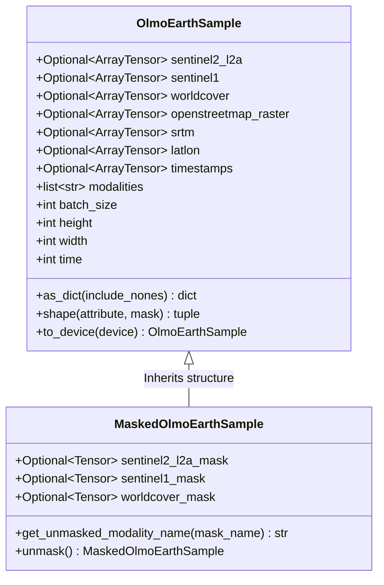
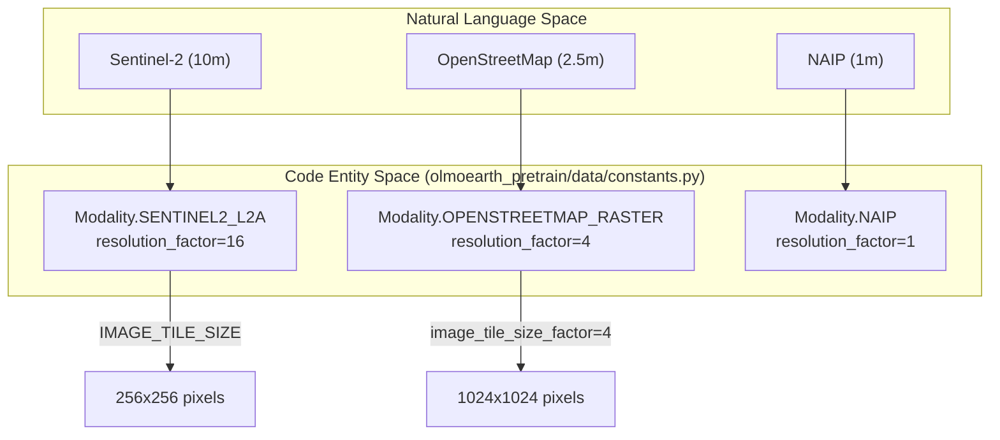

<!-- source: DeepWiki mcp.deepwiki.com · repo allenai/olmoearth_pretrain · page 3.3 OlmoEarthSample Data Structure · fetched 2026-10-26 -->

# OlmoEarthSample Data Structure

Relevant source files

The following files were used as context for generating this wiki page:

- [olmoearth_pretrain/data/collate.py](olmoearth_pretrain/data/collate.py)
- [olmoearth_pretrain/data/constants.py](olmoearth_pretrain/data/constants.py)
- [olmoearth_pretrain/data/dataloader.py](olmoearth_pretrain/data/dataloader.py)
- [olmoearth_pretrain/data/dataset.py](olmoearth_pretrain/data/dataset.py)
- [olmoearth_pretrain/data/visualize.py](olmoearth_pretrain/data/visualize.py)
- [olmoearth_pretrain/datatypes.py](olmoearth_pretrain/datatypes.py)
- [scripts/vnext/new_masking/base_collapsed_bandsets_ndvi.py](scripts/vnext/new_masking/base_collapsed_bandsets_ndvi.py)
- [tests/conftest.py](tests/conftest.py)
- [tests/integration/data/test_dataloader.py](tests/integration/data/test_dataloader.py)
- [tests/integration/data/test_dataset.py](tests/integration/data/test_dataset.py)
- [tests/integration/eval/test_geobench_dataset_with_model.py](tests/integration/eval/test_geobench_dataset_with_model.py)
- [tests/integration/nn/test_latent_mim.py](tests/integration/nn/test_latent_mim.py)
- [tests/unit/data/test_dataset.py](tests/unit/data/test_dataset.py)
- [tests/unit/data/test_visualize.py](tests/unit/data/test_visualize.py)
- [tests/unit/dataset/test_sample.py](tests/unit/dataset/test_sample.py)
- [tests/unit/internal/test_experiment.py](tests/unit/internal/test_experiment.py)
- [tests/unit/train/test_masking.py](tests/unit/train/test_masking.py)

## Purpose and Scope

This page documents the `OlmoEarthSample` data structure, the core container for multi-modal satellite imagery in the OlmoEarth pretraining system. It describes the structure's fields, dimensions, manipulation methods, and handling of missing data.

`OlmoEarthSample` serves as the primary data exchange format between the `OlmoEarthDataset` [olmoearth_pretrain/data/dataset.py:35]() and the model encoders.

---

## Overview

`OlmoEarthSample` is implemented as a `NamedTuple` [olmoearth_pretrain/datatypes.py:76]() designed to encapsulate multi-modal satellite imagery, temporal metadata, and location information. It handles:

- **Multi-modal data**: Satellite sources (Sentinel-2, Sentinel-1, Landsat, etc.) with varying resolutions.
- **Multi-temporal data**: Time series of observations with potentially irregular sampling.
- **Missing data**: Graceful handling of missing modalities or timesteps using a sentinel value.
- **Flexible shapes**: Support for different spatial resolutions and temporal lengths.

**Sources**: [olmoearth_pretrain/datatypes.py:76-106](), [olmoearth_pretrain/data/constants.py:108-126]()

---

## Data Structure and Fields

The structure uses optional fields for each supported modality. If a modality is not available for a specific geographic tile, the field remains `None` or is filled with a sentinel value during batch collation.

### Class Hierarchy and Relationships

The following diagram illustrates the relationship between the base sample container and its masked counterpart used during training.

**Diagram: Data Container Architecture**

**Sources**: [olmoearth_pretrain/datatypes.py:76-106](), [olmoearth_pretrain/train/masking.py:11-32]()

---

## Field Specifications

### Multi-temporal Spatial Modalities
These modalities vary across both space $(H, W)$ and time $(T)$.

| Field Name | Shape | Description |
|------------|-------|-------------|
| `sentinel2_l2a` | `(B, H, W, T, 12)` | Sentinel-2 L2A surface reflectance [olmoearth_pretrain/datatypes.py:85]() |
| `sentinel1` | `(B, H, W, T, 2)` | Sentinel-1 SAR backscatter (VV, VH) [olmoearth_pretrain/datatypes.py:86]() |
| `landsat` | `(B, H, W, T, C)` | Landsat surface reflectance [olmoearth_pretrain/datatypes.py:90]() |
| `naip_10` | `(B, H, W, T, 4)` | NAIP aerial imagery at 10m resolution [olmoearth_pretrain/datatypes.py:94]() |

### Static Spatial Modalities
These modalities vary across space but are treated as constant over the observation period.

| Field Name | Shape | Description |
|------------|-------|-------------|
| `worldcover` | `(B, H, W, 1, 1)` | ESA WorldCover land cover map [olmoearth_pretrain/datatypes.py:87]() |
| `openstreetmap_raster` | `(B, H, W, 1, 30)` | Rasterized OSM features [olmoearth_pretrain/datatypes.py:88]() |
| `srtm` | `(B, H, W, 1, 1)` | SRTM elevation data [olmoearth_pretrain/datatypes.py:89]() |

### Metadata Fields
| Field Name | Shape | Description |
|------------|-------|-------------|
| `latlon` | `(B, 2)` | Center coordinates `[lat, lon]` [olmoearth_pretrain/datatypes.py:105]() |
| `timestamps` | `(B, T, 3)` | Temporal metadata `[day, month, year]` [olmoearth_pretrain/datatypes.py:106]() |

**Sources**: [olmoearth_pretrain/datatypes.py:85-106](), [tests/integration/data/test_dataset.py:47-51]()

---

## Tensor Flow and Resolution

The system handles multiple resolutions by normalizing to a `resolution_factor`. A factor of 16 corresponds to 10m GSD (Sentinel-2 base) [olmoearth_pretrain/data/constants.py:27]().

**Diagram: Spatial Resolution Mapping**

**Sources**: [olmoearth_pretrain/data/constants.py:11-27](), [olmoearth_pretrain/data/constants.py:108-126](), [olmoearth_pretrain/data/constants.py:164-170]()

---

## Handling Missing Data

`OlmoEarthSample` uses a specific sentinel value, `MISSING_VALUE = -99999` [olmoearth_pretrain/data/constants.py:21](), to handle missing observations.

### Modality Level
If a training modality is requested but missing from the H5PY source, `OlmoEarthDataset._fill_missing_modality` creates a tensor of the expected shape filled with `MISSING_VALUE` [olmoearth_pretrain/data/dataset.py:170-180]().

### Timestep Level
For multi-temporal data, missing timesteps are padded. `OlmoEarthDataset._fill_missing_timesteps` expands the temporal dimension to `max_sequence_length`, placing available data at their correct temporal indices and filling gaps with `MISSING_VALUE` [olmoearth_pretrain/data/dataset.py:122-154]().

**Sources**: [olmoearth_pretrain/data/dataset.py:122-180](), [olmoearth_pretrain/data/constants.py:21]()

---

## Subsetting and Token Budgeting

To maintain constant memory usage, samples are subsetted based on a `token_budget`.

### `subset_sample_default`
This function performs rectangular spatial and temporal cropping [olmoearth_pretrain/data/dataset.py:123-147]():
1. **Calculate `max_t`**: Determines the maximum number of timesteps allowed given the spatial dimensions (`sampled_hw_p`) and the token budget [olmoearth_pretrain/data/dataset.py:48-93]().
2. **Find Valid Start**: `get_valid_start_ts` identifies temporal indices where at least one modality has non-missing data [olmoearth_pretrain/data/dataset.py:95-121]().
3. **Crop**: Applies a random spatial crop and a random temporal window starting at a valid index [olmoearth_pretrain/data/dataset.py:158-180]().

**Sources**: [olmoearth_pretrain/data/dataset.py:48-180](), [tests/unit/dataset/test_sample.py:152-179]()

---

## Masking Representation

During training, `OlmoEarthSample` is converted into a `MaskedOlmoEarthSample`. Masks are stored as tensors with the same spatial/temporal dimensions as the data, but with a channel dimension equal to the number of `band_sets` [tests/unit/train/test_masking.py:101-106]().

### MaskValue Semantics
Masks use the `MaskValue` Enum [olmoearth_pretrain/datatypes.py:23-35]():
- `ONLINE_ENCODER (0)`: Token is visible to the training encoder.
- `TARGET_ENCODER_ONLY (1)`: Token is only visible to the EMA target encoder.
- `DECODER (2)`: Token is masked from encoders and must be predicted by the decoder.
- `MISSING (3)`: Token represents missing data and is ignored by loss functions.

**Sources**: [olmoearth_pretrain/datatypes.py:23-35](), [tests/unit/train/test_masking.py:25-40]()

---

## Key Manipulation Methods

| Method | Description |
|--------|-------------|
| `as_dict()` | Converts the NamedTuple to a dictionary, optionally filtering `None` values [olmoearth_pretrain/datatypes.py:108-114](). |
| `to_device()` | Moves all constituent tensors to a specified torch device (e.g., "cuda") [olmoearth_pretrain/datatypes.py:162-172](). |
| `distribute_tensors()` | Wraps tensors for PyTorch Distributed Tensor (DTensor) support [olmoearth_pretrain/datatypes.py:174-181](). |
| `unmask()` | Returns a copy of the sample where all `DECODER` mask values are reset to `ONLINE_ENCODER`, effectively "unveiling" the image [tests/unit/train/test_masking.py:25-40](). |

**Sources**: [olmoearth_pretrain/datatypes.py:108-181](), [tests/unit/train/test_masking.py:25-40]()

---

