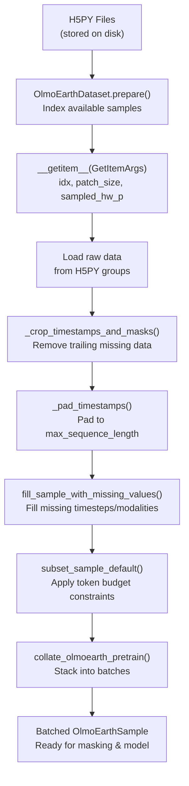
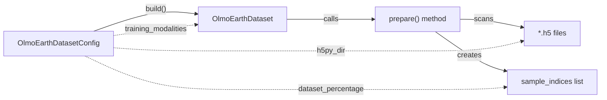
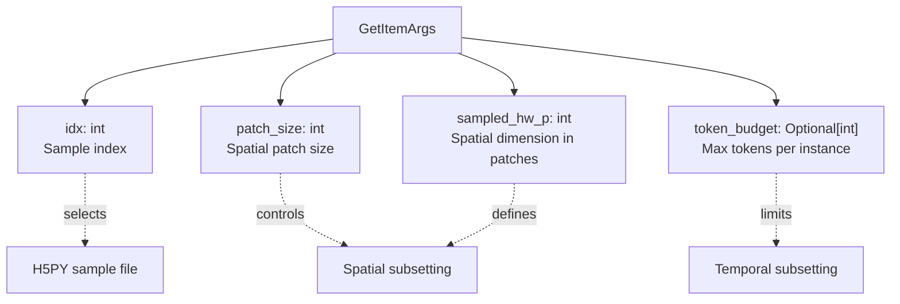
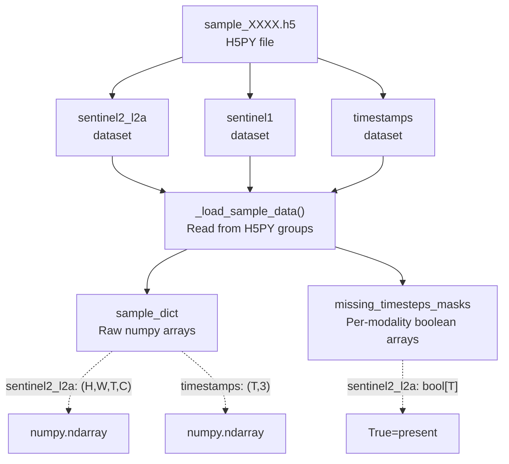
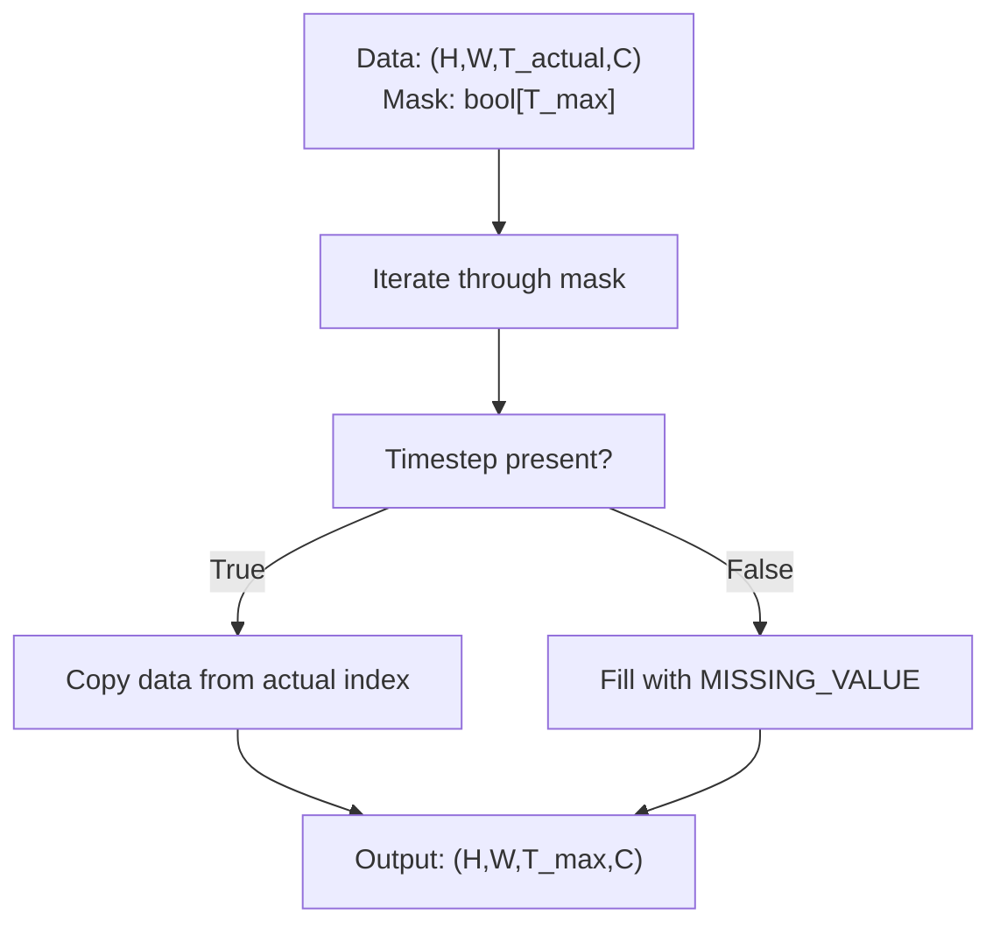
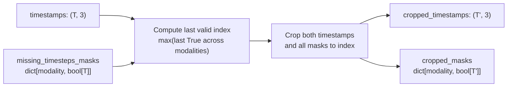
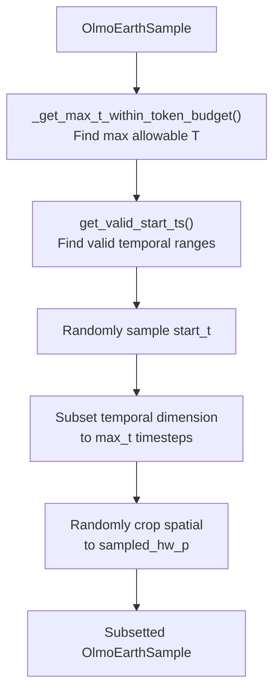
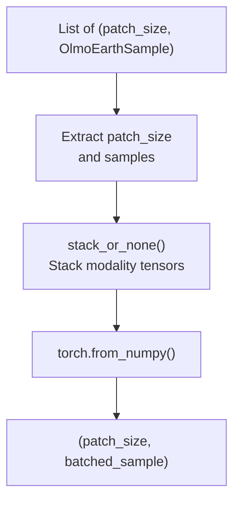

<!-- source: DeepWiki mcp.deepwiki.com · repo allenai/olmoearth_pretrain · page 3.4 Data Loading and Preprocessing · fetched 2026-10-26 -->

# Data Loading and Preprocessing

<details>
<summary>Relevant source files</summary>

The following files were used as context for generating this wiki page:

- [olmoearth_pretrain/data/collate.py](olmoearth_pretrain/data/collate.py)
- [olmoearth_pretrain/data/dataloader.py](olmoearth_pretrain/data/dataloader.py)
- [olmoearth_pretrain/data/dataset.py](olmoearth_pretrain/data/dataset.py)
- [olmoearth_pretrain/data/visualize.py](olmoearth_pretrain/data/visualize.py)
- [olmoearth_pretrain/datatypes.py](olmoearth_pretrain/datatypes.py)
- [scripts/vnext/new_masking/__init__.py](scripts/vnext/new_masking/__init__.py)
- [scripts/vnext/new_masking/base.py](scripts/vnext/new_masking/base.py)
- [scripts/vnext/new_masking/base_collapsed_bandsets.py](scripts/vnext/new_masking/base_collapsed_bandsets.py)
- [scripts/vnext/new_masking/new_masking_script.py](scripts/vnext/new_masking/new_masking_script.py)
- [tests/unit/data/test_dataloader.py](tests/unit/data/test_dataloader.py)
- [tests/unit/data/test_normalizer.py](tests/unit/data/test_normalizer.py)
- [tests/unit/dataset/test_update_streaming_stats.py](tests/unit/dataset/test_update_streaming_stats.py)

</details>


This page documents how `OlmoEarthDataset` loads satellite imagery from H5PY files and preprocesses it for training. The dataset handles multi-modal, multi-temporal data with missing values, applies padding and subsetting operations, and produces batched `OlmoEarthSample` objects ready for model consumption.

**Scope**: This page covers the data loading pipeline from H5PY file access through sample preparation. For information about H5PY file structure, see [3.1 Dataset Format and H5PY Structure](). For normalization strategies, see [3.5 Normalization Strategies](). For augmentation transforms applied after loading, see [3.6 Data Augmentation and Transforms]().

## Overview of the Loading Pipeline

The data loading process follows a multi-stage pipeline that transforms stored H5PY data into model-ready tensors:



**Data Flow Pipeline Stages**

Sources: [olmoearth_pretrain/data/dataset.py:423-446](), [olmoearth_pretrain/data/dataset.py:469-523]()

## Dataset Configuration and Initialization

The `OlmoEarthDataset` class is the primary interface for loading satellite data. It is initialized with parameters controlling which modalities to load, how to handle missing data, and normalization settings.

**Key Configuration Parameters**

| Parameter | Type | Purpose |
|-----------|------|---------|
| `h5py_dir` | `UPath` | Path to directory containing H5PY files [olmoearth_pretrain/data/dataset.py:199]() |
| `training_modalities` | `list[str]` | Modality names to include [olmoearth_pretrain/data/dataset.py:200]() |
| `dtype` | `np.dtype` | Data type for loaded arrays [olmoearth_pretrain/data/dataset.py:201]() |
| `normalize` | `bool` | Whether to apply normalization [olmoearth_pretrain/data/dataset.py:202]() |
| `max_sequence_length` | `int` | Maximum temporal dimension after padding [olmoearth_pretrain/data/dataset.py:204]() |
| `dataset_percentage` | `float` | Fraction of dataset to use [olmoearth_pretrain/data/dataset.py:205]() |



**Configuration to Dataset Initialization**

The `prepare()` method scans the H5PY directory to build an index of available samples [olmoearth_pretrain/data/dataset.py:244-310](). If `dataset_percentage` is less than 1.0, it randomly samples a subset of indices using the provided seed [olmoearth_pretrain/data/dataset.py:302-307]().

Sources: [olmoearth_pretrain/data/dataset.py:196-218](), [olmoearth_pretrain/data/dataset.py:244-310]()

## The GetItemArgs Contract

Dataset indexing uses `GetItemArgs` named tuple to specify what data to load and how to preprocess it:



**GetItemArgs Structure**

The `__getitem__` method accepts `GetItemArgs` and returns a tuple of `(patch_size: int, sample: OlmoEarthSample)` [olmoearth_pretrain/data/dataset.py:423-467]():

```python
args = GetItemArgs(
    idx=0,                    # Sample index
    patch_size=4,             # 4x4 pixel patches
    sampled_hw_p=64,          # 64x64 spatial dimensions in patches
    token_budget=10000        # Maximum tokens
)
patch_size, sample = dataset[args]
```

Sources: [olmoearth_pretrain/data/dataset.py:186-193](), [olmoearth_pretrain/data/dataset.py:423-467]()

## Loading Data from H5PY Files

The dataset loads data from H5PY files organized by modality. Each modality is stored as a separate dataset within the H5PY file structure.



**H5PY Loading Process**

Band ordering is critical during loading. Each modality defines band sets at different resolutions, and the dataset ensures bands are loaded in the order specified by the `ModalitySpec` [olmoearth_pretrain/data/dataset.py:469-523]().

Sources: [olmoearth_pretrain/data/dataset.py:469-523]()

## Handling Missing Data

The dataset must handle two types of missing data: missing timesteps (where a modality has no data for certain timestamps) and missing modalities (where an entire modality is absent from a sample).

### Missing Timesteps

Missing timesteps are tracked via boolean masks. The `_fill_missing_timesteps` method replaces missing timestep positions with `MISSING_VALUE` (defined as `-999999.0` [olmoearth_pretrain/data/constants.py:28]()):



**Filling Missing Timesteps**

The filled data maintains spatial and channel dimensions but extends the temporal dimension to `max_sequence_length` [olmoearth_pretrain/data/dataset.py:545-585]().

Sources: [olmoearth_pretrain/data/dataset.py:545-585]()

### Missing Modalities

When an entire modality is missing from a sample, `_fill_missing_modality` creates a tensor of the expected shape filled entirely with `MISSING_VALUE` [olmoearth_pretrain/data/dataset.py:587-611]():

| Method | Purpose | Returns |
|--------|---------|---------|
| `_fill_missing_modality()` | Create placeholder for missing modality | Array filled with `MISSING_VALUE` |
| `get_expected_shape()` | Determine correct shape for modality | Tuple of dimensions [olmoearth_pretrain/datatypes.py:152]() |
| `fill_sample_with_missing_values()` | Fill all missing data | `(OlmoEarthSample, set[str])` [olmoearth_pretrain/data/dataset.py:613-670]() |

Sources: [olmoearth_pretrain/data/dataset.py:587-670](), [olmoearth_pretrain/datatypes.py:142-153]()

## Timestamp Management

Timestamps are managed through cropping and padding operations to ensure consistent temporal dimensions across samples.

### Cropping Timestamps

The `_crop_timestamps_and_masks` static method removes trailing timesteps where all modalities are missing [olmoearth_pretrain/data/dataset.py:672-698]():



Sources: [olmoearth_pretrain/data/dataset.py:672-698]()

### Padding Timestamps

After cropping, `_pad_timestamps` extends timestamps to `max_sequence_length` with sentinel values [olmoearth_pretrain/data/dataset.py:699-733]():

```python
# Padding value for timestamps: [-1, -1, -1]
padded_timestamps = np.pad(
    timestamps,
    pad_width=((0, max_sequence_length - current_length), (0, 0)),
    mode="constant",
    constant_values=-1,
)
```

Sources: [olmoearth_pretrain/data/dataset.py:699-733]()

## Subsetting Operations

After loading and filling, samples often exceed token budgets and must be subset to fit memory constraints.

### Default Subsetting

The `subset_sample_default` function computes valid temporal ranges and randomly samples contiguous timesteps while applying spatial cropping [olmoearth_pretrain/data/dataset.py:123-147]():



The `get_valid_start_ts` method ensures that for any selected temporal window, at least one modality has valid (non-missing) data [olmoearth_pretrain/data/dataset.py:95-120]().

Sources: [olmoearth_pretrain/data/dataset.py:48-93](), [olmoearth_pretrain/data/dataset.py:95-120](), [olmoearth_pretrain/data/dataset.py:123-147]()

## Collation and Batching

The `collate_olmoearth_pretrain` function stacks individual samples into batches [olmoearth_pretrain/data/collate.py:15-37]():



**Collation Process**

The collation function handles samples with missing modalities by preserving the `MISSING_VALUE` indicator in stacked tensors [olmoearth_pretrain/data/collate.py:21-29]().

Sources: [olmoearth_pretrain/data/collate.py:15-37]()

## Integration with Dataloader-side Masking

The `OlmoEarthDataLoader` can apply masking strategies during the collation phase on the CPU, offloading these operations from the GPU [olmoearth_pretrain/data/dataloader.py:112-120]().

| Collator | Purpose | Output |
|----------|---------|--------|
| `collate_single_masked_batched` | Standard MAE-style masking | `(patch_size, MaskedOlmoEarthSample)` [olmoearth_pretrain/data/collate.py:40-69]() |
| `collate_double_masked_batched` | Dual-view contrastive masking | `(patch_size, sample_a, sample_b)` [olmoearth_pretrain/data/collate.py:72-107]() |

Sources: [olmoearth_pretrain/data/dataloader.py:48-83](), [olmoearth_pretrain/data/collate.py:40-107]()

---

