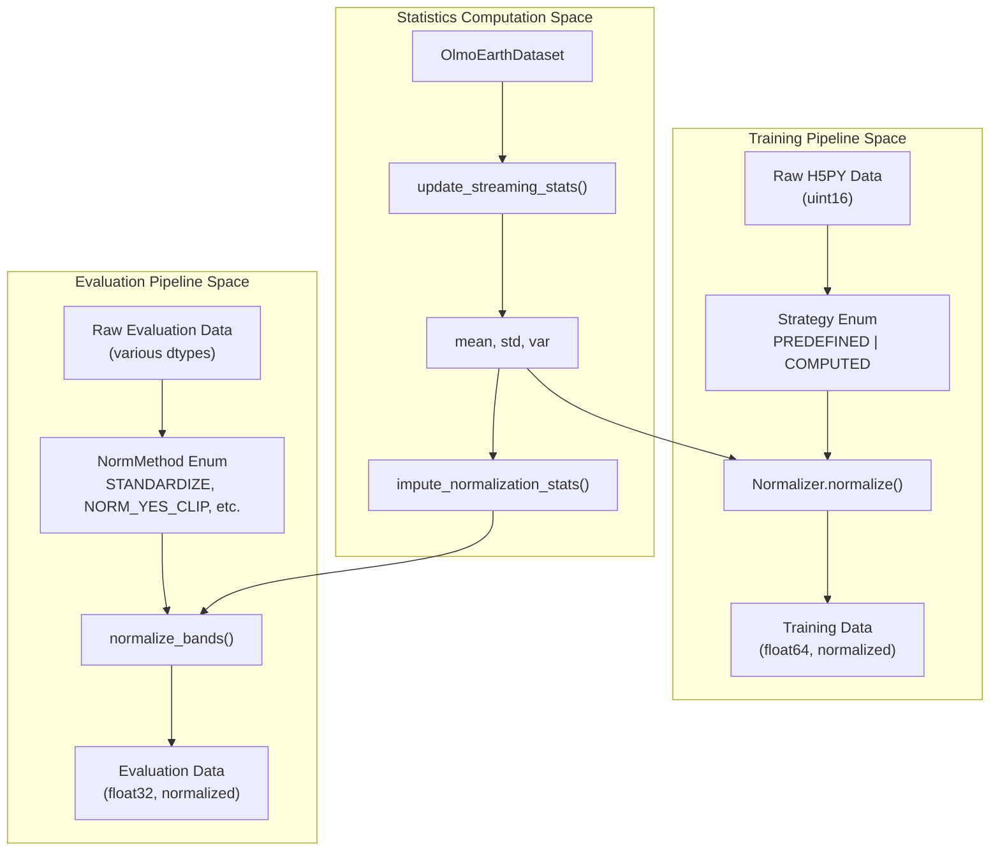
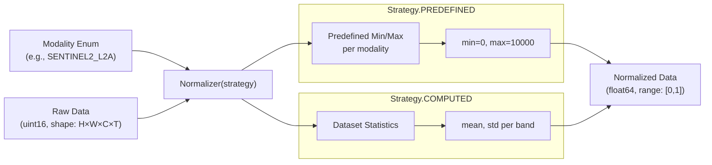
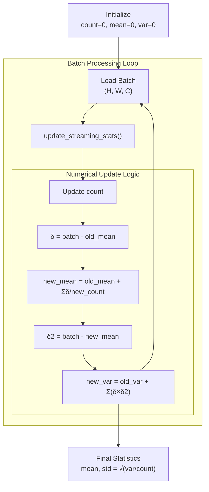

<!-- source: DeepWiki mcp.deepwiki.com · repo allenai/olmoearth_pretrain · page 3.5 Normalization Strategies · fetched 2026-10-26 -->

# Normalization Strategies

<details>
<summary>Relevant source files</summary>

The following files were used as context for generating this wiki page:

- [data/rslearn_dataset_configs/config_worldpop.json](data/rslearn_dataset_configs/config_worldpop.json)
- [tests/unit/data/test_normalizer.py](tests/unit/data/test_normalizer.py)
- [tests/unit/dataset/test_update_streaming_stats.py](tests/unit/dataset/test_update_streaming_stats.py)

</details>


## Purpose and Scope

This page documents the normalization strategies used throughout the OlmoEarth pretraining system for transforming raw satellite imagery pixel values into normalized representations suitable for model training and evaluation. The system provides two distinct normalization subsystems: one for pretraining data loading ([olmoearth_pretrain/data/normalize.py]()) and another for downstream evaluation tasks ([olmoearth_pretrain/evals/datasets/normalize.py]()).

The repository also includes utility functions for computing running statistics over large datasets without loading them entirely into memory, ensuring numerical stability and memory efficiency.

---

## Normalization System Overview

The OlmoEarth codebase implements normalization at two distinct stages of the machine learning pipeline, each with different requirements and implementations:



**Sources:** [tests/unit/data/test_normalizer.py:1-35](), [tests/unit/dataset/test_update_streaming_stats.py:1-42]()

| Pipeline Stage | Module | Primary Class/Function | Input dtype | Output dtype | Purpose |
|----------------|--------|------------------------|-------------|--------------|---------|
| Training | `olmoearth_pretrain.data.normalize` | `Normalizer` | `uint16` | `float64` | Normalize pretraining data with modality-specific strategies |
| Evaluation | `olmoearth_pretrain.evals.datasets.normalize` | `normalize_bands()` | Various | `float32` | Normalize evaluation data with task-specific methods |
| Statistics | `olmoearth_pretrain.data.utils` | `update_streaming_stats()` | Various | N/A | Compute running statistics for `COMPUTED` strategy |

---

## Training-Time Normalization

### Strategy Enum

The training pipeline uses a `Strategy` enum to select between predefined and computed normalization approaches:



**Sources:** [tests/unit/data/test_normalizer.py:9-35]()

### Normalizer Class

The `Normalizer` class provides the primary interface for training-time normalization:

```python
# Usage pattern from tests
from olmoearth_pretrain.data.normalize import Normalizer, Strategy

# PREDEFINED strategy: uses modality-specific min/max values
normalizer = Normalizer(Strategy.PREDEFINED)
normalized_data = normalizer.normalize(modality, data)

# COMPUTED strategy: uses dataset-computed statistics
normalizer = Normalizer(Strategy.COMPUTED)
normalized_data = normalizer.normalize(modality, data)
```

**Key behaviors:**

| Strategy | Statistical Basis | Formula | Value Range | When to Use |
|----------|------------------|---------|-------------|-------------|
| `PREDEFINED` | Fixed min/max per modality | `(data - min) / (max - min)` | `[0, 1]` | Default for pretraining, consistent across runs |
| `COMPUTED` | Dataset-derived statistics | Uses computed mean/std | Depends on data | Custom datasets with non-standard value distributions |

**Sources:** [tests/unit/data/test_normalizer.py:9-35]()

### PREDEFINED Strategy Details

The `PREDEFINED` strategy uses hard-coded min/max values for each modality. For example, Sentinel-2 L2A data uses:

```python
# Typical PREDEFINED values for SENTINEL2_L2A
min_vals = np.array([0] * 12)    # All 12 bands start at 0
max_vals = np.array([10000] * 12) # All 12 bands max at 10000
normalized = (data - min_vals) / (max_vals - min_vals)
```

This ensures:
- Consistent normalization across different runs [tests/unit/data/test_normalizer.py:16-18]().
- Values are strictly in range `[0, 1]` [tests/unit/data/test_normalizer.py:22-23]().
- Output dtype is `float64` [tests/unit/data/test_normalizer.py:20]().

**Sources:** [tests/unit/data/test_normalizer.py:11-24]()

---

## Computing Statistics for Normalization

### Streaming Statistics Algorithm

The `update_streaming_stats` function in `olmoearth_pretrain.data.utils` enables memory-efficient computation of mean and variance across large datasets using a streaming approach:



**Sources:** [tests/unit/dataset/test_update_streaming_stats.py:7](), [tests/unit/dataset/test_update_streaming_stats.py:32-34]()

### Usage Pattern

The function is designed to be called iteratively as data is loaded from the dataset:

```python
from olmoearth_pretrain.data.utils import update_streaming_stats

# Initialize streaming statistics
current_count = 0
current_mean = 0.0
current_var = 0.0

# Process dataset in batches
for batch in batches:
    current_count, current_mean, current_var = update_streaming_stats(
        current_count, current_mean, current_var, batch
    )

# Compute final standard deviation from variance
streaming_std = (current_var / current_count) ** 0.5
```

**Algorithm properties:**
- **Memory efficient:** Processes data in batches, never loads entire dataset [tests/unit/dataset/test_update_streaming_stats.py:31-34]().
- **Numerically stable:** Uses an online update method for mean and variance.
- **Exact:** Produces results that match batch computation within numerical precision [tests/unit/dataset/test_update_streaming_stats.py:40-41]().

**Sources:** [tests/unit/dataset/test_update_streaming_stats.py:12-42]()

---

## Data Source Specifics

Different data sources may require specific handling during the normalization or statistics computation phase. For example, WorldPop data typically includes a `nodata_val` of `-99999` which must be handled to avoid skewing statistics:

| Modality | Data Type | Nodata Value | Bands |
|----------|-----------|--------------|-------|
| WorldPop | `float32` | `-99999` | B1 |

**Sources:** [data/rslearn_dataset_configs/config_worldpop.json:4-13]()

---

## Summary

The OlmoEarth normalization system provides:

1.  **Training normalization** via the `Normalizer` class with `Strategy` enum, supporting both fixed modality-specific ranges and computed dataset statistics [tests/unit/data/test_normalizer.py:6]().
2.  **Streaming statistics** via `update_streaming_stats` for efficient processing of large-scale satellite datasets [tests/unit/dataset/test_update_streaming_stats.py:7]().
3.  **Numerical Precision:** All training-time normalization operations result in `float64` tensors to maintain precision during the transformation [tests/unit/data/test_normalizer.py:20]().

**Sources:** [tests/unit/data/test_normalizer.py:1-35](), [tests/unit/dataset/test_update_streaming_stats.py:1-42]()

---

