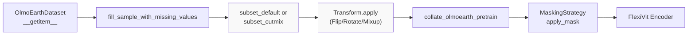
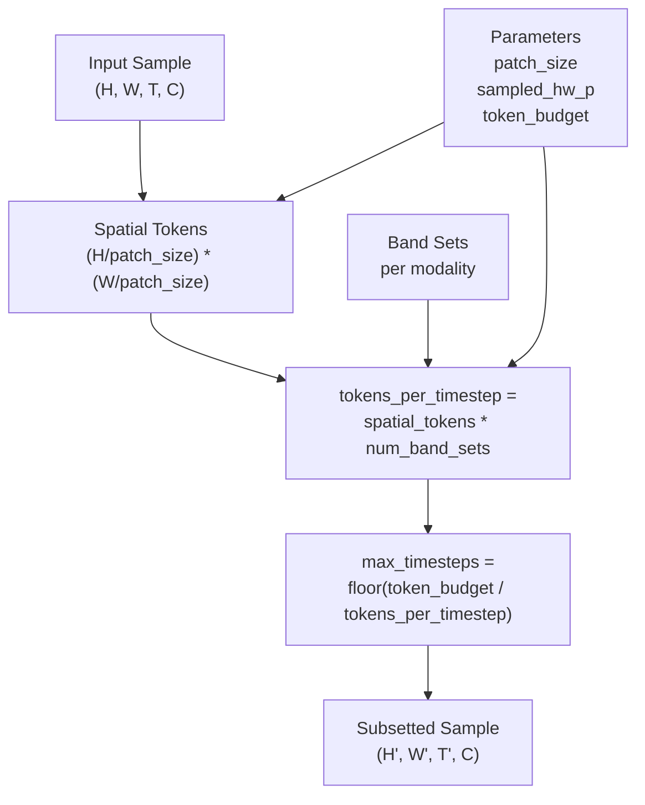
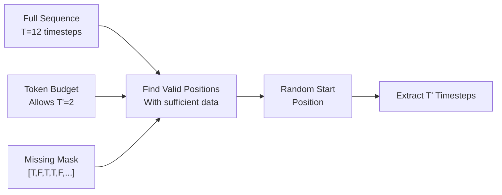
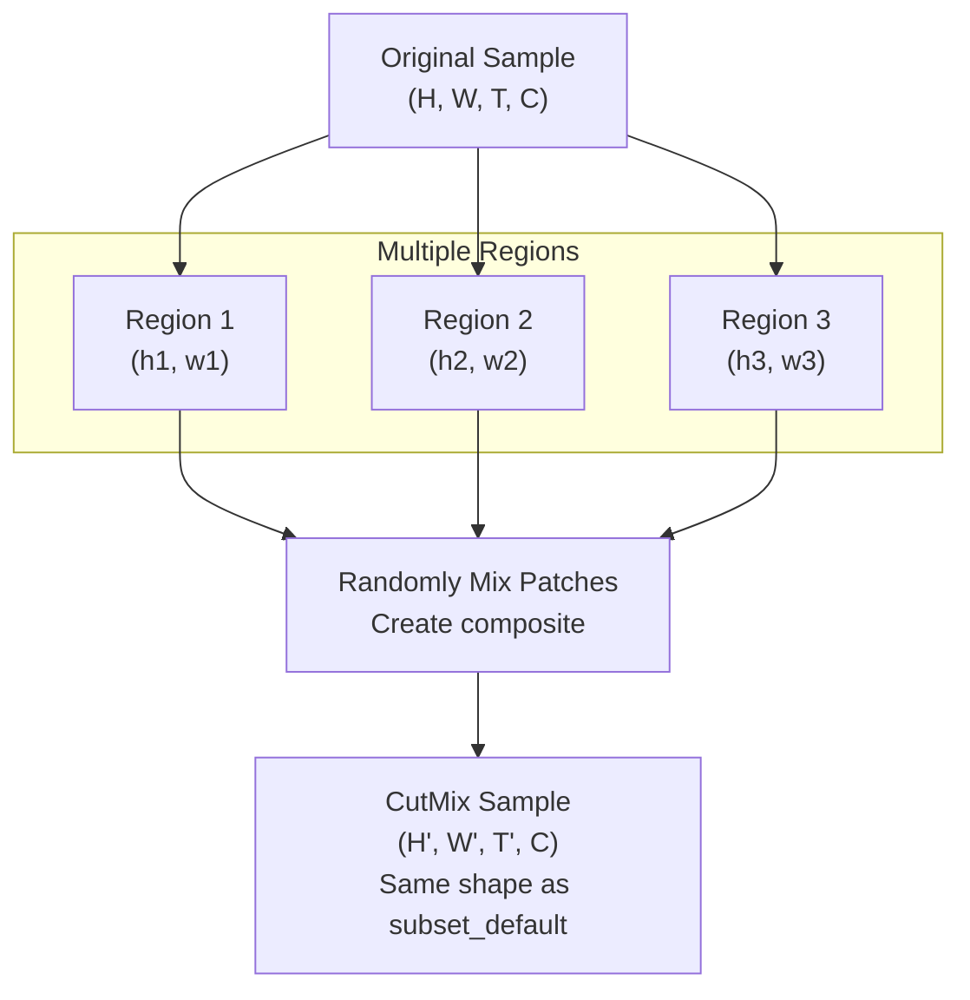
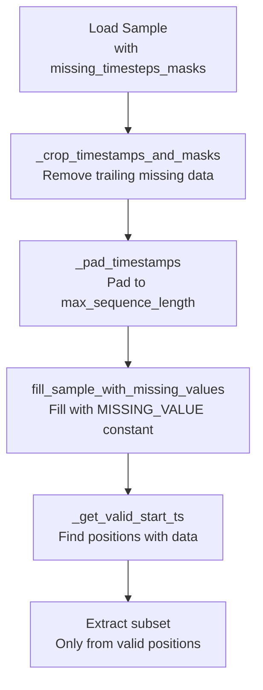
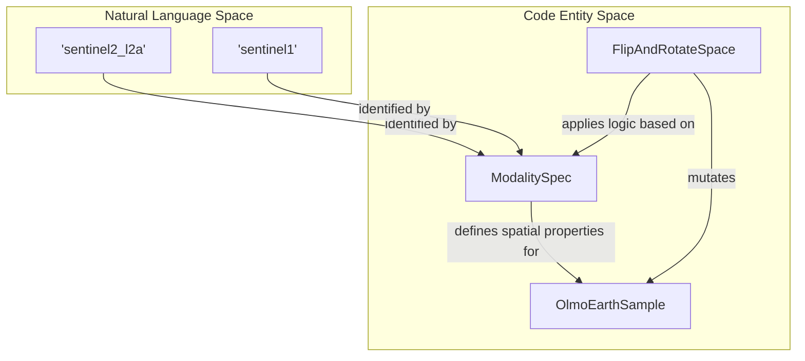
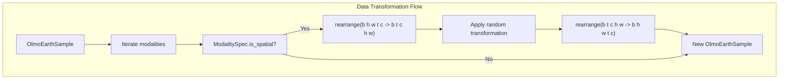

<!-- source: DeepWiki mcp.deepwiki.com · repo allenai/olmoearth_pretrain · page 3.6 Data Augmentation and Transforms · fetched 2026-10-26 -->

# Data Augmentation and Transforms

<details>
<summary>Relevant source files</summary>

The following files were used as context for generating this wiki page:

- [olmoearth_pretrain/data/constants.py](olmoearth_pretrain/data/constants.py)
- [olmoearth_pretrain/data/transform.py](olmoearth_pretrain/data/transform.py)
- [olmoearth_pretrain/nn/flexi_vit.py](olmoearth_pretrain/nn/flexi_vit.py)
- [olmoearth_pretrain/nn/galileo.py](olmoearth_pretrain/nn/galileo.py)
- [olmoearth_pretrain/nn/latent_mim.py](olmoearth_pretrain/nn/latent_mim.py)
- [olmoearth_pretrain/nn/mae.py](olmoearth_pretrain/nn/mae.py)
- [olmoearth_pretrain/train/masking.py](olmoearth_pretrain/train/masking.py)
- [scripts/vnext/new_masking/base_collapsed_bandsets_ndvi.py](scripts/vnext/new_masking/base_collapsed_bandsets_ndvi.py)
- [tests/conftest.py](tests/conftest.py)
- [tests/integration/data/test_dataloader.py](tests/integration/data/test_dataloader.py)
- [tests/integration/data/test_dataset.py](tests/integration/data/test_dataset.py)
- [tests/integration/nn/test_flexi_vit.py](tests/integration/nn/test_flexi_vit.py)
- [tests/unit/data/test_dataset.py](tests/unit/data/test_dataset.py)
- [tests/unit/data/test_visualize.py](tests/unit/data/test_visualize.py)
- [tests/unit/dataset/test_sample.py](tests/unit/dataset/test_sample.py)

</details>


## Purpose and Scope

This page documents the data augmentation and transformation techniques applied to satellite imagery samples during training in the OlmoEarth pretraining pipeline. These transforms prepare data for model consumption while fitting within computational constraints and improving model robustness.

For information about masking strategies applied after these transforms, see [Masking Strategies](#5.1). For details on data loading and preprocessing, see [Data Loading and Preprocessing](#3.4). For information about normalization, see [Normalization Strategies](#3.5).

## Overview

Data augmentation in OlmoEarth occurs primarily at the sample level during dataset loading and through a flexible transform registry. The transforms adapt high-resolution, multi-temporal satellite imagery to fit within the model's token budget while enhancing training diversity.

**Primary Augmentation Techniques:**

| Augmentation Type | Purpose | Applied When |
|-------------------|---------|--------------|
| Subsetting | Reduce sample size to fit token budget | Every sample load |
| CutMix | Mix spatial patches for regularization | Optional per sample |
| Flip and Rotate | 8-way spatial symmetry augmentation | Optional via `Transform` |
| Mixup | Linear interpolation of samples | Optional via `Transform` |

**Pipeline Position:**



**Sources:** [tests/integration/data/test_dataset.py:115-244](), [tests/unit/dataset/test_sample.py:143-196](), [olmoearth_pretrain/data/transform.py:20-26]()

## Transform Registry and Classes

The system uses a `ClassRegistry` to manage various data transformations that can be applied to an `OlmoEarthSample` [olmoearth_pretrain/data/transform.py:20-34]().

### Flip and Rotate
The `FlipAndRotateSpace` transform randomly selects one of eight possible spatial transformations (rotations of 0, 90, 180, 270 degrees, and horizontal/vertical flips) [olmoearth_pretrain/data/transform.py:42-56](). It identifies space-varying modalities (using `ModalitySpec.is_spatial`) and applies the transform to the spatial dimensions [olmoearth_pretrain/data/transform.py:102-111]().

### Mixup
The `Mixup` transform implements the mixup augmentation strategy by linearly interpolating two samples [olmoearth_pretrain/data/transform.py:117-145](). It samples a lambda value from a `Beta` distribution and combines the current batch with a rotated version of itself [olmoearth_pretrain/data/transform.py:134-145]().

**Sources:** [olmoearth_pretrain/data/transform.py:41-113](), [olmoearth_pretrain/data/transform.py:116-146]()

## Subsetting Strategies

### Token Budget Management

The token budget is the hard constraint on the total number of tokens that can be processed per training instance. All subsetting decisions flow from this constraint.

**Token Calculation:**



**Token Formula:**
```
tokens_per_timestep = (H / patch_size) * (W / patch_size) * num_band_sets
max_timesteps = floor(token_budget / tokens_per_timestep)
```

**Sources:** [tests/unit/dataset/test_sample.py:143-166](), [olmoearth_pretrain/data/dataset.py:17-19]()

### Spatial Subsetting

Spatial subsetting extracts a random crop of the full spatial extent to fit the token budget and provide spatial augmentation.

**Key Parameters:**

| Parameter | Description | Example Values |
|-----------|-------------|----------------|
| `sampled_hw_p` | Spatial size in patch units | 4, 6, 8, 12 |
| `patch_size` | Patch size for tokenization | 1, 2, 4, 8, 16 |

**Spatial Size Calculation:**
```
output_height_pixels = sampled_hw_p * patch_size
output_width_pixels = sampled_hw_p * patch_size
```

**Sources:** [tests/integration/data/test_dataset.py:232-237](), [tests/integration/data/test_dataloader.py:36-47]()

### Temporal Subsetting

Temporal subsetting selects a contiguous sequence of timesteps that fits within the token budget after accounting for spatial tokens.



**Algorithm:**
The `get_valid_start_ts` function ensures that at least one modality has data at each selected timestep within the sequence [tests/unit/data/test_dataset.py:95-110]().

**Sources:** [tests/integration/data/test_dataset.py:217-244](), [tests/unit/data/test_dataset.py:81-111]()

## CutMix Augmentation

CutMix is a regularization technique implemented via `subset_sample_cutmix` that mixes spatial patches within a single sample to create augmented training instances [tests/unit/dataset/test_sample.py:203-212]().

### Overview



**Key Properties:**
1. **Same Shape as Default**: Output has identical dimensions to `subset_sample_default` [tests/unit/dataset/test_sample.py:203-212]().
2. **Spatial Mixing Only**: Temporal sequence remains coherent (no mixing across time).
3. **Same Sample Source**: All patches come from different locations in the same sample.

**Sources:** [tests/unit/dataset/test_sample.py:168-196](), [tests/unit/dataset/test_sample.py:203-212]()

## Configuration and Integration

### Transform Configuration

Transforms are configured via `TransformConfig`, which allows specifying the transform type and its keyword arguments [olmoearth_pretrain/data/transform.py:149-166]().

```python
# Example configuration for Mixup
transform_config = TransformConfig(
    transform_type="mixup",
    transform_kwargs={"alpha": 1.3}
)
transform = transform_config.build()
```

**Sources:** [olmoearth_pretrain/data/transform.py:149-166]()

### DataLoader Configuration

Augmentation and subsetting parameters are specified in `OlmoEarthDataLoaderConfig` [tests/integration/data/test_dataloader.py:35-48]().

| Parameter | Type | Description |
|-----------|------|-------------|
| `token_budget` | `int` | Maximum tokens per instance |
| `min_patch_size` | `int` | Minimum patch size for tokenization |
| `max_patch_size` | `int` | Maximum patch size for tokenization |
| `sampled_hw_p_list` | `list[int]` | List of spatial sampling options (patch units) |

**Sources:** [tests/integration/data/test_dataloader.py:36-47](), [tests/integration/data/test_dataloader.py:83-97]()

## Handling Missing Data

Subsetting must respect missing data constraints. The `OlmoEarthDataset` uses `_fill_missing_timesteps` to pad temporal sequences with the `MISSING_VALUE` constant [tests/unit/data/test_dataset.py:141-154]().

### Missing Data Workflow



**Sources:** [tests/integration/data/test_dataset.py:217-244](), [tests/unit/data/test_dataset.py:123-155](), [olmoearth_pretrain/data/constants.py:21]()

## Multi-Modality Considerations

### Consistent Spatial Cropping

The same spatial crop region is applied to all modalities to maintain spatial alignment. Modalities with different resolution factors (e.g., Sentinel-2 vs. WorldCover) are subsetted relative to their resolution [olmoearth_pretrain/data/constants.py:108-126]().



**Sources:** [olmoearth_pretrain/data/transform.py:98-111](), [olmoearth_pretrain/data/constants.py:108-126](), [tests/unit/data/test_dataset.py:52-80]()

### Multi-Modal Transform Logic

The `FlipAndRotateSpace.apply` method iterates through all modalities in an `OlmoEarthSample` and applies the spatial transformation only if the modality is spatial [olmoearth_pretrain/data/transform.py:98-111]().



**Sources:** [olmoearth_pretrain/data/transform.py:90-113](), [olmoearth_pretrain/data/constants.py:172-175]()

---

