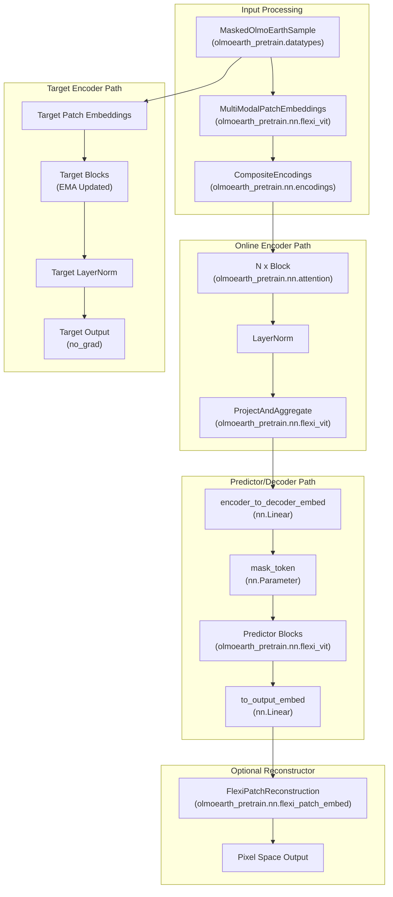
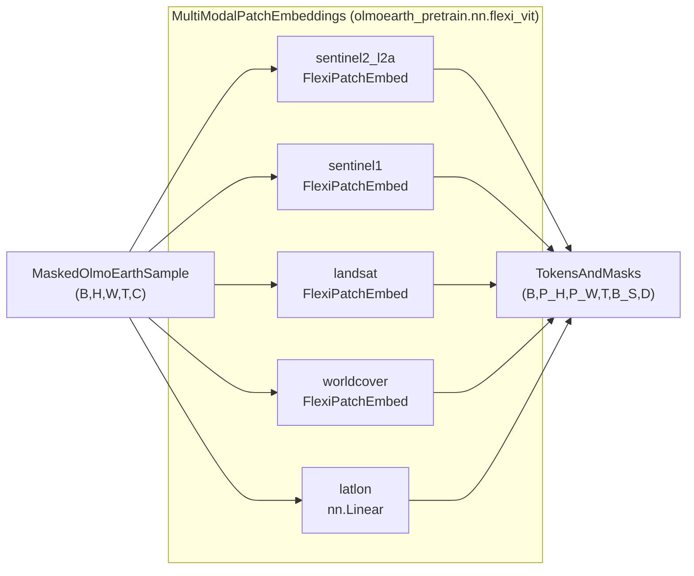
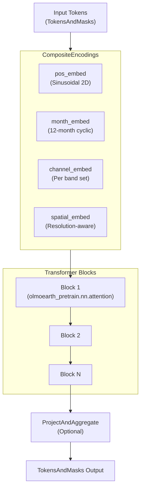

<!-- source: DeepWiki mcp.deepwiki.com · repo allenai/olmoearth_pretrain · page 4 Model Architecture · fetched 2026-10-26 -->

# Model Architecture

Relevant source files

The following files were used as context for generating this wiki page:

- [olmoearth_pretrain/data/transform.py](olmoearth_pretrain/data/transform.py)
- [olmoearth_pretrain/nn/flexi_vit.py](olmoearth_pretrain/nn/flexi_vit.py)
- [olmoearth_pretrain/nn/galileo.py](olmoearth_pretrain/nn/galileo.py)
- [olmoearth_pretrain/nn/latent_mim.py](olmoearth_pretrain/nn/latent_mim.py)
- [olmoearth_pretrain/nn/mae.py](olmoearth_pretrain/nn/mae.py)
- [olmoearth_pretrain/train/masking.py](olmoearth_pretrain/train/masking.py)
- [tests/integration/eval/test_geobench_dataset_with_model.py](tests/integration/eval/test_geobench_dataset_with_model.py)
- [tests/integration/nn/test_flexi_vit.py](tests/integration/nn/test_flexi_vit.py)
- [tests/integration/nn/test_latent_mim.py](tests/integration/nn/test_latent_mim.py)
- [tests/integration/nn/test_mae.py](tests/integration/nn/test_mae.py)
- [tests/unit/internal/test_experiment.py](tests/unit/internal/test_experiment.py)
- [tests/unit/train/test_masking.py](tests/unit/train/test_masking.py)

## Purpose and Scope

This page provides a comprehensive overview of the OlmoEarth model architecture, a flexible vision transformer (FlexiVit) designed for self-supervised pretraining on multi-modal satellite imagery. The architecture supports masked image modeling with both latent-space and pixel-space reconstruction objectives.

This page covers the overall architecture design, component organization, and data flow through the model. For detailed information about specific components, see:
- **FlexiVit Encoder**: [FlexiVit Encoder](#4.1) for patch embeddings, composite encodings, and transformer blocks
- **Predictor and Decoder**: [Predictor and Decoder](#4.2) for cross-attention based masked token prediction
- **Target Encoder and EMA Updates**: [Target Encoder and EMA Updates](#4.3) for exponential moving average updates and contrastive learning
- **Reconstructor for MAE**: [Reconstructor for MAE](#4.4) for pixel-space reconstruction in MAE-style training
- **Model Size Configurations**: [Model Size Configurations](#4.5) for available model sizes and their hyperparameters
- **TokensAndMasks Representation**: [TokensAndMasks Representation](#4.6) for the internal representation format

For information about training objectives and loss functions, see [Loss Functions](#5.2). For evaluation approaches, see [Evaluation System](#6).

**Sources**: [olmoearth_pretrain/nn/flexi_vit.py:1-31](), [olmoearth_pretrain/nn/latent_mim.py:1-50]()

## Architecture Overview

The OlmoEarth model implements a masked image modeling (MIM) approach for self-supervised learning on multi-modal Earth observation data. The architecture consists of three primary pathways:

1. **Online Encoder**: Processes visible (unmasked) tokens through transformer blocks.
2. **Predictor/Decoder**: Reconstructs masked tokens using cross-attention over encoded context.
3. **Target Encoder**: Provides stable targets for contrastive learning via EMA-updated parameters.

### High-Level Architecture Diagram

**Sources**: [olmoearth_pretrain/nn/flexi_vit.py:362-541](), [olmoearth_pretrain/nn/flexi_vit.py:644-923](), [olmoearth_pretrain/nn/latent_mim.py:25-92]()

## Key Components

### LatentMIM Model

The `LatentMIM` class is the top-level model wrapper that orchestrates the encoder-decoder architecture. It manages three main components:

| Component | Type | Purpose |
|-----------|------|---------|
| `encoder` | `Encoder` | Processes visible tokens through self-attention |
| `decoder` | `Predictor` | Predicts masked tokens via cross-attention |
| `target_encoder` | `Encoder` | Provides stable targets (EMA updated) |
| `reconstructor` | `Reconstructor` (optional) | Maps to pixel space for MAE loss |

**Sources**: [olmoearth_pretrain/nn/latent_mim.py:25-53]()

### MultiModalPatchEmbeddings

The `MultiModalPatchEmbeddings` module handles conversion of raw satellite imagery into patch embeddings. It maintains separate `FlexiPatchEmbed` modules for each supported modality, enabling flexible patch sizes based on the modality's spatial resolution.

Key design features:
- **Modality-specific embeddings**: Each modality has dedicated embedding modules based on its characteristics [olmoearth_pretrain/nn/flexi_vit.py:375-410]().
- **Flexible patch sizes**: Supports dynamic patch sizes (1, 2, 4, 8) at inference time via `FlexiPatchEmbed` [olmoearth_pretrain/nn/flexi_patch_embed.py:11-30]().
- **Band sets**: Groups related bands together (e.g., RGB, NIR, SWIR for Sentinel-2) [olmoearth_pretrain/data/constants.py:120-145]().

**Sources**: [olmoearth_pretrain/nn/flexi_vit.py:362-541]()

### Encoder

The `Encoder` class implements a standard vision transformer with multi-modal support. It combines positional, temporal (month), channel, and spatial embeddings into `CompositeEncodings` [olmoearth_pretrain/nn/flexi_vit.py:544-641]().

**Sources**: [olmoearth_pretrain/nn/flexi_vit.py:644-923]()

### Predictor (Decoder)

The `Predictor` module uses cross-attention to predict masked tokens from visible context. It uses a learnable `mask_token` [olmoearth_pretrain/nn/flexi_vit.py:946-947]() which is broadcast to all masked positions before attending to the encoder output.

**Sources**: [olmoearth_pretrain/nn/flexi_vit.py:926-1166]()

## Data Flow Through the Model

### Forward Pass Sequence

The `LatentMIM.forward` method orchestrates the flow [olmoearth_pretrain/nn/latent_mim.py:54-92]():
1. **Encoder**: Generates latent representations for visible tokens.
2. **Reconstructor**: (Optional) Maps latents back to pixel space.
3. **Decoder**: Reconstructs masked regions in latent space using cross-attention.

**Sources**: [olmoearth_pretrain/nn/latent_mim.py:54-92](), [tests/integration/nn/test_latent_mim.py:36-149]()

### Masking and Token Processing

The model uses a masking system defined by `MaskValue` [olmoearth_pretrain/datatypes.py:20-25]():

| Mask Value | Meaning | Processing |
|------------|---------|------------|
| `ONLINE_ENCODER` (1) | Visible to encoder | Processed by online encoder |
| `DECODER` (2) | Masked from encoder | Predicted by decoder |
| `MISSING` (3) | Data missing in source | Excluded from loss and attention |
| `TARGET_ENCODER_ONLY` (4) | Target only | Visible only to the target encoder |

**Sources**: [olmoearth_pretrain/train/masking.py:1-50](), [olmoearth_pretrain/datatypes.py:20-25]()

## Configuration Classes

The model architecture is defined through config dataclasses:

- **EncoderConfig**: Configures embedding size, depth, heads, and supported modalities [olmoearth_pretrain/nn/flexi_vit.py:1169-1216]().
- **PredictorConfig**: Configures the decoder depth and output embedding size [olmoearth_pretrain/nn/flexi_vit.py:1219-1262]().
- **LatentMIMConfig**: Top-level model configuration that builds the full system [olmoearth_pretrain/nn/latent_mim.py:127-170]().

## Model Variants

- **LatentMIM**: Standard variant for latent-space masked image modeling [olmoearth_pretrain/nn/latent_mim.py:25-92]().
- **MAE**: Masked Autoencoder variant adding pixel-space reconstruction [olmoearth_pretrain/nn/mae.py:24-60]().
- **Galileo**: Experimental variant with dual predictors [olmoearth_pretrain/nn/galileo.py:24-111]().

## TokensAndMasks Representation

The model uses a custom `TokensAndMasks` dataclass to represent multi-modal token sequences. It maintains spatial structure `(B, P_H, P_W, T, B_S, D)` until explicitly flattened for transformer blocks [olmoearth_pretrain/datatypes.py:28-150]().

**Sources**: [olmoearth_pretrain/nn/flexi_vit.py:59-283](), [olmoearth_pretrain/datatypes.py:28-150]()

---

