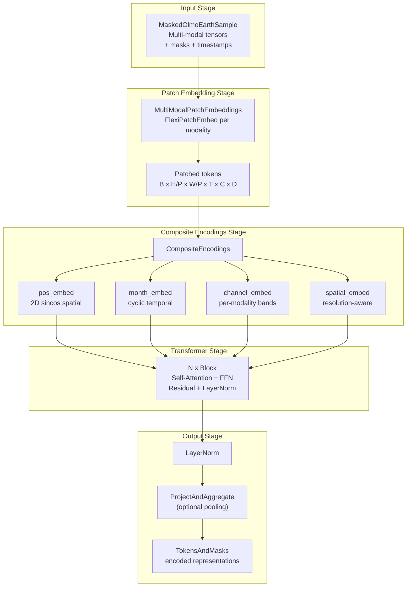
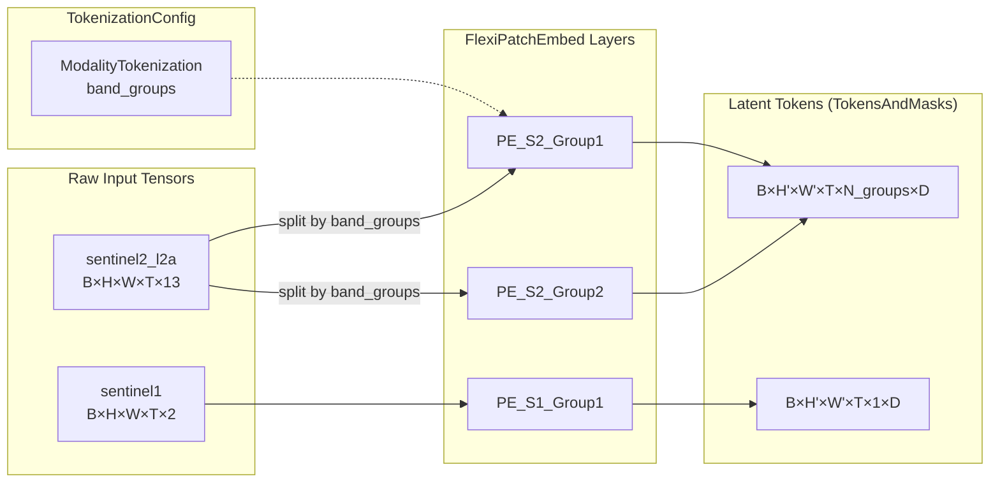

<!-- source: DeepWiki mcp.deepwiki.com · repo allenai/olmoearth_pretrain · page 4.1 FlexiVit Encoder · fetched 2026-10-26 -->

# FlexiVit Encoder

<details>
<summary>Relevant source files</summary>

The following files were used as context for generating this wiki page:

- [.cursor/rules/pr-review.mdc](.cursor/rules/pr-review.mdc)
- [olmoearth_pretrain/data/transform.py](olmoearth_pretrain/data/transform.py)
- [olmoearth_pretrain/nn/attention.py](olmoearth_pretrain/nn/attention.py)
- [olmoearth_pretrain/nn/flexi_patch_embed.py](olmoearth_pretrain/nn/flexi_patch_embed.py)
- [olmoearth_pretrain/nn/flexi_vit.py](olmoearth_pretrain/nn/flexi_vit.py)
- [olmoearth_pretrain/nn/galileo.py](olmoearth_pretrain/nn/galileo.py)
- [olmoearth_pretrain/nn/latent_mim.py](olmoearth_pretrain/nn/latent_mim.py)
- [olmoearth_pretrain/nn/mae.py](olmoearth_pretrain/nn/mae.py)
- [olmoearth_pretrain/nn/utils.py](olmoearth_pretrain/nn/utils.py)
- [olmoearth_pretrain/train/masking.py](olmoearth_pretrain/train/masking.py)
- [scripts/vnext/tokenization_ablations/base_all_bands_single_token.py](scripts/vnext/tokenization_ablations/base_all_bands_single_token.py)
- [scripts/vnext/tokenization_ablations/base_single_band_s2.py](scripts/vnext/tokenization_ablations/base_single_band_s2.py)
- [scripts/vnext/tokenization_ablations/base_spectral_grouping.py](scripts/vnext/tokenization_ablations/base_spectral_grouping.py)
- [tests/integration/nn/test_flexi_vit.py](tests/integration/nn/test_flexi_vit.py)
- [tests/integration/nn/test_tokenization.py](tests/integration/nn/test_tokenization.py)
- [tests/unit/nn/test_flexi_patch_embed.py](tests/unit/nn/test_flexi_patch_embed.py)
- [tests/unit/nn/test_tokenization.py](tests/unit/nn/test_tokenization.py)

</details>


## Purpose and Scope

The **FlexiVit Encoder** is the core encoding component of the OlmoEarth model architecture that transforms multi-modal satellite imagery into latent token representations. It processes inputs with varying spatial resolutions, temporal sequences, and modality types through a flexible patch embedding system and transformer architecture.

This page covers:
- Encoder architecture and components
- Multi-modal patch embedding and configurable tokenization
- Composite encoding system (positional, temporal, channel, spatial)
- Transformer block processing
- Configuration and usage patterns

For information about the decoder/predictor that processes encoded tokens, see [Predictor and Decoder](). For the target encoder used in self-supervised learning, see [Target Encoder and EMA Updates](). For the complete model that combines encoder and decoder, see [Model Architecture]().

---

## Architecture Overview

The FlexiVit Encoder implements a vision transformer architecture adapted for multi-modal, multi-temporal satellite imagery. It consists of five main stages that process input data into contextualized token embeddings.

**Diagram: FlexiVit Encoder Architecture**



**Sources:** [olmoearth_pretrain/nn/flexi_vit.py:25](), [olmoearth_pretrain/nn/flexi_vit.py:202-212](), [olmoearth_pretrain/nn/flexi_vit.py:611-640]()

---

## Encoder Configuration

The encoder is configured through the `EncoderConfig` class, which defines architectural hyperparameters and tokenization strategies.

### Configuration Parameters

| Parameter | Type | Description |
|-----------|------|-------------|
| `supported_modality_names` | `list[str]` | List of modality names to process (e.g., "sentinel2_l2a", "sentinel1") |
| `embedding_size` | `int` | Dimensionality of token embeddings |
| `max_patch_size` | `int` | Maximum patch size for spatial downsampling |
| `num_heads` | `int` | Number of attention heads in transformer blocks |
| `depth` | `int` | Number of transformer blocks |
| `mlp_ratio` | `float` | Ratio of MLP hidden size to embedding size |
| `tokenization_config` | `TokenizationConfig` | Defines how bands are grouped into tokens |

**Example Configuration with Custom Tokenization:**

```python
# Grouping S2 bands into 5 spectral tokens instead of default 3
token_cfg = TokenizationConfig(
    overrides={
        "sentinel2_l2a": ModalityTokenization(
            band_groups=[
                ["B02", "B03", "B04"], # RGB
                ["B08", "B8A"],         # NIR
                ["B05", "B06", "B07"], # Red Edge
                ["B11", "B12"],         # SWIR
                ["B01", "B09"],         # Atmospheric
            ]
        )
    }
)

encoder_config = EncoderConfig(
    supported_modality_names=["sentinel2_l2a"],
    embedding_size=768,
    tokenization_config=token_cfg
)
```

**Sources:** [olmoearth_pretrain/nn/flexi_vit.py:535-565](), [scripts/vnext/tokenization_ablations/base_spectral_grouping.py:55-75](), [tests/integration/nn/test_tokenization.py:22-38]()

---

## Multi-Modal Patch Embedding

The `MultiModalPatchEmbeddings` class manages the initial projection of raw imagery into the latent space. It uses `FlexiPatchEmbed` for spatial modalities and linear projections for global modalities like `latlon`.

### FlexiPatchEmbed Mechanism

The `FlexiPatchEmbed` layer supports variable patch sizes by interpolating the weight buffer. It can use either `nn.Conv2d` or `nn.Linear` for the projection.

- **Linear Mode (`use_linear_patch_embed=True`)**: Reshapes patches and applies a matrix multiplication (GEMM). This is typically faster on modern hardware [olmoearth_pretrain/nn/flexi_patch_embed.py:74-81]().
- **Conv Mode (`use_linear_patch_embed=False`)**: Uses standard 2D convolution, required for backward compatibility with older checkpoints [olmoearth_pretrain/nn/flexi_patch_embed.py:82-89]().

**Diagram: Patch Embedding and Tokenization**



**Sources:** [olmoearth_pretrain/nn/flexi_patch_embed.py:31-62](), [olmoearth_pretrain/nn/flexi_vit.py:202-230](), [tests/unit/nn/test_flexi_patch_embed.py:104-136]()

---

## Composite Encodings

The encoder adds multiple encodings to the latent tokens to provide spatial, temporal, and spectral context.

| Encoding Component | implementation | Purpose |
|--------------------|----------------|---------|
| **Positional** | `get_2d_sincos_pos_encoding_with_resolution` | Resolution-aware spatial position [olmoearth_pretrain/nn/flexi_vit.py:446-455]() |
| **Month** | `get_month_encoding_table` | Cyclic temporal information (0-11) [olmoearth_pretrain/nn/flexi_vit.py:480-484]() |
| **Channel** | `per_modality_channel_embeddings` | Identity of the specific band group [olmoearth_pretrain/nn/flexi_vit.py:417-425]() |
| **Spatial** | `get_2d_sincos_pos_encoding` | Absolute grid position [olmoearth_pretrain/nn/flexi_vit.py:465-470]() |

**Sources:** [olmoearth_pretrain/nn/flexi_vit.py:404-510](), [olmoearth_pretrain/nn/encodings.py:28-40]()

---

## Transformer Blocks

The encoder core consists of `depth` number of `Block` modules. These blocks apply multi-head self-attention across the flattened sequence of all tokens from all modalities.

- **Flattening**: Tokens from shape `(B, H', W', T, N, D)` are flattened into a single sequence `(B, S, D)` where `S` is the total number of unmasked tokens [olmoearth_pretrain/nn/flexi_vit.py:688-705]().
- **Attention**: The `Block` class (imported from `olmoearth_pretrain.nn.attention`) performs the self-attention operation [olmoearth_pretrain/nn/flexi_vit.py:25]().
- **Stochastic Depth**: `DropPath` is applied within blocks to regularize the model [olmoearth_pretrain/nn/flexi_vit.py:623-625]().

**Sources:** [olmoearth_pretrain/nn/flexi_vit.py:611-640](), [olmoearth_pretrain/nn/flexi_vit.py:680-720]()

---

## Masking and Data Flow

The encoder is designed to process only unmasked tokens for efficiency.

1. **Mask Resolution**: The `MaskingStrategy` determines which patches are `ONLINE_ENCODER`, `DECODER`, or `TARGET_ENCODER_ONLY` [olmoearth_pretrain/train/masking.py:141-151]().
2. **Filtering**: Inside `Encoder.forward`, tokens marked as masked (e.g., `MaskValue.DECODER`) are filtered out before entering the transformer blocks [olmoearth_pretrain/nn/flexi_vit.py:688-695]().
3. **Missing Data**: If a modality is entirely missing or has `MISSING_VALUE` at a specific location, those tokens are also excluded [olmoearth_pretrain/train/masking.py:98-109]().

**Sources:** [olmoearth_pretrain/nn/flexi_vit.py:642-740](), [olmoearth_pretrain/train/masking.py:33-82]()

---

## Key Implementation Details

### ProjectAndAggregate
The `ProjectAndAggregate` module is used at the end of the encoder to optionally pool tokens and apply a final linear projection. This is common for contrastive learning objectives where a single vector per sample is needed [olmoearth_pretrain/nn/flexi_vit.py:65-88]().

### Tokenization Ablations
The codebase includes scripts for various tokenization strategies, demonstrating the flexibility of the encoder:
- **Single Band**: Every band is its own token [scripts/vnext/tokenization_ablations/base_single_band_s2.py:51-66]().
- **Spectral Grouping**: Bands grouped by physical properties [scripts/vnext/tokenization_ablations/base_spectral_grouping.py:55-68]().
- **Single Token**: All bands collapsed into one token [scripts/vnext/tokenization_ablations/base_all_bands_single_token.py:51-68]().

**Sources:** [olmoearth_pretrain/nn/flexi_vit.py:65-181](), [tests/unit/nn/test_tokenization.py:15-63]()

---

