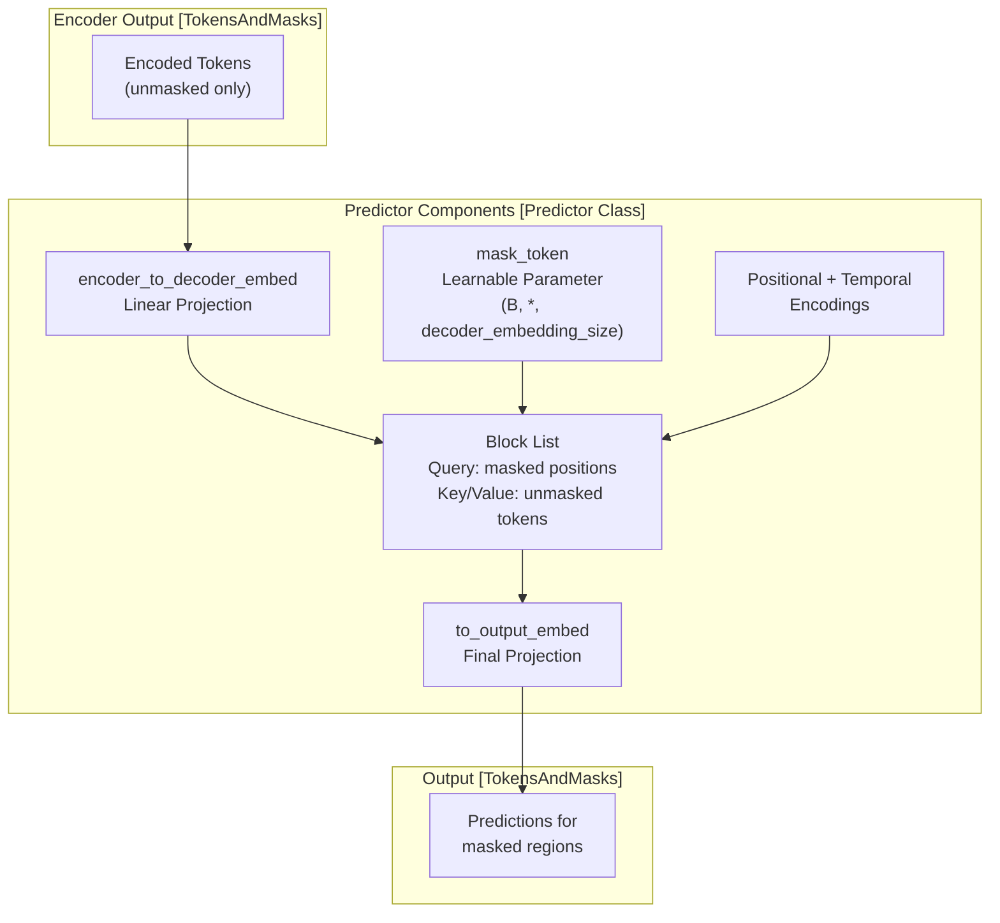
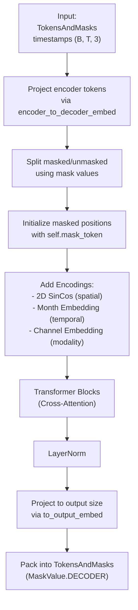
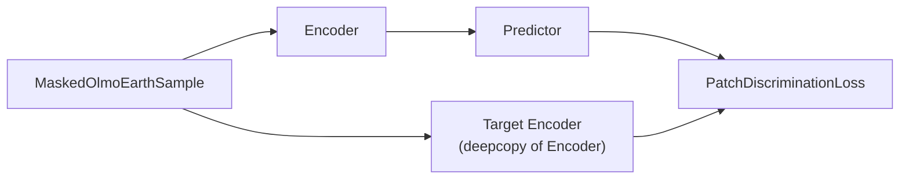

<!-- source: DeepWiki mcp.deepwiki.com · repo allenai/olmoearth_pretrain · page 4.2 Predictor and Decoder · fetched 2026-10-26 -->

# Predictor and Decoder

Relevant source files

The following files were used as context for generating this wiki page:

- [olmoearth_pretrain/data/transform.py](olmoearth_pretrain/data/transform.py)
- [olmoearth_pretrain/nn/flexi_vit.py](olmoearth_pretrain/nn/flexi_vit.py)
- [olmoearth_pretrain/nn/galileo.py](olmoearth_pretrain/nn/galileo.py)
- [olmoearth_pretrain/nn/latent_mim.py](olmoearth_pretrain/nn/latent_mim.py)
- [olmoearth_pretrain/nn/mae.py](olmoearth_pretrain/nn/mae.py)
- [olmoearth_pretrain/train/masking.py](olmoearth_pretrain/train/masking.py)
- [tests/integration/nn/test_flexi_vit.py](tests/integration/nn/test_flexi_vit.py)
- [tests/integration/nn/test_mae.py](tests/integration/nn/test_mae.py)

## Purpose and Scope

This page documents the **Predictor** (also referred to as the decoder in some contexts), a core component of the OlmoEarth model architecture that reconstructs masked regions in latent space using cross-attention. The Predictor processes encoder outputs to predict representations for masked tokens by attending to unmasked context tokens. This component is essential for self-supervised learning with masked modeling objectives.

For information about the encoder that produces the input to the Predictor, see [FlexiVit Encoder](#4.1). For the optional Reconstructor that maps predictions back to pixel space, see [Reconstructor for MAE](#4.4). For the complete model architecture that integrates these components, see [Model Architecture](#4).

---

## Architecture Overview

The Predictor implements a cross-attention-based decoder that operates in latent embedding space. Unlike traditional autoencoders that reconstruct pixels, the Predictor predicts latent representations that can be compared against target encoder outputs for contrastive learning objectives.

### System Components Diagram

**Sources:** [olmoearth_pretrain/nn/flexi_vit.py:25](), [olmoearth_pretrain/nn/flexi_vit.py:821-945](), [tests/integration/nn/test_mae.py:106-115]()

### Key Architectural Features

1. **Learnable Mask Tokens**: Instead of using zeros or fixed embeddings, the Predictor uses learned parameters (`self.mask_token`) to initialize masked positions [olmoearth_pretrain/nn/flexi_vit.py:858-858]().
2. **Cross-Attention Design**: Masked tokens (queries) attend to unmasked tokens (keys/values) from the encoder [olmoearth_pretrain/nn/flexi_vit.py:898-904]().
3. **Modality-Agnostic**: Works with any combination of supported modalities defined in the `supported_modalities` list [olmoearth_pretrain/nn/flexi_vit.py:823-823]().
4. **Configurable Embedding Dimensions**: Encoder and decoder can use different embedding sizes, handled by `encoder_to_decoder_embed` projection [olmoearth_pretrain/nn/flexi_vit.py:851-851]().
5. **Flexible Output**: Can project to a custom `output_embedding_size` or match the `decoder_embedding_size` [olmoearth_pretrain/nn/flexi_vit.py:870-870]().

**Sources:** [olmoearth_pretrain/nn/flexi_vit.py:821-945](), [tests/integration/nn/test_mae.py:106-125]()

---

## Configuration: PredictorConfig

The `PredictorConfig` class specifies all parameters for constructing a Predictor instance.

### Configuration Parameters

| Parameter | Type | Description | Default |
|-----------|------|-------------|---------|
| `supported_modalities` | `list[ModalitySpec]` | Modality specifications the predictor supports | Required |
| `encoder_embedding_size` | `int` | Dimensionality of encoder output tokens | Required |
| `decoder_embedding_size` | `int` | Internal embedding dimension for decoder | Required |
| `depth` | `int` | Number of transformer blocks | Required |
| `mlp_ratio` | `float` | Ratio of MLP hidden dim to embedding dim | Required |
| `num_heads` | `int` | Number of attention heads | Required |
| `max_sequence_length` | `int` | Maximum temporal sequence length | Required |
| `drop_path` | `float` | Stochastic depth drop probability | `0.0` |
| `output_embedding_size` | `int \| None` | Final output size; if None, uses `decoder_embedding_size` | `None` |

**Sources:** [olmoearth_pretrain/nn/flexi_vit.py:948-960]()

---

## Forward Pass Flow

The Predictor's `forward` method processes encoder outputs through a series of transformations to produce predictions for masked regions.

### Code Entity Data Flow

**Sources:** [olmoearth_pretrain/nn/flexi_vit.py:885-945](), [olmoearth_pretrain/nn/flexi_vit.py:843-883]()

### Input and Output Specification

The Predictor's `forward` method expects:
- `encoder_output`: A `TokensAndMasks` object [olmoearth_pretrain/nn/flexi_vit.py:887-887]().
- `timestamps`: Tensor of shape `(B, T, 3)` containing [day, month, year] [olmoearth_pretrain/nn/flexi_vit.py:888-888]().
- `patch_size`: Integer specifying the spatial patch size [olmoearth_pretrain/nn/flexi_vit.py:889-889]().

The Predictor outputs a `TokensAndMasks` object where masked positions are filled with predictions and marked with `MaskValue.DECODER` [olmoearth_pretrain/nn/flexi_vit.py:942-944]().

**Sources:** [olmoearth_pretrain/nn/flexi_vit.py:885-945](), [olmoearth_pretrain/datatypes.py:165-175]()

---

## Integration with Training System

The Predictor is a required component for both `LatentMIM` and `MAE` training modules.

### Latent MIM Flow

In the `LatentMIM` class, the predictor receives the output from the `encoder` and its predictions are used for the training objective.

**Sources:** [olmoearth_pretrain/nn/latent_mim.py:44-47](), [olmoearth_pretrain/nn/latent_mim.py:72-85](), [tests/integration/nn/test_mae.py:162-174]()

### Multi-Loss Training

The Predictor outputs can be used with multiple loss functions simultaneously:

| Loss Type | Purpose | Applied To |
|-----------|---------|------------|
| `PatchDiscriminationLoss` | Latent MIM objective | Predictor output vs target encoder output |
| `MAELoss` | Pixel reconstruction objective | Reconstructor output (which uses Predictor) vs original pixels |

**Sources:** [olmoearth_pretrain/nn/latent_mim.py:81-85](), [olmoearth_pretrain/nn/mae.py:53-58](), [tests/integration/nn/test_mae.py:159-162]()

---

## Predictor vs Reconstructor

The codebase distinguishes between predicting latents and reconstructing pixels:

### Predictor

- **Purpose**: Predict latent representations for masked regions [olmoearth_pretrain/nn/flexi_vit.py:821-821]().
- **Output Space**: Embedding/latent space [olmoearth_pretrain/nn/flexi_vit.py:870-870]().
- **Architecture**: Cross-attention transformer blocks [olmoearth_pretrain/nn/flexi_vit.py:867-867]().

### Reconstructor

- **Purpose**: Map latent predictions back to pixel space [olmoearth_pretrain/nn/flexi_vit.py:978-978]().
- **Output Space**: Original modality data space (e.g., RGB bands) [olmoearth_pretrain/nn/flexi_vit.py:1016-1018]().
- **Architecture**: Wraps a `decoder` (Predictor) and adds `FlexiPatchReconstruction` heads [olmoearth_pretrain/nn/flexi_vit.py:986-993]().

**Sources:** [olmoearth_pretrain/nn/flexi_vit.py:821-945](), [olmoearth_pretrain/nn/flexi_vit.py:978-1033](), [olmoearth_pretrain/nn/flexi_patch_embed.py:112-140]()

---

## TokensAndMasks Representation

The Predictor heavily relies on the `TokensAndMasks` data structure to track which tokens are visible versus predicted.

### Mask Value Semantics

The mask tensors use integer values defined in `MaskValue`:

| Value | Name | Meaning |
|-------|------|---------|
| `0` | `ONLINE_ENCODER` | Visible to the active encoder [olmoearth_pretrain/datatypes.py:27-27](). |
| `1` | `TARGET_ENCODER_ONLY` | Visible only to the target encoder [olmoearth_pretrain/datatypes.py:28-28](). |
| `2` | `DECODER` | Masked token to be predicted by the Predictor [olmoearth_pretrain/datatypes.py:29-29](). |
| `-1` | `MISSING` | Data not available in the source sample [olmoearth_pretrain/datatypes.py:30-30](). |

**Sources:** [olmoearth_pretrain/datatypes.py:25-31](), [olmoearth_pretrain/nn/flexi_vit.py:942-944]()

### Implementation Details

| Class/Method | Location | Purpose |
|--------------|----------|---------|
| `Predictor` | `olmoearth_pretrain/nn/flexi_vit.py:821` | Core prediction logic. |
| `ProjectAndAggregate` | `olmoearth_pretrain/nn/flexi_vit.py:65` | Handles token projection and pooling. |
| `unpack_encoder_output` | `olmoearth_pretrain/nn/utils.py` | Helper to separate encoder results. |

**Sources:** [olmoearth_pretrain/nn/flexi_vit.py:65-181](), [olmoearth_pretrain/nn/flexi_vit.py:821-945](), [olmoearth_pretrain/nn/utils.py:15-30]()

---

