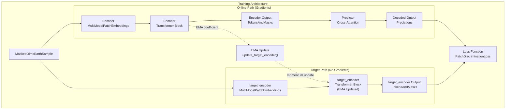
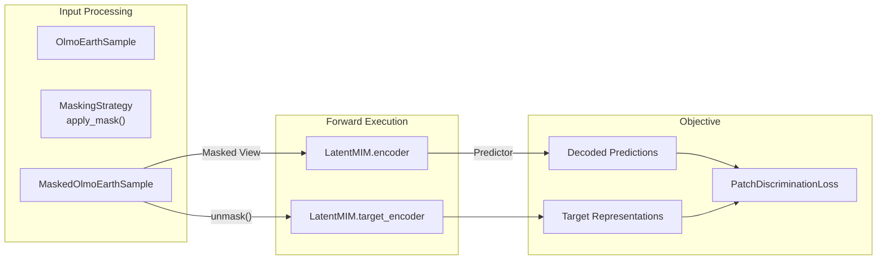

<!-- source: DeepWiki mcp.deepwiki.com · repo allenai/olmoearth_pretrain · page 4.3 Target Encoder and EMA Updates · fetched 2026-10-26 -->

# Target Encoder and EMA Updates

<details>
<summary>Relevant source files</summary>

The following files were used as context for generating this wiki page:

- [olmoearth_pretrain/data/transform.py](olmoearth_pretrain/data/transform.py)
- [olmoearth_pretrain/nn/flexi_vit.py](olmoearth_pretrain/nn/flexi_vit.py)
- [olmoearth_pretrain/nn/galileo.py](olmoearth_pretrain/nn/galileo.py)
- [olmoearth_pretrain/nn/latent_mim.py](olmoearth_pretrain/nn/latent_mim.py)
- [olmoearth_pretrain/nn/mae.py](olmoearth_pretrain/nn/mae.py)
- [olmoearth_pretrain/train/masking.py](olmoearth_pretrain/train/masking.py)
- [tests/integration/eval/test_geobench_dataset_with_model.py](tests/integration/eval/test_geobench_dataset_with_model.py)
- [tests/integration/nn/test_flexi_vit.py](tests/integration/nn/test_flexi_vit.py)
- [tests/integration/nn/test_latent_mim.py](tests/integration/nn/test_latent_mim.py)
- [tests/integration/train/train_module/test_contrastive_latentmim.py](tests/integration/train/train_module/test_contrastive_latentmim.py)
- [tests/integration/train/train_module/test_latent_mim.py](tests/integration/train/train_module/test_latent_mim.py)
- [tests/integration/train/train_module/test_latent_mim_mae.py](tests/integration/train/train_module/test_latent_mim_mae.py)
- [tests/unit/internal/test_experiment.py](tests/unit/internal/test_experiment.py)
- [tests/unit/train/test_masking.py](tests/unit/train/test_masking.py)

</details>


## Overview

This document describes the **target encoder** component of the OlmoEarth model architecture and its **Exponential Moving Average (EMA)** update mechanism. The target encoder is a key component for self-supervised learning that provides stable, slowly-evolving representations used as targets for contrastive losses like Patch Discrimination.

The target encoder is implemented within the `LatentMIM` class as a `deepcopy` of the online encoder `[olmoearth_pretrain/nn/latent_mim.py:47-49]()`. During training, it is updated via a momentum-based approach rather than gradient descent.

**Sources:** [olmoearth_pretrain/nn/latent_mim.py:44-52](), [olmoearth_pretrain/train/train_module/latent_mim.py:20-24](), [olmoearth_pretrain/train/train_module/contrastive_latentmim.py:21-23]()

---

## Purpose and Role in Self-Supervised Learning

The target encoder serves as a **momentum-based teacher network** that provides stable targets for the online encoder to predict. This architecture is crucial for contrastive self-supervised learning methods:

- **Stable Targets**: The target encoder's parameters change slowly via EMA updates, providing consistent targets across training steps `[olmoearth_pretrain/train/train_module/train_module.py:497-524]()`.
- **No Gradient Flow**: The target encoder parameters have `requires_grad = False` `[olmoearth_pretrain/nn/latent_mim.py:48-49]()`. It never receives gradients directly, preventing collapse and instability.
- **Full Information Access**: Unlike the online encoder which sees masked data, the target encoder typically processes unmasked samples `[olmoearth_pretrain/train/train_module/contrastive_latentmim.py:302-306]()`. Additionally, band dropout is disabled on the target encoder so it always sees full spectral info `[olmoearth_pretrain/nn/latent_mim.py:51-52]()`.

**Sources:** [olmoearth_pretrain/nn/latent_mim.py:47-52](), [olmoearth_pretrain/train/train_module/contrastive_latentmim.py:299-310](), [tests/integration/nn/test_latent_mim.py:140-149]()

---

## Architecture and Relationship to Online Encoder

### Component Relationship

The following diagram illustrates the data flow between the `OlmoEarthSample` input, the `Encoder` (Online), and the `target_encoder` (Teacher).

**Model Entity Flow**

**Sources:** [olmoearth_pretrain/nn/latent_mim.py:25-52](), [olmoearth_pretrain/nn/flexi_vit.py:651-680](), [olmoearth_pretrain/train/train_module/contrastive_latentmim.py:280-310]()

### Key Characteristics

| Aspect | Online Encoder (`self.encoder`) | Target Encoder (`self.target_encoder`) |
|--------|---------------|----------------|
| **Architecture** | Full `Encoder` `[olmoearth_pretrain/nn/flexi_vit.py:461-480]()` | Identical architecture via `deepcopy` `[olmoearth_pretrain/nn/latent_mim.py:47]()` |
| **Parameter Updates** | Standard backpropagation via optimizer | EMA of online encoder parameters `[olmoearth_pretrain/train/train_module/train_module.py:497-524]()` |
| **Gradient Flow** | Receives gradients from loss functions | `requires_grad = False` `[olmoearth_pretrain/nn/latent_mim.py:49]()` |
| **Input** | Masked samples `[olmoearth_pretrain/train/train_module/contrastive_latentmim.py:280-285]()` | Unmasked samples (`batch.unmask()`) `[olmoearth_pretrain/train/train_module/contrastive_latentmim.py:302]()` |
| **Band Dropout** | Enabled (if configured) | Explicitly disabled `[olmoearth_pretrain/nn/latent_mim.py:52]()` |

**Sources:** [olmoearth_pretrain/nn/latent_mim.py:44-52](), [olmoearth_pretrain/train/train_module/train_module.py:497-524](), [tests/integration/nn/test_latent_mim.py:177-178]()

---

## EMA Update Mechanism

### Mathematical Formulation

The target encoder parameters are updated using exponential moving average with a linearly-scheduled momentum coefficient defined in `OlmoEarthTrainModule` `[olmoearth_pretrain/train/train_module/train_module.py:497-524]()`:

$$\text{ema\_coeff} = \text{start\_ema} + \frac{\text{step}}{\text{max\_steps}} \times (\text{end\_ema} - \text{start\_ema})$$

$$\theta_{\text{target}} \leftarrow \text{ema\_coeff} \times \theta_{\text{target}} + (1 - \text{ema\_coeff}) \times \theta_{\text{online}}$$

### Implementation Details

The update logic in `update_target_encoder` specifically handles `DTensor` for models using Fully Sharded Data Parallel (FSDP) `[olmoearth_pretrain/train/train_module/train_module.py:514-520]()`.

```python
# Logic from train_module.py
if isinstance(p.data, DTensor):
    p_local = p.data.to_local()
    tp_local = tp.data.to_local()
    tp_local.mul_(cur_ema_value).add_(
        p_local, alpha=(1 - cur_ema_value)
    )
```

**Sources:** [olmoearth_pretrain/train/train_module/train_module.py:497-524]()

---

## Configuration

### Train Module Configuration

EMA parameters are defined in the `LatentMIMTrainModuleConfig` or `ContrastiveLatentMIMTrainModuleConfig` `[olmoearth_pretrain/train/train_module/contrastive_latentmim.py:119]()`.

| Parameter | Type | Default | Description |
|-----------|------|---------|-------------|
| `ema_decay` | `tuple[float, float]` | `(0.996, 1.0)` | Start and end EMA coefficients. |
| `reinit_targets` | `bool` | `False` | If `True`, target encoder is randomly reinitialized rather than copied from the online encoder `[olmoearth_pretrain/train/train_module/contrastive_latentmim.py:167-172]()`. |

**Sources:** [olmoearth_pretrain/train/train_module/contrastive_latentmim.py:52-55](), [tests/integration/train/train_module/test_contrastive_latentmim.py:117-119]()

---

## Training Flow

### Forward Pass and Unmasking

In `ContrastiveLatentMIMTrainModule.model_forward`, the target encoder processes the input after it has been reverted to its original state using the `unmask()` method of `MaskedOlmoEarthSample` `[olmoearth_pretrain/train/train_module/contrastive_latentmim.py:302-306]()`.

**Data Flow: Masking to Loss**

**Sources:** [olmoearth_pretrain/train/train_module/contrastive_latentmim.py:280-310](), [olmoearth_pretrain/train/masking.py:72-82](), [tests/unit/train/test_masking.py:25-40]()

### Integration in the Training Loop

The EMA update occurs at the start of every `train_batch` before any forward passes are executed `[olmoearth_pretrain/train/train_module/contrastive_latentmim.py:178-180]()`.

```python
# train_module/contrastive_latentmim.py
def train_batch(self, batch: tuple[int, OlmoEarthSample], dry_run: bool = False) -> None:
    if not dry_run:
        self.update_target_encoder() # Step 1: Update Teacher
    # ... following forward and backward passes
```

**Sources:** [olmoearth_pretrain/train/train_module/contrastive_latentmim.py:178-185](), [olmoearth_pretrain/train/train_module/train_module.py:497-524]()

---

## Distributed Training Considerations

When using FSDP, the `LatentMIM` model applies sharding to the `encoder`, `decoder`, and `target_encoder` separately via the `apply_fsdp` method `[olmoearth_pretrain/nn/latent_mim.py:94-114]()`.

- **Sharding**: The `target_encoder` is sharded just like the online encoder `[olmoearth_pretrain/nn/latent_mim.py:109]()`.
- **Forward Registration**: The `target_encoder.forward` method is explicitly registered for FSDP `[olmoearth_pretrain/nn/latent_mim.py:114]()`.
- **EMA on DTensors**: As mentioned in the update mechanism, the code iterates through parameters and uses `to_local()` to ensure EMA is applied correctly to the local shard on each GPU `[olmoearth_pretrain/train/train_module/train_module.py:514-520]()`.

**Sources:** [olmoearth_pretrain/nn/latent_mim.py:94-114](), [olmoearth_pretrain/train/train_module/train_module.py:514-524]()

---

